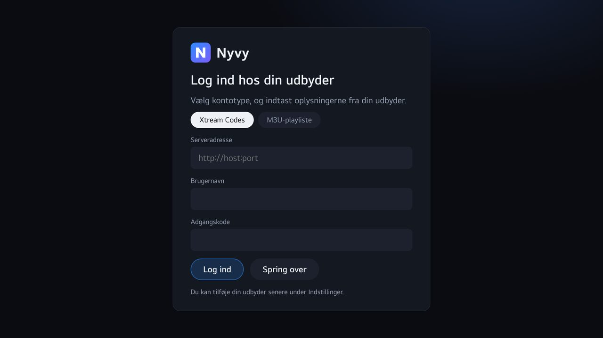
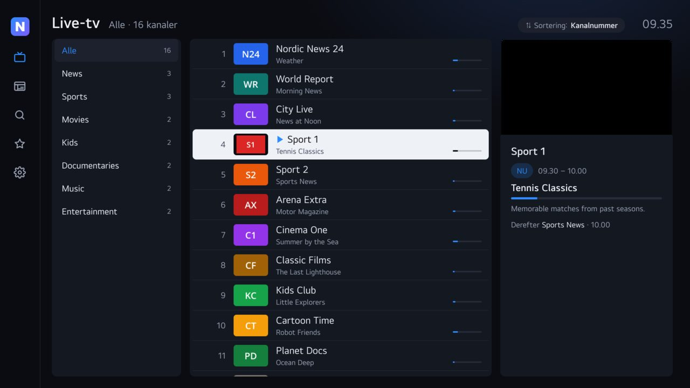
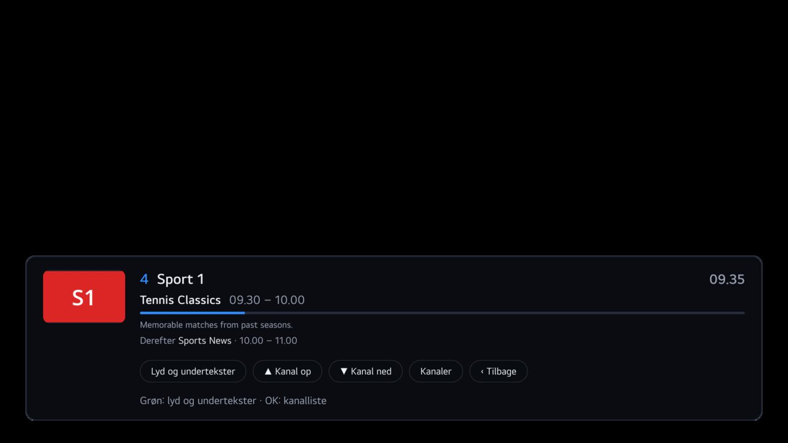
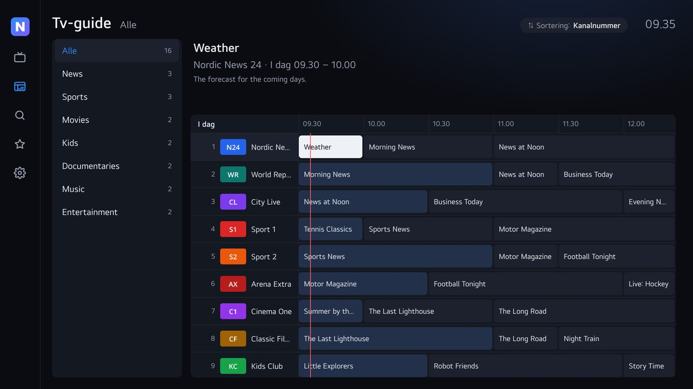
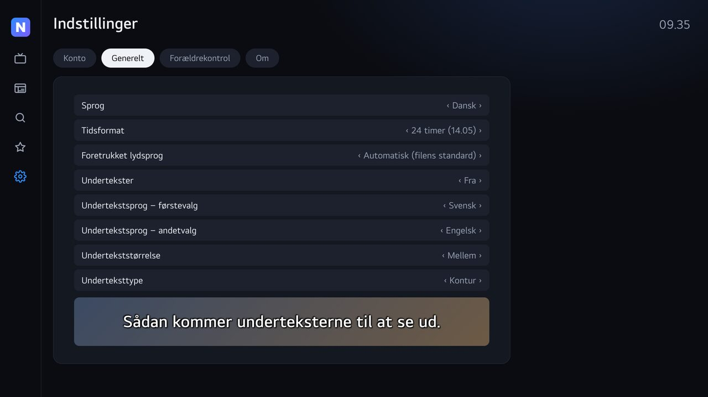
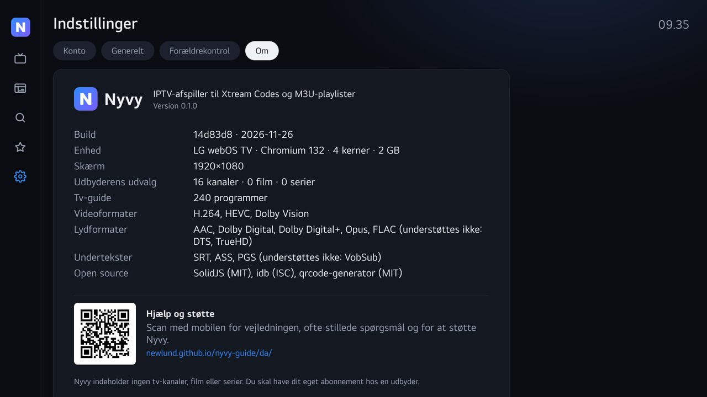

# Vejledning

Alt hvad du skal bruge for at komme i gang med Nyvy og få mest muligt ud af appen.

**Indhold:** [Kom i gang](#getting-started) · [Fjernbetjeningen](#remote) · [Live-tv](#live-tv) · [Tv-guide og catch-up](#tv-guide) · [Film og serier](#films-series) · [Lyd og undertekster](#audio-subtitles) · [Søgning, favoritter og sortering](#search) · [Indstillinger](#settings) · [Ofte stillede spørgsmål](#faq)

## Kom i gang {#getting-started}

Nyvy indeholder ingen kanaler selv. Du skal have et abonnement hos en IPTV-udbyder og de oplysninger, du har fået fra dem.

### Log ind

Første gang du starter Nyvy, vælger du kontotype:

| Kontotype | Det udfylder du | Det får du |
|---|---|---|
| **Xtream Codes** | Serveradresse, brugernavn og adgangskode | Live-tv, tv-guide, catch-up, film, serier og kontostatus |
| **M3U-playliste** | Adressen til playlisten og om nødvendigt adressen til tv-guiden | Live-tv med grupper, tv-guide, favoritter og søgning |

> Har du fået et "M3U-link" med `get.php?username=…&password=…`? Så er det i virkeligheden en Xtream-konto. Nyvy genkender det og tilbyder at logge ind som Xtream i stedet, så du også får film og serier.

Efter login henter Nyvy udvalget (kanaler, film og serier) og tv-guiden. Første gang kan det tage et minut, derefter går det hurtigt. Når du starter Nyvy, opdateres udvalget og guiden automatisk, hvis de er ældre end 12 timer, og du kan altid opdatere selv under *Indstillinger → Konto*.

Vil du se dig omkring først? Vælg *Spring over*. Du kan tilføje din udbyder senere under *Indstillinger → Konto → Tilføj udbyder*.

## Fjernbetjeningen {#remote}

| Knap | Funktion |
|---|---|
| Pile og OK | Flytte og vælge |
| Tilbage | Gå tilbage. I sidemenuen: afslut Nyvy |
| Rød | Tilføj eller fjern favorit |
| Grøn | Sortér (i lister) · lyd og undertekster (når du ser) |
| Gul | Forrige kanal (live-tv i fuld skærm) |
| CH+ / CH− | Skift kanal · bladr i lister |
| Afspil/pause | Pause og fortsæt |
| Spol frem/tilbage | Spring 60 sekunder |
| Info | Vis infolinjen (live-tv) |
| Tal | Gå direkte til et kanalnummer |

Magic Remote virker også: peg for at markere, klik for at vælge og rul med hjulet.

## Live-tv {#live-tv}

- **Vælg kanal:** til venstre er kategorierne, i midten kanalerne med det program, der kører. OK afspiller kanalen i forhåndsvisningen, OK igen giver fuld skærm.
- **I fuld skærm:**
  - Op/ned eller CH+/CH− skifter kanal.
  - OK åbner kanallisten.
  - Venstre/højre eller Info viser infolinjen med nu og derefter samt knapper til Magic Remote.
  - Tal går til et kanalnummer, og Gul tilbage til forrige kanal.
  - Tilbage forlader fuld skærm.

## Tv-guide og catch-up {#tv-guide}

- **Tv-guiden** viser programmerne for alle kanaler i et gitter med en linje for "nu". OK på et program, der kører, starter kanalen.
- **Catch-up:** kanaler med ↺ har arkiv hos udbyderen. Der kan du bladre tilbage i guiden, starte et program, der allerede er sendt, og spole i det.

## Film og serier {#films-series}

Film og serier findes til Xtream-konti.

- **Detaljesiden** viser handling, medvirkende, kvalitet (for eksempel 4K eller Dolby Vision) og knapperne *Afspil*, *Fortsæt* og *Favorit*. Findes filmen i flere versioner, vises de som valg under knapperne.
- **Serier:** vælg sæson og afsnit. Når et afsnit slutter, starter det næste efter en nedtælling.
- **Når du ser:**
  - OK sætter på pause.
  - Venstre/højre springer 10 sekunder (hold nede for længere spring). Et eksempelbillede viser, hvor du lander, og OK springer derhen.
  - Op viser knapperne på skærmen.
  - Tilbage afslutter og husker, hvor du var.

## Lyd og undertekster {#audio-subtitles}

- **Film og serier:** tryk ned eller Grøn for at vælge lydspor, undertekster og version.
- **Live-tv:** tryk Grøn for at slå udsendelsens undertekster til eller fra og vælge lydspor.
- **Standardvalg:** under *Indstillinger → Generelt* vælger du foretrukket lydsprog, om undertekster skal være slået til, første- og andetvalg for undertekstsprog samt tekststørrelse og type.

## Søgning, favoritter og sortering {#search}

- **Søg:** skriv med tastaturet på skærmen eller med fjernbetjeningens tal. Søgningen finder kanaler, film og serier og ser bort fra accenter (*malmo* finder *Malmö*).
- **Favoritter:** tryk Rød på en kanal, film eller serie. Favoritterne ligger først i hver liste og under *Favoritter* i menuen.
- **Sortering:** knappen *Sortering* øverst i listerne (eller Grøn). Kanaler kan sorteres efter nummer, kvalitet eller navn, og film og serier for eksempel efter senest tilføjet, år, bedømmelse eller kvalitet. Serier kan også sorteres efter afsnittenes længde.

## Indstillinger {#settings}

- **Konto:**
  - Viser dine oplysninger, hvornår udvalget blev opdateret, og knappen *Opdater udvalget*.
  - **Ret oplysninger:** ny serveradresse, ny adgangskode eller ny playliste. Favoritter og hvor du nåede til bevares, så længe det er den samme konto.
  - **Log ud** fjerner kontoen og dens data fra tv'et.
- **Generelt:** sprog, tidsformat, lyd og undertekster.
- **Forældrekontrol:**
  - Indhold for voksne er skjult fra start.
  - Med en firecifret pinkode kan du vise det og låse eller skjule enkelte kategorier.
  - Låste kategorier kræver pinkoden.
- **Om:** version, hvilke formater dit tv kan afspille, og linket til denne side.

## Ofte stillede spørgsmål {#faq}

### "Kanalen sender ikke lige nu"
Udbyderens udsendelse er nede, eller kanalen sender kun ved bestemte begivenheder. Prøv igen senere, eller vælg en anden kanal. OK prøver igen.

### "Udbyderen tillader ikke flere forbindelser lige nu"
Mange abonnementer tillader kun én stream ad gangen. Luk appen på andre enheder, der bruger samme konto, vent lidt og prøv igen.

### "Udbyderen svarer ikke"
Tjek tv'ets internetforbindelse. Virker den, ligger fejlen sandsynligvis hos udbyderen.

### En film har ingen lyd
Filmen har sandsynligvis kun lyd i DTS eller Dolby TrueHD, som LG-tv ikke kan afspille i apps. Vælg et andet lydspor eller en anden version af filmen, hvis der er en.

### Tv-guiden er tom (M3U)
Ikke alle playlister angiver en tv-guide. Spørg din udbyder om adressen til en XMLTV-guide, og udfyld den under *Indstillinger → Konto → Ret oplysninger*.

### Jeg kan ikke se film og serier (M3U)
Playlister giver kun live-tv i Nyvy. Har du en Xtream-konto, så log ind med den for at få film og serier.

### Hvordan afslutter jeg Nyvy?
Tryk Tilbage, indtil sidemenuen er markeret, tryk Tilbage igen, og vælg *Afslut*.
