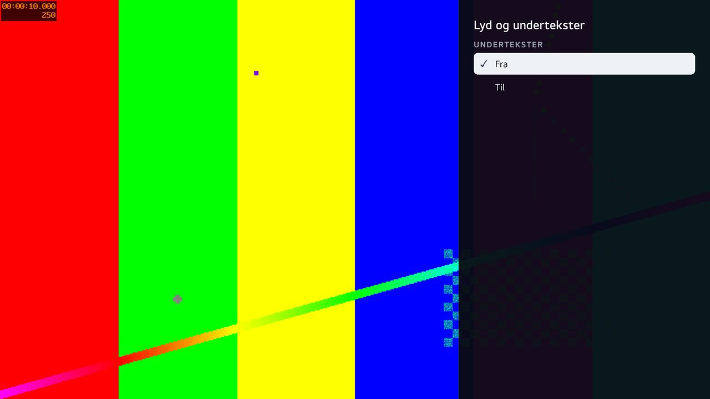
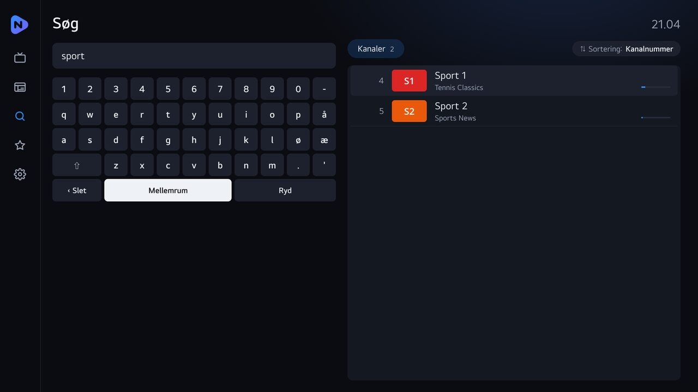
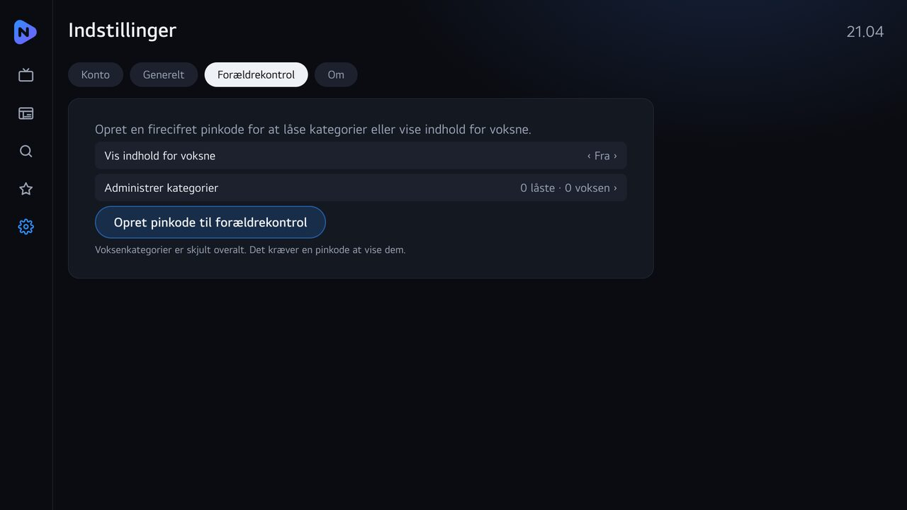

# Vejledning

Alt hvad du skal bruge for at komme i gang med Nyvy og få mest muligt ud af appen.

**Indhold:** [Kom i gang](#getting-started) · [Fjernbetjeningen](#remote) · [Live-tv](#live-tv) · [Tv-guide og catch-up](#tv-guide) · [Film og serier](#films-series) · [Lyd og undertekster](#audio-subtitles) · [Søgning, favoritter og sortering](#search) · [Indstillinger](#settings) · [Ofte stillede spørgsmål](#faq)

## Kom i gang {#getting-started}

Nyvy indeholder ingen kanaler selv. Du skal have et abonnement hos en IPTV-udbyder og de oplysninger, du har fået fra dem.

### Log ind

Første gang du starter Nyvy, vælger du kontotype:

| Kontotype | Det udfylder du | Det får du |
|---|---|---|
| **Xtream Codes** | Serveradresse, brugernavn og adgangskode | Live-tv, tv-guide, catch-up, film, serier og kontostatus |
| **M3U-playliste** | Adressen til playlisten og om nødvendigt adressen til tv-guiden | Live-tv med grupper, tv-guide, favoritter og søgning |

> Har du fået et "M3U-link" med `get.php?username=…&password=…`? Så er det i virkeligheden en Xtream-konto. Nyvy genkender det og tilbyder at logge ind som Xtream i stedet, så du også får film og serier.

Efter login henter Nyvy udvalget (kanaler, film og serier) og tv-guiden. Første gang kan det tage et minut, derefter går det hurtigt. Når du starter Nyvy, opdateres udvalget og guiden automatisk, hvis de er ældre end 12 timer, og du kan altid opdatere selv under *Indstillinger → Konto*.

Vil du se dig omkring først? Vælg *Spring over*. Du kan tilføje din udbyder senere under *Indstillinger → Konto → Tilføj udbyder*.

## Fjernbetjeningen {#remote}

| Knap | Funktion |
|---|---|
| Pile og OK | Flytte og vælge |
| Tilbage | Gå tilbage. I sidemenuen: afslut Nyvy |
| Rød · Grøn · Gul | Genveje (se nedenfor) |
| CH+ / CH− | Skift kanal · bladr i lister |
| Afspil/pause | Pause og fortsæt |
| Spol frem/tilbage | Spring 60 sekunder |
| Info | Vis infolinjen (live-tv) |
| Tal | Gå direkte til et kanalnummer |

Magic Remote virker også: peg for at markere, klik for at vælge og rul med hjulet.

**Ingen farveknapper på fjernbetjeningen?** Mange Magic Remote har dem ikke, og du har ikke brug for dem: alt virker med knapper på skærmen. ☆ *Favorit* findes på detaljesiden for film og serier, til højre for kanallisten (tryk højre) og i infolinjen i fuld skærm. *Sortering* findes øverst i listerne, og *Lyd og undertekster* og *Forrige kanal* i infolinjen. Vil du alligevel bruge genvejene, så tryk **123** på fjernbetjeningen: et panel med farveknapperne vises på skærmen. Rød: favorit · Grøn: sortering, eller lyd og undertekster mens du ser · Gul: forrige kanal.

### Hvad Tilbage gør

| Hvor du er | Tilbage |
|---|---|
| Sidemenuen | Spørger, om du vil afslutte Nyvy |
| En liste i *Live-tv*, *Film* eller *Serier* | Først til kategorierne, derefter til sidemenuen |
| Søgning eller indstillinger | Til sidemenuen |
| En films eller series detaljeside | Tilbage til listen |
| Film eller afsnit, der afspilles | Skjuler først spolelinjen og knapperne; næste tryk afslutter. Nyvy husker, hvor du var |
| Live-tv i fuld skærm | I rækkefølge: rydder et kanalnummer, du er ved at taste, forlader knaprækken, skjuler infolinjen, forlader fuld skærm |
| Kanallisten eller *Lyd og undertekster* er åben | Lukker den |
| En dialogboks, fx PIN-koden | Lukker den uden at ændre noget |

## Live-tv {#live-tv}

- **Vælg kanal:** til venstre er kategorierne, i midten kanalerne med det program, der kører. OK afspiller kanalen i forhåndsvisningen, OK igen giver fuld skærm.
- **I fuld skærm:**
  - Op/ned eller CH+/CH− skifter kanal.
  - OK vælger infolinjens knapper: *Kanaler*, *Lyd og undertekster*, ☆ *Favorit*, *Forrige kanal*, kanal op/ned og *Tilbage*. Venstre/højre flytter mellem dem, OK vælger.
  - Venstre/højre eller Info viser infolinjen med nu og derefter.
  - Tal går til et kanalnummer.
  - Tilbage skjuler først infolinjen; tryk Tilbage igen for at forlade fuld skærm.

### Mere om live-tv

- **Forhåndsvisning:** OK på en kanal i listen afspiller den i feltet til højre; OK igen giver fuld skærm. Tilbage fra fuld skærm fører dig til listen, og forhåndsvisningen fortsætter.
- **Skifte kanal i fuld skærm:** tryk OK og vælg *Kanaler*, så åbner kanallisten oven på billedet.
- **Kanalnumre:** tast cifrene på fjernbetjeningen. Nyvy skifter efter et øjeblik.
- **Forrige kanal:** knappen i infolinjen fører dig tilbage til den kanal, du så før.
- **Markeringer:** ↺ betyder, at kanalen har catch-up. Stregen under programmet viser, hvor langt det er nået. I feltet til højre viser *Catch-up · 2 dage*, hvor langt tilbage arkivet rækker.
- **Sortere efter kvalitet:** Nyvy læser HD og 4K i kanalnavnene, så de bedste kanaler kommer først.

## Tv-guide og catch-up {#tv-guide}

- **Tv-guiden** viser programmerne for alle kanaler i et gitter med en linje for "nu". OK på et program, der kører, starter kanalen.
- **Catch-up:** kanaler med ↺ har arkiv hos udbyderen. Der kan du bladre tilbage i guiden, starte et program, der allerede er sendt, og spole i det.

### Bevæg dig rundt i guiden

- Op/ned skifter kanal, og CH+/CH− bladrer en side ad gangen.
- Venstre/højre flytter i tiden, ét program ad gangen. Fremad rækker guiden tre dage. Bagud virker kun på kanaler med catch-up, så langt arkivet rækker.
- OK på et program, der vises nu, starter kanalen i fuld skærm. På et kommende program viser Nyvy, hvornår det starter, fx *Starter 21:00*.

### Se et program, der allerede er vist

1. Åbn *Tv-guide* og vælg en kanal med ↺.
2. Tryk venstre, til du når programmet. Programmer, du kan se bagefter, er markeret ↺, og infoen siger *Catch-up: OK for at se fra starten*.
3. Tryk OK. Programmet starter fra begyndelsen.
4. Spol med venstre/højre, sæt på pause med OK, og afslut med Tilbage, ligesom med en film.

## Film og serier {#films-series}

Film og serier findes til Xtream-konti.

- **Detaljesiden** viser handling, medvirkende, kvalitet (for eksempel 4K eller Dolby Vision) og knapperne *Afspil*, *Fortsæt* og *Favorit*. Findes filmen i flere versioner, vises de som valg under knapperne.
- **Serier:** vælg sæson og afsnit. Når et afsnit slutter, starter det næste efter en nedtælling.
- **Når du ser:**
  - OK sætter på pause.
  - Venstre/højre springer 10 sekunder (hold nede for længere spring). Et eksempelbillede viser, hvor du lander, og OK springer derhen.
  - Op viser knapperne på skærmen.
  - Tilbage skjuler først søgelinjen og knapperne; tryk Tilbage igen for at afslutte. Nyvy husker, hvor du var.

### Versioner

Udbydere har ofte den samme film i flere versioner, fx 4K, 1080p eller med andre sprog og undertekster. Nyvy samler dem: detaljesiden viser dem under *Versioner*, og mens filmen afspilles, skifter du under *Lyd og undertekster* → *Version*.

### Fortsæt med at se og senest tilføjet

Først i *Film* og *Serier* kommer dine favoritter, *Se videre* (det, du er begyndt på) og *Senest tilføjet* (det, udbyderen har tilføjet senest). På detaljesiden for noget, du er begyndt på, står der fx *Fortsæt fra 42:10*, med *Afspil fra start* ved siden af.

### 4K, HDR og Dolby Vision

- **Markeringer:** 4K, 1080p, 720p eller SD, nogle gange med HDR eller DV (Dolby Vision). Nyvy viser kun det, den ved med sikkerhed, fra titlen eller fra afspilning, så ikke alle film har en markering.
- **Dolby Vision** afspilles som Dolby Vision, når tv'et understøtter det. Nogle filer (Blu-ray-kopier med to billedlag) og tv'er uden Dolby Vision viser i stedet filmen i HDR10 med samme opløsning.

## Lyd og undertekster {#audio-subtitles}

- **Film og serier:** tryk ned eller Grøn for at vælge lydspor, undertekster og version.
- **Live-tv:** vælg *Lyd og undertekster* i infolinjen (eller tryk Grøn) for at slå udsendelsens undertekster til eller fra og vælge lydspor.
- **Standardvalg:** under *Indstillinger → Generelt* vælger du foretrukket lydsprog, om undertekster skal være slået til, første- og andetvalg for undertekstsprog samt tekststørrelse og type.

### Tekst- og billedundertekster

- **Tekstundertekster** (fx SRT og ASS) tegner Nyvy selv, i den størrelse og stil, du vælger.
- **Billedundertekster** (PGS, fra Blu-ray) er færdige billeder og vises, som de er. Størrelse og stil påvirker dem ikke.
- **Udsendelsens undertekster** i live-tv (DVB og tekst-tv) tegnes af tv'et. I Nyvy slår du dem kun til eller fra.

### Spor, der ikke kan afspilles

Et spor, som tv'et ikke kan afspille, vises nedtonet med teksten *kan ikke afspilles på denne enhed*. Mest almindeligt er DTS og Dolby TrueHD. Har en film kun sådan lyd, siger Nyvy det, når den starter, og filmen afspilles uden lyd: vælg en anden version, hvis der er en. Under *Indstillinger* → *Om* kan du se, hvilke formater dit tv kan afspille.

### Underteksternes størrelse og stil

Under *Indstillinger* → *Generelt* vælger du *Undertekststørrelse* (Lille, Mellem, Stor eller Ekstra stor) og *Underteksttype* (Kontur eller Baggrundsboks). En forhåndsvisning viser, hvordan det bliver.

## Søgning, favoritter og sortering {#search}

- **Søg:** skriv med tastaturet på skærmen eller med fjernbetjeningens tal. Søgningen finder kanaler, film og serier og ser bort fra accenter (*malmo* finder *Malmö*).
- **Favoritter:** vælg ☆ *Favorit* på detaljesiden for en film eller serie, til højre for kanallisten eller i infolinjen i fuld skærm (Rød er en genvej). Favoritterne ligger først i hver liste og under *Favoritter* i menuen.
- **Sortering:** knappen *Sortering* øverst i listerne (eller Grøn). Kanaler kan sorteres efter nummer, kvalitet eller navn, og film og serier for eksempel efter senest tilføjet, år, bedømmelse eller kvalitet. Serier kan også sorteres efter afsnittenes længde.

### Tilføje og finde favoritter

- **En kanal:** marker den i listen i *Live-tv*, tryk højre og vælg ☆ *Favorit*. I fuld skærm er den samme knap i infolinjen (tryk OK).
- **En film eller serie:** vælg ☆ *Favorit* på detaljesiden.
- **Find dem:** under *Favoritter* i menuen, delt op i kanaler, film og serier, og først i hver liste.
- **Fjern:** vælg ★ *Fjern favorit* samme sted.

## Indstillinger {#settings}

- **Konto:**
  - Viser dine oplysninger, hvornår udvalget blev opdateret, og knappen *Opdater udvalget*.
  - **Ret oplysninger:** ny serveradresse, ny adgangskode eller ny playliste. Favoritter og hvor du nåede til bevares, så længe det er den samme konto.
  - **Log ud** fjerner kontoen og dens data fra tv'et.
- **Generelt:** sprog, tidsformat, lyd og undertekster.
- **Forældrekontrol:**
  - Indhold for voksne er skjult fra start.
  - Med en firecifret pinkode kan du vise det og låse eller skjule enkelte kategorier.
  - Låste kategorier kræver pinkoden.
- **Om:** version, hvilke formater dit tv kan afspille, og linket til denne side.

### Opsætning af forældrekontrol

1. Gå til *Indstillinger* → *Forældrekontrol* og vælg *Opret pinkode til forældrekontrol*. Indtast fire cifre og derefter de samme cifre igen.
2. *Vis indhold for voksne*: voksenindhold er skjult fra start, og at vise det kræver PIN-koden. Kategorier, der ligner voksenindhold, fx med XXX eller 18+ i navnet, markeres automatisk.
3. *Administrer kategorier*: tryk OK på en kategori for at skifte mellem *🔒 Låst* (kræver PIN-koden), *🔞 Voksen* (skjult, mens voksenindhold er skjult) og fra.
4. En låst kategori åbner du med OK og PIN-koden. Den er derefter låst op, til du lukker Nyvy.
5. *Skift pinkode* og *Fjern pinkode* findes på samme side.

### Hvis du glemmer PIN-koden

PIN-koden kan ikke nulstilles i Nyvy, med vilje, da et barn ellers kunne komme uden om den. Også *Log ud* kræver PIN-koden. Tilbage er at fjerne Nyvy fra tv'et og installere appen igen. Så logger du ind på ny, og favoritter, hvor du slap, og indstillinger forsvinder.

### Privatliv

Alt, hvad Nyvy gemmer, bliver på dit tv: dine kontooplysninger (krypteret), udvalget, tv-guiden, favoritter, hvor du slap, og indstillinger. Intet sendes til Nyvy. *Log ud* fjerner det hele. Læs mere på siden [Privatliv](privacy.html).

## Ofte stillede spørgsmål {#faq}

### "Kanalen sender ikke lige nu"
Udbyderens udsendelse er nede, eller kanalen sender kun ved bestemte begivenheder. Prøv igen senere, eller vælg en anden kanal. OK prøver igen.

### "Udbyderen tillader ikke flere forbindelser lige nu"
Mange abonnementer tillader kun én stream ad gangen. Luk appen på andre enheder, der bruger samme konto, vent lidt og prøv igen.

### "Udbyderen svarer ikke"
Tjek tv'ets internetforbindelse. Virker den, ligger fejlen sandsynligvis hos udbyderen.

### En film har ingen lyd
Filmen har sandsynligvis kun lyd i DTS eller Dolby TrueHD, som LG-tv ikke kan afspille i apps. Vælg et andet lydspor eller en anden version af filmen, hvis der er en.

### Tv-guiden er tom (M3U)
Ikke alle playlister angiver en tv-guide. Spørg din udbyder om adressen til en XMLTV-guide, og udfyld den under *Indstillinger → Konto → Ret oplysninger*.

### Jeg kan ikke se film og serier (M3U)
Playlister giver kun live-tv i Nyvy. Har du en Xtream-konto, så log ind med den for at få film og serier.

### Hvordan afslutter jeg Nyvy?
Tryk Tilbage, indtil sidemenuen er markeret, tryk Tilbage igen, og vælg *Afslut*.

### »Prøver igen… (2/3)«
Starten satte sig fast, og Nyvy prøver selv igen op til tre gange. Som regel er det et midlertidigt problem hos udbyderen. Mislykkes også tredje forsøg, viser Nyvy, hvad der er galt.

### »Titlen findes ikke hos udbyderen«
Udbyderen viser titlen, men har ikke filen længere. Det kan ikke rettes i Nyvy. Vælg en anden version, hvis der er en.

### Billedet hakker eller indlæser igen og igen
Tjek netværket. 4K kræver omkring 25 Mbit/s stabilt, og en kablet forbindelse er mere pålidelig end wi-fi. Hakker kun én kanal eller film, ligger problemet som regel hos udbyderen.

### Underteksterne vises ikke
Tjek, at det rigtige spor er valgt under *Lyd og undertekster*. Nogle spor har kun tekst til replikker på andre sprog, og i stille scener vises intet. Udsendelsens undertekster i live-tv findes kun, når kanalen sender dem.

### Tiderne i tv-guiden passer ikke
Tjek tid og tidszone i tv'ets egne indstillinger. Passer de, er det udbyderens guidedata, der er forkerte.

### En kanal mangler programinformation (M3U)
Nyvy matcher kanaler med tv-guiden via tvg-id, ellers via kanalnavnet. Har kanalen ingen af delene, eller er navnet anderledes, kan den ikke matches. Udbyderen kan rette det i playlisten.

### Udvalget virker forældet
Nyvy opdaterer udvalget og tv-guiden, når du starter appen, hvis de er mere end 12 timer gamle. Opdater med det samme: *Indstillinger* → *Konto* → *Opdater udvalget*.

## Ordliste

- **Xtream Codes:** en almindelig måde for IPTV-udbydere at levere kanaler, film og serier på, med en serveradresse, et brugernavn og en adgangskode.
- **M3U:** en playliste: en lang liste med kanaler og deres adresser. Giver live-tv, men ikke film og serier i Nyvy.
- **EPG / XMLTV:** tv-guidedata, altså hvad der vises hvornår. XMLTV er filformatet.
- **Catch-up:** at se programmer, der allerede er vist, fra udbyderens arkiv (markeret ↺).
- **4K:** et billede på 3840×2160 punkter, fire gange så mange som Full HD (1080p).
- **HDR:** et større kontrast- og farveomfang end et almindeligt billede. HDR10 er den mest almindelige variant.
- **Dolby Vision:** en HDR-variant, hvor billedet justeres scene for scene.
- **Dolby Digital / Dolby Digital Plus:** almindelige surroundformater, som tv'et kan afspille.
- **DTS / Dolby TrueHD:** lydformater fra biograf og Blu-ray, som LG-tv'er ikke kan afspille i apps.
