# Anleitung

Alles, was du für den Einstieg in Nyvy brauchst, und wie du das Beste aus der App holst.

**Inhalt:** [Erste Schritte](#getting-started) · [Fernbedienung](#remote) · [Live-TV](#live-tv) · [TV-Programm und Catch-up](#tv-guide) · [Filme und Serien](#films-series) · [Ton und Untertitel](#audio-subtitles) · [Suche, Favoriten und Sortierung](#search) · [Einstellungen](#settings) · [Häufige Fragen](#faq)

## Erste Schritte {#getting-started}

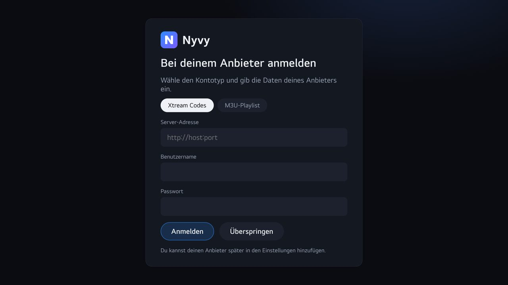

Nyvy enthält selbst keine Sender. Du brauchst ein Abonnement bei einem IPTV-Anbieter und die Zugangsdaten, die du von ihm bekommen hast.

### Anmelden

Beim ersten Start wählst du den Kontotyp:

| Kontotyp | Das gibst du ein | Das bekommst du |
|---|---|---|
| **Xtream Codes** | Server-Adresse, Benutzername und Passwort | Live-TV, TV-Programm, Catch-up, Filme, Serien und Kontostatus |
| **M3U-Playlist** | Adresse der Playlist und bei Bedarf die Adresse des TV-Programms | Live-TV mit Gruppen, TV-Programm, Favoriten und Suche |

> Du hast einen „M3U-Link“ mit `get.php?username=…&password=…` bekommen? Dann ist es eigentlich ein Xtream-Konto. Nyvy erkennt das und bietet an, dich stattdessen als Xtream anzumelden – dann bekommst du auch Filme und Serien.

Nach der Anmeldung lädt Nyvy das Angebot (Sender, Filme und Serien) und das TV-Programm. Beim ersten Mal kann das eine Minute dauern, danach geht es schnell. Beim Start von Nyvy werden Angebot und TV-Programm automatisch aktualisiert, wenn sie älter als 12 Stunden sind. Du kannst sie jederzeit selbst unter *Einstellungen → Konto* aktualisieren.

Möchtest du dich erst umsehen? Wähle *Überspringen*. Deinen Anbieter kannst du später unter *Einstellungen → Konto → Anbieter hinzufügen* eintragen.

## Fernbedienung {#remote}

| Taste | Funktion |
|---|---|
| Pfeile und OK | Bewegen und auswählen |
| Zurück | Zurück. Im Seitenmenü: Nyvy beenden |
| Rot · Grün · Gelb | Kurzwahl (siehe unten) |
| CH+ / CH− | Sender wechseln · in Listen blättern |
| Play/Pause | Pausieren und fortsetzen |
| Vor-/Zurückspulen | 60 Sekunden springen |
| Info | Infoleiste anzeigen (Live-TV) |
| Ziffern | Direkt zu einer Sendernummer |

Die Magic Remote funktioniert auch: zeigen zum Markieren, klicken zum Auswählen und mit dem Rad scrollen.

**Keine Farbtasten auf der Fernbedienung?** Vielen Magic Remotes fehlen sie, und du brauchst sie nicht: Alles funktioniert mit Tasten auf dem Bildschirm. ☆ *Favorit* findest du auf der Detailseite von Filmen und Serien, rechts neben der Senderliste (rechts drücken) und in der Infoleiste im Vollbild. *Sortierung* steht oben in den Listen, *Ton und Untertitel* und *Vorheriger Sender* in der Infoleiste. Möchtest du die Kurzwahl trotzdem nutzen, drücke **123** auf der Fernbedienung: Ein Feld mit den Farbtasten erscheint auf dem Bildschirm. Rot: Favorit · Grün: Sortierung, oder Ton und Untertitel beim Schauen · Gelb: vorheriger Sender.

### Was Zurück macht

| Wo du bist | Zurück |
|---|---|
| Das Seitenmenü | Fragt, ob du Nyvy beenden möchtest |
| Eine Liste in *Live-TV*, *Filme* oder *Serien* | Zuerst zu den Kategorien, dann zum Seitenmenü |
| Suche oder Einstellungen | Zum Seitenmenü |
| Die Detailseite eines Films oder einer Serie | Zurück zur Liste |
| Ein Film oder eine Folge läuft | Blendet zuerst die Spulleiste und die Tasten aus; der nächste Druck beendet. Nyvy merkt sich, wo du warst |
| Live-TV im Vollbild | Der Reihe nach: löscht eine angefangene Sendernummer, verlässt die Tastenreihe, blendet die Infoleiste aus, verlässt das Vollbild |
| Die Senderliste oder *Ton und Untertitel* ist offen | Schließt sie |
| Ein Dialog, zum Beispiel die PIN | Schließt ihn, ohne etwas zu ändern |

## Live-TV {#live-tv}

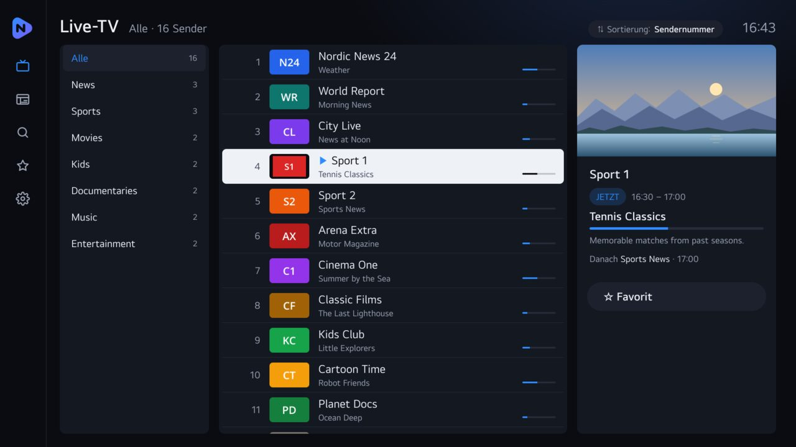
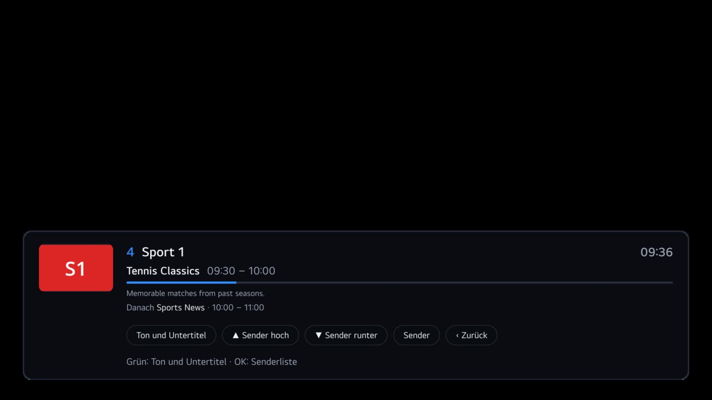

- **Sender wählen:** links die Kategorien, in der Mitte die Sender mit der laufenden Sendung. OK spielt den Sender im Vorschaufenster ab, ein weiteres OK schaltet auf Vollbild.
- **Im Vollbild:**
  - Hoch/runter oder CH+/CH− wechseln den Sender.
  - OK wählt die Tasten der Infoleiste: *Sender*, *Ton und Untertitel*, ☆ *Favorit*, *Vorheriger Sender*, Sender hoch/runter und *Zurück*. Links/rechts wechseln zwischen ihnen, OK wählt aus.
  - Links/rechts oder Info zeigen die Infoleiste mit Jetzt und Danach.
  - Ziffern wählen eine Sendernummer.
  - Zurück blendet zuerst die Infoleiste aus; ein weiteres Zurück verlässt das Vollbild.

### Mehr zu Live-TV

- **Vorschau:** OK auf einem Sender in der Liste spielt ihn im Feld rechts ab; noch einmal OK zeigt ihn im Vollbild. Zurück aus dem Vollbild führt zur Liste, und die Vorschau läuft weiter.
- **Sender wechseln im Vollbild:** OK drücken und *Sender* wählen, dann öffnet sich die Senderliste über dem Bild.
- **Sendernummern:** die Ziffern auf der Fernbedienung eingeben. Nyvy wechselt nach einem Moment.
- **Vorheriger Sender:** die Taste in der Infoleiste bringt dich zum Sender zurück, den du vorher gesehen hast.
- **Markierungen:** ↺ bedeutet, dass der Sender Catch-up hat. Der Strich unter der Sendung zeigt, wie weit sie fortgeschritten ist. Im Feld rechts zeigt *Catch-up · 2 Tage*, wie weit das Archiv zurückreicht.
- **Nach Qualität sortieren:** Nyvy liest HD und 4K aus den Sendernamen, sodass die besten Sender zuerst kommen.

## TV-Programm und Catch-up {#tv-guide}

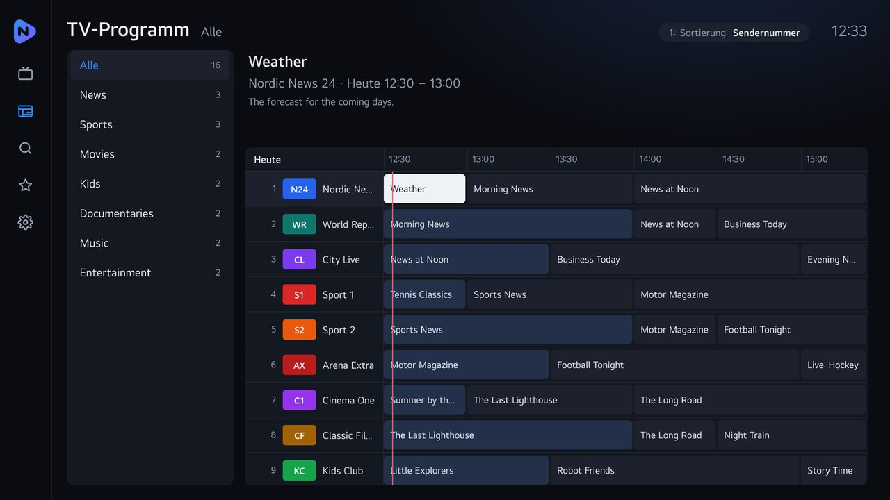

- **Das TV-Programm** zeigt die Sendungen aller Sender in einem Raster mit einer Linie für „jetzt“. OK auf einer laufenden Sendung startet den Sender.
- **Catch-up:** Sender mit ↺ haben ein Archiv beim Anbieter. Dort kannst du im TV-Programm zurückblättern, eine bereits gelaufene Sendung starten und darin spulen.

### Im TV-Programm bewegen

- Hoch/runter wechseln den Sender, CH+/CH− blättern eine Seite weiter.
- Links/rechts bewegen sich in der Zeit, eine Sendung nach der anderen. Nach vorn reicht das Programm drei Tage. Zurück geht es nur bei Sendern mit Catch-up, so weit das Archiv reicht.
- OK auf einer laufenden Sendung startet den Sender im Vollbild. Bei einer kommenden Sendung zeigt Nyvy, wann sie beginnt, zum Beispiel *Beginnt um 21:00*.

### Eine bereits gesendete Sendung ansehen

1. *TV-Programm* öffnen und einen Sender mit ↺ wählen.
2. Links drücken, bis du bei der Sendung bist. Sendungen, die du nachträglich ansehen kannst, sind mit ↺ markiert, und die Info zeigt *Catch-up: OK zum Ansehen von Anfang an*.
3. OK drücken. Die Sendung beginnt von vorn.
4. Mit links/rechts spulen, mit OK pausieren und mit Zurück beenden, wie bei einem Film.

## Filme und Serien {#films-series}

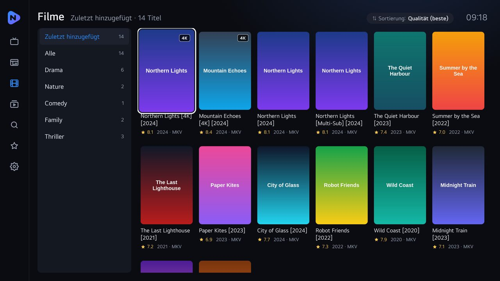
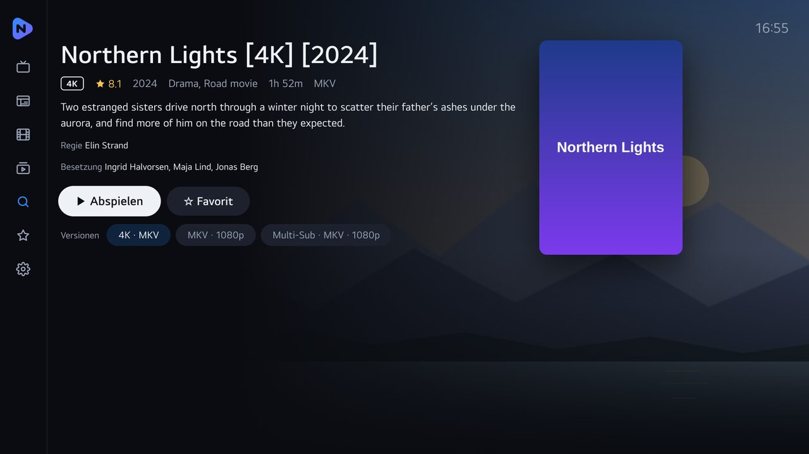
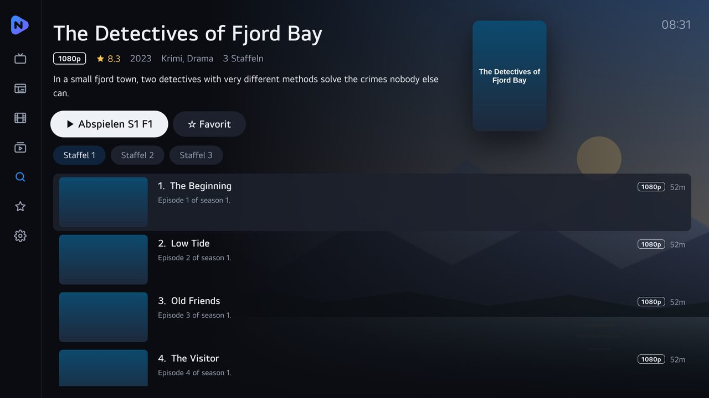

Filme und Serien gibt es bei Xtream-Konten.

- **Die Detailseite** zeigt Handlung, Besetzung, Qualität (zum Beispiel 4K oder Dolby Vision) und die Tasten *Abspielen*, *Fortsetzen* und *Favorit*. Gibt es einen Film in mehreren Versionen, werden sie unter den Tasten zur Auswahl angezeigt.
- **Serien:** Staffel und Folge wählen. Wenn eine Folge endet, startet die nächste nach einem Countdown.
- **Beim Ansehen:**
  - OK pausiert.
  - Links/rechts springen 10 Sekunden (gedrückt halten für größere Sprünge). Ein Vorschaubild zeigt, wo du landest, und OK springt dorthin.
  - Hoch zeigt die Tasten auf dem Bildschirm.
  - Zurück blendet zuerst die Zeitleiste und die Tasten aus; ein weiteres Zurück beendet die Wiedergabe. Nyvy merkt sich die Stelle.

### Versionen

Anbieter haben denselben Film oft in mehreren Versionen, zum Beispiel 4K, 1080p oder mit anderen Sprachen und Untertiteln. Nyvy fasst sie zusammen: Die Detailseite zeigt sie unter *Versionen*, und während der Film läuft, wechselst du unter *Ton und Untertitel* → *Version*.

### Weiterschauen und zuletzt hinzugefügt

Am Anfang von *Filme* und *Serien* stehen deine Favoriten, *Weiterschauen* (was du angefangen hast) und *Zuletzt hinzugefügt* (was der Anbieter zuletzt hinzugefügt hat). Auf der Detailseite von etwas Angefangenem steht zum Beispiel *Fortsetzen ab 42:10*, daneben *Von Anfang an*.

### 4K, HDR und Dolby Vision

- **Markierungen:** 4K, 1080p, 720p oder SD, manchmal mit HDR oder DV (Dolby Vision). Nyvy zeigt nur, was es sicher weiß, aus dem Titel oder vom Abspielen, daher hat nicht jeder Film eine Markierung.
- **Dolby Vision** wird als Dolby Vision abgespielt, wenn der Fernseher es unterstützt. Manche Dateien (Blu-ray-Kopien mit zwei Bildebenen) und Fernseher ohne Dolby Vision zeigen den Film stattdessen in HDR10, in derselben Auflösung.

## Ton und Untertitel {#audio-subtitles}

- **Filme und Serien:** runter oder Grün drücken, um Tonspur, Untertitel und Version zu wählen.
- **Live-TV:** *Ton und Untertitel* in der Infoleiste wählen (oder Grün drücken), um die Untertitel der Sendung ein- oder auszuschalten und die Tonspur zu wählen.
- **Standards:** unter *Einstellungen → Allgemein* wählst du die bevorzugte Tonsprache, ob Untertitel an sind, die Untertitelsprachen (1. und 2. Wahl) sowie Größe und Stil.

### Text- und Bilduntertitel

- **Textuntertitel** (zum Beispiel SRT und ASS) zeichnet Nyvy selbst, in der Größe und dem Stil, die du wählst.
- **Bilduntertitel** (PGS, von Blu-ray) sind fertige Bilder und werden unverändert gezeigt. Größe und Stil wirken sich nicht auf sie aus.
- **Untertitel der Sendung** im Live-TV (DVB und Videotext) zeichnet der Fernseher. In Nyvy schaltest du sie nur ein oder aus.

### Spuren, die nicht abgespielt werden können

Eine Spur, die der Fernseher nicht abspielen kann, ist ausgegraut und mit *auf diesem Gerät nicht abspielbar* gekennzeichnet. Am häufigsten sind das DTS und Dolby TrueHD. Hat ein Film nur solchen Ton, sagt Nyvy das beim Start, und der Film läuft ohne Ton: Wähle eine andere Version, falls vorhanden. Unter *Einstellungen* → *Info* siehst du, welche Formate dein Fernseher abspielen kann.

Kann der Hauptton eines Films nicht abgespielt werden, eine andere Spur aber schon, spielt Nyvy diese ab, und ein Hinweis nennt sie. Kommentarspuren werden nur gewählt, wenn sonst nichts abspielbar ist; du kannst sie trotzdem selbst wählen.

### Größe und Stil der Untertitel

Unter *Einstellungen* → *Allgemein* wählst du *Untertitelgröße* (Klein, Mittel, Groß oder Sehr groß) und *Untertitelstil* (Kontur oder Hintergrundbox). Eine Vorschau zeigt, wie es aussieht.

*Helligkeit der Untertitel* macht Untertitel weniger weiß, wenn sie zu hell wirken, in Stufen bis 10 %. Das gilt für Text- und Bilduntertitel, nicht aber für die Untertitel der Sendung im Live-TV, die der Fernseher zeichnet.

## Suche, Favoriten und Sortierung {#search}

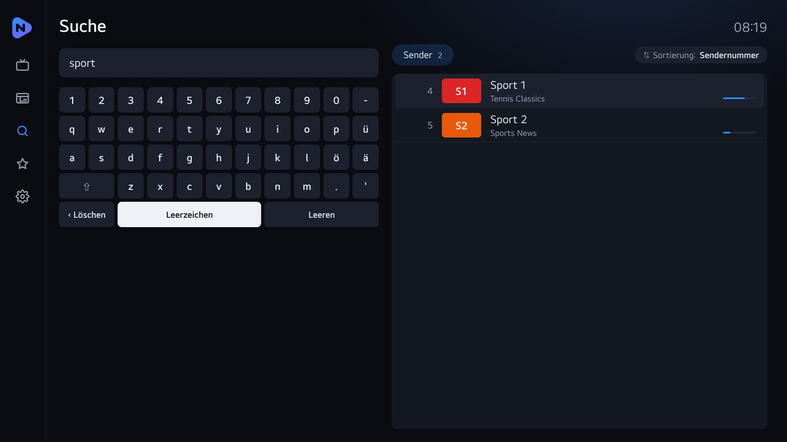

- **Suche:** mit der Bildschirmtastatur oder den Ziffern der Fernbedienung tippen. Die Suche findet Sender, Filme und Serien und ignoriert Akzente (*malmo* findet *Malmö*).
- **Favoriten:** ☆ *Favorit* auf der Detailseite eines Films oder einer Serie, rechts neben der Senderliste oder in der Infoleiste im Vollbild wählen (Rot ist eine Kurzwahl). Favoriten stehen in jeder Liste ganz oben und unter *Favoriten* im Menü.
- **Sortierung:** die Taste *Sortierung* oben in den Listen (oder Grün). Sender lassen sich nach Nummer, Qualität oder Name sortieren, Filme und Serien zum Beispiel nach zuletzt hinzugefügt, Jahr, Bewertung oder Qualität. Serien lassen sich außerdem nach der Länge der Folgen sortieren.

### Favoriten hinzufügen und finden

- **Ein Sender:** in der Liste in *Live-TV* markieren, rechts drücken und ☆ *Favorit* wählen. Im Vollbild ist dieselbe Taste in der Infoleiste (OK drücken).
- **Ein Film oder eine Serie:** ☆ *Favorit* auf der Detailseite wählen.
- **Finden:** unter *Favoriten* im Menü, aufgeteilt in Sender, Filme und Serien, und ganz oben in jeder Liste.
- **Entfernen:** ★ *Favorit entfernen* an derselben Stelle wählen.

## Einstellungen {#settings}

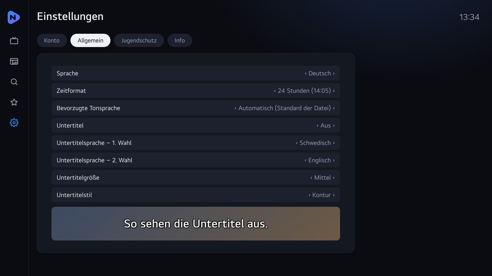
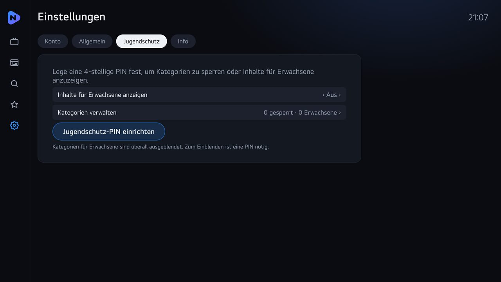
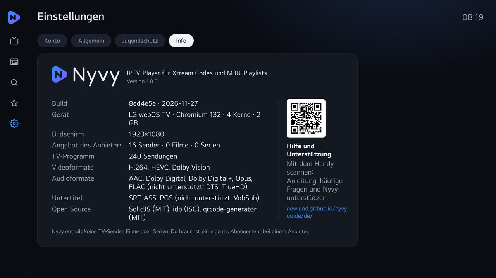

- **Konto:**
  - Zeigt deine Daten, wann das Angebot aktualisiert wurde, und die Taste *Angebot aktualisieren*.
  - **Daten ändern:** neue Server-Adresse, neues Passwort oder neue Playlist. Favoriten und Wiedergabepositionen bleiben, solange es dasselbe Konto ist.
  - **Abmelden** entfernt das Konto und seine Daten vom Fernseher.
- **Allgemein:** Sprache, Zeitformat, Ton und Untertitel.
- **Jugendschutz:**
  - Inhalte für Erwachsene sind von Anfang an ausgeblendet.
  - Mit einer vierstelligen PIN kannst du sie anzeigen und einzelne Kategorien sperren oder ausblenden.
  - Gesperrte Kategorien brauchen die PIN.
- **Info:** Version, welche Formate dein Fernseher abspielen kann, und der Link zu dieser Seite.

### Kindersicherung einrichten

1. Gehe zu *Einstellungen* → *Jugendschutz* und wähle *Jugendschutz-PIN einrichten*. Gib vier Ziffern ein und dann dieselben Ziffern noch einmal.
2. *Inhalte für Erwachsene anzeigen*: Inhalte für Erwachsene sind von Anfang an ausgeblendet, und sie anzuzeigen erfordert die PIN. Kategorien, die nach Erwachseneninhalten aussehen, zum Beispiel mit XXX oder 18+ im Namen, werden automatisch markiert.
3. *Kategorien verwalten*: OK auf einer Kategorie wechselt zwischen *🔒 Gesperrt* (erfordert die PIN), *🔞 Erwachsene* (ausgeblendet, solange Inhalte für Erwachsene ausgeblendet sind) und aus.
4. Eine gesperrte Kategorie öffnest du mit OK und der PIN. Sie bleibt dann entsperrt, bis du Nyvy schließt.
5. *PIN ändern* und *PIN entfernen* findest du auf derselben Seite.

### Wenn du die PIN vergisst

Die PIN lässt sich in Nyvy nicht zurücksetzen, mit Absicht, denn sonst könnte ein Kind sie umgehen. Auch *Abmelden* erfordert die PIN. Es bleibt, Nyvy vom Fernseher zu entfernen und neu zu installieren. Dann meldest du dich erneut an, und Favoriten, Fortsetzungspunkte und Einstellungen sind weg.

### Datenschutz

Alles, was Nyvy speichert, bleibt auf deinem Fernseher: deine Kontodaten (verschlüsselt), das Angebot, das TV-Programm, Favoriten, Fortsetzungspunkte und Einstellungen. Nichts wird an Nyvy gesendet. *Abmelden* entfernt alles. Mehr auf der Seite [Datenschutz](privacy.html).

## Häufige Fragen {#faq}

### „Dieser Sender sendet gerade nicht“
Der Stream des Anbieters ist ausgefallen, oder der Sender sendet nur bei bestimmten Ereignissen. Versuche es später noch einmal oder wähle einen anderen Sender. OK versucht es erneut.

### „Der Anbieter erlaubt gerade keine weiteren Verbindungen“
Viele Abonnements erlauben nur einen Stream gleichzeitig. Schließe die App auf anderen Geräten mit demselben Konto, warte kurz und versuche es erneut.

### „Der Anbieter antwortet nicht“
Prüfe die Internetverbindung des Fernsehers. Funktioniert sie, liegt das Problem wahrscheinlich beim Anbieter.

### Ein Film hat keinen Ton
Der Film hat wahrscheinlich nur Ton in DTS oder Dolby TrueHD, den LG-Fernseher in Apps nicht abspielen können. Wähle eine andere Tonspur oder eine andere Version des Films, falls vorhanden.

### Ich höre einen Kommentar statt des Films
Der Hauptton des Films (oft DTS) kann auf dem Fernseher nicht abgespielt werden, also spielt Nyvy die einzige Spur, die geht, manchmal einen Kommentar. Der Hinweis zu Beginn nennt sie. Wähle eine andere Version des Films, falls es eine gibt.

### Das TV-Programm ist leer (M3U)
Nicht jede Playlist gibt ein TV-Programm an. Frag deinen Anbieter nach der Adresse eines XMLTV-Programms und trage sie unter *Einstellungen → Konto → Daten ändern* ein.

### Ich sehe keine Filme und Serien (M3U)
Playlists liefern in Nyvy nur Live-TV. Wenn du ein Xtream-Konto hast, melde dich damit an, um Filme und Serien zu bekommen.

### Wie beende ich Nyvy?
Drücke Zurück, bis das Seitenmenü markiert ist, drücke noch einmal Zurück und wähle *Beenden*.

### „Neuer Versuch… (2/3)“
Der Start ist hängen geblieben, und Nyvy versucht es selbst bis zu dreimal erneut. Meist ist es ein vorübergehendes Problem beim Anbieter. Klappt auch der dritte Versuch nicht, zeigt Nyvy, was nicht stimmt.

### „Dieser Titel ist beim Anbieter nicht verfügbar“
Der Anbieter führt den Titel, hat die Datei aber nicht mehr. Das lässt sich in Nyvy nicht beheben. Wähle eine andere Version, falls vorhanden.

### Das Bild ruckelt oder lädt ständig
Prüfe das Netzwerk. 4K braucht etwa 25 Mbit/s stabil, und eine Kabelverbindung ist zuverlässiger als WLAN. Ruckelt nur ein Sender oder Film, liegt das Problem meist beim Anbieter. Wenn das Bild eines Films anhält, weil es auf Daten wartet, erscheint ein Ladekreis darauf, bis es weiterläuft.

### Die Einstellungen zeigen „Download stalled“
Der Anbieter hat die Playlist oder das TV-Programm mittendrin nicht mehr gesendet, und Nyvy hat nach 30 Sekunden aufgegeben. Was du schon hattest, bleibt erhalten. Versuche es später erneut: *Einstellungen* → *Konto* → *Angebot aktualisieren*.

### Untertitel erscheinen nicht
Prüfe, ob unter *Ton und Untertitel* die richtige Spur gewählt ist. Manche Spuren enthalten nur Text für Dialoge in anderen Sprachen, und in leisen Szenen erscheint nichts. Untertitel der Sendung im Live-TV gibt es nur, wenn der Sender sie ausstrahlt.

### Die Zeiten im TV-Programm stimmen nicht
Prüfe Uhrzeit und Zeitzone in den Einstellungen des Fernsehers. Stimmen sie, sind die Programmdaten des Anbieters falsch.

### Ein Sender hat keine Programminfos (M3U)
Nyvy ordnet Sender dem TV-Programm über die tvg-id zu, sonst über den Sendernamen. Hat ein Sender beides nicht oder weicht der Name ab, klappt die Zuordnung nicht. Der Anbieter kann das in der Playlist korrigieren.

### Das Angebot wirkt veraltet
Nyvy aktualisiert Angebot und TV-Programm beim Start der App, wenn sie älter als 12 Stunden sind. Sofort aktualisieren: *Einstellungen* → *Konto* → *Angebot aktualisieren*.

### Keine Antwort gefunden?
Melde ein Problem oder schlage eine Verbesserung auf [GitHub](https://github.com/newlund/nyvy-guide/issues) vor (du brauchst ein kostenloses GitHub-Konto). Gib an, welche Version du hast (*Einstellungen* → *Info*), und was passiert ist.

## Glossar

- **Xtream Codes:** eine verbreitete Art, wie IPTV-Anbieter Sender, Filme und Serien liefern, mit Serveradresse, Benutzername und Passwort.
- **M3U:** eine Playlist: eine lange Liste von Sendern und ihren Adressen. Liefert Live-TV, in Nyvy aber keine Filme und Serien.
- **EPG / XMLTV:** TV-Programmdaten, also was wann läuft. XMLTV ist das Dateiformat.
- **Catch-up:** bereits gesendete Sendungen aus dem Archiv des Anbieters ansehen (mit ↺ markiert).
- **4K:** ein Bild mit 3840×2160 Bildpunkten, viermal so viele wie Full HD (1080p).
- **HDR:** ein größerer Kontrast- und Farbumfang als bei einem normalen Bild. HDR10 ist die häufigste Variante.
- **Dolby Vision:** eine HDR-Variante, bei der das Bild Szene für Szene angepasst wird.
- **Dolby Digital / Dolby Digital Plus:** verbreitete Surround-Formate, die der Fernseher abspielen kann.
- **DTS / Dolby TrueHD:** Tonformate aus Kino und Blu-ray, die LG-Fernseher in Apps nicht abspielen können.
