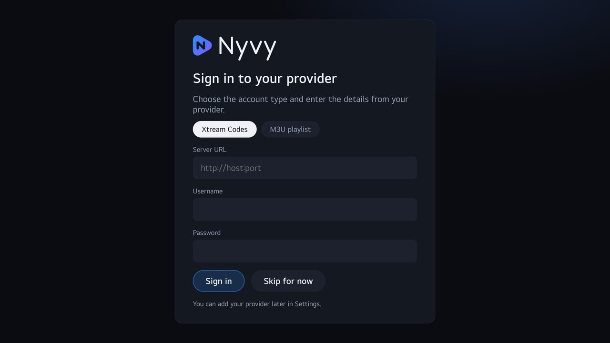
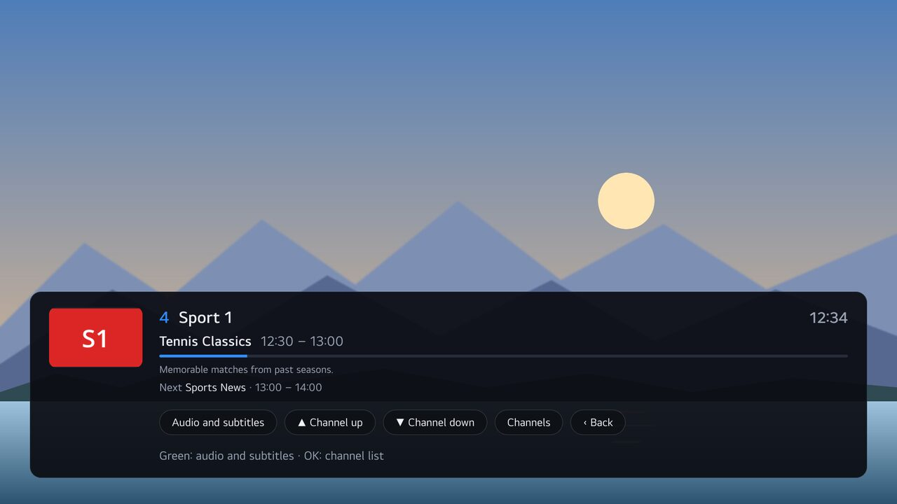
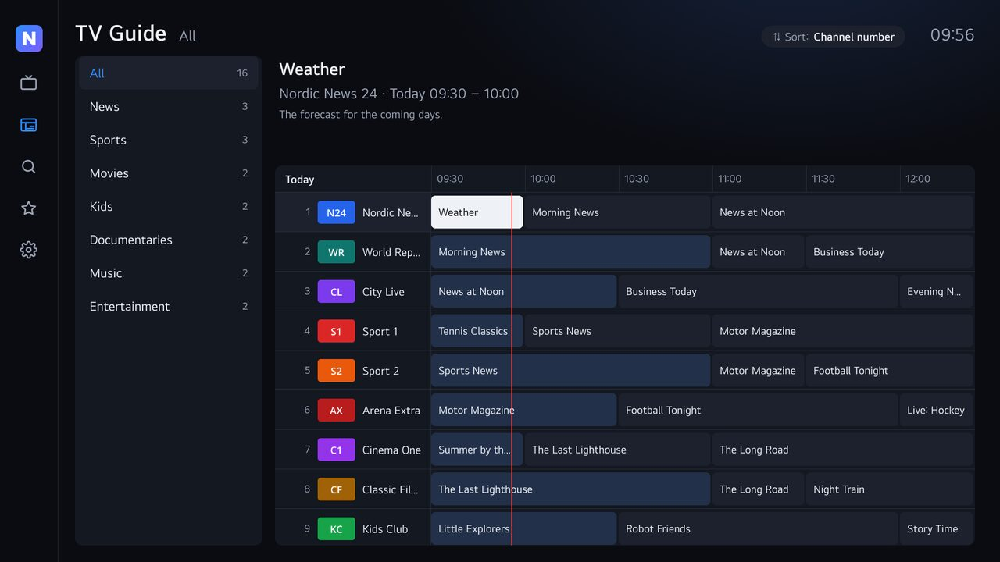
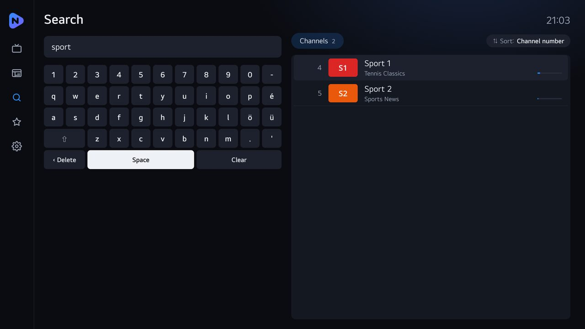
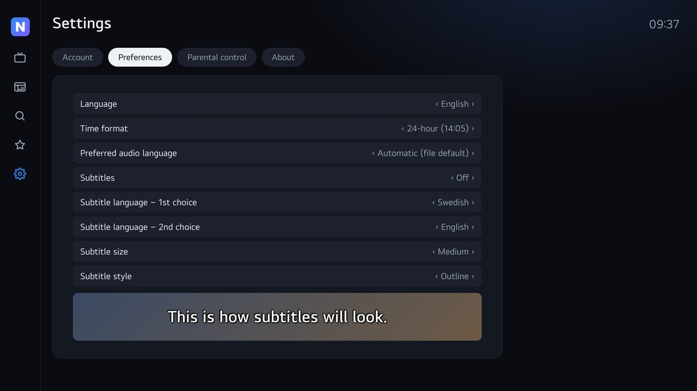
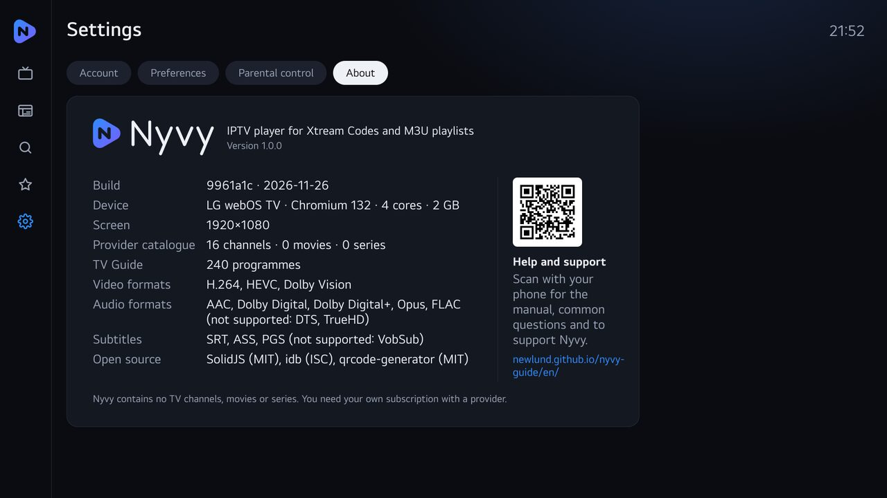

# Manual

Everything you need to get started with Nyvy and get the most out of it.

**Contents:** [Getting started](#getting-started) · [The remote](#the-remote) · [Live TV](#live-tv) · [TV Guide and catch-up](#tv-guide-and-catch-up) · [Films and series](#films-and-series) · [Audio and subtitles](#audio-and-subtitles) · [Search, favorites and sorting](#search-favorites-and-sorting) · [Settings](#settings) · [Common questions](#common-questions)

## Getting started

Nyvy contains no channels itself. You need a subscription with an IPTV provider, and the details they gave you.

### Sign in

The first time you start Nyvy, choose the account type:

| Account type | What you enter | What you get |
|---|---|---|
| **Xtream Codes** | Server address, username and password | Live TV, TV Guide, catch-up, films, series and account status |
| **M3U playlist** | The playlist address, and the guide address if needed | Live TV with groups, TV Guide, favorites and search |

> Got an "M3U link" containing `get.php?username=…&password=…`? That is really an Xtream account. Nyvy recognises it and offers to sign in as Xtream instead, which also gives you films and series.

After signing in, Nyvy downloads the catalogue (channels, films and series) and the TV Guide. The first time can take a minute; after that it's quick. When you start Nyvy, the catalogue and guide are updated automatically if they are more than 12 hours old, and you can always update them yourself under *Settings → Account*.

Want to look around first? Choose *Skip for now*. You can add your provider later under *Settings → Account → Add provider*.

## The remote

| Button | Does |
|---|---|
| Arrows and OK | Move and select |
| Back | Go back. On the side menu: exit Nyvy |
| Red | Add or remove a favorite |
| Green | Sort (in lists) · audio and subtitles (while watching) |
| Yellow | Previous channel (full-screen live TV) |
| CH+ / CH− | Switch channel · page through lists |
| Play/Pause | Pause and resume |
| Fast forward/rewind | Jump 60 seconds |
| Info | Show the info bar (live TV) |
| Digits | Go straight to a channel number |

The Magic Remote works too: point to highlight, click to select and scroll with the wheel.

## Live TV

- **Choose a channel:** categories are on the left, channels with the current programme in the middle. OK plays the channel in the preview pane; OK again goes full screen.
- **In full screen:**
  - Up/down or CH+/CH− switch channel.
  - OK opens the channel list.
  - Left/right or Info show the info bar with now and next, and buttons for the Magic Remote.
  - Digits go to a channel number, and Yellow back to the previous channel.
  - Back first hides the info bar; press Back again to leave full screen.

## TV Guide and catch-up

- **The TV Guide** shows the programmes for all channels in a grid with a "now" line. OK on a running programme starts the channel.
- **Catch-up:** channels marked ↺ have an archive with the provider. There you can go back in the guide, start a programme that has already aired, and seek in it.

## Films and series

Films and series are available for Xtream accounts.

- **The details page** shows the plot, cast, quality (for example 4K or Dolby Vision) and the *Play*, *Continue* and *Favorite* buttons. If a film exists in several versions, they're shown as choices below the buttons.
- **Series:** pick a season and an episode. When an episode ends, the next one starts after a countdown.
- **While watching:**
  - OK pauses.
  - Left/right jump 10 seconds (hold for longer jumps). A preview picture shows where you'll land, and OK jumps there.
  - Up shows the on-screen buttons.
  - Back first hides the seek bar and buttons; press Back again to exit. Nyvy remembers where you were.

## Audio and subtitles

- **Films and series:** press down or Green to choose the audio track, subtitles and version.
- **Live TV:** press Green to turn the broadcast's subtitles on or off (for example SVT's Swedish subtitles) and choose the audio track.
- **Defaults:** under *Settings → Preferences* you choose the preferred audio language, whether subtitles are on, first and second choice subtitle languages, and the text size and style.

## Search, favorites and sorting

- **Search:** type with the on-screen keyboard or the remote's digits. Search finds channels, films and series, and ignores accents (*malmo* finds *Malmö*).
- **Favorites:** press Red on a channel, film or series. Favorites come first in every list and under *Favorites* in the menu.
- **Sorting:** the *Sort* button at the top of lists (or Green). Channels can be sorted by number, quality or name, and films and series by, for example, recently added, year, rating or quality. Series can also be sorted by episode length.

## Settings

- **Account:**
  - Shows your details, when the catalogue was updated, and the *Refresh catalogue* button.
  - **Edit details:** a new server address, password or playlist. Favorites and resume points are kept as long as it's the same account.
  - **Sign out** removes the account and its data from the TV.
- **Preferences:** language, time format, audio and subtitles.
- **Parental control:**
  - Adult content is hidden from the start.
  - With a four-digit PIN you can show it, and lock or hide individual categories.
  - Locked categories need the PIN.
- **About:** version, which formats your TV can play, and the link to this page.

## Common questions

### "This channel is not broadcasting right now"
The provider's stream is down, or the channel only broadcasts during certain events. Try again later or choose another channel. Press OK to try again.

### "The provider allows no more connections right now"
Many subscriptions allow only one stream at a time. Close the app on other devices that use the same account, wait a moment and try again.

### "The provider is not responding"
Check the TV's internet connection. If it works, the problem is most likely with the provider.

### A film has no sound
The film most likely has audio only in DTS or Dolby TrueHD, which LG TVs can't play through apps. Choose another audio track, or another version of the film if there is one.

### The TV Guide is empty (M3U)
Not every playlist names a TV Guide. Ask your provider for the address of an XMLTV guide and enter it under *Settings → Account → Edit details*.

### I don't see films and series (M3U)
Playlists give live TV only in Nyvy. If you have an Xtream account, sign in with it to get films and series.

### How do I exit Nyvy?
Press Back until the side menu is highlighted, press Back again and choose *Exit*.
