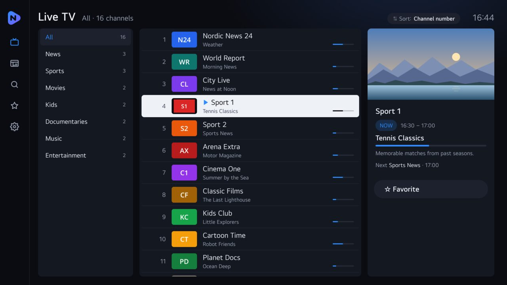
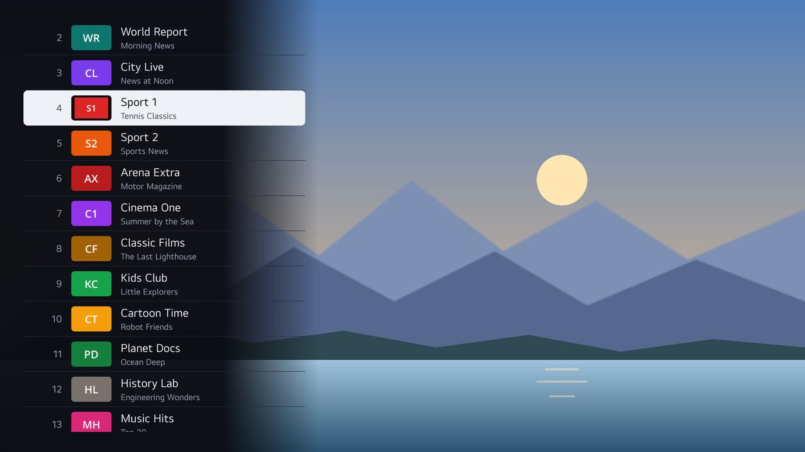
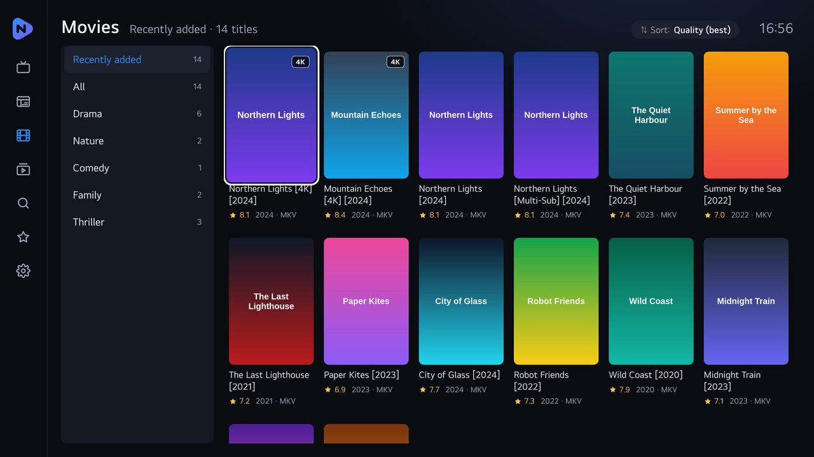
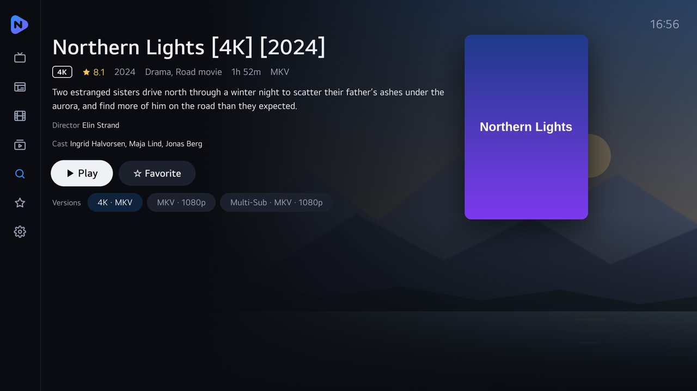
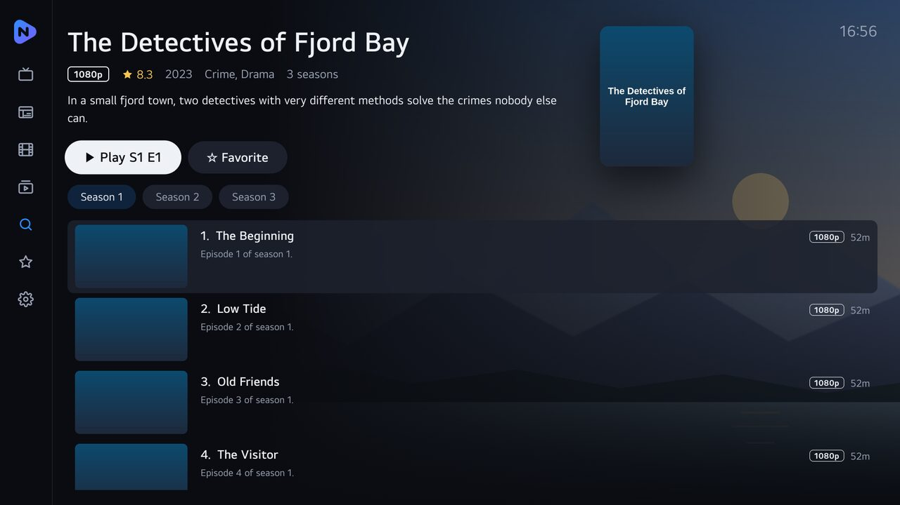
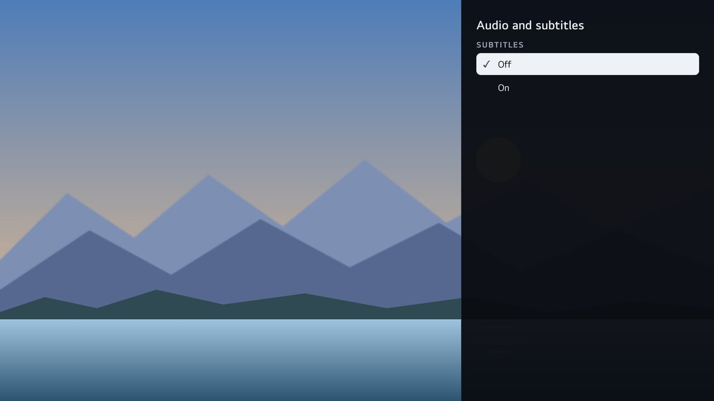
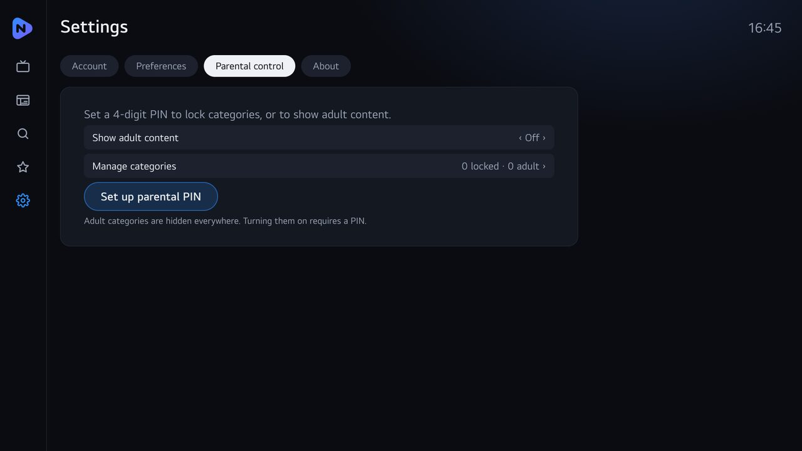

# Manual

Everything you need to get started with Nyvy and get the most out of it.

**Contents:** [Getting started](#getting-started) · [The remote](#the-remote) · [Live TV](#live-tv) · [TV Guide and catch-up](#tv-guide-and-catch-up) · [Films and series](#films-and-series) · [Audio and subtitles](#audio-and-subtitles) · [Search, favorites and sorting](#search-favorites-and-sorting) · [Settings](#settings) · [Common questions](#common-questions)

## Getting started

Nyvy contains no channels itself. You need a subscription with an IPTV provider, and the details they gave you.

### Sign in

The first time you start Nyvy, choose the account type:

| Account type | What you enter | What you get |
|---|---|---|
| **Xtream Codes** | Server address, username and password | Live TV, TV Guide, catch-up, films, series and account status |
| **M3U playlist** | The playlist address, and the guide address if needed | Live TV with groups, TV Guide, favorites and search |

> Got an "M3U link" containing `get.php?username=…&password=…`? That is really an Xtream account. Nyvy recognises it and offers to sign in as Xtream instead, which also gives you films and series.

After signing in, Nyvy downloads the catalogue (channels, films and series) and the TV Guide. The first time can take a minute; after that it's quick. When you start Nyvy, the catalogue and guide are updated automatically if they are more than 12 hours old, and you can always update them yourself under *Settings → Account*.

Want to look around first? Choose *Skip for now*. You can add your provider later under *Settings → Account → Add provider*.

## The remote

| Button | Does |
|---|---|
| Arrows and OK | Move and select |
| Back | Go back. On the side menu: exit Nyvy |
| Red · Green · Yellow | Shortcuts (see below) |
| CH+ / CH− | Switch channel · page through lists |
| Play/Pause | Pause and resume |
| Fast forward/rewind | Jump 60 seconds |
| Info | Show the info bar (live TV) |
| Digits | Go straight to a channel number |

The Magic Remote works too: point to highlight, click to select and scroll with the wheel.

**No coloured buttons on your remote?** Many Magic Remotes don't have them, and you don't need them: everything works with buttons on screen. ☆ *Favorite* is on the details page of films and series, to the right of the channel list (press right) and in the info bar in full screen. *Sort* is at the top of the lists, and *Audio and subtitles* and *Previous channel* are in the info bar. If you want the shortcuts anyway, press **123** on the remote: a panel with the coloured buttons appears on screen. Red: favorite · Green: sort, or audio and subtitles while watching · Yellow: previous channel.

### What Back does

| Where you are | Back |
|---|---|
| The side menu | Asks whether to exit Nyvy |
| A list in *Live TV*, *Movies* or *Series* | First to the categories, then to the side menu |
| Search or settings | To the side menu |
| A film's or series' details page | Back to the list |
| A film or episode playing | First hides the seek bar and buttons; the next press exits. Nyvy remembers where you were |
| Full-screen live TV | In turn: clears a channel number being typed, leaves the button row, hides the info bar, leaves full screen |
| The channel list or *Audio and subtitles* is open | Closes it |
| A dialog, such as the PIN | Closes it without changing anything |

## Live TV

- **Choose a channel:** categories are on the left, channels with the current programme in the middle. OK plays the channel in the preview pane; OK again goes full screen.
- **In full screen:**
  - Up/down or CH+/CH− switch channel.
  - OK selects the info bar's buttons: *Channels*, *Audio and subtitles*, ☆ *Favorite*, *Previous channel*, channel up/down and *Back*. Left/right move between them, OK selects.
  - Left/right or Info show the info bar with now and next.
  - Digits go to a channel number.
  - Back first hides the info bar; press Back again to leave full screen.

### More about live TV

- **Preview:** OK on a channel in the list plays it in the pane on the right; OK again goes full screen. Back from full screen takes you to the list, and the preview keeps playing.
- **Changing channel in full screen:** press OK and choose *Channels*, and the channel list opens over the picture.
- **Channel numbers:** type the digits on the remote. Nyvy switches after a moment.
- **Previous channel:** the button in the info bar takes you back to the channel you watched before.
- **Markers:** ↺ means the channel has catch-up. The line under the programme shows how far it has got. In the pane on the right, *Catch-up · 2 days* shows how far back the archive goes.
- **Sorting by quality:** Nyvy reads HD and 4K from the channel names, so the best channels come first.

## TV Guide and catch-up

- **The TV Guide** shows the programmes for all channels in a grid with a "now" line. OK on a running programme starts the channel.
- **Catch-up:** channels marked ↺ have an archive with the provider. There you can go back in the guide, start a programme that has already aired, and seek in it.

### Moving around the guide

- Up/down change channel, and CH+/CH− page through a screenful at a time.
- Left/right move in time, one programme at a time. Forward, the guide reaches three days ahead. Back in time only works on catch-up channels, as far as the archive goes.
- OK on a programme that is on now starts the channel in full screen. On a programme still to come, Nyvy shows when it starts, for example *Starts at 21:00*.

### Watching a programme that has already aired

1. Open *TV Guide* and choose a channel marked ↺.
2. Press left until you reach the programme. Programmes you can watch afterwards are marked ↺, and the info says *Catch-up: OK to watch from the start*.
3. Press OK. The programme starts from the beginning.
4. Seek with left/right, pause with OK and exit with Back, just like a film.

## Films and series

Films and series are available for Xtream accounts.

- **The details page** shows the plot, cast, quality (for example 4K or Dolby Vision) and the *Play*, *Continue* and *Favorite* buttons. If a film exists in several versions, they're shown as choices below the buttons.
- **Series:** pick a season and an episode. When an episode ends, the next one starts after a countdown.
- **While watching:**
  - OK pauses.
  - Left/right jump 10 seconds (hold for longer jumps). A preview picture shows where you'll land, and OK jumps there.
  - Up shows the on-screen buttons.
  - Back first hides the seek bar and buttons; press Back again to exit. Nyvy remembers where you were.

### Versions

Providers often have the same film in several versions, for example 4K, 1080p, or with other languages and subtitles. Nyvy groups them: the details page lists them under *Versions*, and while the film plays you switch under *Audio and subtitles* → *Version*.

### Continue watching and recently added

First in *Movies* and *Series* come your favorites, *Continue watching* (what you have started) and *Recently added* (what the provider added last). The details page of something you have started says, for example, *Resume from 42:10*, with *Play from start* next to it.

### 4K, HDR and Dolby Vision

- **Markers:** 4K, 1080p, 720p or SD, sometimes with HDR or DV (Dolby Vision). Nyvy only shows what it knows for sure, from the title or from playing the film, so not every film has a marker.
- **Dolby Vision** plays as Dolby Vision when the TV supports it. Some files (Blu-ray copies with two picture layers) and TVs without Dolby Vision show the film in HDR10 instead, at the same resolution.

## Audio and subtitles

- **Films and series:** press down or Green to choose the audio track, subtitles and version.
- **Live TV:** choose *Audio and subtitles* in the info bar (or press Green) to turn the broadcast's subtitles on or off (for example SVT's Swedish subtitles) and choose the audio track.
- **Defaults:** under *Settings → Preferences* you choose the preferred audio language, whether subtitles are on, first and second choice subtitle languages, and the text size and style.

### Text and picture subtitles

- **Text subtitles** (for example SRT and ASS) are drawn by Nyvy, in the size and style you choose.
- **Picture subtitles** (PGS, from Blu-ray) are ready-made images and are shown as they are. Size and style don't affect them.
- **Broadcast subtitles** in live TV (DVB and teletext) are drawn by the TV. In Nyvy you only turn them on or off.

### Tracks that can't be played

A track the TV can't play is greyed out with the text *not playable on this device*. The most common are DTS and Dolby TrueHD. If a film only has such audio, Nyvy says so when it starts and the film plays without sound: choose another version if there is one. *Settings* → *About* shows which formats your TV can play.

If a film's main audio can't be played but another track can, Nyvy plays that one and a notice names it. Commentary tracks are only chosen when nothing else can be played; you can still pick them yourself.

### Subtitle size and style

Under *Settings* → *Preferences* you choose *Subtitle size* (Small, Medium, Large or Extra large) and *Subtitle style* (Outline or Background box). A preview shows how it will look.

*Subtitle brightness* makes subtitles less white if they feel too bright, in steps down to 10%. It applies to text and picture subtitles, but not to broadcast subtitles in live TV, which the TV draws.

## Search, favorites and sorting

- **Search:** type with the on-screen keyboard or the remote's digits. Search finds channels, films and series, and ignores accents (*malmo* finds *Malmö*).
- **Favorites:** choose ☆ *Favorite* on the details page of a film or series, to the right of the channel list, or in the info bar in full screen (Red is a shortcut). Favorites come first in every list and under *Favorites* in the menu.
- **Sorting:** the *Sort* button at the top of lists (or Green). Channels can be sorted by number, quality or name, and films and series by, for example, recently added, year, rating or quality. Series can also be sorted by episode length.

### Adding and finding favorites

- **A channel:** highlight it in the list in *Live TV*, press right and choose ☆ *Favorite*. In full screen the same button is in the info bar (press OK).
- **A film or series:** choose ☆ *Favorite* on the details page.
- **Finding them:** under *Favorites* in the menu, split into channels, films and series, and first in every list.
- **Removing:** choose ★ *Remove favorite* in the same place.

## Settings

- **Account:**
  - Shows your details, when the catalogue was updated, and the *Refresh catalogue* button.
  - **Edit details:** a new server address, password or playlist. Favorites and resume points are kept as long as it's the same account.
  - **Sign out** removes the account and its data from the TV.
- **Preferences:** language, time format, audio and subtitles.
- **Parental control:**
  - Adult content is hidden from the start.
  - With a four-digit PIN you can show it, and lock or hide individual categories.
  - Locked categories need the PIN.
- **About:** version, which formats your TV can play, and the link to this page.

### Setting up parental control

1. Go to *Settings* → *Parental control* and choose *Set up parental PIN*. Enter four digits, then the same digits again.
2. *Show adult content*: adult content is hidden from the start, and showing it needs the PIN. Categories that look adult, for example with XXX or 18+ in the name, are marked automatically.
3. *Manage categories*: press OK on a category to switch between *🔒 Locked* (needs the PIN), *🔞 Adult* (hidden while adult content is hidden) and off.
4. You open a locked category with OK and the PIN. It then stays unlocked until you close Nyvy.
5. *Change PIN* and *Remove PIN* are on the same page.

### If you forget the PIN

The PIN can't be reset in Nyvy, on purpose, since otherwise a child could get around it. *Sign out* needs the PIN too. What remains is to remove Nyvy from the TV and install it again. You then sign in again, and favorites, resume points and settings are gone.

### Privacy

Everything Nyvy stores stays on your TV: your account details (encrypted), the catalogue, the TV guide, favorites, resume points and settings. Nothing is sent to Nyvy. *Sign out* removes it all. More on the [Privacy](privacy.html) page.

## Common questions

### "This channel is not broadcasting right now"
The provider's stream is down, or the channel only broadcasts during certain events. Try again later or choose another channel. Press OK to try again.

### "The provider allows no more connections right now"
Many subscriptions allow only one stream at a time. Close the app on other devices that use the same account, wait a moment and try again.

### "The provider is not responding"
Check the TV's internet connection. If it works, the problem is most likely with the provider.

### A film has no sound
The film most likely has audio only in DTS or Dolby TrueHD, which LG TVs can't play through apps. Choose another audio track, or another version of the film if there is one.

### I hear a commentary instead of the film
The film's main audio (often DTS) can't be played on the TV, so Nyvy plays the only track that can, sometimes a commentary. The notice at the start says which. Choose another version of the film if there is one.

### The TV Guide is empty (M3U)
Not every playlist names a TV Guide. Ask your provider for the address of an XMLTV guide and enter it under *Settings → Account → Edit details*.

### I don't see films and series (M3U)
Playlists give live TV only in Nyvy. If you have an Xtream account, sign in with it to get films and series.

### How do I exit Nyvy?
Press Back until the side menu is highlighted, press Back again and choose *Exit*.

### "Retrying… (2/3)"
The start got stuck, and Nyvy tries again by itself, up to three times. Usually it's a temporary problem at the provider. If the third try fails too, Nyvy shows what is wrong.

### "This title is not available from the provider"
The provider lists the title but no longer has the file. This can't be fixed in Nyvy. Choose another version if there is one.

### The picture stutters or keeps loading
Check the network. 4K needs about 25 Mbit/s steadily, and a wired connection is more reliable than Wi-Fi. If only one channel or film stutters, the problem is usually at the provider.

### Subtitles don't appear
Check that the right track is chosen under *Audio and subtitles*. Some tracks only have text for lines in other languages, and nothing shows in quiet scenes. Broadcast subtitles in live TV are only there when the channel sends them.

### The times in the TV guide are wrong
Check the time and time zone in the TV's own settings. If they're right, the provider's guide data is off.

### A channel has no programme information (M3U)
Nyvy matches channels to the TV guide by tvg-id, otherwise by the channel name. If a channel has neither, or the name differs, it can't be matched. The provider can fix it in the playlist.

### The catalogue looks out of date
Nyvy updates the catalogue and the TV guide when you start the app, if they are more than 12 hours old. To update right away: *Settings* → *Account* → *Refresh catalogue*.

## Glossary

- **Xtream Codes:** a common way for IPTV providers to deliver channels, films and series, with a server address, a username and a password.
- **M3U:** a playlist: a long list of channels and their addresses. Gives live TV, but not films and series in Nyvy.
- **EPG / XMLTV:** TV guide data: what is on when. XMLTV is the file format.
- **Catch-up:** watching programmes that have already aired, from the provider's archive (marked ↺).
- **4K:** a picture of 3840×2160 pixels, four times as many as Full HD (1080p).
- **HDR:** a wider range of contrast and colour than a regular picture. HDR10 is the most common kind.
- **Dolby Vision:** a kind of HDR where the picture is adjusted scene by scene.
- **Dolby Digital / Dolby Digital Plus:** common surround sound formats the TV can play.
- **DTS / Dolby TrueHD:** cinema and Blu-ray audio formats that LG TVs can't play in apps.
