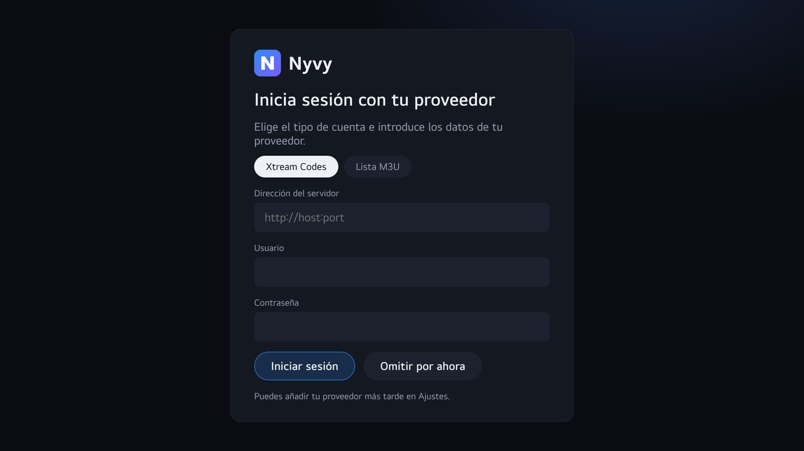
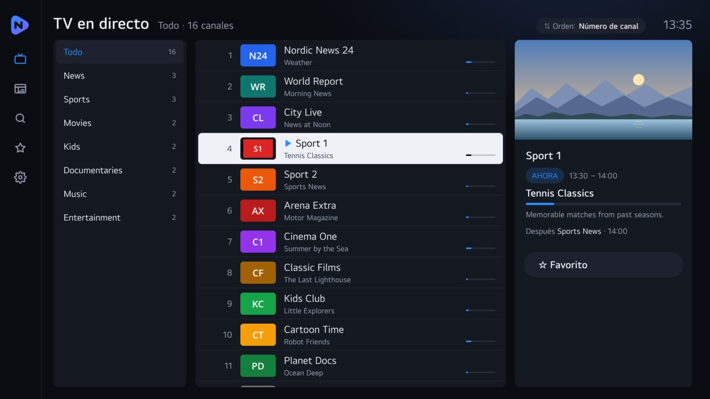
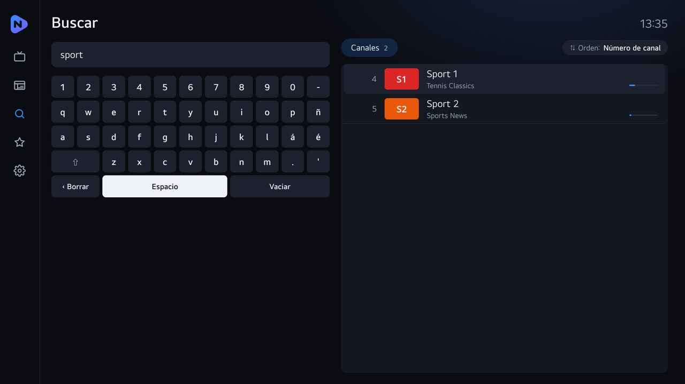

# Manual

Todo lo que necesitas para empezar con Nyvy y sacarle el máximo partido.

**Contenido:** [Primeros pasos](#getting-started) · [El mando](#remote) · [TV en directo](#live-tv) · [Guía de TV y catch-up](#tv-guide) · [Películas y series](#films-series) · [Audio y subtítulos](#audio-subtitles) · [Buscar, favoritos y orden](#search) · [Ajustes](#settings) · [Preguntas frecuentes](#faq)

## Primeros pasos {#getting-started}

Nyvy no incluye canales. Necesitas una suscripción con un proveedor de IPTV y los datos que te ha dado.

### Iniciar sesión

La primera vez que abres Nyvy, elige el tipo de cuenta:

| Tipo de cuenta | Qué introduces | Qué obtienes |
|---|---|---|
| **Xtream Codes** | Dirección del servidor, usuario y contraseña | TV en directo, guía de TV, catch-up, películas, series y estado de la cuenta |
| **Lista M3U** | La dirección de la lista y, si hace falta, la de la guía | TV en directo con grupos, guía de TV, favoritos y búsqueda |

> ¿Te han dado un «enlace M3U» con `get.php?username=…&password=…`? En realidad es una cuenta Xtream. Nyvy lo reconoce y te ofrece iniciar sesión como Xtream, así tendrás también películas y series.

Tras iniciar sesión, Nyvy descarga el catálogo (canales, películas y series) y la guía de TV. La primera vez puede tardar un minuto; después va rápido. Al abrir Nyvy, el catálogo y la guía se actualizan solos si tienen más de 12 horas, y siempre puedes actualizarlos tú en *Ajustes → Cuenta*.

¿Quieres echar un vistazo primero? Elige *Omitir por ahora*. Puedes añadir tu proveedor más tarde en *Ajustes → Cuenta → Añadir proveedor*.

## El mando {#remote}

| Botón | Función |
|---|---|
| Flechas y OK | Moverse y seleccionar |
| Atrás | Volver. En el menú lateral: salir de Nyvy |
| Rojo · Verde · Amarillo | Atajos (ver abajo) |
| CH+ / CH− | Cambiar de canal · pasar páginas en listas |
| Reproducir/Pausa | Pausar y continuar |
| Avance/retroceso rápido | Saltar 60 segundos |
| Info | Mostrar la barra de información (TV en directo) |
| Números | Ir directamente a un número de canal |

El Magic Remote también funciona: apunta para marcar, haz clic para seleccionar y desplázate con la rueda.

**¿Tu mando no tiene botones de colores?** Muchos Magic Remote no los tienen, y no los necesitas: todo funciona con botones en pantalla. ☆ *Favorito* está en la página de detalles de películas y series, a la derecha de la lista de canales (pulsa derecha) y en la barra de información a pantalla completa. *Orden* está arriba en las listas, y *Audio y subtítulos* y *Canal anterior* en la barra de información. Si aun así quieres los atajos, pulsa **123** en el mando: aparece en pantalla un panel con los botones de colores. Rojo: favorito · Verde: ordenar, o audio y subtítulos mientras ves · Amarillo: canal anterior.

## TV en directo {#live-tv}

- **Elegir canal:** a la izquierda están las categorías y en el centro los canales con el programa actual. OK reproduce el canal en la vista previa; OK otra vez pasa a pantalla completa.
- **A pantalla completa:**
  - Arriba/abajo o CH+/CH− cambian de canal.
  - OK selecciona los botones de la barra de información: *Canales*, *Audio y subtítulos*, ☆ *Favorito*, *Canal anterior*, canal arriba/abajo y *Atrás*. Izquierda/derecha se mueven entre ellos, OK selecciona.
  - Izquierda/derecha o Info muestran la barra de información con ahora y después.
  - Los números van a un canal.
  - Atrás oculta primero la barra de información; pulsa Atrás otra vez para salir de la pantalla completa.

## Guía de TV y catch-up {#tv-guide}

- **La guía de TV** muestra los programas de todos los canales en una cuadrícula con una línea de «ahora». OK en un programa en emisión abre el canal.
- **Catch-up:** los canales con ↺ tienen archivo en el proveedor. En ellos puedes retroceder en la guía, abrir un programa ya emitido y avanzar o retroceder en él.

## Películas y series {#films-series}

Las películas y series están disponibles en las cuentas Xtream.

- **La página de detalles** muestra la sinopsis, el reparto, la calidad (por ejemplo 4K o Dolby Vision) y los botones *Reproducir*, *Continuar* y *Favorito*. Si una película tiene varias versiones, aparecen como opciones debajo de los botones.
- **Series:** elige temporada y episodio. Cuando termina un episodio, el siguiente empieza tras una cuenta atrás.
- **Mientras ves:**
  - OK pausa.
  - Izquierda/derecha saltan 10 segundos (mantén pulsado para saltos más largos). Una imagen de vista previa muestra dónde caerás y OK salta allí.
  - Arriba muestra los botones en pantalla.
  - Atrás oculta primero la barra de progreso y los botones; pulsa Atrás otra vez para salir. Nyvy recuerda dónde te quedaste.

## Audio y subtítulos {#audio-subtitles}

- **Películas y series:** pulsa abajo o Verde para elegir pista de audio, subtítulos y versión.
- **TV en directo:** elige *Audio y subtítulos* en la barra de información (o pulsa Verde) para activar o desactivar los subtítulos de la emisión y elegir la pista de audio.
- **Valores predeterminados:** en *Ajustes → General* eliges el idioma de audio preferido, si los subtítulos están activados, los idiomas de subtítulos (1.ª y 2.ª opción) y el tamaño y estilo del texto.

## Buscar, favoritos y orden {#search}

- **Buscar:** escribe con el teclado en pantalla o con los números del mando. La búsqueda encuentra canales, películas y series e ignora los acentos (*malmo* encuentra *Malmö*).
- **Favoritos:** elige ☆ *Favorito* en la página de detalles de una película o serie, a la derecha de la lista de canales o en la barra de información a pantalla completa (Rojo es un atajo). Los favoritos aparecen primero en cada lista y en *Favoritos* en el menú.
- **Orden:** el botón *Orden* arriba en las listas (o Verde). Los canales se pueden ordenar por número, calidad o nombre, y las películas y series, por ejemplo, por añadidos recientemente, año, valoración o calidad. Las series también se pueden ordenar por la duración de los episodios.

## Ajustes {#settings}

- **Cuenta:**
  - Muestra tus datos, cuándo se actualizó el catálogo y el botón *Actualizar catálogo*.
  - **Editar datos:** nueva dirección del servidor, nueva contraseña o nueva lista. Los favoritos y los puntos de reanudación se conservan mientras sea la misma cuenta.
  - **Cerrar sesión** elimina la cuenta y sus datos del televisor.
- **General:** idioma, formato de hora, audio y subtítulos.
- **Control parental:**
  - El contenido para adultos está oculto desde el principio.
  - Con un PIN de cuatro cifras puedes mostrarlo y bloquear u ocultar categorías concretas.
  - Las categorías bloqueadas requieren el PIN.
- **Acerca de:** versión, qué formatos puede reproducir tu televisor y el enlace a esta página.

## Preguntas frecuentes {#faq}

### «Este canal no está emitiendo ahora»
La emisión del proveedor ha caído o el canal solo emite en eventos concretos. Vuelve a intentarlo más tarde o elige otro canal. OK lo intenta de nuevo.

### «El proveedor no permite más conexiones ahora»
Muchas suscripciones solo permiten una emisión a la vez. Cierra la app en otros dispositivos que usen la misma cuenta, espera un momento y vuelve a intentarlo.

### «El proveedor no responde»
Comprueba la conexión a internet del televisor. Si funciona, lo más probable es que el problema esté en el proveedor.

### Una película no tiene sonido
Lo más probable es que la película solo tenga audio en DTS o Dolby TrueHD, que los televisores LG no pueden reproducir en apps. Elige otra pista de audio u otra versión de la película si la hay.

### La guía de TV está vacía (M3U)
No todas las listas indican una guía. Pide a tu proveedor la dirección de una guía XMLTV e introdúcela en *Ajustes → Cuenta → Editar datos*.

### No veo películas ni series (M3U)
En Nyvy las listas solo dan TV en directo. Si tienes una cuenta Xtream, inicia sesión con ella para tener películas y series.

### ¿Cómo salgo de Nyvy?
Pulsa Atrás hasta que el menú lateral esté seleccionado, pulsa Atrás otra vez y elige *Salir*.
