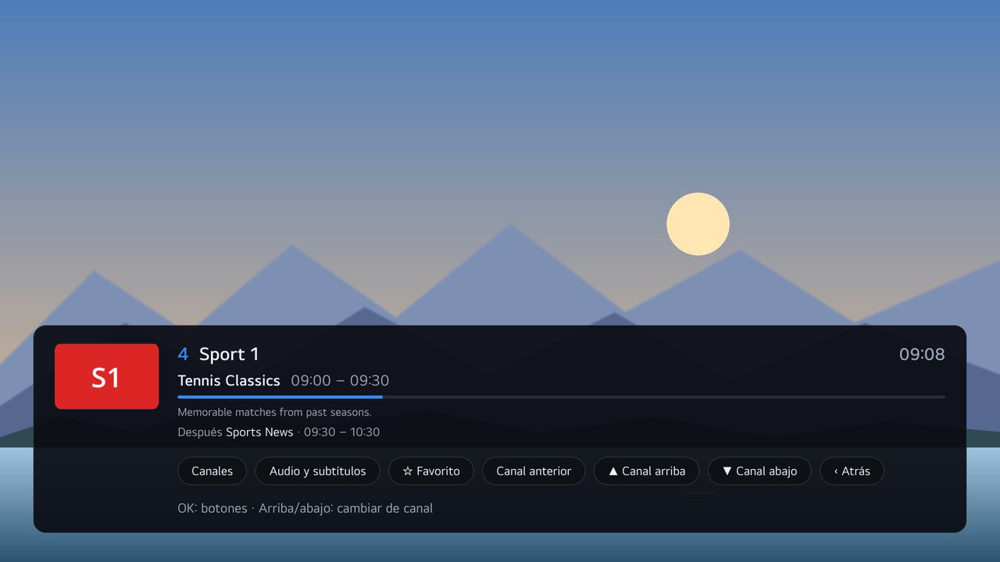
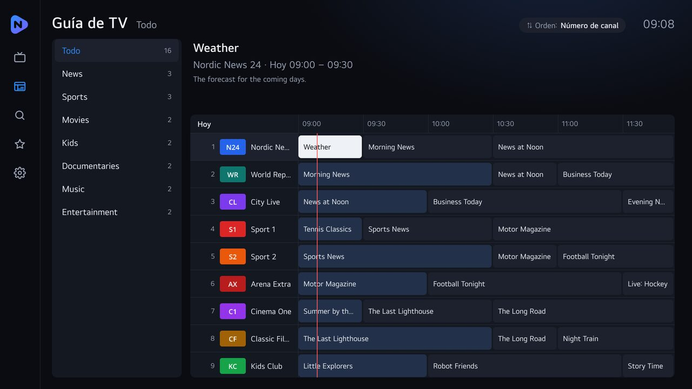
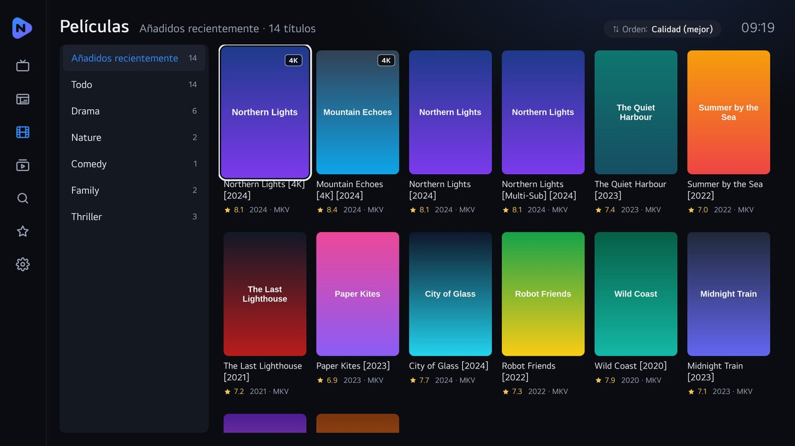
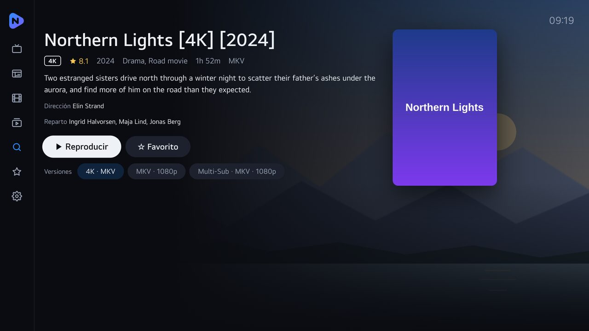
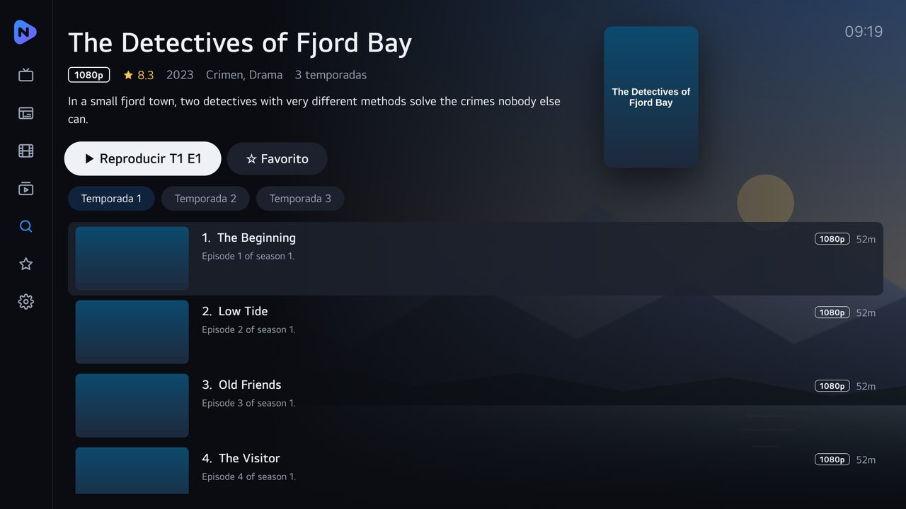
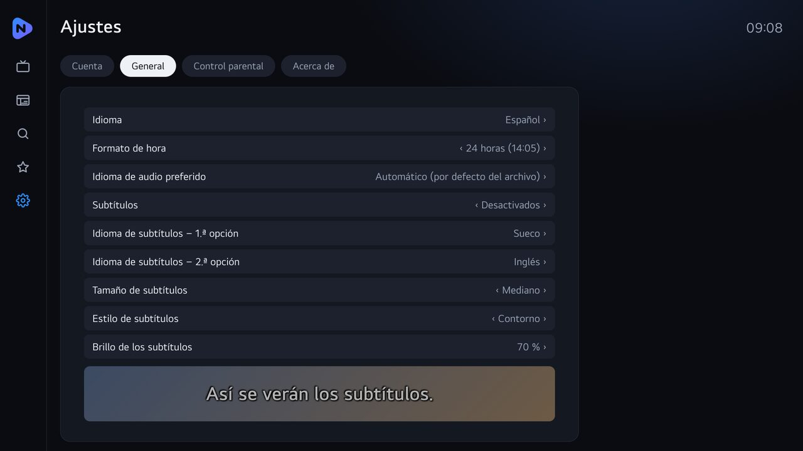
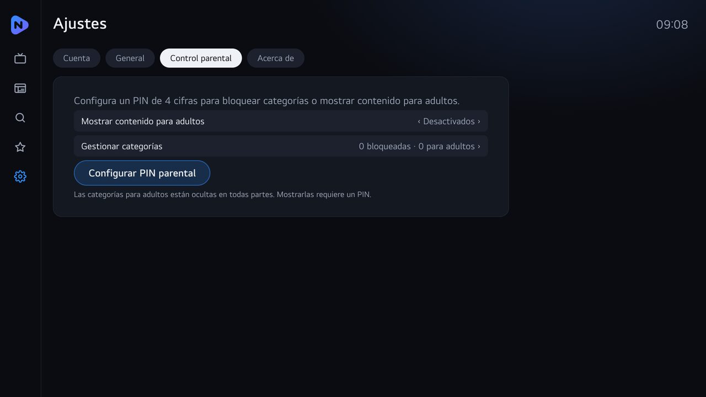
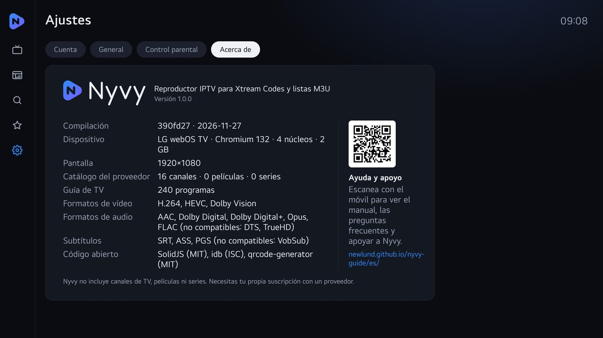

# Manual

Todo lo que necesitas para empezar con Nyvy y sacarle el máximo partido.

**Contenido:** [Primeros pasos](#getting-started) · [El mando](#remote) · [TV en directo](#live-tv) · [Guía de TV y catch-up](#tv-guide) · [Películas y series](#films-series) · [Audio y subtítulos](#audio-subtitles) · [Buscar, favoritos y orden](#search) · [Ajustes](#settings) · [Preguntas frecuentes](#faq)

## Primeros pasos {#getting-started}

Nyvy no incluye canales. Necesitas una suscripción con un proveedor de IPTV y los datos que te ha dado.

### Iniciar sesión

La primera vez que abres Nyvy, elige el tipo de cuenta:

| Tipo de cuenta | Qué introduces | Qué obtienes |
|---|---|---|
| **Xtream Codes** | Dirección del servidor, usuario y contraseña | TV en directo, guía de TV, catch-up, películas, series y estado de la cuenta |
| **Lista M3U** | La dirección de la lista y, si hace falta, la de la guía | TV en directo con grupos, guía de TV, favoritos y búsqueda |

> ¿Te han dado un «enlace M3U» con `get.php?username=…&password=…`? En realidad es una cuenta Xtream. Nyvy lo reconoce y te ofrece iniciar sesión como Xtream, así tendrás también películas y series.

Tras iniciar sesión, Nyvy descarga el catálogo (canales, películas y series) y la guía de TV. La primera vez puede tardar un minuto; después va rápido. Al abrir Nyvy, el catálogo y la guía se actualizan solos si tienen más de 12 horas, y siempre puedes actualizarlos tú en *Ajustes → Cuenta*.

¿Quieres echar un vistazo primero? Elige *Omitir por ahora*. Puedes añadir tu proveedor más tarde en *Ajustes → Cuenta → Añadir proveedor*.

## El mando {#remote}

| Botón | Función |
|---|---|
| Flechas y OK | Moverse y seleccionar |
| Atrás | Volver. En el menú lateral: salir de Nyvy |
| Rojo · Verde · Amarillo | Atajos (ver abajo) |
| CH+ / CH− | Cambiar de canal · pasar páginas en listas |
| Reproducir/Pausa | Pausar y continuar |
| Avance/retroceso rápido | Saltar 60 segundos |
| Info | Mostrar la barra de información (TV en directo) |
| Números | Ir directamente a un número de canal |

El Magic Remote también funciona: apunta para marcar, haz clic para seleccionar y desplázate con la rueda.

**¿Tu mando no tiene botones de colores?** Muchos Magic Remote no los tienen, y no los necesitas: todo funciona con botones en pantalla. ☆ *Favorito* está en la página de detalles de películas y series, a la derecha de la lista de canales (pulsa derecha) y en la barra de información a pantalla completa. *Orden* está arriba en las listas, y *Audio y subtítulos* y *Canal anterior* en la barra de información. Si aun así quieres los atajos, pulsa **123** en el mando: aparece en pantalla un panel con los botones de colores. Rojo: favorito · Verde: ordenar, o audio y subtítulos mientras ves · Amarillo: canal anterior.

### Qué hace Atrás

| Dónde estás | Atrás |
|---|---|
| El menú lateral | Pregunta si quieres salir de Nyvy |
| Una lista en *TV en directo*, *Películas* o *Series* | Primero a las categorías, luego al menú lateral |
| La búsqueda o los ajustes | Al menú lateral |
| La página de detalles de una película o serie | Vuelve a la lista |
| Una película o un episodio en reproducción | Primero oculta la barra de avance y los botones; la siguiente pulsación sale. Nyvy recuerda dónde te quedaste |
| TV en directo a pantalla completa | Por orden: borra un número de canal a medio escribir, sale de la fila de botones, oculta la barra de información, sale de la pantalla completa |
| La lista de canales o *Audio y subtítulos* está abierta | La cierra |
| Un cuadro de diálogo, por ejemplo el PIN | Lo cierra sin cambiar nada |

## TV en directo {#live-tv}

- **Elegir canal:** a la izquierda están las categorías y en el centro los canales con el programa actual. OK reproduce el canal en la vista previa; OK otra vez pasa a pantalla completa.
- **A pantalla completa:**
  - Arriba/abajo o CH+/CH− cambian de canal.
  - OK selecciona los botones de la barra de información: *Canales*, *Audio y subtítulos*, ☆ *Favorito*, *Canal anterior*, canal arriba/abajo y *Atrás*. Izquierda/derecha se mueven entre ellos, OK selecciona.
  - Izquierda/derecha o Info muestran la barra de información con ahora y después.
  - Los números van a un canal.
  - Atrás oculta primero la barra de información; pulsa Atrás otra vez para salir de la pantalla completa.

### Más sobre la TV en directo

- **Vista previa:** OK sobre un canal de la lista lo reproduce en el recuadro de la derecha; otro OK lo pone a pantalla completa. Atrás desde la pantalla completa te lleva a la lista, y la vista previa sigue.
- **Cambiar de canal a pantalla completa:** pulsa OK y elige *Canales*, y la lista de canales se abre sobre la imagen.
- **Números de canal:** escribe los dígitos con el mando. Nyvy cambia tras un momento.
- **Canal anterior:** el botón de la barra de información te devuelve al canal que veías antes.
- **Marcas:** ↺ significa que el canal tiene catch-up. La línea bajo el programa muestra cuánto ha avanzado. En el recuadro de la derecha, *Catch-up · 2 días* indica hasta dónde llega el archivo.
- **Ordenar por calidad:** Nyvy lee HD y 4K en los nombres de los canales, así que los mejores van primero.

## Guía de TV y catch-up {#tv-guide}

- **La guía de TV** muestra los programas de todos los canales en una cuadrícula con una línea de «ahora». OK en un programa en emisión abre el canal.
- **Catch-up:** los canales con ↺ tienen archivo en el proveedor. En ellos puedes retroceder en la guía, abrir un programa ya emitido y avanzar o retroceder en él.

### Moverse por la guía

- Arriba/abajo cambia de canal, y CH+/CH− pasa una página cada vez.
- Izquierda/derecha avanza o retrocede en el tiempo, un programa cada vez. Hacia delante, la guía llega a tres días. Hacia atrás, solo en canales con catch-up, hasta donde llegue el archivo.
- OK sobre un programa en emisión abre el canal a pantalla completa. Sobre uno futuro, Nyvy muestra cuándo empieza, por ejemplo *Empieza a las 21:00*.

### Ver un programa que ya se emitió

1. Abre *Guía de TV* y elige un canal con ↺.
2. Pulsa izquierda hasta llegar al programa. Los programas que se pueden ver después están marcados con ↺, y la información dice *Catch-up: OK para verlo desde el principio*.
3. Pulsa OK. El programa empieza desde el principio.
4. Avanza o retrocede con izquierda/derecha, pausa con OK y sal con Atrás, igual que una película.

## Películas y series {#films-series}

Las películas y series están disponibles en las cuentas Xtream.

- **La página de detalles** muestra la sinopsis, el reparto, la calidad (por ejemplo 4K o Dolby Vision) y los botones *Reproducir*, *Continuar* y *Favorito*. Si una película tiene varias versiones, aparecen como opciones debajo de los botones.
- **Series:** elige temporada y episodio. Cuando termina un episodio, el siguiente empieza tras una cuenta atrás.
- **Mientras ves:**
  - OK pausa.
  - Izquierda/derecha saltan 10 segundos (mantén pulsado para saltos más largos). Una imagen de vista previa muestra dónde caerás y OK salta allí.
  - Arriba muestra los botones en pantalla.
  - Atrás oculta primero la barra de progreso y los botones; pulsa Atrás otra vez para salir. Nyvy recuerda dónde te quedaste.

### Versiones

Los proveedores suelen tener la misma película en varias versiones, por ejemplo 4K, 1080p o con otros idiomas y subtítulos. Nyvy las agrupa: la página de detalles las muestra en *Versiones*, y durante la reproducción cambias en *Audio y subtítulos* → *Versión*.

### Seguir viendo y añadidos recientemente

Al principio de *Películas* y *Series* están tus favoritos, *Seguir viendo* (lo que has empezado) y *Añadidos recientemente* (lo último que añadió el proveedor). En la página de detalles de algo que has empezado pone, por ejemplo, *Continuar desde 42:10*, con *Desde el principio* al lado.

### 4K, HDR y Dolby Vision

- **Marcas:** 4K, 1080p, 720p o SD, a veces con HDR o DV (Dolby Vision). Nyvy solo muestra lo que sabe con seguridad, por el título o por haberla reproducido, así que no todas las películas tienen marca.
- **Dolby Vision** se reproduce como Dolby Vision cuando el televisor lo admite. Algunos archivos (copias de Blu-ray con dos capas de imagen) y los televisores sin Dolby Vision muestran la película en HDR10, con la misma resolución.

## Audio y subtítulos {#audio-subtitles}

- **Películas y series:** pulsa abajo o Verde para elegir pista de audio, subtítulos y versión.
- **TV en directo:** elige *Audio y subtítulos* en la barra de información (o pulsa Verde) para activar o desactivar los subtítulos de la emisión y elegir la pista de audio.
- **Valores predeterminados:** en *Ajustes → General* eliges el idioma de audio preferido, si los subtítulos están activados, los idiomas de subtítulos (1.ª y 2.ª opción) y el tamaño y estilo del texto.

### Subtítulos de texto y de imagen

- **Los subtítulos de texto** (por ejemplo SRT y ASS) los dibuja Nyvy, con el tamaño y estilo que elijas.
- **Los subtítulos de imagen** (PGS, de Blu-ray) son imágenes ya hechas y se muestran tal cual. El tamaño y el estilo no les afectan.
- **Los subtítulos de la emisión** en directo (DVB y teletexto) los dibuja el televisor. En Nyvy solo los activas o desactivas.

### Pistas que no se pueden reproducir

Una pista que el televisor no puede reproducir aparece atenuada con el texto *no se puede reproducir en este dispositivo*. Las más comunes son DTS y Dolby TrueHD. Si una película solo tiene ese audio, Nyvy lo avisa al empezar y se reproduce sin sonido: elige otra versión si la hay. *Ajustes* → *Acerca de* muestra qué formatos admite tu televisor.

### Tamaño y estilo de los subtítulos

En *Ajustes* → *General* eliges *Tamaño de subtítulos* (Pequeño, Mediano, Grande o Muy grande) y *Estilo de subtítulos* (Contorno o Caja de fondo). Una vista previa muestra cómo quedará.

*Brillo de los subtítulos* hace los subtítulos menos blancos si te parecen demasiado brillantes, por pasos hasta el 40 %. Se aplica a los subtítulos de texto y de imagen, pero no a los de la emisión en directo, que dibuja el televisor.

## Buscar, favoritos y orden {#search}

- **Buscar:** escribe con el teclado en pantalla o con los números del mando. La búsqueda encuentra canales, películas y series e ignora los acentos (*malmo* encuentra *Malmö*).
- **Favoritos:** elige ☆ *Favorito* en la página de detalles de una película o serie, a la derecha de la lista de canales o en la barra de información a pantalla completa (Rojo es un atajo). Los favoritos aparecen primero en cada lista y en *Favoritos* en el menú.
- **Orden:** el botón *Orden* arriba en las listas (o Verde). Los canales se pueden ordenar por número, calidad o nombre, y las películas y series, por ejemplo, por añadidos recientemente, año, valoración o calidad. Las series también se pueden ordenar por la duración de los episodios.

### Añadir y encontrar favoritos

- **Un canal:** márcalo en la lista de *TV en directo*, pulsa derecha y elige ☆ *Favorito*. A pantalla completa, el mismo botón está en la barra de información (pulsa OK).
- **Una película o serie:** elige ☆ *Favorito* en la página de detalles.
- **Encontrarlos:** en *Favoritos* del menú, separados en canales, películas y series, y al principio de cada lista.
- **Quitar:** elige ★ *Quitar de favoritos* en el mismo sitio.

## Ajustes {#settings}

- **Cuenta:**
  - Muestra tus datos, cuándo se actualizó el catálogo y el botón *Actualizar catálogo*.
  - **Editar datos:** nueva dirección del servidor, nueva contraseña o nueva lista. Los favoritos y los puntos de reanudación se conservan mientras sea la misma cuenta.
  - **Cerrar sesión** elimina la cuenta y sus datos del televisor.
- **General:** idioma, formato de hora, audio y subtítulos.
- **Control parental:**
  - El contenido para adultos está oculto desde el principio.
  - Con un PIN de cuatro cifras puedes mostrarlo y bloquear u ocultar categorías concretas.
  - Las categorías bloqueadas requieren el PIN.
- **Acerca de:** versión, qué formatos puede reproducir tu televisor y el enlace a esta página.

### Configurar el control parental

1. Ve a *Ajustes* → *Control parental* y elige *Configurar PIN parental*. Escribe cuatro dígitos y luego los mismos otra vez.
2. *Mostrar contenido para adultos*: el contenido para adultos está oculto desde el principio, y mostrarlo pide el PIN. Las categorías que parecen para adultos, por ejemplo con XXX o 18+ en el nombre, se marcan automáticamente.
3. *Gestionar categorías*: OK sobre una categoría alterna entre *🔒 Bloqueado* (pide el PIN), *🔞 Adultos* (oculta mientras lo esté el contenido para adultos) y desactivado.
4. Una categoría bloqueada se abre con OK y el PIN. Después sigue desbloqueada hasta que cierres Nyvy.
5. *Cambiar PIN* y *Quitar PIN* están en la misma página.

### Si olvidas el PIN

El PIN no se puede restablecer en Nyvy, a propósito, porque si no un niño podría saltárselo. *Cerrar sesión* también pide el PIN. Lo que queda es eliminar Nyvy del televisor e instalarlo de nuevo. Entonces vuelves a iniciar sesión, y se pierden los favoritos, los puntos donde te quedaste y los ajustes.

### Privacidad

Todo lo que Nyvy guarda se queda en tu televisor: los datos de tu cuenta (cifrados), el catálogo, la guía de TV, los favoritos, dónde te quedaste y los ajustes. No se envía nada a Nyvy. *Cerrar sesión* lo borra todo. Más en la página [Privacidad](privacy.html).

## Preguntas frecuentes {#faq}

### «Este canal no está emitiendo ahora»
La emisión del proveedor ha caído o el canal solo emite en eventos concretos. Vuelve a intentarlo más tarde o elige otro canal. OK lo intenta de nuevo.

### «El proveedor no permite más conexiones ahora»
Muchas suscripciones solo permiten una emisión a la vez. Cierra la app en otros dispositivos que usen la misma cuenta, espera un momento y vuelve a intentarlo.

### «El proveedor no responde»
Comprueba la conexión a internet del televisor. Si funciona, lo más probable es que el problema esté en el proveedor.

### Una película no tiene sonido
Lo más probable es que la película solo tenga audio en DTS o Dolby TrueHD, que los televisores LG no pueden reproducir en apps. Elige otra pista de audio u otra versión de la película si la hay.

### La guía de TV está vacía (M3U)
No todas las listas indican una guía. Pide a tu proveedor la dirección de una guía XMLTV e introdúcela en *Ajustes → Cuenta → Editar datos*.

### No veo películas ni series (M3U)
En Nyvy las listas solo dan TV en directo. Si tienes una cuenta Xtream, inicia sesión con ella para tener películas y series.

### ¿Cómo salgo de Nyvy?
Pulsa Atrás hasta que el menú lateral esté seleccionado, pulsa Atrás otra vez y elige *Salir*.

### «Reintentando… (2/3)»
El inicio se atascó, y Nyvy lo vuelve a intentar solo, hasta tres veces. Normalmente es un problema temporal del proveedor. Si el tercer intento también falla, Nyvy muestra qué ocurre.

### «Este título no está disponible en el proveedor»
El proveedor muestra el título pero ya no tiene el archivo. No se puede arreglar en Nyvy. Elige otra versión si la hay.

### La imagen se entrecorta o se queda cargando
Revisa la red. El 4K necesita unos 25 Mbit/s estables, y una conexión por cable es más fiable que el wifi. Si solo falla un canal o una película, el problema suele estar en el proveedor.

### No aparecen los subtítulos
Comprueba que la pista correcta está elegida en *Audio y subtítulos*. Algunas pistas solo tienen texto para diálogos en otros idiomas, y en escenas silenciosas no aparece nada. Los subtítulos de la emisión en directo solo existen si el canal los envía.

### Las horas de la guía de TV no cuadran
Comprueba la hora y la zona horaria en los ajustes del propio televisor. Si son correctas, los datos de la guía del proveedor están mal.

### Un canal no tiene información de programas (M3U)
Nyvy asocia los canales con la guía de TV por tvg-id, o si no por el nombre del canal. Si un canal no tiene ninguno de los dos, o el nombre es distinto, no se puede asociar. El proveedor puede corregirlo en la lista.

### El catálogo parece desactualizado
Nyvy actualiza el catálogo y la guía de TV al abrir la app, si tienen más de 12 horas. Para actualizar al momento: *Ajustes* → *Cuenta* → *Actualizar catálogo*.

## Glosario

- **Xtream Codes:** una forma habitual de que los proveedores de IPTV ofrezcan canales, películas y series, con una dirección de servidor, un usuario y una contraseña.
- **M3U:** una lista de reproducción: una larga lista de canales y sus direcciones. Ofrece TV en directo, pero no películas ni series en Nyvy.
- **EPG / XMLTV:** datos de la guía de TV: qué se emite y cuándo. XMLTV es el formato de archivo.
- **Catch-up:** ver programas que ya se emitieron, desde el archivo del proveedor (marcados con ↺).
- **4K:** una imagen de 3840×2160 puntos, cuatro veces más que Full HD (1080p).
- **HDR:** un rango de contraste y color más amplio que una imagen normal. HDR10 es la variante más común.
- **Dolby Vision:** una variante de HDR en la que la imagen se ajusta escena a escena.
- **Dolby Digital / Dolby Digital Plus:** formatos de sonido envolvente habituales que el televisor puede reproducir.
- **DTS / Dolby TrueHD:** formatos de audio de cine y Blu-ray que los televisores LG no pueden reproducir en apps.
