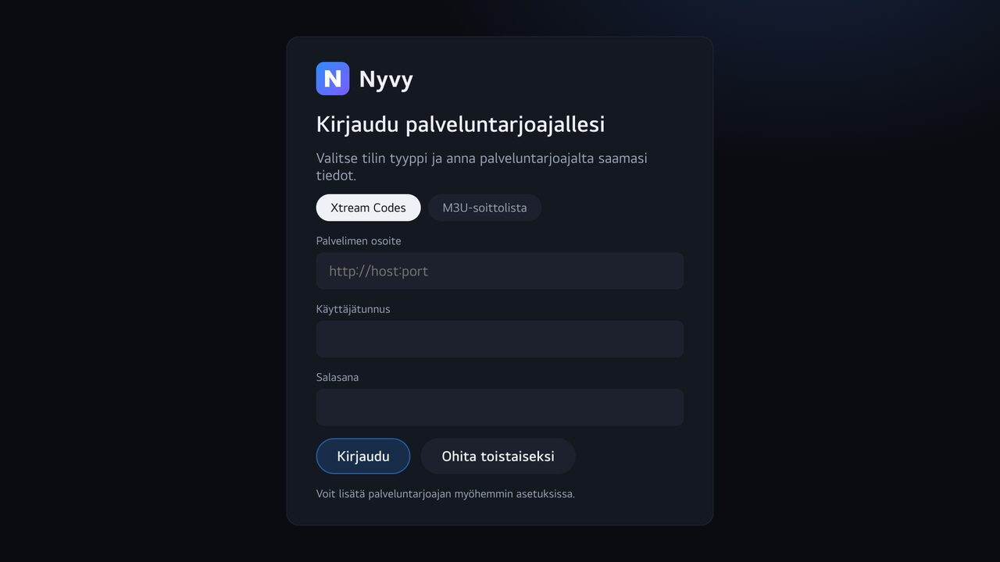
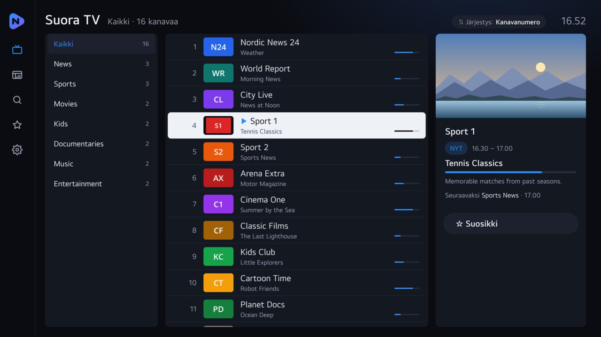
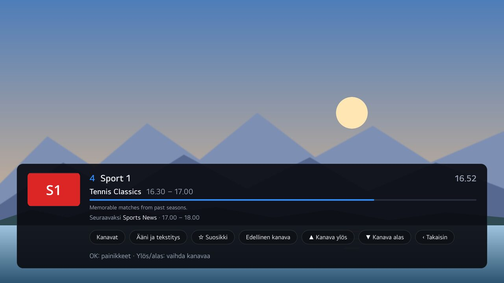
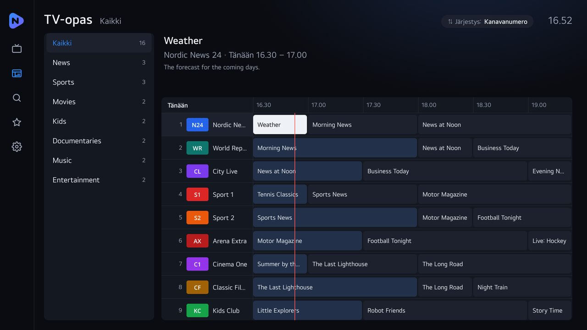
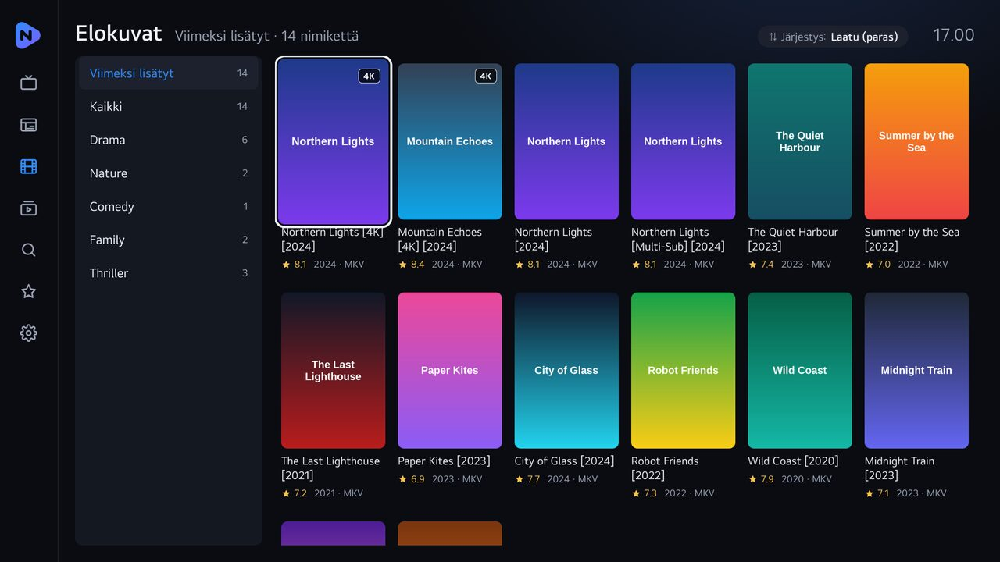
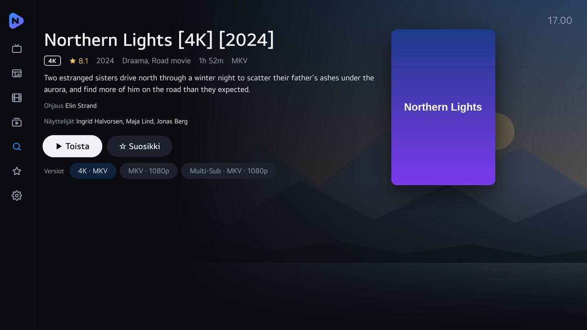
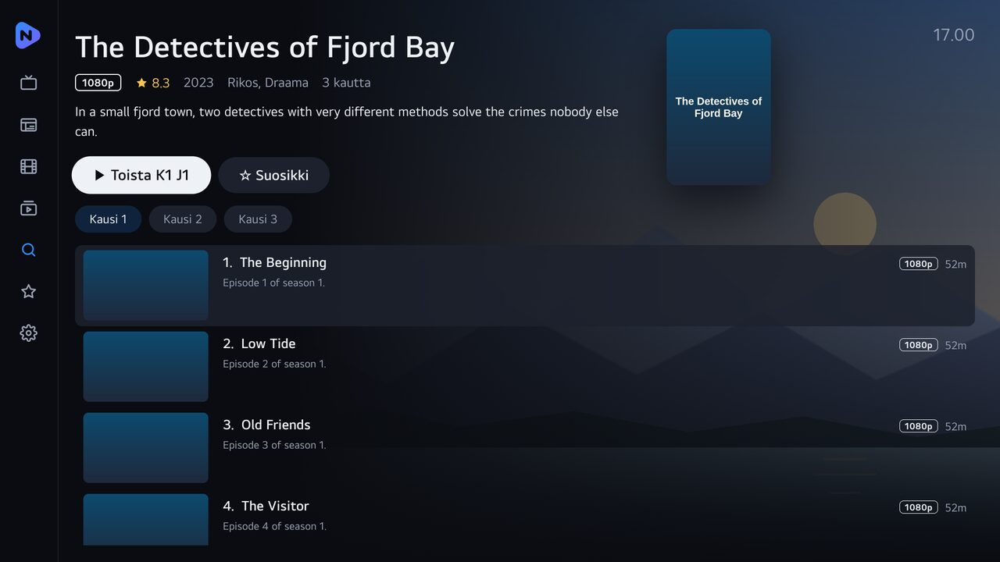
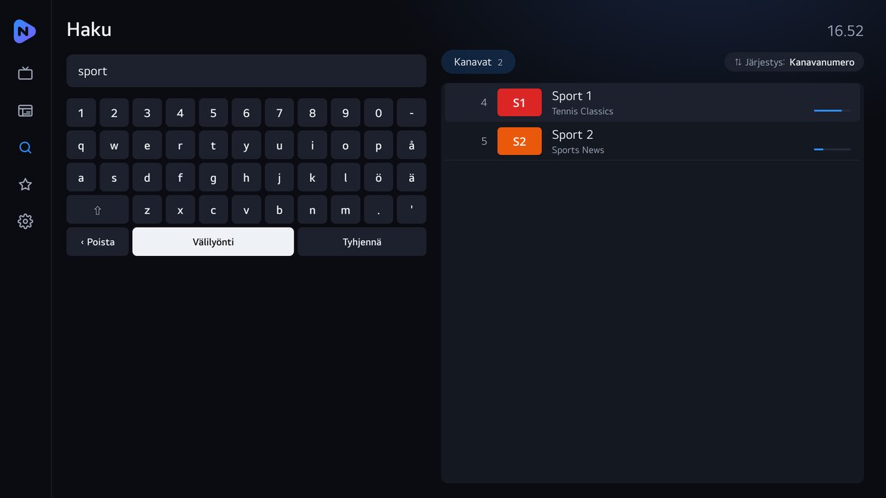
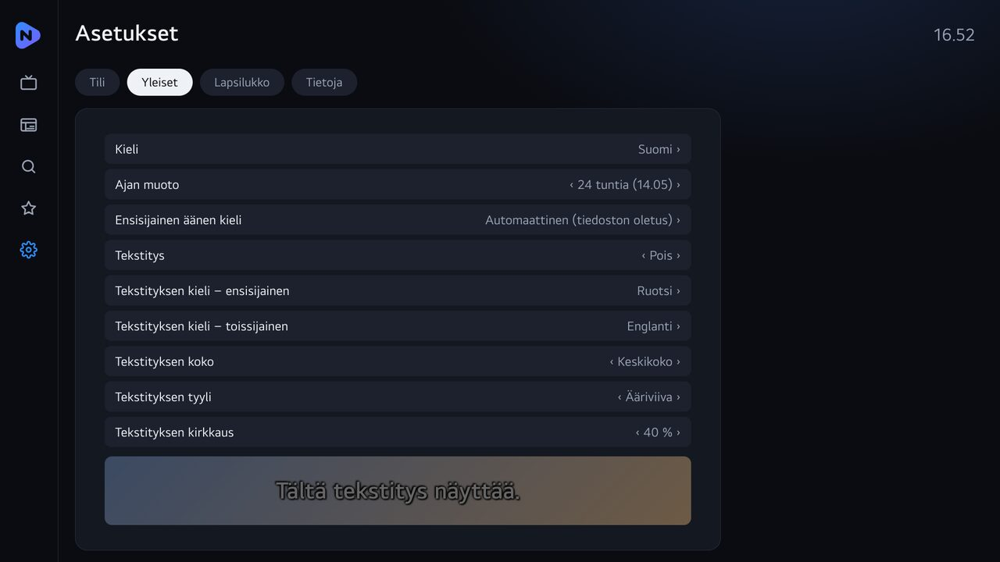
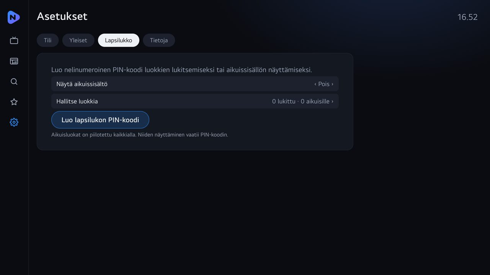

# Käyttöohje

Kaikki, mitä tarvitset Nyvyn käytön aloittamiseen ja sen parhaaseen hyödyntämiseen.

**Sisältö:** [Aloitus](#getting-started) · [Kaukosäädin](#remote) · [Suora TV](#live-tv) · [TV-opas ja catch-up](#tv-guide) · [Elokuvat ja sarjat](#films-series) · [Ääni ja tekstitys](#audio-subtitles) · [Haku, suosikit ja järjestys](#search) · [Asetukset](#settings) · [Usein kysytyt kysymykset](#faq)

## Aloitus {#getting-started}

Nyvy ei itse sisällä kanavia. Tarvitset tilauksen IPTV-palveluntarjoajalta ja heiltä saamasi tiedot.

### Kirjautuminen

Kun käynnistät Nyvyn ensimmäisen kerran, valitse tilin tyyppi:

| Tilin tyyppi | Mitä täytät | Mitä saat |
|---|---|---|
| **Xtream Codes** | Palvelimen osoite, käyttäjätunnus ja salasana | Suora TV, TV-opas, catch-up, elokuvat, sarjat ja tilin tila |
| **M3U-soittolista** | Soittolistan osoite ja tarvittaessa TV-oppaan osoite | Suora TV ryhmineen, TV-opas, suosikit ja haku |

> Saitko "M3U-linkin", jossa on `get.php?username=…&password=…`? Se on oikeastaan Xtream-tili. Nyvy tunnistaa sen ja tarjoaa kirjautumista Xtream-tilinä, jolloin saat myös elokuvat ja sarjat.

Kirjautumisen jälkeen Nyvy lataa valikoiman (kanavat, elokuvat ja sarjat) ja TV-oppaan. Ensimmäisellä kerralla se voi kestää minuutin, sen jälkeen se on nopeaa. Kun käynnistät Nyvyn, valikoima ja opas päivittyvät automaattisesti, jos ne ovat yli 12 tuntia vanhoja, ja voit aina päivittää ne itse kohdassa *Asetukset → Tili*.

Haluatko ensin katsella ympärillesi? Valitse *Ohita toistaiseksi*. Voit lisätä palveluntarjoajan myöhemmin kohdassa *Asetukset → Tili → Lisää palveluntarjoaja*.

## Kaukosäädin {#remote}

| Painike | Toiminto |
|---|---|
| Nuolet ja OK | Liiku ja valitse |
| Takaisin | Palaa. Sivuvalikossa: sulje Nyvy |
| Punainen · Vihreä · Keltainen | Pikavalinnat (katso alta) |
| CH+ / CH− | Vaihda kanavaa · selaa listoja |
| Toisto/tauko | Pysäytä ja jatka |
| Pikakelaus | Siirry 60 sekuntia |
| Info | Näytä tietopalkki (suora TV) |
| Numerot | Siirry suoraan kanavanumeroon |

Myös Magic Remote toimii: osoita korostaaksesi, napsauta valitaksesi ja vieritä rullalla.

**Ei värinäppäimiä kaukosäätimessä?** Monessa Magic Remotessa niitä ei ole, etkä tarvitse niitä: kaikki toimii näytön painikkeilla. ☆ *Suosikki* löytyy elokuvien ja sarjojen tietosivulta, kanavalistan oikealta puolelta (paina oikealle) ja tietopalkista koko näytöllä. *Lajittelu* on listojen yläreunassa, ja *Ääni ja tekstitys* sekä *Edellinen kanava* tietopalkissa. Jos haluat silti käyttää pikavalintoja, paina kaukosäätimen **123**-painiketta: näytölle tulee paneeli, jossa on värinäppäimet. Punainen: suosikki · Vihreä: lajittelu, tai ääni ja tekstitys katsellessa · Keltainen: edellinen kanava.

### Mitä Takaisin tekee

| Missä olet | Takaisin |
|---|---|
| Sivuvalikko | Kysyy, haluatko lopettaa Nyvyn |
| Lista kohdassa *Suora TV*, *Elokuvat* tai *Sarjat* | Ensin luokkiin, sitten sivuvalikkoon |
| Haku tai asetukset | Sivuvalikkoon |
| Elokuvan tai sarjan tietosivu | Takaisin listaan |
| Elokuva tai jakso toistossa | Piilottaa ensin kelauspalkin ja painikkeet; seuraava painallus lopettaa. Nyvy muistaa, mihin jäit |
| Suora TV koko näytöllä | Järjestyksessä: tyhjentää kesken olevan kanavanumeron, poistuu painikeriviltä, piilottaa tietopalkin, poistuu koko näytöltä |
| Kanavalista tai *Ääni ja tekstitys* on auki | Sulkee sen |
| Valintaikkuna, esimerkiksi PIN-koodi | Sulkee sen muuttamatta mitään |

## Suora TV {#live-tv}

- **Valitse kanava:** vasemmalla ovat luokat, keskellä kanavat ja meneillään oleva ohjelma. OK toistaa kanavan esikatselussa, ja uusi OK avaa koko näytön.
- **Koko näytöllä:**
  - Ylös/alas tai CH+/CH− vaihtavat kanavaa.
  - OK valitsee tietopalkin painikkeet: *Kanavat*, *Ääni ja tekstitys*, ☆ *Suosikki*, *Edellinen kanava*, kanava ylös/alas ja *Takaisin*. Vasen/oikea siirtää niiden välillä, OK valitsee.
  - Vasen/oikea tai Info näyttävät tietopalkin (nyt ja seuraavaksi).
  - Numerot vievät kanavanumeroon.
  - Takaisin piilottaa ensin tietopalkin; poistu koko näytöltä painamalla Takaisin uudelleen.

### Lisää suorasta TV:stä

- **Esikatselu:** OK listan kanavalla toistaa sen oikeanpuoleisessa ruudussa; uusi OK avaa koko näytön. Takaisin koko näytöltä vie listaan, ja esikatselu jatkuu.
- **Kanavan vaihto koko näytöllä:** paina OK ja valitse *Kanavat*, niin kanavalista avautuu kuvan päälle.
- **Kanavanumerot:** näppäile numerot kaukosäätimellä. Nyvy vaihtaa kanavan hetken kuluttua.
- **Edellinen kanava:** tietopalkin painike vie takaisin kanavalle, jota katsoit aiemmin.
- **Merkinnät:** ↺ tarkoittaa, että kanavalla on catch-up. Ohjelman alla oleva viiva näyttää, kuinka pitkällä se on. Oikeanpuoleisessa ruudussa *Catch-up · 2 päivää* kertoo, kuinka kauas taaksepäin arkisto ulottuu.
- **Lajittelu laadun mukaan:** Nyvy lukee HD:n ja 4K:n kanavien nimistä, joten parhaat kanavat tulevat ensin.

## TV-opas ja catch-up {#tv-guide}

- **TV-opas** näyttää kaikkien kanavien ohjelmat ruudukossa, jossa on "nyt"-viiva. OK meneillään olevan ohjelman kohdalla avaa kanavan.
- **Catch-up:** kanavilla, joissa on ↺, on arkisto palveluntarjoajalla. Niissä voit selata opasta taaksepäin, aloittaa jo lähetetyn ohjelman ja siirtyä siinä.

### Liikkuminen oppaassa

- Ylös/alas vaihtaa kanavaa, ja CH+/CH− selaa sivun kerrallaan.
- Vasen/oikea liikkuu ajassa ohjelma kerrallaan. Eteenpäin opas ulottuu kolmen päivän päähän. Taaksepäin pääsee vain catch-up-kanavilla, niin pitkälle kuin arkisto ulottuu.
- OK parhaillaan menevässä ohjelmassa avaa kanavan koko näytölle. Tulevassa ohjelmassa Nyvy kertoo, milloin se alkaa, esimerkiksi *Alkaa klo 21:00*.

### Jo esitetyn ohjelman katsominen

1. Avaa *TV-opas* ja valitse kanava, jossa on merkintä ↺.
2. Paina vasemmalle, kunnes pääset ohjelmaan. Jälkikäteen katsottavat ohjelmat on merkitty ↺, ja tiedoissa lukee *Catch-up: katso alusta painamalla OK*.
3. Paina OK. Ohjelma alkaa alusta.
4. Kelaa vasemmalle/oikealle, keskeytä OK:lla ja lopeta Takaisin-painikkeella, kuten elokuvassa.

## Elokuvat ja sarjat {#films-series}

Elokuvat ja sarjat ovat käytettävissä Xtream-tileillä.

- **Tietosivu** näyttää juonen, näyttelijät, laadun (esimerkiksi 4K tai Dolby Vision) sekä painikkeet *Toista*, *Jatka* ja *Suosikki*. Jos elokuvasta on useita versioita, ne näkyvät valintoina painikkeiden alla.
- **Sarjat:** valitse kausi ja jakso. Kun jakso loppuu, seuraava alkaa lähtölaskennan jälkeen.
- **Katsellessa:**
  - OK pysäyttää.
  - Vasen/oikea siirtävät 10 sekuntia (pidä pohjassa pidempiä siirtoja varten). Esikatselukuva näyttää, mihin päädyt, ja OK siirtyy sinne.
  - Ylös näyttää näytön painikkeet.
  - Takaisin piilottaa ensin aikajanan ja painikkeet; lopeta painamalla Takaisin uudelleen. Nyvy muistaa, mihin jäit.

### Versiot

Palveluntarjoajilla on usein sama elokuva useana versiona, esimerkiksi 4K, 1080p tai eri kielillä ja tekstityksillä. Nyvy kokoaa ne yhteen: tietosivu näyttää ne kohdassa *Versiot*, ja toiston aikana vaihdat kohdassa *Ääni ja tekstitys* → *Versio*.

### Jatka katsomista ja viimeksi lisätyt

Kohtien *Elokuvat* ja *Sarjat* alussa ovat suosikkisi, *Jatka katsomista* (aloittamasi) ja *Viimeksi lisätyt* (palveluntarjoajan viimeksi lisäämät). Aloittamasi kohteen tietosivulla lukee esimerkiksi *Jatka kohdasta 42:10*, ja vieressä on *Toista alusta*.

### 4K, HDR ja Dolby Vision

- **Merkinnät:** 4K, 1080p, 720p tai SD, joskus HDR tai DV (Dolby Vision). Nyvy näyttää vain sen, minkä se tietää varmasti, nimestä tai toistosta, joten kaikilla elokuvilla ei ole merkintää.
- **Dolby Vision** toistetaan Dolby Visionina, kun televisio tukee sitä. Jotkin tiedostot (Blu-ray-kopiot, joissa on kaksi kuvakerrosta) ja televisiot ilman Dolby Visionia näyttävät elokuvan sen sijaan HDR10-muodossa samalla tarkkuudella.

## Ääni ja tekstitys {#audio-subtitles}

- **Elokuvat ja sarjat:** paina alas tai Vihreää valitaksesi ääniraidan, tekstityksen ja version.
- **Suora TV:** valitse tietopalkista *Ääni ja tekstitys* (tai paina Vihreää) kytkeäksesi lähetyksen tekstityksen päälle tai pois ja valitaksesi ääniraidan.
- **Oletukset:** kohdassa *Asetukset → Yleiset* valitset ensisijaisen äänen kielen, onko tekstitys päällä, tekstityksen ensi- ja toissijaisen kielen sekä tekstin koon ja tyylin.

### Teksti- ja kuvatekstitykset

- **Tekstitekstitykset** (esimerkiksi SRT ja ASS) Nyvy piirtää itse valitsemassasi koossa ja tyylissä.
- **Kuvatekstitykset** (PGS, Blu-raylta) ovat valmiita kuvia ja näkyvät sellaisinaan. Koko ja tyyli eivät vaikuta niihin.
- **Lähetyksen tekstitykset** suorassa TV:ssä (DVB ja teksti-TV) piirtää televisio. Nyvyssä vain kytket ne päälle tai pois.

### Raidat, joita ei voi toistaa

Raita, jota televisio ei voi toistaa, näkyy himmennettynä tekstillä *ei toistettavissa tällä laitteella*. Yleisimmät ovat DTS ja Dolby TrueHD. Jos elokuvassa on vain tällaista ääntä, Nyvy kertoo sen alussa, ja elokuva toistuu ilman ääntä: valitse toinen versio, jos sellainen on. Kohdasta *Asetukset* → *Tietoja* näet, mitä muotoja televisiosi tukee.

Jos elokuvan pääääntä ei voi toistaa mutta jotain toista raitaa voi, Nyvy toistaa sen ja ilmoitus kertoo, mikä raita on käytössä. Kommentaariraitoja valitaan vain, kun mitään muuta ei voi toistaa; voit silti valita ne itse.

### Tekstityksen koko ja tyyli

Kohdassa *Asetukset* → *Yleiset* valitset *Tekstityksen koko* (Pieni, Keskikoko, Suuri tai Erittäin suuri) ja *Tekstityksen tyyli* (Ääriviiva tai Taustalaatikko). Esikatselu näyttää, miltä se näyttää.

*Tekstityksen kirkkaus* himmentää tekstityksiä, jos valkoinen tuntuu liian kirkkaalta, portaittain 10 %:iin asti. Se koskee teksti- ja kuvatekstityksiä, mutta ei suoran TV:n lähetyksen tekstityksiä, jotka televisio piirtää.

## Haku, suosikit ja järjestys {#search}

- **Haku:** kirjoita näytön näppäimistöllä tai kaukosäätimen numeroilla. Haku löytää kanavat, elokuvat ja sarjat eikä välitä aksenteista (*malmo* löytää *Malmö*).
- **Suosikit:** valitse ☆ *Suosikki* elokuvan tai sarjan tietosivulla, kanavalistan oikealla puolella tai tietopalkissa koko näytöllä (Punainen on pikavalinta). Suosikit ovat ensimmäisinä jokaisessa listassa ja kohdassa *Suosikit* valikossa.
- **Järjestys:** painike *Järjestys* listojen yläosassa (tai Vihreä). Kanavat voi järjestää numeron, laadun tai nimen mukaan, elokuvat ja sarjat esimerkiksi viimeksi lisättyjen, vuoden, arvion tai laadun mukaan. Sarjat voi järjestää myös jaksojen keston mukaan.

### Suosikkien lisääminen ja löytäminen

- **Kanava:** korosta se listassa kohdassa *Suora TV*, paina oikealle ja valitse ☆ *Suosikki*. Koko näytöllä sama painike on tietopalkissa (paina OK).
- **Elokuva tai sarja:** valitse ☆ *Suosikki* tietosivulla.
- **Löydät ne** valikon kohdasta *Suosikit*, jaettuna kanaviin, elokuviin ja sarjoihin, sekä jokaisen listan alusta.
- **Poistaminen:** valitse ★ *Poista suosikeista* samasta paikasta.

## Asetukset {#settings}

- **Tili:**
  - Näyttää tietosi, milloin valikoima päivitettiin, ja painikkeen *Päivitä valikoima*.
  - **Muokkaa tietoja:** uusi palvelimen osoite, uusi salasana tai uusi soittolista. Suosikit ja katselukohdat säilyvät, kun kyseessä on sama tili.
  - **Kirjaudu ulos** poistaa tilin ja sen tiedot televisiosta.
- **Yleiset:** kieli, ajan muoto, ääni ja tekstitys.
- **Lapsilukko:**
  - Aikuissisältö on alusta asti piilotettu.
  - Nelinumeroisella PIN-koodilla voit näyttää sen sekä lukita tai piilottaa yksittäisiä luokkia.
  - Lukitut luokat vaativat PIN-koodin.
- **Tietoja:** versio, mitä muotoja televisiosi voi toistaa, ja linkki tälle sivulle.

### Lapsilukon käyttöönotto

1. Siirry kohtaan *Asetukset* → *Lapsilukko* ja valitse *Luo lapsilukon PIN-koodi*. Anna neljä numeroa ja sitten samat numerot uudelleen.
2. *Näytä aikuissisältö*: aikuissisältö on alusta asti piilotettu, ja sen näyttäminen vaatii PIN-koodin. Aikuisilta näyttävät luokat, esimerkiksi joiden nimessä on XXX tai 18+, merkitään automaattisesti.
3. *Hallitse luokkia*: paina OK luokassa vaihtaaksesi tilojen *🔒 Lukittu* (vaatii PIN-koodin), *🔞 Aikuisille* (piilossa, kun aikuissisältö on piilotettu) ja pois välillä.
4. Lukitun luokan avaat OK:lla ja PIN-koodilla. Se pysyy sen jälkeen auki, kunnes suljet Nyvyn.
5. *Vaihda PIN-koodi* ja *Poista PIN-koodi* ovat samalla sivulla.

### Jos unohdat PIN-koodin

PIN-koodia ei voi nollata Nyvyssä, tarkoituksella, koska muuten lapsi voisi kiertää sen. Myös *Kirjaudu ulos* vaatii PIN-koodin. Jäljelle jää Nyvyn poistaminen televisiosta ja asentaminen uudelleen. Silloin kirjaudut uudelleen, ja suosikit, kohdat, joihin jäit, sekä asetukset katoavat.

### Tietosuoja

Kaikki, mitä Nyvy tallentaa, pysyy televisiossasi: tilitietosi (salattuina), valikoima, TV-opas, suosikit, kohdat, joihin jäit, ja asetukset. Mitään ei lähetetä Nyvylle. *Kirjaudu ulos* poistaa kaiken. Lue lisää sivulta [Tietosuoja](privacy.html).

## Usein kysytyt kysymykset {#faq}

### "Kanava ei lähetä juuri nyt"
Palveluntarjoajan lähetys on poikki tai kanava lähettää vain tiettyjen tapahtumien aikana. Yritä myöhemmin uudelleen tai valitse toinen kanava. OK yrittää uudelleen.

### "Palveluntarjoaja ei salli juuri nyt enempää yhteyksiä"
Monet tilaukset sallivat vain yhden lähetyksen kerrallaan. Sulje sovellus muilta laitteilta, jotka käyttävät samaa tiliä, odota hetki ja yritä uudelleen.

### "Palveluntarjoaja ei vastaa"
Tarkista television internetyhteys. Jos se toimii, vika on todennäköisesti palveluntarjoajalla.

### Elokuvassa ei ole ääntä
Elokuvassa on todennäköisesti vain DTS- tai Dolby TrueHD -ääni, jota LG-televisiot eivät voi toistaa sovelluksissa. Valitse toinen ääniraita tai elokuvan toinen versio, jos sellainen on.

### Kuulen kommentaarin elokuvan sijaan
Elokuvan pääääntä (usein DTS) ei voi toistaa televisiossa, joten Nyvy toistaa ainoan raidan, joka toimii, joskus kommentaariraidan. Alussa näkyvä ilmoitus kertoo, mikä raita on käytössä. Valitse elokuvasta toinen versio, jos sellainen on.

### TV-opas on tyhjä (M3U)
Kaikki soittolistat eivät ilmoita TV-opasta. Kysy palveluntarjoajalta XMLTV-oppaan osoite ja täytä se kohtaan *Asetukset → Tili → Muokkaa tietoja*.

### En näe elokuvia ja sarjoja (M3U)
Soittolistat antavat Nyvyssä vain suoran TV:n. Jos sinulla on Xtream-tili, kirjaudu sillä saadaksesi elokuvat ja sarjat.

### Miten suljen Nyvyn?
Paina Takaisin, kunnes sivuvalikko on korostettuna, paina Takaisin vielä kerran ja valitse *Sulje*.

### ”Yritetään uudelleen… (2/3)”
Käynnistys jumittui, ja Nyvy yrittää itse uudelleen enintään kolme kertaa. Yleensä kyse on palveluntarjoajan tilapäisestä ongelmasta. Jos kolmaskin yritys epäonnistuu, Nyvy näyttää, mikä on vialla.

### ”Nimikettä ei löydy palveluntarjoajalta”
Palveluntarjoaja listaa nimikkeen, mutta tiedostoa ei enää ole. Sitä ei voi korjata Nyvyssä. Valitse toinen versio, jos sellainen on.

### Kuva pätkii tai latautuu jatkuvasti
Tarkista verkko. 4K tarvitsee noin 25 Mbit/s tasaisesti, ja kiinteä yhteys on luotettavampi kuin wifi. Jos vain yksi kanava tai elokuva pätkii, ongelma on yleensä palveluntarjoajan päässä.

### Tekstitykset eivät näy
Tarkista, että oikea raita on valittu kohdassa *Ääni ja tekstitys*. Joissakin raidoissa on tekstiä vain muunkielisille repliikeille, eikä hiljaisissa kohtauksissa näy mitään. Lähetyksen tekstitykset suorassa TV:ssä ovat käytössä vain, kun kanava lähettää niitä.

### TV-oppaan ajat eivät täsmää
Tarkista aika ja aikavyöhyke television omista asetuksista. Jos ne ovat oikein, palveluntarjoajan oppaan tiedot ovat virheelliset.

### Kanavalta puuttuvat ohjelmatiedot (M3U)
Nyvy yhdistää kanavat TV-oppaaseen tvg-id:n tai muuten kanavan nimen perusteella. Jos kanavalla ei ole kumpaakaan tai nimi poikkeaa, sitä ei voi yhdistää. Palveluntarjoaja voi korjata sen soittolistassa.

### Valikoima näyttää vanhentuneelta
Nyvy päivittää valikoiman ja TV-oppaan, kun käynnistät sovelluksen, jos ne ovat yli 12 tuntia vanhoja. Päivitä heti: *Asetukset* → *Tili* → *Päivitä valikoima*.

## Sanasto

- **Xtream Codes:** IPTV-palveluntarjoajien yleinen tapa toimittaa kanavia, elokuvia ja sarjoja palvelinosoitteen, käyttäjänimen ja salasanan avulla.
- **M3U:** soittolista: pitkä lista kanavia osoitteineen. Antaa suoran TV:n, mutta ei elokuvia ja sarjoja Nyvyssä.
- **EPG / XMLTV:** TV-oppaan tiedot, eli mitä tulee milloinkin. XMLTV on tiedostomuoto.
- **Catch-up:** jo esitettyjen ohjelmien katsominen palveluntarjoajan arkistosta (merkitty ↺).
- **4K:** kuva, jossa on 3840×2160 pistettä, neljä kertaa enemmän kuin Full HD:ssa (1080p).
- **HDR:** tavallista kuvaa laajempi kontrasti- ja värialue. HDR10 on yleisin muoto.
- **Dolby Vision:** HDR-muoto, jossa kuvaa säädetään kohtaus kohtaukselta.
- **Dolby Digital / Dolby Digital Plus:** yleisiä tilaäänimuotoja, joita televisio tukee.
- **DTS / Dolby TrueHD:** elokuvateattereiden ja Blu-rayn äänimuotoja, joita LG:n televisiot eivät voi toistaa sovelluksissa.
