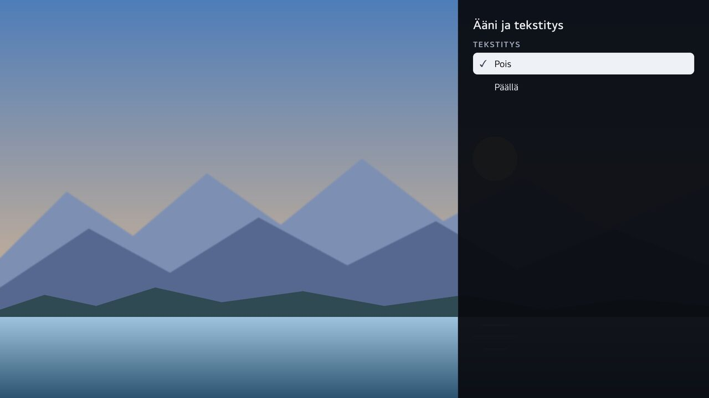
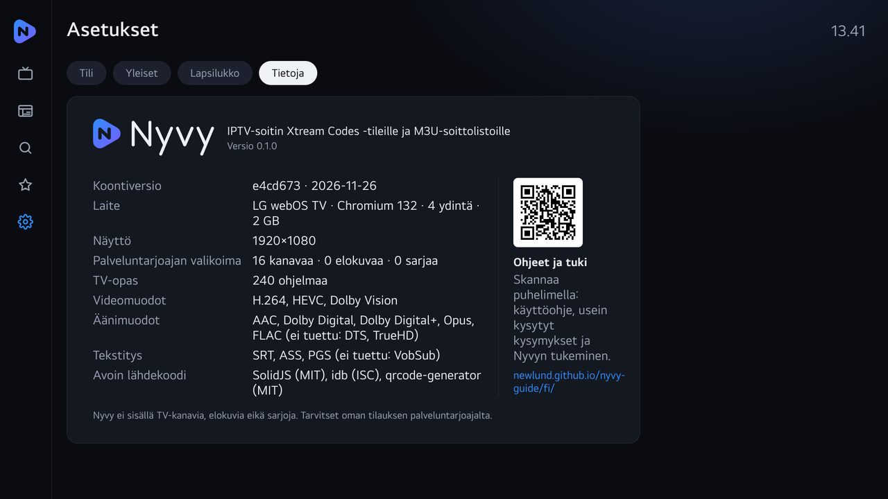

# Käyttöohje

Kaikki, mitä tarvitset Nyvyn käytön aloittamiseen ja sen parhaaseen hyödyntämiseen.

**Sisältö:** [Aloitus](#getting-started) · [Kaukosäädin](#remote) · [Suora TV](#live-tv) · [TV-opas ja catch-up](#tv-guide) · [Elokuvat ja sarjat](#films-series) · [Ääni ja tekstitys](#audio-subtitles) · [Haku, suosikit ja järjestys](#search) · [Asetukset](#settings) · [Usein kysytyt kysymykset](#faq)

## Aloitus {#getting-started}

Nyvy ei itse sisällä kanavia. Tarvitset tilauksen IPTV-palveluntarjoajalta ja heiltä saamasi tiedot.

### Kirjautuminen

Kun käynnistät Nyvyn ensimmäisen kerran, valitse tilin tyyppi:

| Tilin tyyppi | Mitä täytät | Mitä saat |
|---|---|---|
| **Xtream Codes** | Palvelimen osoite, käyttäjätunnus ja salasana | Suora TV, TV-opas, catch-up, elokuvat, sarjat ja tilin tila |
| **M3U-soittolista** | Soittolistan osoite ja tarvittaessa TV-oppaan osoite | Suora TV ryhmineen, TV-opas, suosikit ja haku |

> Saitko "M3U-linkin", jossa on `get.php?username=…&password=…`? Se on oikeastaan Xtream-tili. Nyvy tunnistaa sen ja tarjoaa kirjautumista Xtream-tilinä, jolloin saat myös elokuvat ja sarjat.

Kirjautumisen jälkeen Nyvy lataa valikoiman (kanavat, elokuvat ja sarjat) ja TV-oppaan. Ensimmäisellä kerralla se voi kestää minuutin, sen jälkeen se on nopeaa. Kun käynnistät Nyvyn, valikoima ja opas päivittyvät automaattisesti, jos ne ovat yli 12 tuntia vanhoja, ja voit aina päivittää ne itse kohdassa *Asetukset → Tili*.

Haluatko ensin katsella ympärillesi? Valitse *Ohita toistaiseksi*. Voit lisätä palveluntarjoajan myöhemmin kohdassa *Asetukset → Tili → Lisää palveluntarjoaja*.

## Kaukosäädin {#remote}

| Painike | Toiminto |
|---|---|
| Nuolet ja OK | Liiku ja valitse |
| Takaisin | Palaa. Sivuvalikossa: sulje Nyvy |
| Punainen · Vihreä · Keltainen | Pikavalinnat (katso alta) |
| CH+ / CH− | Vaihda kanavaa · selaa listoja |
| Toisto/tauko | Pysäytä ja jatka |
| Pikakelaus | Siirry 60 sekuntia |
| Info | Näytä tietopalkki (suora TV) |
| Numerot | Siirry suoraan kanavanumeroon |

Myös Magic Remote toimii: osoita korostaaksesi, napsauta valitaksesi ja vieritä rullalla.

**Ei värinäppäimiä kaukosäätimessä?** Monessa Magic Remotessa niitä ei ole, etkä tarvitse niitä: kaikki toimii näytön painikkeilla. ☆ *Suosikki* löytyy elokuvien ja sarjojen tietosivulta, kanavalistan oikealta puolelta (paina oikealle) ja tietopalkista koko näytöllä. *Lajittelu* on listojen yläreunassa, ja *Ääni ja tekstitys* sekä *Edellinen kanava* tietopalkissa. Jos haluat silti käyttää pikavalintoja, paina kaukosäätimen **123**-painiketta: näytölle tulee paneeli, jossa on värinäppäimet. Punainen: suosikki · Vihreä: lajittelu, tai ääni ja tekstitys katsellessa · Keltainen: edellinen kanava.

## Suora TV {#live-tv}

- **Valitse kanava:** vasemmalla ovat luokat, keskellä kanavat ja meneillään oleva ohjelma. OK toistaa kanavan esikatselussa, ja uusi OK avaa koko näytön.
- **Koko näytöllä:**
  - Ylös/alas tai CH+/CH− vaihtavat kanavaa.
  - OK valitsee tietopalkin painikkeet: *Kanavat*, *Ääni ja tekstitys*, ☆ *Suosikki*, *Edellinen kanava*, kanava ylös/alas ja *Takaisin*. Vasen/oikea siirtää niiden välillä, OK valitsee.
  - Vasen/oikea tai Info näyttävät tietopalkin (nyt ja seuraavaksi).
  - Numerot vievät kanavanumeroon.
  - Takaisin piilottaa ensin tietopalkin; poistu koko näytöltä painamalla Takaisin uudelleen.

## TV-opas ja catch-up {#tv-guide}

- **TV-opas** näyttää kaikkien kanavien ohjelmat ruudukossa, jossa on "nyt"-viiva. OK meneillään olevan ohjelman kohdalla avaa kanavan.
- **Catch-up:** kanavilla, joissa on ↺, on arkisto palveluntarjoajalla. Niissä voit selata opasta taaksepäin, aloittaa jo lähetetyn ohjelman ja siirtyä siinä.

## Elokuvat ja sarjat {#films-series}

Elokuvat ja sarjat ovat käytettävissä Xtream-tileillä.

- **Tietosivu** näyttää juonen, näyttelijät, laadun (esimerkiksi 4K tai Dolby Vision) sekä painikkeet *Toista*, *Jatka* ja *Suosikki*. Jos elokuvasta on useita versioita, ne näkyvät valintoina painikkeiden alla.
- **Sarjat:** valitse kausi ja jakso. Kun jakso loppuu, seuraava alkaa lähtölaskennan jälkeen.
- **Katsellessa:**
  - OK pysäyttää.
  - Vasen/oikea siirtävät 10 sekuntia (pidä pohjassa pidempiä siirtoja varten). Esikatselukuva näyttää, mihin päädyt, ja OK siirtyy sinne.
  - Ylös näyttää näytön painikkeet.
  - Takaisin piilottaa ensin aikajanan ja painikkeet; lopeta painamalla Takaisin uudelleen. Nyvy muistaa, mihin jäit.

## Ääni ja tekstitys {#audio-subtitles}

- **Elokuvat ja sarjat:** paina alas tai Vihreää valitaksesi ääniraidan, tekstityksen ja version.
- **Suora TV:** valitse tietopalkista *Ääni ja tekstitys* (tai paina Vihreää) kytkeäksesi lähetyksen tekstityksen päälle tai pois ja valitaksesi ääniraidan.
- **Oletukset:** kohdassa *Asetukset → Yleiset* valitset ensisijaisen äänen kielen, onko tekstitys päällä, tekstityksen ensi- ja toissijaisen kielen sekä tekstin koon ja tyylin.

## Haku, suosikit ja järjestys {#search}

- **Haku:** kirjoita näytön näppäimistöllä tai kaukosäätimen numeroilla. Haku löytää kanavat, elokuvat ja sarjat eikä välitä aksenteista (*malmo* löytää *Malmö*).
- **Suosikit:** valitse ☆ *Suosikki* elokuvan tai sarjan tietosivulla, kanavalistan oikealla puolella tai tietopalkissa koko näytöllä (Punainen on pikavalinta). Suosikit ovat ensimmäisinä jokaisessa listassa ja kohdassa *Suosikit* valikossa.
- **Järjestys:** painike *Järjestys* listojen yläosassa (tai Vihreä). Kanavat voi järjestää numeron, laadun tai nimen mukaan, elokuvat ja sarjat esimerkiksi viimeksi lisättyjen, vuoden, arvion tai laadun mukaan. Sarjat voi järjestää myös jaksojen keston mukaan.

## Asetukset {#settings}

- **Tili:**
  - Näyttää tietosi, milloin valikoima päivitettiin, ja painikkeen *Päivitä valikoima*.
  - **Muokkaa tietoja:** uusi palvelimen osoite, uusi salasana tai uusi soittolista. Suosikit ja katselukohdat säilyvät, kun kyseessä on sama tili.
  - **Kirjaudu ulos** poistaa tilin ja sen tiedot televisiosta.
- **Yleiset:** kieli, ajan muoto, ääni ja tekstitys.
- **Lapsilukko:**
  - Aikuissisältö on alusta asti piilotettu.
  - Nelinumeroisella PIN-koodilla voit näyttää sen sekä lukita tai piilottaa yksittäisiä luokkia.
  - Lukitut luokat vaativat PIN-koodin.
- **Tietoja:** versio, mitä muotoja televisiosi voi toistaa, ja linkki tälle sivulle.

## Usein kysytyt kysymykset {#faq}

### "Kanava ei lähetä juuri nyt"
Palveluntarjoajan lähetys on poikki tai kanava lähettää vain tiettyjen tapahtumien aikana. Yritä myöhemmin uudelleen tai valitse toinen kanava. OK yrittää uudelleen.

### "Palveluntarjoaja ei salli juuri nyt enempää yhteyksiä"
Monet tilaukset sallivat vain yhden lähetyksen kerrallaan. Sulje sovellus muilta laitteilta, jotka käyttävät samaa tiliä, odota hetki ja yritä uudelleen.

### "Palveluntarjoaja ei vastaa"
Tarkista television internetyhteys. Jos se toimii, vika on todennäköisesti palveluntarjoajalla.

### Elokuvassa ei ole ääntä
Elokuvassa on todennäköisesti vain DTS- tai Dolby TrueHD -ääni, jota LG-televisiot eivät voi toistaa sovelluksissa. Valitse toinen ääniraita tai elokuvan toinen versio, jos sellainen on.

### TV-opas on tyhjä (M3U)
Kaikki soittolistat eivät ilmoita TV-opasta. Kysy palveluntarjoajalta XMLTV-oppaan osoite ja täytä se kohtaan *Asetukset → Tili → Muokkaa tietoja*.

### En näe elokuvia ja sarjoja (M3U)
Soittolistat antavat Nyvyssä vain suoran TV:n. Jos sinulla on Xtream-tili, kirjaudu sillä saadaksesi elokuvat ja sarjat.

### Miten suljen Nyvyn?
Paina Takaisin, kunnes sivuvalikko on korostettuna, paina Takaisin vielä kerran ja valitse *Sulje*.
