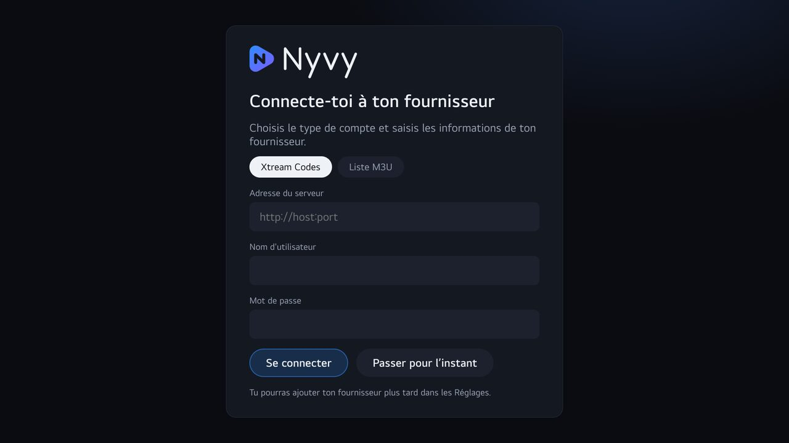
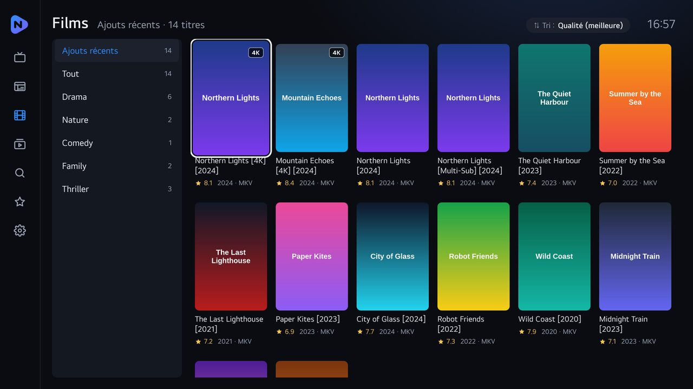
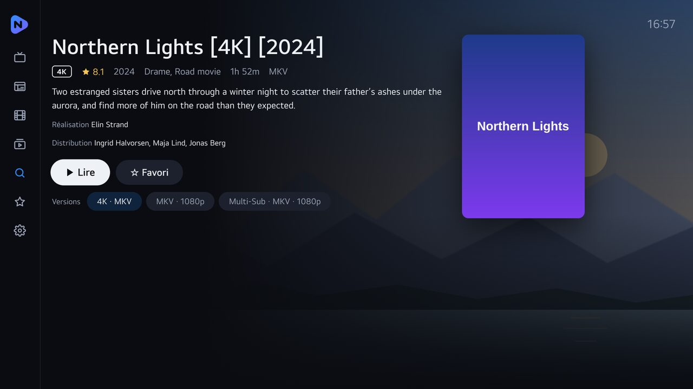
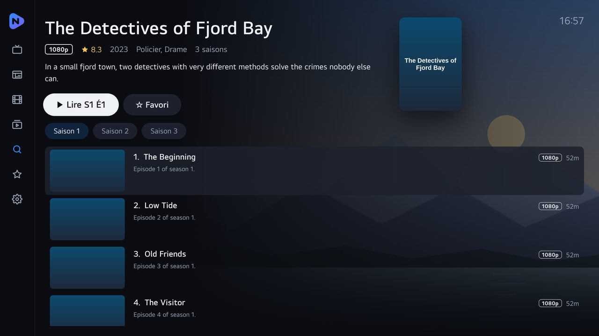
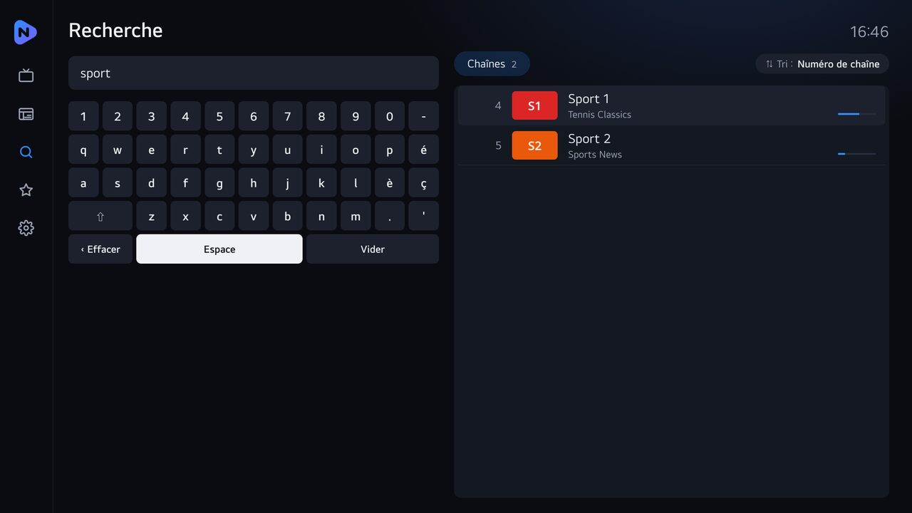
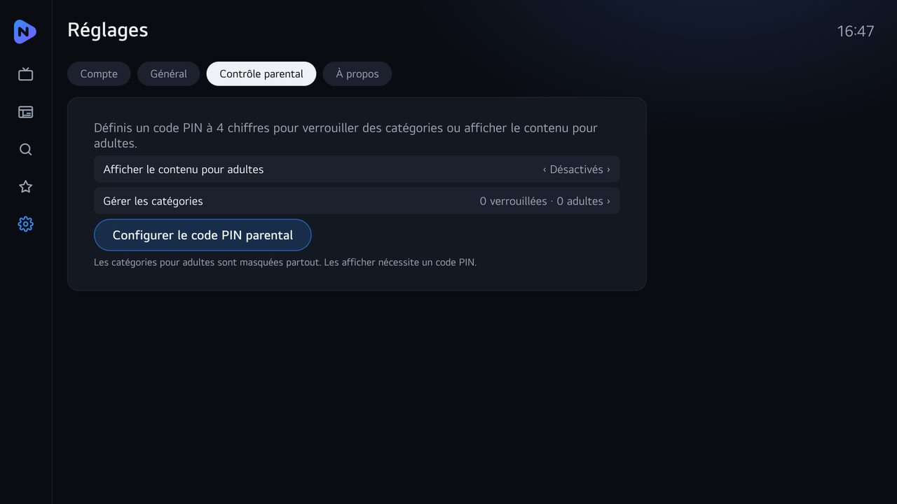

# Manuel

Tout ce qu’il faut pour bien démarrer avec Nyvy et en tirer le meilleur.

**Sommaire :** [Premiers pas](#getting-started) · [La télécommande](#remote) · [TV en direct](#live-tv) · [Guide TV et replay](#tv-guide) · [Films et séries](#films-series) · [Audio et sous-titres](#audio-subtitles) · [Recherche, favoris et tri](#search) · [Réglages](#settings) · [Questions fréquentes](#faq)

## Premiers pas {#getting-started}

Nyvy ne contient aucune chaîne. Tu as besoin d’un abonnement auprès d’un fournisseur IPTV et des informations qu’il t’a données.

### Se connecter

Au premier démarrage de Nyvy, choisis le type de compte :

| Type de compte | Ce que tu saisis | Ce que tu obtiens |
|---|---|---|
| **Xtream Codes** | Adresse du serveur, nom d’utilisateur et mot de passe | TV en direct, guide TV, replay, films, séries et statut du compte |
| **Liste M3U** | L’adresse de la liste et, si besoin, celle du guide | TV en direct avec groupes, guide TV, favoris et recherche |

> On t’a donné un « lien M3U » contenant `get.php?username=…&password=…` ? C’est en fait un compte Xtream. Nyvy le reconnaît et propose de te connecter en Xtream à la place, ce qui te donne aussi les films et les séries.

Après la connexion, Nyvy télécharge le catalogue (chaînes, films et séries) et le guide TV. La première fois peut prendre une minute ; ensuite c’est rapide. Au démarrage de Nyvy, le catalogue et le guide sont mis à jour automatiquement s’ils ont plus de 12 heures, et tu peux toujours les mettre à jour toi-même dans *Réglages → Compte*.

Tu veux d’abord faire un tour ? Choisis *Passer pour l’instant*. Tu pourras ajouter ton fournisseur plus tard dans *Réglages → Compte → Ajouter un fournisseur*.

## La télécommande {#remote}

| Touche | Action |
|---|---|
| Flèches et OK | Se déplacer et choisir |
| Retour | Revenir. Dans le menu latéral : quitter Nyvy |
| Rouge · Vert · Jaune | Raccourcis (voir ci-dessous) |
| CH+ / CH− | Changer de chaîne · faire défiler les listes |
| Lecture/Pause | Mettre en pause et reprendre |
| Avance/retour rapide | Sauter de 60 secondes |
| Info | Afficher la barre d’informations (TV en direct) |
| Chiffres | Aller directement à un numéro de chaîne |

La Magic Remote fonctionne aussi : pointe pour sélectionner, clique pour valider et fais défiler avec la molette.

**Pas de touches de couleur sur ta télécommande ?** Beaucoup de Magic Remote n’en ont pas, et tu n’en as pas besoin : tout fonctionne avec des boutons à l’écran. ☆ *Favori* se trouve sur la page de détails des films et séries, à droite de la liste des chaînes (appuie sur droite) et dans la barre d’informations en plein écran. *Tri* est en haut des listes, et *Audio et sous-titres* et *Chaîne précédente* dans la barre d’informations. Si tu veux quand même les raccourcis, appuie sur **123** sur la télécommande : un panneau avec les touches de couleur apparaît à l’écran. Rouge : favori · Vert : tri, ou audio et sous-titres pendant la lecture · Jaune : chaîne précédente.

### Ce que fait Retour

| Où tu es | Retour |
|---|---|
| Le menu latéral | Demande si tu veux quitter Nyvy |
| Une liste dans *TV en direct*, *Films* ou *Séries* | D’abord vers les catégories, puis vers le menu latéral |
| La recherche ou les réglages | Vers le menu latéral |
| La page de détails d’un film ou d’une série | Retour à la liste |
| Un film ou un épisode en lecture | Masque d’abord la barre de lecture et les boutons ; l’appui suivant quitte. Nyvy retient où tu en étais |
| La TV en direct en plein écran | Dans l’ordre : efface un numéro de chaîne en cours de saisie, quitte la rangée de boutons, masque la barre d’informations, quitte le plein écran |
| La liste des chaînes ou *Audio et sous-titres* est ouverte | La ferme |
| Une boîte de dialogue, par exemple le code PIN | La ferme sans rien changer |

## TV en direct {#live-tv}

- **Choisir une chaîne :** les catégories sont à gauche, les chaînes avec le programme en cours au centre. OK lit la chaîne dans l’aperçu ; OK de nouveau passe en plein écran.
- **En plein écran :**
  - Haut/bas ou CH+/CH− changent de chaîne.
  - OK sélectionne les boutons de la barre d’informations : *Chaînes*, *Audio et sous-titres*, ☆ *Favori*, *Chaîne précédente*, chaîne haut/bas et *Retour*. Gauche/droite passent de l’un à l’autre, OK valide.
  - Gauche/droite ou Info affichent la barre d’informations avec le programme en cours et le suivant.
  - Les chiffres vont à un numéro de chaîne.
  - Retour masque d’abord la barre d’informations ; appuie de nouveau sur Retour pour quitter le plein écran.

### Plus sur la TV en direct

- **Aperçu :** OK sur une chaîne de la liste la lit dans le cadre de droite ; un nouvel OK passe en plein écran. Retour depuis le plein écran ramène à la liste, et l’aperçu continue.
- **Changer de chaîne en plein écran :** appuie sur OK et choisis *Chaînes*, la liste des chaînes s’ouvre par-dessus l’image.
- **Numéros de chaîne :** tape les chiffres sur la télécommande. Nyvy change de chaîne après un instant.
- **Chaîne précédente :** le bouton de la barre d’informations te ramène à la chaîne que tu regardais avant.
- **Repères :** ↺ signifie que la chaîne propose le replay. Le trait sous le programme montre où il en est. Dans le cadre de droite, *Replay · 2 jours* indique jusqu’où remonte l’archive.
- **Trier par qualité :** Nyvy lit HD et 4K dans le nom des chaînes, pour que les meilleures viennent en premier.

## Guide TV et replay {#tv-guide}

- **Le guide TV** affiche les programmes de toutes les chaînes dans une grille avec une ligne « maintenant ». OK sur un programme en cours lance la chaîne.
- **Replay :** les chaînes marquées ↺ ont des archives chez le fournisseur. Tu peux y remonter dans le guide, lancer un programme déjà diffusé et te déplacer dedans.

### Se déplacer dans le guide

- Haut/bas change de chaîne, et CH+/CH− fait défiler une page à la fois.
- Gauche/droite avance ou recule dans le temps, un programme à la fois. Vers l’avant, le guide va jusqu’à trois jours. Vers l’arrière, seulement sur les chaînes avec replay, aussi loin que va l’archive.
- OK sur un programme en cours lance la chaîne en plein écran. Sur un programme à venir, Nyvy indique quand il commence, par exemple *Commence à 21:00*.

### Regarder un programme déjà diffusé

1. Ouvre *Guide TV* et choisis une chaîne marquée ↺.
2. Appuie sur gauche jusqu’au programme. Les programmes visibles après coup sont marqués ↺, et l’info indique *Replay : OK pour regarder depuis le début*.
3. Appuie sur OK. Le programme commence au début.
4. Avance ou recule avec gauche/droite, mets en pause avec OK et quitte avec Retour, comme pour un film.

## Films et séries {#films-series}

Les films et séries sont disponibles avec les comptes Xtream.

- **La page de détails** affiche le résumé, la distribution, la qualité (par exemple 4K ou Dolby Vision) et les boutons *Lire*, *Reprendre* et *Favori*. Si un film existe en plusieurs versions, elles apparaissent sous les boutons.
- **Séries :** choisis la saison et l’épisode. À la fin d’un épisode, le suivant démarre après un compte à rebours.
- **Pendant la lecture :**
  - OK met en pause.
  - Gauche/droite sautent de 10 secondes (maintiens pour des sauts plus longs). Une image d’aperçu montre où tu vas arriver, et OK y va.
  - Haut affiche les boutons à l’écran.
  - Retour masque d’abord la barre de progression et les boutons ; appuie de nouveau sur Retour pour quitter. Nyvy retient où tu en étais.

### Versions

Les fournisseurs proposent souvent le même film en plusieurs versions, par exemple 4K, 1080p, ou avec d’autres langues et sous-titres. Nyvy les regroupe : la page de détails les liste sous *Versions*, et pendant la lecture tu changes sous *Audio et sous-titres* → *Version*.

### Reprendre et ajouts récents

En tête de *Films* et *Séries* viennent tes favoris, *Reprendre* (ce que tu as commencé) et *Ajouts récents* (ce que le fournisseur a ajouté en dernier). La page de détails de quelque chose que tu as commencé indique par exemple *Reprendre à 42:10*, avec *Lire depuis le début* à côté.

### 4K, HDR et Dolby Vision

- **Repères :** 4K, 1080p, 720p ou SD, parfois avec HDR ou DV (Dolby Vision). Nyvy n’affiche que ce qu’il sait avec certitude, d’après le titre ou la lecture, donc tous les films n’ont pas de repère.
- **Dolby Vision** est lu en Dolby Vision quand le téléviseur le prend en charge. Certains fichiers (copies Blu-ray à deux couches d’image) et les téléviseurs sans Dolby Vision affichent le film en HDR10, à la même résolution.

## Audio et sous-titres {#audio-subtitles}

- **Films et séries :** appuie sur bas ou Vert pour choisir la piste audio, les sous-titres et la version.
- **TV en direct :** choisis *Audio et sous-titres* dans la barre d’informations (ou appuie sur Vert) pour activer ou désactiver les sous-titres de la diffusion et choisir la piste audio.
- **Par défaut :** dans *Réglages → Général*, tu choisis la langue audio préférée, si les sous-titres sont activés, les langues des sous-titres (1er et 2e choix) ainsi que la taille et le style du texte.

### Sous-titres texte et image

- **Les sous-titres texte** (par exemple SRT et ASS) sont dessinés par Nyvy, dans la taille et le style que tu choisis.
- **Les sous-titres image** (PGS, issus de Blu-ray) sont des images toutes faites, affichées telles quelles. La taille et le style ne les modifient pas.
- **Les sous-titres de la diffusion** en direct (DVB et télétexte) sont dessinés par le téléviseur. Dans Nyvy, tu peux seulement les activer ou les désactiver.

### Pistes illisibles

Une piste que le téléviseur ne peut pas lire apparaît grisée avec la mention *non lisible sur cet appareil*. Les plus courantes sont DTS et Dolby TrueHD. Si un film n’a que ce type de son, Nyvy le signale au démarrage et le film est lu sans son : choisis une autre version s’il y en a une. *Réglages* → *À propos* montre les formats que ton téléviseur sait lire.

Si le son principal d’un film ne peut pas être lu mais qu’une autre piste le peut, Nyvy lit celle-ci et un message indique laquelle. Les pistes de commentaire ne sont choisies que si rien d’autre n’est lisible ; tu peux toujours les choisir toi-même.

### Taille et style des sous-titres

Dans *Réglages* → *Général*, tu choisis *Taille des sous-titres* (Petite, Moyenne, Grande ou Très grande) et *Style des sous-titres* (Contour ou Fond). Un aperçu montre le résultat.

*Luminosité des sous-titres* rend les sous-titres moins blancs s’ils te semblent trop lumineux, par paliers jusqu’à 10 %. Cela s’applique aux sous-titres texte et image, mais pas aux sous-titres de la diffusion en direct, que dessine le téléviseur.

## Recherche, favoris et tri {#search}

- **Recherche :** tape avec le clavier à l’écran ou les chiffres de la télécommande. La recherche trouve chaînes, films et séries et ignore les accents (*malmo* trouve *Malmö*).
- **Favoris :** choisis ☆ *Favori* sur la page de détails d’un film ou d’une série, à droite de la liste des chaînes ou dans la barre d’informations en plein écran (Rouge est un raccourci). Les favoris apparaissent en premier dans chaque liste et sous *Favoris* dans le menu.
- **Tri :** le bouton *Tri* en haut des listes (ou Vert). Les chaînes se trient par numéro, qualité ou nom, les films et séries par exemple par ajouts récents, année, note ou qualité. Les séries peuvent aussi être triées par durée des épisodes.

### Ajouter et retrouver des favoris

- **Une chaîne :** sélectionne-la dans la liste de *TV en direct*, appuie sur droite et choisis ☆ *Favori*. En plein écran, le même bouton se trouve dans la barre d’informations (appuie sur OK).
- **Un film ou une série :** choisis ☆ *Favori* sur la page de détails.
- **Les retrouver :** sous *Favoris* dans le menu, répartis en chaînes, films et séries, et en tête de chaque liste.
- **Retirer :** choisis ★ *Retirer des favoris* au même endroit.

## Réglages {#settings}

- **Compte :**
  - Affiche tes informations, la date de mise à jour du catalogue et le bouton *Mettre à jour le catalogue*.
  - **Modifier les informations :** nouvelle adresse de serveur, nouveau mot de passe ou nouvelle liste. Les favoris et les points de reprise sont conservés tant qu’il s’agit du même compte.
  - **Se déconnecter** supprime le compte et ses données du téléviseur.
- **Général :** langue, format de l’heure, audio et sous-titres.
- **Contrôle parental :**
  - Le contenu pour adultes est masqué dès le départ.
  - Avec un code PIN à quatre chiffres, tu peux l’afficher, et verrouiller ou masquer des catégories.
  - Les catégories verrouillées demandent le code PIN.
- **À propos :** version, formats que ton téléviseur peut lire, et le lien vers cette page.

### Configurer le contrôle parental

1. Va dans *Réglages* → *Contrôle parental* et choisis *Configurer le code PIN parental*. Saisis quatre chiffres, puis les mêmes une deuxième fois.
2. *Afficher le contenu pour adultes* : le contenu pour adultes est masqué dès le départ, et l’afficher demande le code PIN. Les catégories qui semblent réservées aux adultes, par exemple avec XXX ou 18+ dans le nom, sont marquées automatiquement.
3. *Gérer les catégories* : OK sur une catégorie alterne entre *🔒 Verrouillé* (demande le code PIN), *🔞 Adultes* (masquée tant que le contenu pour adultes l’est) et désactivé.
4. Tu ouvres une catégorie verrouillée avec OK et le code PIN. Elle reste ensuite déverrouillée jusqu’à ce que tu fermes Nyvy.
5. *Changer le code PIN* et *Supprimer le code PIN* se trouvent sur la même page.

### Si tu oublies le code PIN

Le code PIN ne peut pas être réinitialisé dans Nyvy, volontairement, sinon un enfant pourrait le contourner. *Se déconnecter* demande aussi le code PIN. Il reste à supprimer Nyvy du téléviseur et à le réinstaller. Tu te reconnectes alors, et les favoris, les reprises et les réglages sont perdus.

### Confidentialité

Tout ce que Nyvy enregistre reste sur ton téléviseur : tes identifiants (chiffrés), le catalogue, le guide TV, les favoris, les reprises et les réglages. Rien n’est envoyé à Nyvy. *Se déconnecter* supprime tout. Plus d’infos sur la page [Confidentialité](privacy.html).

## Questions fréquentes {#faq}

### « Cette chaîne ne diffuse pas en ce moment »
Le flux du fournisseur est coupé ou la chaîne ne diffuse que lors de certains événements. Réessaie plus tard ou choisis une autre chaîne. OK réessaie.

### « Le fournisseur n’autorise pas plus de connexions pour le moment »
Beaucoup d’abonnements n’autorisent qu’un flux à la fois. Ferme l’app sur les autres appareils qui utilisent le même compte, attends un peu et réessaie.

### « Le fournisseur ne répond pas »
Vérifie la connexion internet du téléviseur. Si elle fonctionne, le problème vient sans doute du fournisseur.

### Un film n’a pas de son
Le film n’a sans doute que du son en DTS ou Dolby TrueHD, que les téléviseurs LG ne peuvent pas lire dans les apps. Choisis une autre piste audio ou une autre version du film s’il y en a une.

### J’entends un commentaire au lieu du film
Le son principal du film (souvent DTS) ne peut pas être lu sur le téléviseur, alors Nyvy lit la seule piste possible, parfois un commentaire. Le message au début indique laquelle. Choisis une autre version du film s’il y en a une.

### Le guide TV est vide (M3U)
Toutes les listes n’indiquent pas de guide. Demande à ton fournisseur l’adresse d’un guide XMLTV et saisis-la dans *Réglages → Compte → Modifier les informations*.

### Je ne vois ni films ni séries (M3U)
Dans Nyvy, les listes ne donnent que la TV en direct. Si tu as un compte Xtream, connecte-toi avec pour avoir les films et les séries.

### Comment quitter Nyvy ?
Appuie sur Retour jusqu’à ce que le menu latéral soit sélectionné, appuie encore sur Retour et choisis *Quitter*.

### « Nouvel essai… (2/3) »
Le démarrage s’est bloqué, et Nyvy réessaie tout seul, jusqu’à trois fois. Le plus souvent, c’est un problème passager chez le fournisseur. Si le troisième essai échoue aussi, Nyvy indique ce qui ne va pas.

### « Ce titre n’est pas disponible chez le fournisseur »
Le fournisseur liste le titre mais n’a plus le fichier. Cela ne peut pas être corrigé dans Nyvy. Choisis une autre version s’il y en a une.

### L’image saccade ou se recharge sans cesse
Vérifie le réseau. La 4K demande environ 25 Mbit/s en continu, et une connexion filaire est plus fiable que le Wi-Fi. Si une seule chaîne ou un seul film saccade, le problème vient généralement du fournisseur.

### Les sous-titres n’apparaissent pas
Vérifie que la bonne piste est choisie sous *Audio et sous-titres*. Certaines pistes ne contiennent du texte que pour les répliques dans d’autres langues, et rien n’apparaît dans les scènes silencieuses. Les sous-titres de la diffusion en direct n’existent que si la chaîne les envoie.

### Les horaires du guide TV sont faux
Vérifie l’heure et le fuseau horaire dans les réglages du téléviseur. S’ils sont justes, ce sont les données du guide du fournisseur qui sont décalées.

### Une chaîne n’a pas d’infos de programme (M3U)
Nyvy associe les chaînes au guide TV par tvg-id, sinon par le nom de la chaîne. Si une chaîne n’a ni l’un ni l’autre, ou si le nom diffère, l’association échoue. Le fournisseur peut le corriger dans la liste.

### Le catalogue semble ancien
Nyvy met à jour le catalogue et le guide TV au démarrage de l’appli s’ils ont plus de 12 heures. Pour mettre à jour tout de suite : *Réglages* → *Compte* → *Mettre à jour le catalogue*.

## Glossaire

- **Xtream Codes:** une façon courante pour les fournisseurs IPTV de livrer chaînes, films et séries, avec une adresse de serveur, un nom d’utilisateur et un mot de passe.
- **M3U:** une liste de lecture : une longue liste de chaînes et de leurs adresses. Donne la TV en direct, mais pas les films et séries dans Nyvy.
- **EPG / XMLTV:** les données du guide TV : ce qui passe et quand. XMLTV est le format de fichier.
- **Replay (catch-up):** regarder des programmes déjà diffusés, depuis l’archive du fournisseur (marqués ↺).
- **4K:** une image de 3840×2160 points, quatre fois plus que la Full HD (1080p).
- **HDR:** une plage de contraste et de couleurs plus large qu’une image classique. HDR10 est la variante la plus courante.
- **Dolby Vision:** une variante du HDR où l’image est ajustée scène par scène.
- **Dolby Digital / Dolby Digital Plus:** des formats de son surround courants que le téléviseur sait lire.
- **DTS / Dolby TrueHD:** des formats audio du cinéma et du Blu-ray que les téléviseurs LG ne peuvent pas lire dans les applis.
