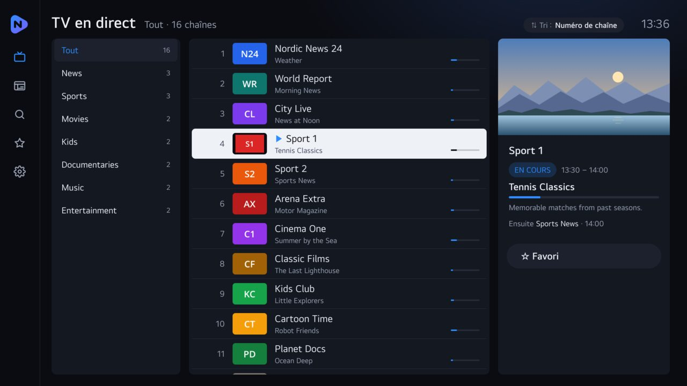
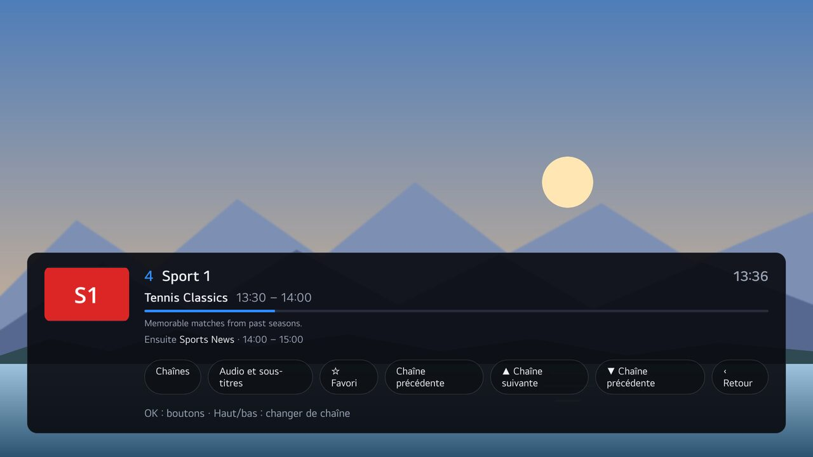
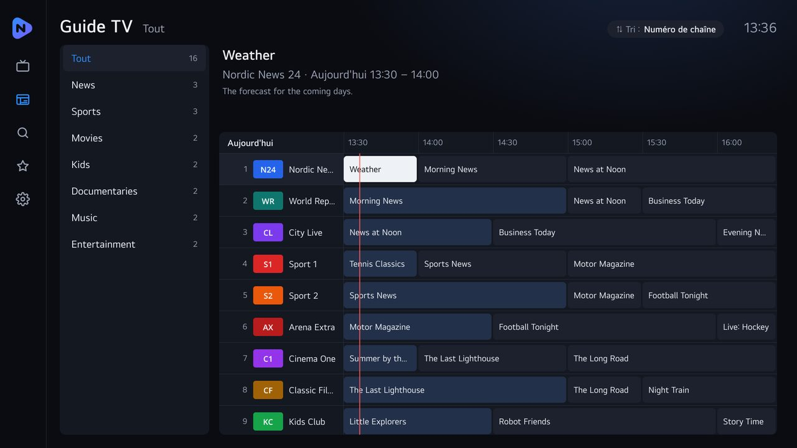
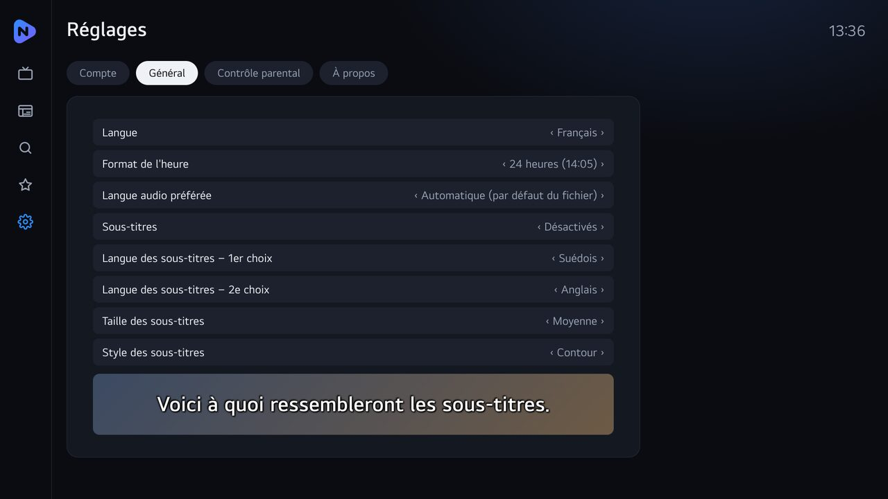
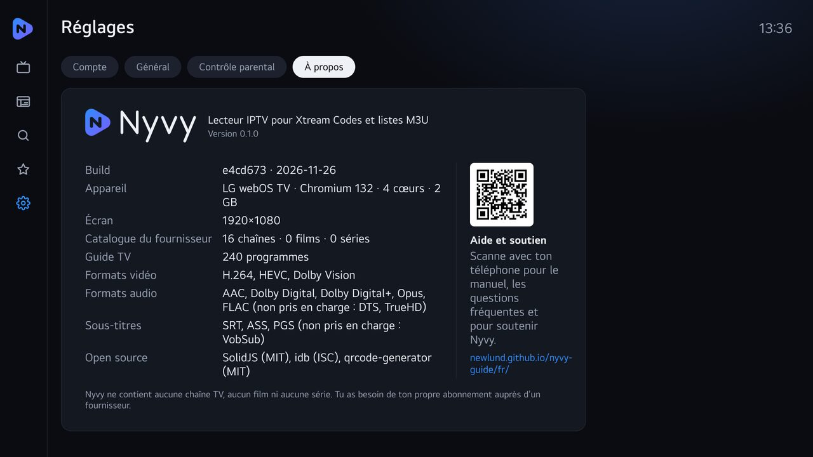

# Manuel

Tout ce qu’il faut pour bien démarrer avec Nyvy et en tirer le meilleur.

**Sommaire :** [Premiers pas](#getting-started) · [La télécommande](#remote) · [TV en direct](#live-tv) · [Guide TV et replay](#tv-guide) · [Films et séries](#films-series) · [Audio et sous-titres](#audio-subtitles) · [Recherche, favoris et tri](#search) · [Réglages](#settings) · [Questions fréquentes](#faq)

## Premiers pas {#getting-started}

Nyvy ne contient aucune chaîne. Tu as besoin d’un abonnement auprès d’un fournisseur IPTV et des informations qu’il t’a données.

### Se connecter

Au premier démarrage de Nyvy, choisis le type de compte :

| Type de compte | Ce que tu saisis | Ce que tu obtiens |
|---|---|---|
| **Xtream Codes** | Adresse du serveur, nom d’utilisateur et mot de passe | TV en direct, guide TV, replay, films, séries et statut du compte |
| **Liste M3U** | L’adresse de la liste et, si besoin, celle du guide | TV en direct avec groupes, guide TV, favoris et recherche |

> On t’a donné un « lien M3U » contenant `get.php?username=…&password=…` ? C’est en fait un compte Xtream. Nyvy le reconnaît et propose de te connecter en Xtream à la place, ce qui te donne aussi les films et les séries.

Après la connexion, Nyvy télécharge le catalogue (chaînes, films et séries) et le guide TV. La première fois peut prendre une minute ; ensuite c’est rapide. Au démarrage de Nyvy, le catalogue et le guide sont mis à jour automatiquement s’ils ont plus de 12 heures, et tu peux toujours les mettre à jour toi-même dans *Réglages → Compte*.

Tu veux d’abord faire un tour ? Choisis *Passer pour l’instant*. Tu pourras ajouter ton fournisseur plus tard dans *Réglages → Compte → Ajouter un fournisseur*.

## La télécommande {#remote}

| Touche | Action |
|---|---|
| Flèches et OK | Se déplacer et choisir |
| Retour | Revenir. Dans le menu latéral : quitter Nyvy |
| Rouge · Vert · Jaune | Raccourcis (voir ci-dessous) |
| CH+ / CH− | Changer de chaîne · faire défiler les listes |
| Lecture/Pause | Mettre en pause et reprendre |
| Avance/retour rapide | Sauter de 60 secondes |
| Info | Afficher la barre d’informations (TV en direct) |
| Chiffres | Aller directement à un numéro de chaîne |

La Magic Remote fonctionne aussi : pointe pour sélectionner, clique pour valider et fais défiler avec la molette.

**Pas de touches de couleur sur ta télécommande ?** Beaucoup de Magic Remote n’en ont pas, et tu n’en as pas besoin : tout fonctionne avec des boutons à l’écran. ☆ *Favori* se trouve sur la page de détails des films et séries, à droite de la liste des chaînes (appuie sur droite) et dans la barre d’informations en plein écran. *Tri* est en haut des listes, et *Audio et sous-titres* et *Chaîne précédente* dans la barre d’informations. Si tu veux quand même les raccourcis, appuie sur **123** sur la télécommande : un panneau avec les touches de couleur apparaît à l’écran. Rouge : favori · Vert : tri, ou audio et sous-titres pendant la lecture · Jaune : chaîne précédente.

## TV en direct {#live-tv}

- **Choisir une chaîne :** les catégories sont à gauche, les chaînes avec le programme en cours au centre. OK lit la chaîne dans l’aperçu ; OK de nouveau passe en plein écran.
- **En plein écran :**
  - Haut/bas ou CH+/CH− changent de chaîne.
  - OK sélectionne les boutons de la barre d’informations : *Chaînes*, *Audio et sous-titres*, ☆ *Favori*, *Chaîne précédente*, chaîne haut/bas et *Retour*. Gauche/droite passent de l’un à l’autre, OK valide.
  - Gauche/droite ou Info affichent la barre d’informations avec le programme en cours et le suivant.
  - Les chiffres vont à un numéro de chaîne.
  - Retour masque d’abord la barre d’informations ; appuie de nouveau sur Retour pour quitter le plein écran.

## Guide TV et replay {#tv-guide}

- **Le guide TV** affiche les programmes de toutes les chaînes dans une grille avec une ligne « maintenant ». OK sur un programme en cours lance la chaîne.
- **Replay :** les chaînes marquées ↺ ont des archives chez le fournisseur. Tu peux y remonter dans le guide, lancer un programme déjà diffusé et te déplacer dedans.

## Films et séries {#films-series}

Les films et séries sont disponibles avec les comptes Xtream.

- **La page de détails** affiche le résumé, la distribution, la qualité (par exemple 4K ou Dolby Vision) et les boutons *Lire*, *Reprendre* et *Favori*. Si un film existe en plusieurs versions, elles apparaissent sous les boutons.
- **Séries :** choisis la saison et l’épisode. À la fin d’un épisode, le suivant démarre après un compte à rebours.
- **Pendant la lecture :**
  - OK met en pause.
  - Gauche/droite sautent de 10 secondes (maintiens pour des sauts plus longs). Une image d’aperçu montre où tu vas arriver, et OK y va.
  - Haut affiche les boutons à l’écran.
  - Retour masque d’abord la barre de progression et les boutons ; appuie de nouveau sur Retour pour quitter. Nyvy retient où tu en étais.

## Audio et sous-titres {#audio-subtitles}

- **Films et séries :** appuie sur bas ou Vert pour choisir la piste audio, les sous-titres et la version.
- **TV en direct :** choisis *Audio et sous-titres* dans la barre d’informations (ou appuie sur Vert) pour activer ou désactiver les sous-titres de la diffusion et choisir la piste audio.
- **Par défaut :** dans *Réglages → Général*, tu choisis la langue audio préférée, si les sous-titres sont activés, les langues des sous-titres (1er et 2e choix) ainsi que la taille et le style du texte.

## Recherche, favoris et tri {#search}

- **Recherche :** tape avec le clavier à l’écran ou les chiffres de la télécommande. La recherche trouve chaînes, films et séries et ignore les accents (*malmo* trouve *Malmö*).
- **Favoris :** choisis ☆ *Favori* sur la page de détails d’un film ou d’une série, à droite de la liste des chaînes ou dans la barre d’informations en plein écran (Rouge est un raccourci). Les favoris apparaissent en premier dans chaque liste et sous *Favoris* dans le menu.
- **Tri :** le bouton *Tri* en haut des listes (ou Vert). Les chaînes se trient par numéro, qualité ou nom, les films et séries par exemple par ajouts récents, année, note ou qualité. Les séries peuvent aussi être triées par durée des épisodes.

## Réglages {#settings}

- **Compte :**
  - Affiche tes informations, la date de mise à jour du catalogue et le bouton *Mettre à jour le catalogue*.
  - **Modifier les informations :** nouvelle adresse de serveur, nouveau mot de passe ou nouvelle liste. Les favoris et les points de reprise sont conservés tant qu’il s’agit du même compte.
  - **Se déconnecter** supprime le compte et ses données du téléviseur.
- **Général :** langue, format de l’heure, audio et sous-titres.
- **Contrôle parental :**
  - Le contenu pour adultes est masqué dès le départ.
  - Avec un code PIN à quatre chiffres, tu peux l’afficher, et verrouiller ou masquer des catégories.
  - Les catégories verrouillées demandent le code PIN.
- **À propos :** version, formats que ton téléviseur peut lire, et le lien vers cette page.

## Questions fréquentes {#faq}

### « Cette chaîne ne diffuse pas en ce moment »
Le flux du fournisseur est coupé ou la chaîne ne diffuse que lors de certains événements. Réessaie plus tard ou choisis une autre chaîne. OK réessaie.

### « Le fournisseur n’autorise pas plus de connexions pour le moment »
Beaucoup d’abonnements n’autorisent qu’un flux à la fois. Ferme l’app sur les autres appareils qui utilisent le même compte, attends un peu et réessaie.

### « Le fournisseur ne répond pas »
Vérifie la connexion internet du téléviseur. Si elle fonctionne, le problème vient sans doute du fournisseur.

### Un film n’a pas de son
Le film n’a sans doute que du son en DTS ou Dolby TrueHD, que les téléviseurs LG ne peuvent pas lire dans les apps. Choisis une autre piste audio ou une autre version du film s’il y en a une.

### Le guide TV est vide (M3U)
Toutes les listes n’indiquent pas de guide. Demande à ton fournisseur l’adresse d’un guide XMLTV et saisis-la dans *Réglages → Compte → Modifier les informations*.

### Je ne vois ni films ni séries (M3U)
Dans Nyvy, les listes ne donnent que la TV en direct. Si tu as un compte Xtream, connecte-toi avec pour avoir les films et les séries.

### Comment quitter Nyvy ?
Appuie sur Retour jusqu’à ce que le menu latéral soit sélectionné, appuie encore sur Retour et choisis *Quitter*.
