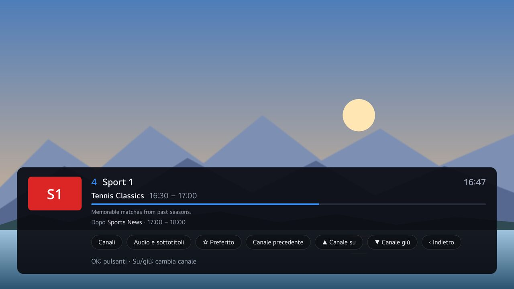
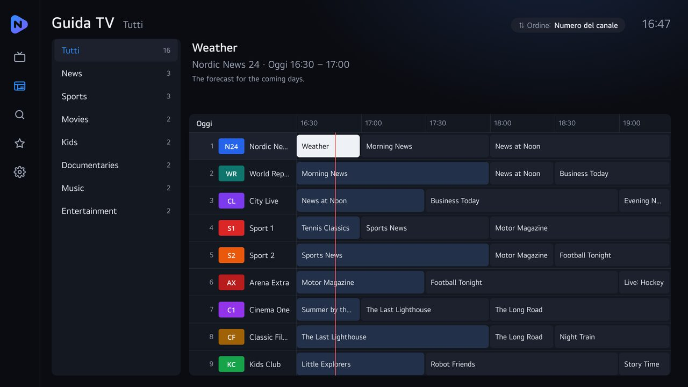
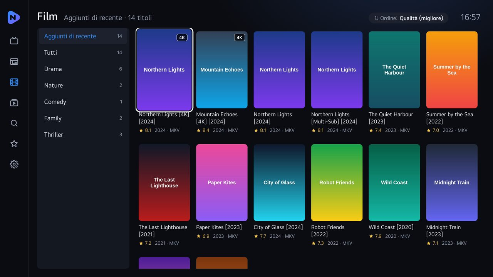
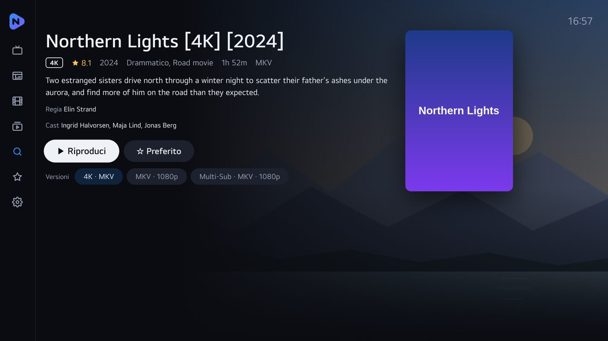
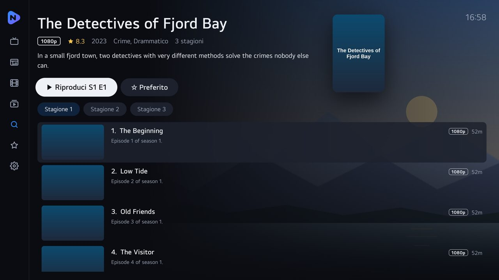
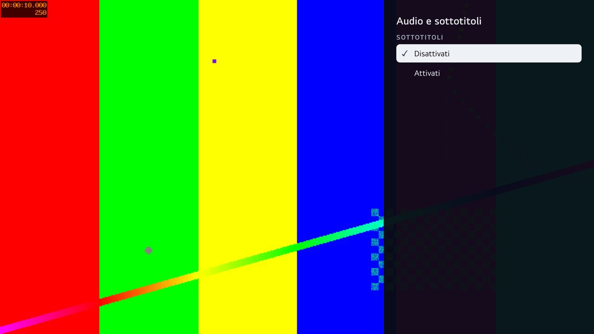
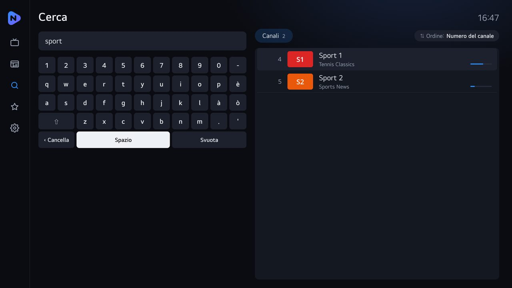
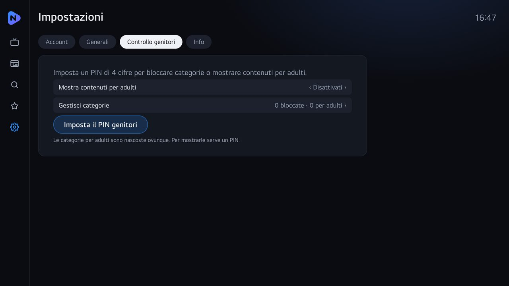

# Manuale

Tutto quello che serve per iniziare con Nyvy e sfruttarlo al meglio.

**Indice:** [Primi passi](#getting-started) · [Il telecomando](#remote) · [TV in diretta](#live-tv) · [Guida TV e catch-up](#tv-guide) · [Film e serie](#films-series) · [Audio e sottotitoli](#audio-subtitles) · [Ricerca, preferiti e ordine](#search) · [Impostazioni](#settings) · [Domande frequenti](#faq)

## Primi passi {#getting-started}

Nyvy non contiene canali. Ti serve un abbonamento con un fornitore IPTV e i dati che ti ha dato.

### Accedere

Al primo avvio di Nyvy scegli il tipo di account:

| Tipo di account | Cosa inserisci | Cosa ottieni |
|---|---|---|
| **Xtream Codes** | Indirizzo del server, nome utente e password | TV in diretta, guida TV, catch-up, film, serie e stato dell’account |
| **Playlist M3U** | L’indirizzo della playlist e, se serve, quello della guida | TV in diretta con gruppi, guida TV, preferiti e ricerca |

> Hai ricevuto un «link M3U» con `get.php?username=…&password=…`? In realtà è un account Xtream. Nyvy lo riconosce e ti propone di accedere come Xtream, così avrai anche film e serie.

Dopo l’accesso Nyvy scarica il catalogo (canali, film e serie) e la guida TV. La prima volta può volerci un minuto; poi è veloce. All’avvio di Nyvy catalogo e guida si aggiornano da soli se hanno più di 12 ore, e puoi sempre aggiornarli tu in *Impostazioni → Account*.

Vuoi prima dare un’occhiata? Scegli *Salta per ora*. Puoi aggiungere il fornitore più tardi in *Impostazioni → Account → Aggiungi fornitore*.

## Il telecomando {#remote}

| Tasto | Funzione |
|---|---|
| Frecce e OK | Muoversi e selezionare |
| Indietro | Tornare indietro. Nel menu laterale: uscire da Nyvy |
| Rosso · Verde · Giallo | Scorciatoie (vedi sotto) |
| CH+ / CH− | Cambiare canale · scorrere gli elenchi |
| Play/Pausa | Mettere in pausa e riprendere |
| Avanti/indietro veloce | Saltare di 60 secondi |
| Info | Mostrare la barra informazioni (TV in diretta) |
| Numeri | Andare direttamente a un numero di canale |

Funziona anche il Magic Remote: punta per evidenziare, fai clic per selezionare e scorri con la rotellina.

**Il telecomando non ha i tasti colorati?** Molti Magic Remote non li hanno, e non ti servono: tutto funziona con i pulsanti sullo schermo. ☆ *Preferito* si trova nella pagina dei dettagli di film e serie, a destra dell’elenco dei canali (premi destra) e nella barra informazioni a schermo intero. *Ordinamento* è in alto negli elenchi, *Audio e sottotitoli* e *Canale precedente* nella barra informazioni. Se vuoi comunque le scorciatoie, premi **123** sul telecomando: sullo schermo compare un pannello con i tasti colorati. Rosso: preferito · Verde: ordinamento, oppure audio e sottotitoli durante la visione · Giallo: canale precedente.

### Cosa fa Indietro

| Dove sei | Indietro |
|---|---|
| Il menu laterale | Chiede se vuoi uscire da Nyvy |
| Un elenco in *TV in diretta*, *Film* o *Serie* | Prima alle categorie, poi al menu laterale |
| La ricerca o le impostazioni | Al menu laterale |
| La pagina dei dettagli di un film o di una serie | Torna all’elenco |
| Un film o un episodio in riproduzione | Prima nasconde la barra di avanzamento e i pulsanti; la pressione successiva esce. Nyvy ricorda dove eri arrivato |
| La TV in diretta a schermo intero | Nell’ordine: cancella un numero di canale in digitazione, lascia la fila di pulsanti, nasconde la barra informazioni, esce dallo schermo intero |
| L’elenco dei canali o *Audio e sottotitoli* è aperto | Lo chiude |
| Una finestra di dialogo, per esempio il PIN | La chiude senza cambiare nulla |

## TV in diretta {#live-tv}

- **Scegliere un canale:** a sinistra le categorie, al centro i canali con il programma in corso. OK riproduce il canale nell’anteprima; un altro OK passa a schermo intero.
- **A schermo intero:**
  - Su/giù o CH+/CH− cambiano canale.
  - OK seleziona i pulsanti della barra informazioni: *Canali*, *Audio e sottotitoli*, ☆ *Preferito*, *Canale precedente*, canale su/giù e *Indietro*. Sinistra/destra si spostano tra di essi, OK seleziona.
  - Sinistra/destra o Info mostrano la barra informazioni con ora e dopo.
  - I numeri vanno a un canale.
  - Indietro nasconde prima la barra informazioni; premi di nuovo Indietro per uscire dallo schermo intero.

### Altro sulla TV in diretta

- **Anteprima:** OK su un canale dell’elenco lo riproduce nel riquadro a destra; un altro OK passa a schermo intero. Indietro dallo schermo intero ti riporta all’elenco, e l’anteprima continua.
- **Cambiare canale a schermo intero:** premi OK e scegli *Canali*: l’elenco dei canali si apre sopra l’immagine.
- **Numeri di canale:** digita le cifre sul telecomando. Nyvy cambia dopo un attimo.
- **Canale precedente:** il pulsante nella barra informazioni ti riporta al canale che guardavi prima.
- **Indicatori:** ↺ significa che il canale ha il catch-up. La linea sotto il programma mostra a che punto è. Nel riquadro a destra, *Catch-up · 2 giorni* indica fin dove arriva l’archivio.
- **Ordinare per qualità:** Nyvy legge HD e 4K dai nomi dei canali, così i migliori vengono prima.

## Guida TV e catch-up {#tv-guide}

- **La guida TV** mostra i programmi di tutti i canali in una griglia con una linea per «adesso». OK su un programma in corso avvia il canale.
- **Catch-up:** i canali con ↺ hanno un archivio presso il fornitore. Lì puoi tornare indietro nella guida, avviare un programma già andato in onda e spostarti al suo interno.

### Muoversi nella guida

- Su/giù cambia canale, e CH+/CH− scorre una pagina alla volta.
- Sinistra/destra si sposta nel tempo, un programma alla volta. In avanti la guida arriva a tre giorni. All’indietro solo sui canali con catch-up, fin dove arriva l’archivio.
- OK su un programma in onda avvia il canale a schermo intero. Su un programma futuro, Nyvy mostra quando inizia, per esempio *Inizia alle 21:00*.

### Guardare un programma già trasmesso

1. Apri *Guida TV* e scegli un canale con ↺.
2. Premi sinistra fino al programma. I programmi che si possono vedere dopo sono segnati con ↺, e le informazioni dicono *Catch-up: OK per guardare dall'inizio*.
3. Premi OK. Il programma parte dall’inizio.
4. Avanza o torna indietro con sinistra/destra, metti in pausa con OK ed esci con Indietro, come per un film.

## Film e serie {#films-series}

Film e serie sono disponibili con gli account Xtream.

- **La pagina dei dettagli** mostra trama, cast, qualità (per esempio 4K o Dolby Vision) e i pulsanti *Riproduci*, *Riprendi* e *Preferito*. Se un film esiste in più versioni, appaiono come scelte sotto i pulsanti.
- **Serie:** scegli stagione ed episodio. Quando un episodio finisce, il successivo parte dopo un conto alla rovescia.
- **Durante la visione:**
  - OK mette in pausa.
  - Sinistra/destra saltano di 10 secondi (tieni premuto per salti più lunghi). Un’immagine di anteprima mostra dove arriverai, e OK ci va.
  - Su mostra i pulsanti sullo schermo.
  - Indietro nasconde prima la barra di avanzamento e i pulsanti; premi di nuovo Indietro per uscire. Nyvy ricorda dove eri arrivato.

### Versioni

I fornitori hanno spesso lo stesso film in più versioni, per esempio 4K, 1080p o con altre lingue e sottotitoli. Nyvy le raggruppa: la pagina dei dettagli le elenca sotto *Versioni*, e durante la riproduzione cambi in *Audio e sottotitoli* → *Versione*.

### Continua a guardare e aggiunti di recente

All’inizio di *Film* e *Serie* ci sono i tuoi preferiti, *Continua a guardare* (ciò che hai iniziato) e *Aggiunti di recente* (ciò che il fornitore ha aggiunto per ultimo). La pagina dei dettagli di qualcosa che hai iniziato mostra per esempio *Riprendi da 42:10*, con *Dall'inizio* accanto.

### 4K, HDR e Dolby Vision

- **Indicatori:** 4K, 1080p, 720p o SD, a volte con HDR o DV (Dolby Vision). Nyvy mostra solo ciò che sa con certezza, dal titolo o dalla riproduzione, quindi non tutti i film hanno un indicatore.
- **Dolby Vision** viene riprodotto come Dolby Vision quando la TV lo supporta. Alcuni file (copie Blu-ray con due livelli d’immagine) e le TV senza Dolby Vision mostrano il film in HDR10, alla stessa risoluzione.

## Audio e sottotitoli {#audio-subtitles}

- **Film e serie:** premi giù o Verde per scegliere traccia audio, sottotitoli e versione.
- **TV in diretta:** scegli *Audio e sottotitoli* nella barra informazioni (o premi Verde) per attivare o disattivare i sottotitoli della trasmissione e scegliere la traccia audio.
- **Predefiniti:** in *Impostazioni → Generali* scegli la lingua audio preferita, se i sottotitoli sono attivi, le lingue dei sottotitoli (1ª e 2ª scelta) e dimensione e stile del testo.

### Sottotitoli di testo e a immagine

- **I sottotitoli di testo** (per esempio SRT e ASS) li disegna Nyvy, nelle dimensioni e nello stile che scegli.
- **I sottotitoli a immagine** (PGS, da Blu-ray) sono immagini già pronte e vengono mostrati così come sono. Dimensioni e stile non li modificano.
- **I sottotitoli della trasmissione** nella TV in diretta (DVB e televideo) li disegna la TV. In Nyvy puoi solo attivarli o disattivarli.

### Tracce non riproducibili

Una traccia che la TV non può riprodurre appare in grigio con la scritta *non riproducibile su questo dispositivo*. Le più comuni sono DTS e Dolby TrueHD. Se un film ha solo audio di questo tipo, Nyvy lo dice all’avvio e il film parte senza audio: scegli un’altra versione, se c’è. *Impostazioni* → *Info* mostra quali formati la tua TV può riprodurre.

Se l’audio principale di un film non può essere riprodotto ma un’altra traccia sì, Nyvy riproduce quella e un avviso indica quale. Le tracce di commento vengono scelte solo quando nient’altro è riproducibile; puoi comunque sceglierle tu.

### Dimensioni e stile dei sottotitoli

In *Impostazioni* → *Generali* scegli *Dimensione sottotitoli* (Piccola, Media, Grande o Molto grande) e *Stile sottotitoli* (Contorno o Sfondo). Un’anteprima mostra il risultato.

*Luminosità dei sottotitoli* rende i sottotitoli meno bianchi se ti sembrano troppo luminosi, a passi fino al 10%. Vale per i sottotitoli di testo e a immagine, ma non per quelli della trasmissione nella TV in diretta, che disegna la TV.

## Ricerca, preferiti e ordine {#search}

- **Ricerca:** scrivi con la tastiera sullo schermo o con i numeri del telecomando. La ricerca trova canali, film e serie e ignora gli accenti (*malmo* trova *Malmö*).
- **Preferiti:** scegli ☆ *Preferito* nella pagina dei dettagli di un film o una serie, a destra dell’elenco dei canali o nella barra informazioni a schermo intero (Rosso è una scorciatoia). I preferiti compaiono per primi in ogni elenco e in *Preferiti* nel menu.
- **Ordine:** il pulsante *Ordine* in alto negli elenchi (o Verde). I canali si ordinano per numero, qualità o nome, film e serie per esempio per aggiunti di recente, anno, voto o qualità. Le serie si possono ordinare anche per durata degli episodi.

### Aggiungere e trovare i preferiti

- **Un canale:** selezionalo nell’elenco di *TV in diretta*, premi destra e scegli ☆ *Preferito*. A schermo intero lo stesso pulsante è nella barra informazioni (premi OK).
- **Un film o una serie:** scegli ☆ *Preferito* nella pagina dei dettagli.
- **Trovarli:** in *Preferiti* nel menu, divisi in canali, film e serie, e all’inizio di ogni elenco.
- **Rimuovere:** scegli ★ *Rimuovi dai preferiti* nello stesso punto.

## Impostazioni {#settings}

- **Account:**
  - Mostra i tuoi dati, quando è stato aggiornato il catalogo e il pulsante *Aggiorna catalogo*.
  - **Modifica dati:** nuovo indirizzo del server, nuova password o nuova playlist. Preferiti e punti di ripresa restano finché si tratta dello stesso account.
  - **Esci** rimuove l’account e i suoi dati dalla TV.
- **Generali:** lingua, formato ora, audio e sottotitoli.
- **Controllo genitori:**
  - I contenuti per adulti sono nascosti fin dall’inizio.
  - Con un PIN di quattro cifre puoi mostrarli e bloccare o nascondere singole categorie.
  - Le categorie bloccate richiedono il PIN.
- **Info:** versione, quali formati può riprodurre la tua TV e il link a questa pagina.

### Impostare il controllo parentale

1. Vai in *Impostazioni* → *Controllo genitori* e scegli *Imposta il PIN genitori*. Inserisci quattro cifre e poi di nuovo le stesse.
2. *Mostra contenuti per adulti*: i contenuti per adulti sono nascosti fin dall’inizio, e mostrarli richiede il PIN. Le categorie che sembrano per adulti, per esempio con XXX o 18+ nel nome, vengono segnate automaticamente.
3. *Gestisci categorie*: OK su una categoria passa tra *🔒 Bloccato* (richiede il PIN), *🔞 Adulti* (nascosta finché lo sono i contenuti per adulti) e disattivato.
4. Apri una categoria bloccata con OK e il PIN. Resta poi sbloccata finché non chiudi Nyvy.
5. *Cambia PIN* e *Rimuovi PIN* si trovano nella stessa pagina.

### Se dimentichi il PIN

Il PIN non si può reimpostare in Nyvy, di proposito, perché altrimenti un bambino potrebbe aggirarlo. Anche *Esci* richiede il PIN. Non resta che rimuovere Nyvy dalla TV e reinstallarlo. A quel punto accedi di nuovo, e preferiti, punti di ripresa e impostazioni vanno persi.

### Privacy

Tutto ciò che Nyvy salva resta sulla tua TV: i dati dell’account (cifrati), il catalogo, la guida TV, i preferiti, i punti di ripresa e le impostazioni. Nulla viene inviato a Nyvy. *Esci* cancella tutto. Maggiori dettagli nella pagina [Privacy](privacy.html).

## Domande frequenti {#faq}

### «Questo canale non sta trasmettendo al momento»
Lo stream del fornitore non funziona o il canale trasmette solo per certi eventi. Riprova più tardi o scegli un altro canale. OK riprova.

### «Il fornitore non consente altre connessioni al momento»
Molti abbonamenti consentono un solo stream alla volta. Chiudi l’app sugli altri dispositivi che usano lo stesso account, aspetta un attimo e riprova.

### «Il fornitore non risponde»
Controlla la connessione internet della TV. Se funziona, il problema è probabilmente del fornitore.

### Un film non ha audio
Probabilmente il film ha solo audio DTS o Dolby TrueHD, che le TV LG non possono riprodurre nelle app. Scegli un’altra traccia audio o un’altra versione del film, se c’è.

### Sento un commento invece del film
L’audio principale del film (spesso DTS) non può essere riprodotto sulla TV, quindi Nyvy riproduce l’unica traccia possibile, a volte un commento. L’avviso all’inizio indica quale. Scegli un’altra versione del film se c’è.

### La guida TV è vuota (M3U)
Non tutte le playlist indicano una guida. Chiedi al tuo fornitore l’indirizzo di una guida XMLTV e inseriscilo in *Impostazioni → Account → Modifica dati*.

### Non vedo film e serie (M3U)
In Nyvy le playlist danno solo TV in diretta. Se hai un account Xtream, accedi con quello per avere film e serie.

### Come esco da Nyvy?
Premi Indietro finché il menu laterale è selezionato, premi di nuovo Indietro e scegli *Esci*.

### «Nuovo tentativo… (2/3)»
L’avvio si è bloccato, e Nyvy riprova da solo fino a tre volte. Di solito è un problema temporaneo del fornitore. Se anche il terzo tentativo fallisce, Nyvy mostra cosa non va.

### «Questo titolo non è disponibile presso il fornitore»
Il fornitore elenca il titolo ma non ha più il file. Non si può risolvere in Nyvy. Scegli un’altra versione, se c’è.

### L’immagine scatta o continua a caricare
Controlla la rete. Il 4K richiede circa 25 Mbit/s costanti, e una connessione via cavo è più affidabile del Wi-Fi. Se scatta solo un canale o un film, il problema di solito è del fornitore.

### I sottotitoli non compaiono
Controlla che in *Audio e sottotitoli* sia scelta la traccia giusta. Alcune tracce hanno testo solo per le battute in altre lingue, e nelle scene silenziose non compare nulla. I sottotitoli della trasmissione nella TV in diretta ci sono solo se il canale li invia.

### Gli orari della guida TV sono sbagliati
Controlla ora e fuso orario nelle impostazioni della TV. Se sono corretti, sono sbagliati i dati della guida del fornitore.

### Un canale non ha informazioni sui programmi (M3U)
Nyvy abbina i canali alla guida TV tramite tvg-id, altrimenti tramite il nome del canale. Se un canale non ha né l’uno né l’altro, o il nome è diverso, l’abbinamento non riesce. Il fornitore può correggerlo nella playlist.

### Il catalogo sembra vecchio
Nyvy aggiorna catalogo e guida TV all’avvio dell’app, se hanno più di 12 ore. Per aggiornare subito: *Impostazioni* → *Account* → *Aggiorna catalogo*.

## Glossario

- **Xtream Codes:** un modo comune con cui i fornitori IPTV offrono canali, film e serie, con un indirizzo del server, un nome utente e una password.
- **M3U:** una playlist: un lungo elenco di canali e dei loro indirizzi. Offre la TV in diretta, ma non film e serie in Nyvy.
- **EPG / XMLTV:** i dati della guida TV: cosa va in onda e quando. XMLTV è il formato del file.
- **Catch-up:** guardare programmi già trasmessi dall’archivio del fornitore (segnati con ↺).
- **4K:** un’immagine di 3840×2160 punti, quattro volte quelli del Full HD (1080p).
- **HDR:** una gamma di contrasto e colori più ampia di un’immagine normale. HDR10 è la variante più comune.
- **Dolby Vision:** una variante dell’HDR in cui l’immagine viene regolata scena per scena.
- **Dolby Digital / Dolby Digital Plus:** formati audio surround comuni che la TV può riprodurre.
- **DTS / Dolby TrueHD:** formati audio del cinema e dei Blu-ray che le TV LG non possono riprodurre nelle app.
