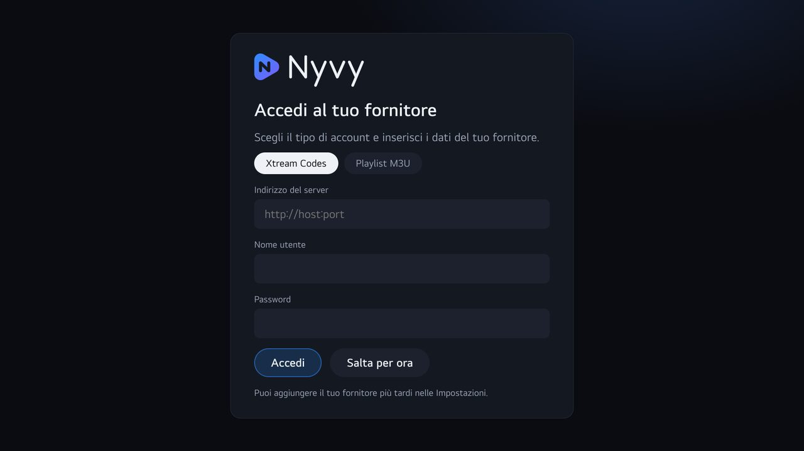
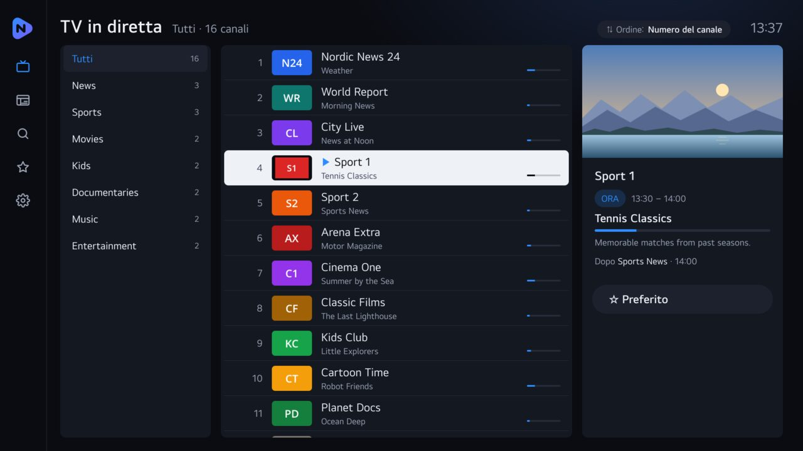
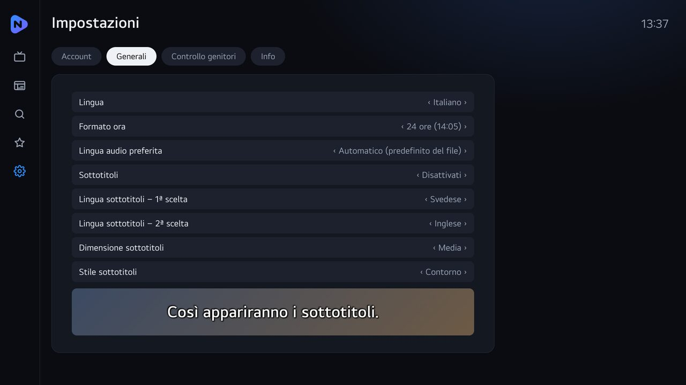
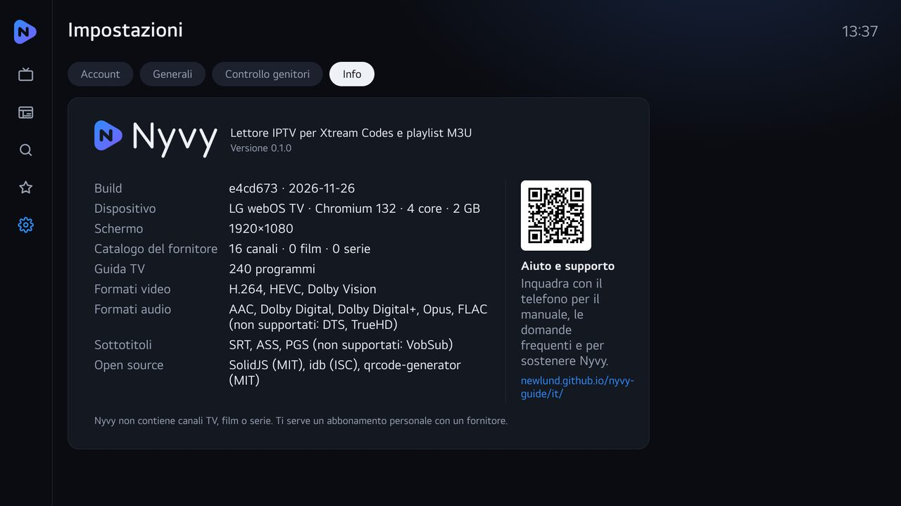

# Manuale

Tutto quello che serve per iniziare con Nyvy e sfruttarlo al meglio.

**Indice:** [Primi passi](#getting-started) · [Il telecomando](#remote) · [TV in diretta](#live-tv) · [Guida TV e catch-up](#tv-guide) · [Film e serie](#films-series) · [Audio e sottotitoli](#audio-subtitles) · [Ricerca, preferiti e ordine](#search) · [Impostazioni](#settings) · [Domande frequenti](#faq)

## Primi passi {#getting-started}

Nyvy non contiene canali. Ti serve un abbonamento con un fornitore IPTV e i dati che ti ha dato.

### Accedere

Al primo avvio di Nyvy scegli il tipo di account:

| Tipo di account | Cosa inserisci | Cosa ottieni |
|---|---|---|
| **Xtream Codes** | Indirizzo del server, nome utente e password | TV in diretta, guida TV, catch-up, film, serie e stato dell’account |
| **Playlist M3U** | L’indirizzo della playlist e, se serve, quello della guida | TV in diretta con gruppi, guida TV, preferiti e ricerca |

> Hai ricevuto un «link M3U» con `get.php?username=…&password=…`? In realtà è un account Xtream. Nyvy lo riconosce e ti propone di accedere come Xtream, così avrai anche film e serie.

Dopo l’accesso Nyvy scarica il catalogo (canali, film e serie) e la guida TV. La prima volta può volerci un minuto; poi è veloce. All’avvio di Nyvy catalogo e guida si aggiornano da soli se hanno più di 12 ore, e puoi sempre aggiornarli tu in *Impostazioni → Account*.

Vuoi prima dare un’occhiata? Scegli *Salta per ora*. Puoi aggiungere il fornitore più tardi in *Impostazioni → Account → Aggiungi fornitore*.

## Il telecomando {#remote}

| Tasto | Funzione |
|---|---|
| Frecce e OK | Muoversi e selezionare |
| Indietro | Tornare indietro. Nel menu laterale: uscire da Nyvy |
| Rosso · Verde · Giallo | Scorciatoie (vedi sotto) |
| CH+ / CH− | Cambiare canale · scorrere gli elenchi |
| Play/Pausa | Mettere in pausa e riprendere |
| Avanti/indietro veloce | Saltare di 60 secondi |
| Info | Mostrare la barra informazioni (TV in diretta) |
| Numeri | Andare direttamente a un numero di canale |

Funziona anche il Magic Remote: punta per evidenziare, fai clic per selezionare e scorri con la rotellina.

**Il telecomando non ha i tasti colorati?** Molti Magic Remote non li hanno, e non ti servono: tutto funziona con i pulsanti sullo schermo. ☆ *Preferito* si trova nella pagina dei dettagli di film e serie, a destra dell’elenco dei canali (premi destra) e nella barra informazioni a schermo intero. *Ordinamento* è in alto negli elenchi, *Audio e sottotitoli* e *Canale precedente* nella barra informazioni. Se vuoi comunque le scorciatoie, premi **123** sul telecomando: sullo schermo compare un pannello con i tasti colorati. Rosso: preferito · Verde: ordinamento, oppure audio e sottotitoli durante la visione · Giallo: canale precedente.

## TV in diretta {#live-tv}

- **Scegliere un canale:** a sinistra le categorie, al centro i canali con il programma in corso. OK riproduce il canale nell’anteprima; un altro OK passa a schermo intero.
- **A schermo intero:**
  - Su/giù o CH+/CH− cambiano canale.
  - OK seleziona i pulsanti della barra informazioni: *Canali*, *Audio e sottotitoli*, ☆ *Preferito*, *Canale precedente*, canale su/giù e *Indietro*. Sinistra/destra si spostano tra di essi, OK seleziona.
  - Sinistra/destra o Info mostrano la barra informazioni con ora e dopo.
  - I numeri vanno a un canale.
  - Indietro nasconde prima la barra informazioni; premi di nuovo Indietro per uscire dallo schermo intero.

## Guida TV e catch-up {#tv-guide}

- **La guida TV** mostra i programmi di tutti i canali in una griglia con una linea per «adesso». OK su un programma in corso avvia il canale.
- **Catch-up:** i canali con ↺ hanno un archivio presso il fornitore. Lì puoi tornare indietro nella guida, avviare un programma già andato in onda e spostarti al suo interno.

## Film e serie {#films-series}

Film e serie sono disponibili con gli account Xtream.

- **La pagina dei dettagli** mostra trama, cast, qualità (per esempio 4K o Dolby Vision) e i pulsanti *Riproduci*, *Riprendi* e *Preferito*. Se un film esiste in più versioni, appaiono come scelte sotto i pulsanti.
- **Serie:** scegli stagione ed episodio. Quando un episodio finisce, il successivo parte dopo un conto alla rovescia.
- **Durante la visione:**
  - OK mette in pausa.
  - Sinistra/destra saltano di 10 secondi (tieni premuto per salti più lunghi). Un’immagine di anteprima mostra dove arriverai, e OK ci va.
  - Su mostra i pulsanti sullo schermo.
  - Indietro nasconde prima la barra di avanzamento e i pulsanti; premi di nuovo Indietro per uscire. Nyvy ricorda dove eri arrivato.

## Audio e sottotitoli {#audio-subtitles}

- **Film e serie:** premi giù o Verde per scegliere traccia audio, sottotitoli e versione.
- **TV in diretta:** scegli *Audio e sottotitoli* nella barra informazioni (o premi Verde) per attivare o disattivare i sottotitoli della trasmissione e scegliere la traccia audio.
- **Predefiniti:** in *Impostazioni → Generali* scegli la lingua audio preferita, se i sottotitoli sono attivi, le lingue dei sottotitoli (1ª e 2ª scelta) e dimensione e stile del testo.

## Ricerca, preferiti e ordine {#search}

- **Ricerca:** scrivi con la tastiera sullo schermo o con i numeri del telecomando. La ricerca trova canali, film e serie e ignora gli accenti (*malmo* trova *Malmö*).
- **Preferiti:** scegli ☆ *Preferito* nella pagina dei dettagli di un film o una serie, a destra dell’elenco dei canali o nella barra informazioni a schermo intero (Rosso è una scorciatoia). I preferiti compaiono per primi in ogni elenco e in *Preferiti* nel menu.
- **Ordine:** il pulsante *Ordine* in alto negli elenchi (o Verde). I canali si ordinano per numero, qualità o nome, film e serie per esempio per aggiunti di recente, anno, voto o qualità. Le serie si possono ordinare anche per durata degli episodi.

## Impostazioni {#settings}

- **Account:**
  - Mostra i tuoi dati, quando è stato aggiornato il catalogo e il pulsante *Aggiorna catalogo*.
  - **Modifica dati:** nuovo indirizzo del server, nuova password o nuova playlist. Preferiti e punti di ripresa restano finché si tratta dello stesso account.
  - **Esci** rimuove l’account e i suoi dati dalla TV.
- **Generali:** lingua, formato ora, audio e sottotitoli.
- **Controllo genitori:**
  - I contenuti per adulti sono nascosti fin dall’inizio.
  - Con un PIN di quattro cifre puoi mostrarli e bloccare o nascondere singole categorie.
  - Le categorie bloccate richiedono il PIN.
- **Info:** versione, quali formati può riprodurre la tua TV e il link a questa pagina.

## Domande frequenti {#faq}

### «Questo canale non sta trasmettendo al momento»
Lo stream del fornitore non funziona o il canale trasmette solo per certi eventi. Riprova più tardi o scegli un altro canale. OK riprova.

### «Il fornitore non consente altre connessioni al momento»
Molti abbonamenti consentono un solo stream alla volta. Chiudi l’app sugli altri dispositivi che usano lo stesso account, aspetta un attimo e riprova.

### «Il fornitore non risponde»
Controlla la connessione internet della TV. Se funziona, il problema è probabilmente del fornitore.

### Un film non ha audio
Probabilmente il film ha solo audio DTS o Dolby TrueHD, che le TV LG non possono riprodurre nelle app. Scegli un’altra traccia audio o un’altra versione del film, se c’è.

### La guida TV è vuota (M3U)
Non tutte le playlist indicano una guida. Chiedi al tuo fornitore l’indirizzo di una guida XMLTV e inseriscilo in *Impostazioni → Account → Modifica dati*.

### Non vedo film e serie (M3U)
In Nyvy le playlist danno solo TV in diretta. Se hai un account Xtream, accedi con quello per avere film e serie.

### Come esco da Nyvy?
Premi Indietro finché il menu laterale è selezionato, premi di nuovo Indietro e scegli *Esci*.
