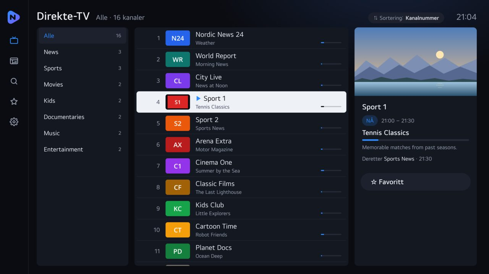
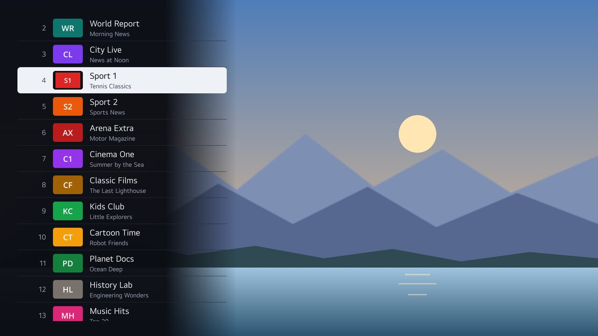
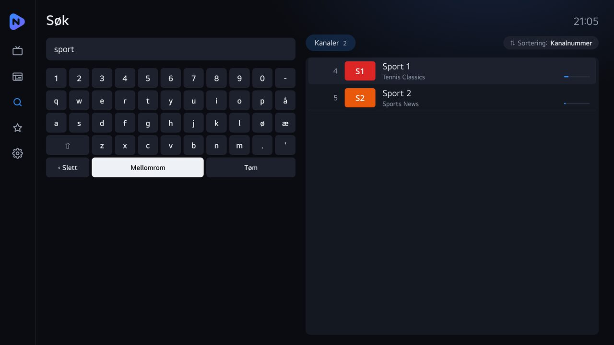
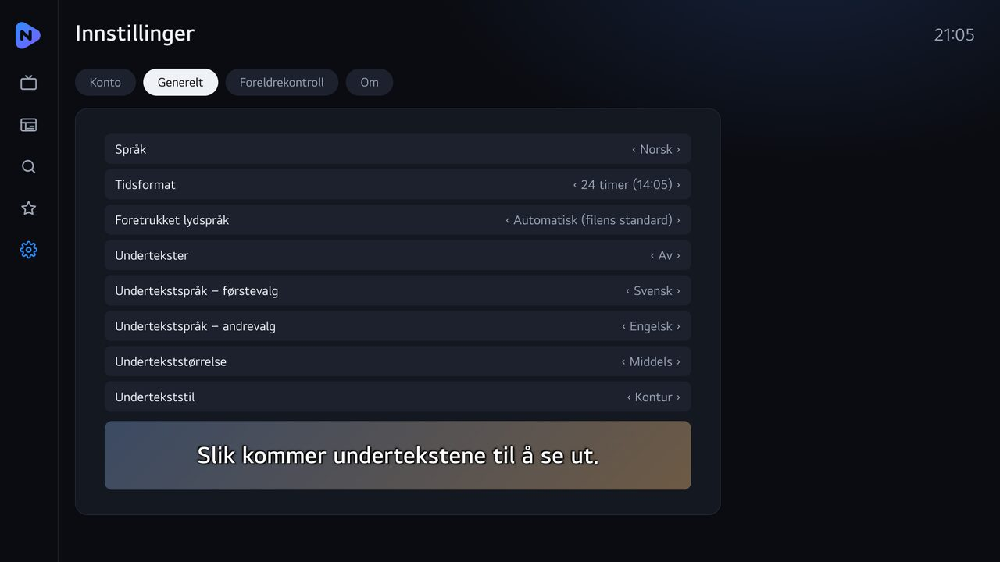
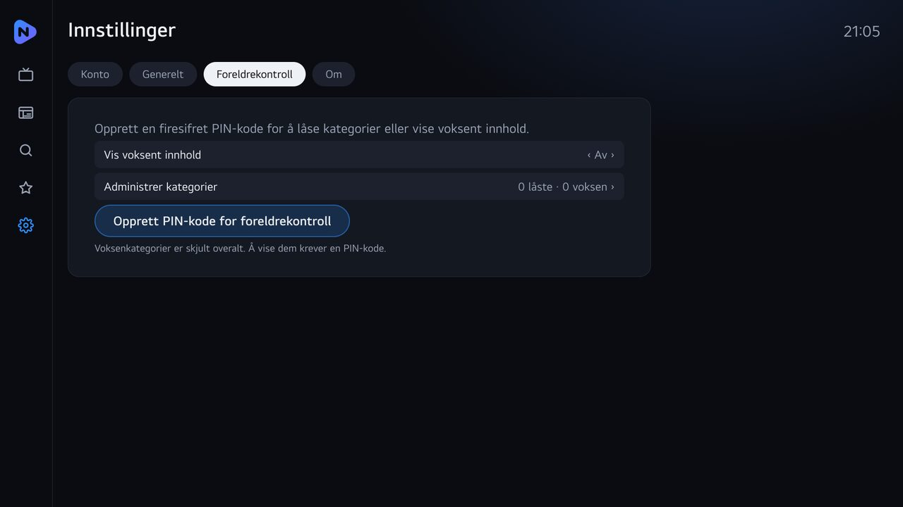
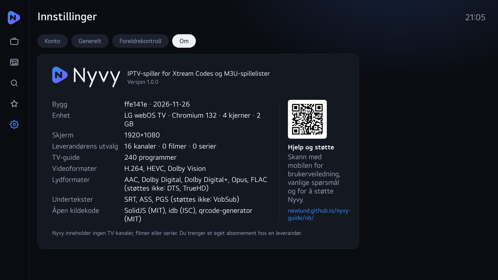

# Brukerveiledning

Alt du trenger for å komme i gang med Nyvy og få mest mulig ut av appen.

**Innhold:** [Kom i gang](#getting-started) · [Fjernkontrollen](#remote) · [Direkte-TV](#live-tv) · [TV-guide og catch-up](#tv-guide) · [Filmer og serier](#films-series) · [Lyd og undertekster](#audio-subtitles) · [Søk, favoritter og sortering](#search) · [Innstillinger](#settings) · [Vanlige spørsmål](#faq)

## Kom i gang {#getting-started}

Nyvy inneholder ingen kanaler selv. Du trenger et abonnement hos en IPTV-leverandør og opplysningene du har fått fra dem.

### Logg inn

Første gang du starter Nyvy, velger du kontotype:

| Kontotype | Dette fyller du inn | Dette får du |
|---|---|---|
| **Xtream Codes** | Serveradresse, brukernavn og passord | Direkte-TV, TV-guide, catch-up, filmer, serier og kontostatus |
| **M3U-spilleliste** | Adressen til spillelisten, og ved behov adressen til TV-guiden | Direkte-TV med grupper, TV-guide, favoritter og søk |

> Har du fått en «M3U-lenke» som inneholder `get.php?username=…&password=…`? Da er det egentlig en Xtream-konto. Nyvy kjenner det igjen og tilbyr å logge inn som Xtream i stedet, så får du også filmer og serier.

Etter innloggingen henter Nyvy utvalget (kanaler, filmer og serier) og TV-guiden. Første gang kan det ta et minutt, deretter går det fort. Når du starter Nyvy, oppdateres utvalget og guiden automatisk hvis de er eldre enn 12 timer, og du kan alltid oppdatere selv under *Innstillinger → Konto*.

Vil du se deg rundt først? Velg *Hopp over*. Du kan legge til leverandøren senere under *Innstillinger → Konto → Legg til leverandør*.

## Fjernkontrollen {#remote}

| Knapp | Gjør |
|---|---|
| Piler og OK | Flytte og velge |
| Tilbake | Gå tilbake. I sidemenyen: avslutt Nyvy |
| Rød · Grønn · Gul | Snarveier (se nedenfor) |
| CH+ / CH− | Bytt kanal · bla i lister |
| Spill av/pause | Pause og fortsette |
| Spol fram/tilbake | Hopp 60 sekunder |
| Info | Vis informasjonslinjen (direkte-TV) |
| Tall | Gå rett til et kanalnummer |

Magic Remote fungerer også: pek for å markere, klikk for å velge og rull med hjulet.

**Ingen fargeknapper på fjernkontrollen?** Mange Magic Remote mangler dem, og du trenger dem ikke: alt fungerer med knapper på skjermen. ☆ *Favoritt* finnes på detaljsiden for filmer og serier, til høyre for kanallisten (trykk høyre) og i informasjonslinjen i fullskjerm. *Sortering* finnes øverst i listene, og *Lyd og undertekster* og *Forrige kanal* i informasjonslinjen. Vil du likevel bruke snarveiene, trykk **123** på fjernkontrollen: et panel med fargeknappene vises på skjermen. Rød: favoritt · Grønn: sortering, eller lyd og undertekster mens du ser · Gul: forrige kanal.

### Hva Tilbake gjør

| Der du er | Tilbake |
|---|---|
| Sidemenyen | Spør om du vil avslutte Nyvy |
| En liste i *Direkte-TV*, *Filmer* eller *Serier* | Først til kategoriene, deretter til sidemenyen |
| Søk eller innstillinger | Til sidemenyen |
| Detaljsiden for en film eller serie | Tilbake til listen |
| Film eller episode som spilles | Skjuler først spolelinjen og knappene; neste trykk avslutter. Nyvy husker hvor du var |
| Direkte-TV i fullskjerm | I rekkefølge: tømmer et kanalnummer du holder på å taste, forlater knapperaden, skjuler informasjonslinjen, forlater fullskjerm |
| Kanallisten eller *Lyd og undertekster* er åpen | Lukker den |
| En dialogboks, for eksempel PIN-koden | Lukker den uten å endre noe |

## Direkte-TV {#live-tv}

- **Velg kanal:** til venstre er kategoriene, i midten kanalene med programmet som går. OK spiller kanalen i forhåndsvisningen, OK igjen gir fullskjerm.
- **I fullskjerm:**
  - Opp/ned eller CH+/CH− bytter kanal.
  - OK velger informasjonslinjens knapper: *Kanaler*, *Lyd og undertekster*, ☆ *Favoritt*, *Forrige kanal*, kanal opp/ned og *Tilbake*. Venstre/høyre flytter mellom dem, OK velger.
  - Venstre/høyre eller Info viser informasjonslinjen med nå og deretter.
  - Tall går til et kanalnummer.
  - Tilbake skjuler først informasjonslinjen; trykk Tilbake igjen for å gå ut av fullskjerm.

### Mer om direkte-TV

- **Forhåndsvisning:** OK på en kanal i listen spiller den i ruten til høyre; OK igjen gir fullskjerm. Tilbake fra fullskjerm tar deg til listen, og forhåndsvisningen fortsetter.
- **Bytte kanal i fullskjerm:** trykk OK og velg *Kanaler*, så åpnes kanallisten over bildet.
- **Kanalnumre:** tast sifrene på fjernkontrollen. Nyvy bytter etter et øyeblikk.
- **Forrige kanal:** knappen i informasjonslinjen tar deg tilbake til kanalen du så på før.
- **Merker:** ↺ betyr at kanalen har catch-up. Streken under programmet viser hvor langt det har kommet. I ruten til høyre viser *Catch-up · 2 dager* hvor langt tilbake arkivet rekker.
- **Sortere etter kvalitet:** Nyvy leser HD og 4K i kanalnavnene, så de beste kanalene kommer først.

## TV-guide og catch-up {#tv-guide}

- **TV-guiden** viser programmene for alle kanaler i et rutenett med en linje for «nå». OK på et program som går, starter kanalen.
- **Catch-up:** kanaler med ↺ har arkiv hos leverandøren. Der kan du bla bakover i guiden, starte et program som allerede er sendt, og spole i det.

### Gå rundt i guiden

- Opp/ned bytter kanal, og CH+/CH− blar en side om gangen.
- Venstre/høyre flytter i tid, ett program om gangen. Framover rekker guiden tre dager. Bakover går bare på kanaler med catch-up, så langt arkivet rekker.
- OK på et program som går nå, starter kanalen i fullskjerm. På et kommende program viser Nyvy når det starter, for eksempel *Starter 21:00*.

### Se et program som allerede er sendt

1. Åpne *TV-guide* og velg en kanal med ↺.
2. Trykk venstre til du kommer til programmet. Programmer du kan se i ettertid, er merket ↺, og informasjonen sier *Catch-up: OK for å se fra starten*.
3. Trykk OK. Programmet starter fra begynnelsen.
4. Spol med venstre/høyre, sett på pause med OK og avslutt med Tilbake, som med en film.

## Filmer og serier {#films-series}

Filmer og serier finnes for Xtream-kontoer.

- **Detaljsiden** viser handling, skuespillere, kvalitet (for eksempel 4K eller Dolby Vision) og knappene *Spill av*, *Fortsett* og *Favoritt*. Finnes filmen i flere versjoner, vises de som valg under knappene.
- **Serier:** velg sesong og episode. Når en episode er slutt, starter neste etter en nedtelling.
- **Når du ser på:**
  - OK setter på pause.
  - Venstre/høyre hopper 10 sekunder (hold inne for lengre hopp). Et forhåndsbilde viser hvor du havner, og OK hopper dit.
  - Opp viser knappene på skjermen.
  - Tilbake skjuler først tidslinjen og knappene; trykk Tilbake igjen for å avslutte. Nyvy husker hvor du var.

### Versjoner

Leverandører har ofte samme film i flere versjoner, for eksempel 4K, 1080p eller med andre språk og undertekster. Nyvy samler dem: detaljsiden viser dem under *Versjoner*, og mens filmen spilles, bytter du under *Lyd og undertekster* → *Versjon*.

### Fortsett å se og sist lagt til

Først i *Filmer* og *Serier* kommer favorittene dine, *Fortsett å se* (det du har begynt på) og *Nylig lagt til* (det leverandøren la til sist). På detaljsiden for noe du har begynt på, står det for eksempel *Fortsett fra 42:10*, med *Spill av fra start* ved siden av.

### 4K, HDR og Dolby Vision

- **Merker:** 4K, 1080p, 720p eller SD, noen ganger med HDR eller DV (Dolby Vision). Nyvy viser bare det den vet sikkert, fra tittelen eller fra avspilling, så ikke alle filmer har et merke.
- **Dolby Vision** spilles som Dolby Vision når TV-en støtter det. Noen filer (Blu-ray-kopier med to bildelag) og TV-er uten Dolby Vision viser i stedet filmen i HDR10, med samme oppløsning.

## Lyd og undertekster {#audio-subtitles}

- **Filmer og serier:** trykk ned eller Grønn for å velge lydspor, undertekster og versjon.
- **Direkte-TV:** velg *Lyd og undertekster* i informasjonslinjen (eller trykk Grønn) for å slå sendingens undertekster av eller på og velge lydspor.
- **Standardvalg:** under *Innstillinger → Generelt* velger du foretrukket lydspråk, om undertekster skal være på, første- og andrevalg for undertekstspråk, samt tekststørrelse og stil.

### Tekst- og bildeundertekster

- **Tekstundertekster** (for eksempel SRT og ASS) tegner Nyvy selv, i den størrelsen og stilen du velger.
- **Bildeundertekster** (PGS, fra Blu-ray) er ferdige bilder og vises som de er. Størrelse og stil påvirker dem ikke.
- **Sendingens undertekster** i direkte-TV (DVB og tekst-TV) tegnes av TV-en. I Nyvy slår du dem bare av eller på.

### Spor som ikke kan spilles

Et spor TV-en ikke kan spille, vises nedtonet med teksten *kan ikke spilles av på denne enheten*. Vanligst er DTS og Dolby TrueHD. Har en film bare slik lyd, sier Nyvy fra når den starter, og filmen spilles uten lyd: velg en annen versjon hvis det finnes. Under *Innstillinger* → *Om* ser du hvilke formater TV-en din kan spille.

### Undertekstenes størrelse og stil

Under *Innstillinger* → *Generelt* velger du *Undertekststørrelse* (Liten, Middels, Stor eller Ekstra stor) og *Undertekststil* (Kontur eller Bakgrunnsboks). En forhåndsvisning viser hvordan det blir.

## Søk, favoritter og sortering {#search}

- **Søk:** skriv med tastaturet på skjermen eller med fjernkontrollens tall. Søket finner kanaler, filmer og serier og bryr seg ikke om aksenter (*malmo* finner *Malmö*).
- **Favoritter:** velg ☆ *Favoritt* på detaljsiden for en film eller serie, til høyre for kanallisten eller i informasjonslinjen i fullskjerm (Rød er en snarvei). Favorittene ligger først i hver liste og under *Favoritter* i menyen.
- **Sortering:** knappen *Sortering* øverst i listene (eller Grønn). Kanaler kan sorteres etter nummer, kvalitet eller navn, og filmer og serier for eksempel etter nylig lagt til, år, vurdering eller kvalitet. Serier kan også sorteres etter episodenes lengde.

### Legge til og finne favoritter

- **En kanal:** marker den i listen i *Direkte-TV*, trykk høyre og velg ☆ *Favoritt*. I fullskjerm finnes samme knapp i informasjonslinjen (trykk OK).
- **En film eller serie:** velg ☆ *Favoritt* på detaljsiden.
- **Finne dem:** under *Favoritter* i menyen, delt i kanaler, filmer og serier, og først i hver liste.
- **Fjerne:** velg ★ *Fjern favoritt* på samme sted.

## Innstillinger {#settings}

- **Konto:**
  - Viser opplysningene dine, når utvalget ble oppdatert, og knappen *Oppdater utvalget*.
  - **Endre opplysninger:** ny serveradresse, nytt passord eller ny spilleliste. Favoritter og hvor du slapp beholdes så lenge det er samme konto.
  - **Logg ut** fjerner kontoen og lagrede data fra TV-en.
- **Generelt:** språk, tidsformat, lyd og undertekster.
- **Foreldrekontroll:**
  - Voksent innhold er skjult fra start.
  - Med en firesifret PIN-kode kan du vise det, og låse eller skjule enkelte kategorier.
  - Låste kategorier krever PIN-koden.
- **Om:** versjon, hvilke formater TV-en din kan spille av, og lenken til denne siden.

### Sette opp foreldrekontroll

1. Gå til *Innstillinger* → *Foreldrekontroll* og velg *Opprett PIN-kode for foreldrekontroll*. Skriv inn fire sifre, og de samme sifrene en gang til.
2. *Vis voksent innhold*: voksenindhold er skjult fra start, og å vise det krever PIN-koden. Kategorier som ser ut til å være for voksne, for eksempel med XXX eller 18+ i navnet, merkes automatisk.
3. *Administrer kategorier*: trykk OK på en kategori for å veksle mellom *🔒 Låst* (krever PIN-koden), *🔞 Voksen* (skjult når voksenindhold er skjult) og av.
4. En låst kategori åpner du med OK og PIN-koden. Den er deretter låst opp til du lukker Nyvy.
5. *Endre PIN-kode* og *Fjern PIN-kode* finnes på samme side.

### Hvis du glemmer PIN-koden

PIN-koden kan ikke tilbakestilles i Nyvy, med vilje, siden et barn ellers kunne komme forbi den. Også *Logg ut* krever PIN-koden. Det som gjenstår, er å fjerne Nyvy fra TV-en og installere appen på nytt. Da logger du inn igjen, og favoritter, hvor du slapp og innstillinger forsvinner.

### Personvern

Alt Nyvy lagrer, blir på TV-en din: kontoopplysningene (kryptert), utvalget, TV-guiden, favoritter, hvor du slapp og innstillinger. Ingenting sendes til Nyvy. *Logg ut* fjerner alt. Les mer på siden [Personvern](privacy.html).

## Vanlige spørsmål {#faq}

### «Kanalen sender ikke akkurat nå»
Leverandørens sending er nede, eller kanalen sender bare under bestemte arrangementer. Prøv igjen senere eller velg en annen kanal. OK prøver på nytt.

### «Leverandøren tillater ikke flere tilkoblinger akkurat nå»
Mange abonnementer tillater bare én strøm om gangen. Lukk appen på andre enheter som bruker samme konto, vent litt og prøv igjen.

### «Leverandøren svarer ikke»
Sjekk TV-ens internettilkobling. Fungerer den, ligger feilen trolig hos leverandøren.

### En film har ikke lyd
Filmen har trolig bare lyd i DTS eller Dolby TrueHD, som LG-TV ikke kan spille av i apper. Velg et annet lydspor eller en annen versjon av filmen hvis det finnes.

### TV-guiden er tom (M3U)
Ikke alle spillelister oppgir en TV-guide. Spør leverandøren om adressen til en XMLTV-guide og fyll den inn under *Innstillinger → Konto → Endre opplysninger*.

### Jeg ser ikke filmer og serier (M3U)
Spillelister gir bare direkte-TV i Nyvy. Har du en Xtream-konto, logg inn med den for å få filmer og serier.

### Hvordan avslutter jeg Nyvy?
Trykk Tilbake til sidemenyen er markert, trykk Tilbake igjen og velg *Avslutt*.

### «Prøver igjen… (2/3)»
Starten satte seg fast, og Nyvy prøver selv igjen opptil tre ganger. Som regel er det et midlertidig problem hos leverandøren. Mislykkes også tredje forsøk, viser Nyvy hva som er galt.

### «Tittelen finnes ikke hos leverandøren»
Leverandøren viser tittelen, men har ikke filen lenger. Det kan ikke rettes i Nyvy. Velg en annen versjon hvis det finnes.

### Bildet hakker eller laster hele tiden
Sjekk nettverket. 4K trenger omtrent 25 Mbit/s stabilt, og kablet tilkobling er mer pålitelig enn wifi. Hakker bare én kanal eller film, ligger problemet som regel hos leverandøren.

### Undertekstene vises ikke
Sjekk at riktig spor er valgt under *Lyd og undertekster*. Noen spor har bare tekst for replikker på andre språk, og i stille scener vises ingenting. Sendingens undertekster i direkte-TV finnes bare når kanalen sender dem.

### Tidene i TV-guiden stemmer ikke
Sjekk tid og tidssone i TV-ens egne innstillinger. Stemmer de, er det leverandørens guidedata som er feil.

### En kanal mangler programinformasjon (M3U)
Nyvy matcher kanaler mot TV-guiden med tvg-id, ellers med kanalnavnet. Mangler kanalen begge, eller er navnet annerledes, kan den ikke matches. Leverandøren kan rette det i spillelisten.

### Utvalget virker gammelt
Nyvy oppdaterer utvalget og TV-guiden når du starter appen, hvis de er eldre enn 12 timer. Oppdatere med en gang: *Innstillinger* → *Konto* → *Oppdater utvalget*.

## Ordliste

- **Xtream Codes:** en vanlig måte for IPTV-leverandører å levere kanaler, filmer og serier på, med en serveradresse, et brukernavn og et passord.
- **M3U:** en spilleliste: en lang liste med kanaler og adressene deres. Gir direkte-TV, men ikke filmer og serier i Nyvy.
- **EPG / XMLTV:** TV-guidedata, altså hva som sendes når. XMLTV er filformatet.
- **Catch-up:** å se programmer som allerede er sendt, fra leverandørens arkiv (merket ↺).
- **4K:** et bilde på 3840×2160 punkter, fire ganger så mange som Full HD (1080p).
- **HDR:** større kontrast- og fargeomfang enn et vanlig bilde. HDR10 er den vanligste varianten.
- **Dolby Vision:** en HDR-variant der bildet justeres scene for scene.
- **Dolby Digital / Dolby Digital Plus:** vanlige surroundformater som TV-en kan spille.
- **DTS / Dolby TrueHD:** lydformater fra kino og Blu-ray som LG-TV-er ikke kan spille i apper.
