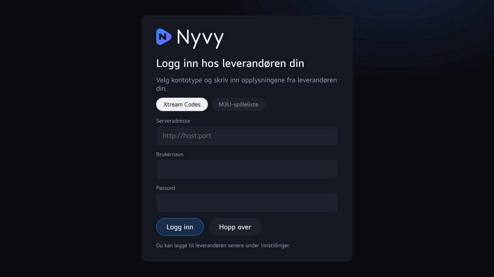
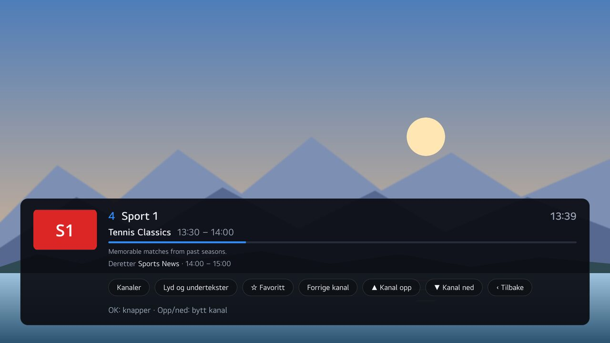
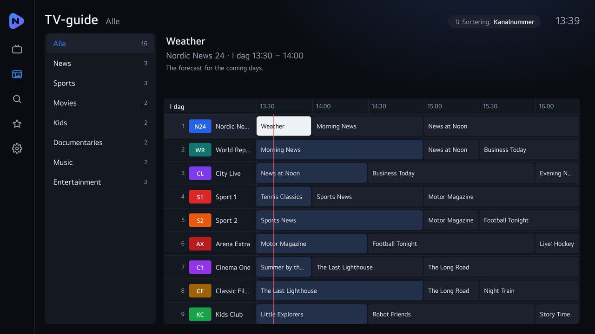
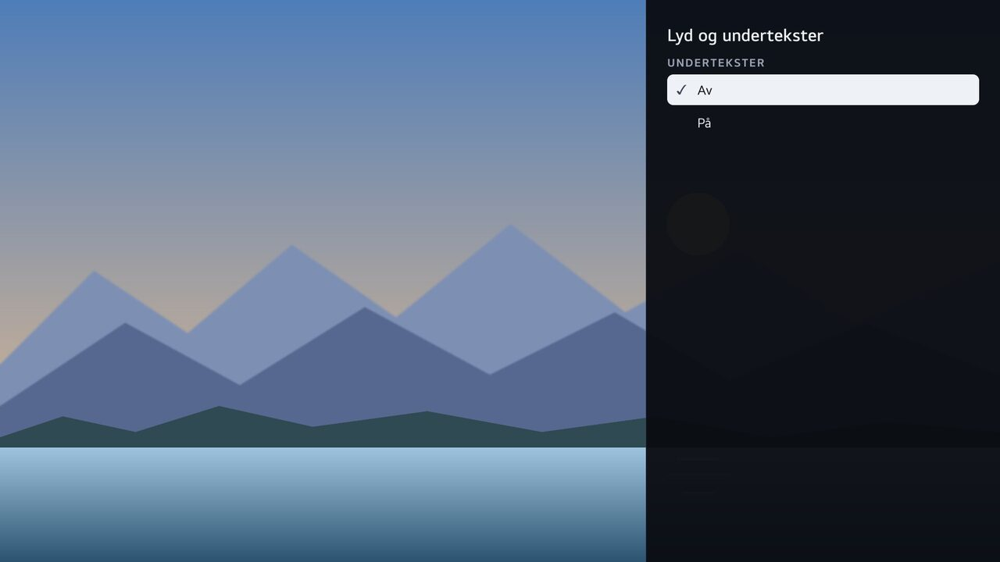

# Brukerveiledning

Alt du trenger for å komme i gang med Nyvy og få mest mulig ut av appen.

**Innhold:** [Kom i gang](#getting-started) · [Fjernkontrollen](#remote) · [Direkte-TV](#live-tv) · [TV-guide og catch-up](#tv-guide) · [Filmer og serier](#films-series) · [Lyd og undertekster](#audio-subtitles) · [Søk, favoritter og sortering](#search) · [Innstillinger](#settings) · [Vanlige spørsmål](#faq)

## Kom i gang {#getting-started}

Nyvy inneholder ingen kanaler selv. Du trenger et abonnement hos en IPTV-leverandør og opplysningene du har fått fra dem.

### Logg inn

Første gang du starter Nyvy, velger du kontotype:

| Kontotype | Dette fyller du inn | Dette får du |
|---|---|---|
| **Xtream Codes** | Serveradresse, brukernavn og passord | Direkte-TV, TV-guide, catch-up, filmer, serier og kontostatus |
| **M3U-spilleliste** | Adressen til spillelisten, og ved behov adressen til TV-guiden | Direkte-TV med grupper, TV-guide, favoritter og søk |

> Har du fått en «M3U-lenke» som inneholder `get.php?username=…&password=…`? Da er det egentlig en Xtream-konto. Nyvy kjenner det igjen og tilbyr å logge inn som Xtream i stedet, så får du også filmer og serier.

Etter innloggingen henter Nyvy utvalget (kanaler, filmer og serier) og TV-guiden. Første gang kan det ta et minutt, deretter går det fort. Når du starter Nyvy, oppdateres utvalget og guiden automatisk hvis de er eldre enn 12 timer, og du kan alltid oppdatere selv under *Innstillinger → Konto*.

Vil du se deg rundt først? Velg *Hopp over*. Du kan legge til leverandøren senere under *Innstillinger → Konto → Legg til leverandør*.

## Fjernkontrollen {#remote}

| Knapp | Gjør |
|---|---|
| Piler og OK | Flytte og velge |
| Tilbake | Gå tilbake. I sidemenyen: avslutt Nyvy |
| Rød · Grønn · Gul | Snarveier (se nedenfor) |
| CH+ / CH− | Bytt kanal · bla i lister |
| Spill av/pause | Pause og fortsette |
| Spol fram/tilbake | Hopp 60 sekunder |
| Info | Vis informasjonslinjen (direkte-TV) |
| Tall | Gå rett til et kanalnummer |

Magic Remote fungerer også: pek for å markere, klikk for å velge og rull med hjulet.

**Ingen fargeknapper på fjernkontrollen?** Mange Magic Remote mangler dem, og du trenger dem ikke: alt fungerer med knapper på skjermen. ☆ *Favoritt* finnes på detaljsiden for filmer og serier, til høyre for kanallisten (trykk høyre) og i informasjonslinjen i fullskjerm. *Sortering* finnes øverst i listene, og *Lyd og undertekster* og *Forrige kanal* i informasjonslinjen. Vil du likevel bruke snarveiene, trykk **123** på fjernkontrollen: et panel med fargeknappene vises på skjermen. Rød: favoritt · Grønn: sortering, eller lyd og undertekster mens du ser · Gul: forrige kanal.

## Direkte-TV {#live-tv}

- **Velg kanal:** til venstre er kategoriene, i midten kanalene med programmet som går. OK spiller kanalen i forhåndsvisningen, OK igjen gir fullskjerm.
- **I fullskjerm:**
  - Opp/ned eller CH+/CH− bytter kanal.
  - OK velger informasjonslinjens knapper: *Kanaler*, *Lyd og undertekster*, ☆ *Favoritt*, *Forrige kanal*, kanal opp/ned og *Tilbake*. Venstre/høyre flytter mellom dem, OK velger.
  - Venstre/høyre eller Info viser informasjonslinjen med nå og deretter.
  - Tall går til et kanalnummer.
  - Tilbake skjuler først informasjonslinjen; trykk Tilbake igjen for å gå ut av fullskjerm.

## TV-guide og catch-up {#tv-guide}

- **TV-guiden** viser programmene for alle kanaler i et rutenett med en linje for «nå». OK på et program som går, starter kanalen.
- **Catch-up:** kanaler med ↺ har arkiv hos leverandøren. Der kan du bla bakover i guiden, starte et program som allerede er sendt, og spole i det.

## Filmer og serier {#films-series}

Filmer og serier finnes for Xtream-kontoer.

- **Detaljsiden** viser handling, skuespillere, kvalitet (for eksempel 4K eller Dolby Vision) og knappene *Spill av*, *Fortsett* og *Favoritt*. Finnes filmen i flere versjoner, vises de som valg under knappene.
- **Serier:** velg sesong og episode. Når en episode er slutt, starter neste etter en nedtelling.
- **Når du ser på:**
  - OK setter på pause.
  - Venstre/høyre hopper 10 sekunder (hold inne for lengre hopp). Et forhåndsbilde viser hvor du havner, og OK hopper dit.
  - Opp viser knappene på skjermen.
  - Tilbake skjuler først tidslinjen og knappene; trykk Tilbake igjen for å avslutte. Nyvy husker hvor du var.

## Lyd og undertekster {#audio-subtitles}

- **Filmer og serier:** trykk ned eller Grønn for å velge lydspor, undertekster og versjon.
- **Direkte-TV:** velg *Lyd og undertekster* i informasjonslinjen (eller trykk Grønn) for å slå sendingens undertekster av eller på og velge lydspor.
- **Standardvalg:** under *Innstillinger → Generelt* velger du foretrukket lydspråk, om undertekster skal være på, første- og andrevalg for undertekstspråk, samt tekststørrelse og stil.

## Søk, favoritter og sortering {#search}

- **Søk:** skriv med tastaturet på skjermen eller med fjernkontrollens tall. Søket finner kanaler, filmer og serier og bryr seg ikke om aksenter (*malmo* finner *Malmö*).
- **Favoritter:** velg ☆ *Favoritt* på detaljsiden for en film eller serie, til høyre for kanallisten eller i informasjonslinjen i fullskjerm (Rød er en snarvei). Favorittene ligger først i hver liste og under *Favoritter* i menyen.
- **Sortering:** knappen *Sortering* øverst i listene (eller Grønn). Kanaler kan sorteres etter nummer, kvalitet eller navn, og filmer og serier for eksempel etter nylig lagt til, år, vurdering eller kvalitet. Serier kan også sorteres etter episodenes lengde.

## Innstillinger {#settings}

- **Konto:**
  - Viser opplysningene dine, når utvalget ble oppdatert, og knappen *Oppdater utvalget*.
  - **Endre opplysninger:** ny serveradresse, nytt passord eller ny spilleliste. Favoritter og hvor du slapp beholdes så lenge det er samme konto.
  - **Logg ut** fjerner kontoen og lagrede data fra TV-en.
- **Generelt:** språk, tidsformat, lyd og undertekster.
- **Foreldrekontroll:**
  - Voksent innhold er skjult fra start.
  - Med en firesifret PIN-kode kan du vise det, og låse eller skjule enkelte kategorier.
  - Låste kategorier krever PIN-koden.
- **Om:** versjon, hvilke formater TV-en din kan spille av, og lenken til denne siden.

## Vanlige spørsmål {#faq}

### «Kanalen sender ikke akkurat nå»
Leverandørens sending er nede, eller kanalen sender bare under bestemte arrangementer. Prøv igjen senere eller velg en annen kanal. OK prøver på nytt.

### «Leverandøren tillater ikke flere tilkoblinger akkurat nå»
Mange abonnementer tillater bare én strøm om gangen. Lukk appen på andre enheter som bruker samme konto, vent litt og prøv igjen.

### «Leverandøren svarer ikke»
Sjekk TV-ens internettilkobling. Fungerer den, ligger feilen trolig hos leverandøren.

### En film har ikke lyd
Filmen har trolig bare lyd i DTS eller Dolby TrueHD, som LG-TV ikke kan spille av i apper. Velg et annet lydspor eller en annen versjon av filmen hvis det finnes.

### TV-guiden er tom (M3U)
Ikke alle spillelister oppgir en TV-guide. Spør leverandøren om adressen til en XMLTV-guide og fyll den inn under *Innstillinger → Konto → Endre opplysninger*.

### Jeg ser ikke filmer og serier (M3U)
Spillelister gir bare direkte-TV i Nyvy. Har du en Xtream-konto, logg inn med den for å få filmer og serier.

### Hvordan avslutter jeg Nyvy?
Trykk Tilbake til sidemenyen er markert, trykk Tilbake igjen og velg *Avslutt*.
