# Handleiding

Alles wat je nodig hebt om met Nyvy aan de slag te gaan en er het meeste uit te halen.

**Inhoud:** [Aan de slag](#getting-started) · [De afstandsbediening](#remote) · [Live tv](#live-tv) · [Tv-gids en terugkijken](#tv-guide) · [Films en series](#films-series) · [Audio en ondertiteling](#audio-subtitles) · [Zoeken, favorieten en sorteren](#search) · [Instellingen](#settings) · [Veelgestelde vragen](#faq)

## Aan de slag {#getting-started}

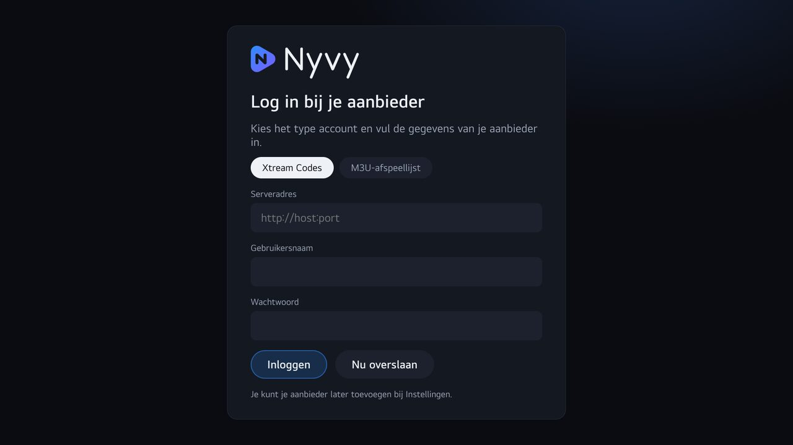

Nyvy bevat zelf geen zenders. Je hebt een abonnement bij een IPTV-aanbieder nodig en de gegevens die je van hen hebt gekregen.

### Inloggen

De eerste keer dat je Nyvy start, kies je het type account:

| Type account | Wat je invult | Wat je krijgt |
|---|---|---|
| **Xtream Codes** | Serveradres, gebruikersnaam en wachtwoord | Live tv, tv-gids, terugkijken, films, series en accountstatus |
| **M3U-afspeellijst** | Het adres van de afspeellijst en zo nodig het adres van de tv-gids | Live tv met groepen, tv-gids, favorieten en zoeken |

> Heb je een "M3U-link" met `get.php?username=…&password=…` gekregen? Dan is het eigenlijk een Xtream-account. Nyvy herkent dat en biedt aan om als Xtream in te loggen, zodat je ook films en series krijgt.

Na het inloggen haalt Nyvy het aanbod (zenders, films en series) en de tv-gids op. De eerste keer kan dat een minuut duren, daarna gaat het snel. Bij het starten van Nyvy worden het aanbod en de gids automatisch bijgewerkt als ze ouder zijn dan 12 uur, en je kunt ze altijd zelf bijwerken via *Instellingen → Account*.

Wil je eerst rondkijken? Kies *Nu overslaan*. Je kunt je aanbieder later toevoegen via *Instellingen → Account → Aanbieder toevoegen*.

## De afstandsbediening {#remote}

| Knop | Functie |
|---|---|
| Pijlen en OK | Bewegen en kiezen |
| Terug | Teruggaan. In het zijmenu: Nyvy afsluiten |
| Rood · Groen · Geel | Sneltoetsen (zie hieronder) |
| CH+ / CH− | Andere zender · bladeren in lijsten |
| Afspelen/pauze | Pauzeren en verdergaan |
| Vooruit-/terugspoelen | 60 seconden springen |
| Info | Infobalk tonen (live tv) |
| Cijfers | Direct naar een zendernummer |

De Magic Remote werkt ook: wijs aan om te markeren, klik om te kiezen en scrol met het wieltje.

**Geen kleurtoetsen op je afstandsbediening?** Veel Magic Remotes hebben ze niet, en je hebt ze niet nodig: alles werkt met knoppen op het scherm. ☆ *Favoriet* staat op de detailpagina van films en series, rechts van de zenderlijst (druk op rechts) en in de infobalk op volledig scherm. *Sortering* staat bovenaan de lijsten, *Audio en ondertiteling* en *Vorige zender* in de infobalk. Wil je toch de sneltoetsen, druk dan op **123** op de afstandsbediening: er verschijnt een paneel met de kleurtoetsen op het scherm. Rood: favoriet · Groen: sorteren, of audio en ondertiteling tijdens het kijken · Geel: vorige zender.

### Wat Terug doet

| Waar je bent | Terug |
|---|---|
| Het zijmenu | Vraagt of je Nyvy wilt afsluiten |
| Een lijst in *Live tv*, *Films* of *Series* | Eerst naar de categorieën, dan naar het zijmenu |
| Zoeken of instellingen | Naar het zijmenu |
| De detailpagina van een film of serie | Terug naar de lijst |
| Een film of aflevering die speelt | Verbergt eerst de voortgangsbalk en knoppen; de volgende druk sluit af. Nyvy onthoudt waar je was |
| Live tv op volledig scherm | Op volgorde: wist een half getypt zendernummer, verlaat de knoppenrij, verbergt de infobalk, verlaat volledig scherm |
| De zenderlijst of *Audio en ondertiteling* is open | Sluit die |
| Een dialoogvenster, zoals de pincode | Sluit het zonder iets te veranderen |

## Live tv {#live-tv}

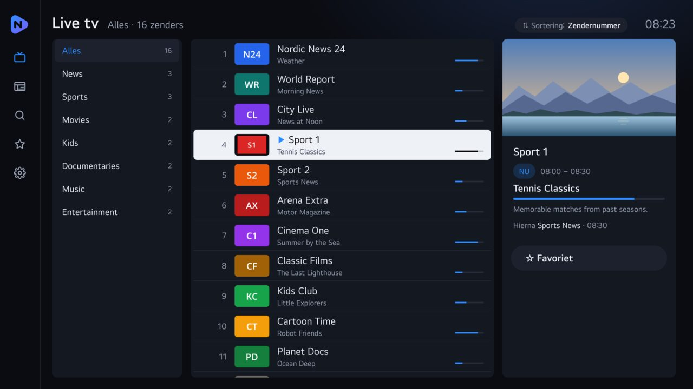
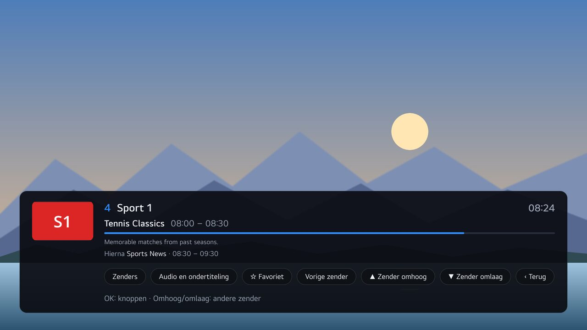

- **Zender kiezen:** links staan de categorieën, in het midden de zenders met het huidige programma. OK speelt de zender af in het voorbeeldvenster, nog een keer OK geeft volledig scherm.
- **Op volledig scherm:**
  - Omhoog/omlaag of CH+/CH− kiezen een andere zender.
  - OK kiest de knoppen van de infobalk: *Zenders*, *Audio en ondertiteling*, ☆ *Favoriet*, *Vorige zender*, zender omhoog/omlaag en *Terug*. Links/rechts gaan ertussen, OK kiest.
  - Links/rechts of Info tonen de infobalk met nu en hierna.
  - Cijfers gaan naar een zendernummer.
  - Terug verbergt eerst de infobalk; druk nogmaals op Terug om het volledige scherm te verlaten.

### Meer over live tv

- **Voorbeeld:** OK op een zender in de lijst speelt die af in het vak rechts; nog eens OK geeft volledig scherm. Terug vanuit volledig scherm brengt je naar de lijst, en het voorbeeld speelt door.
- **Van zender wisselen op volledig scherm:** druk op OK en kies *Zenders*; de zenderlijst opent over het beeld.
- **Zendernummers:** typ de cijfers op de afstandsbediening. Nyvy wisselt na een ogenblik.
- **Vorige zender:** de knop in de infobalk brengt je terug naar de zender waar je eerder naar keek.
- **Markeringen:** ↺ betekent dat de zender terugkijken heeft. Het streepje onder het programma toont hoe ver het is. In het vak rechts toont *Terugkijken · 2 dagen* hoe ver het archief teruggaat.
- **Sorteren op kwaliteit:** Nyvy leest HD en 4K uit de zendernamen, zodat de beste zenders eerst komen.

## Tv-gids en terugkijken {#tv-guide}

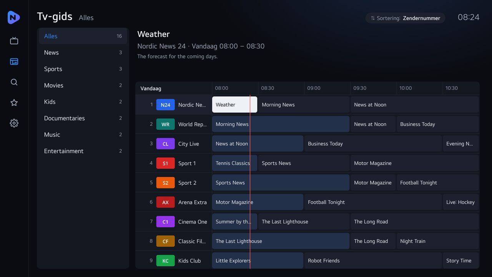

- **De tv-gids** toont de programma's van alle zenders in een raster met een lijn voor "nu". OK op een lopend programma start de zender.
- **Terugkijken:** zenders met ↺ hebben een archief bij de aanbieder. Daar kun je terugbladeren in de gids, een programma starten dat al is uitgezonden en erin spoelen.

### Bewegen in de gids

- Omhoog/omlaag wisselt van zender, en CH+/CH− bladert een pagina tegelijk.
- Links/rechts gaat door de tijd, één programma tegelijk. Vooruit gaat de gids drie dagen. Terug kan alleen bij zenders met terugkijken, zo ver als het archief gaat.
- OK op een programma dat nu loopt, start de zender op volledig scherm. Bij een programma dat nog komt, toont Nyvy wanneer het begint, bijvoorbeeld *Begint om 21:00*.

### Een programma terugkijken

1. Open *Tv-gids* en kies een zender met ↺.
2. Druk op links tot je bij het programma bent. Programma’s die je kunt terugkijken, zijn gemarkeerd met ↺, en de info zegt *Terugkijken: OK om vanaf het begin te kijken*.
3. Druk op OK. Het programma begint vanaf het begin.
4. Spoel met links/rechts, pauzeer met OK en sluit af met Terug, net als bij een film.

## Films en series {#films-series}

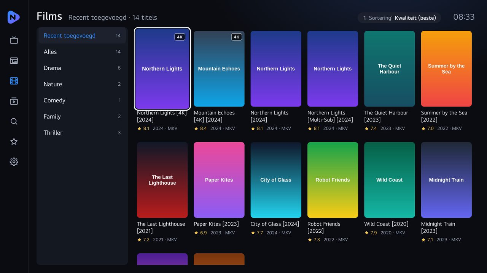
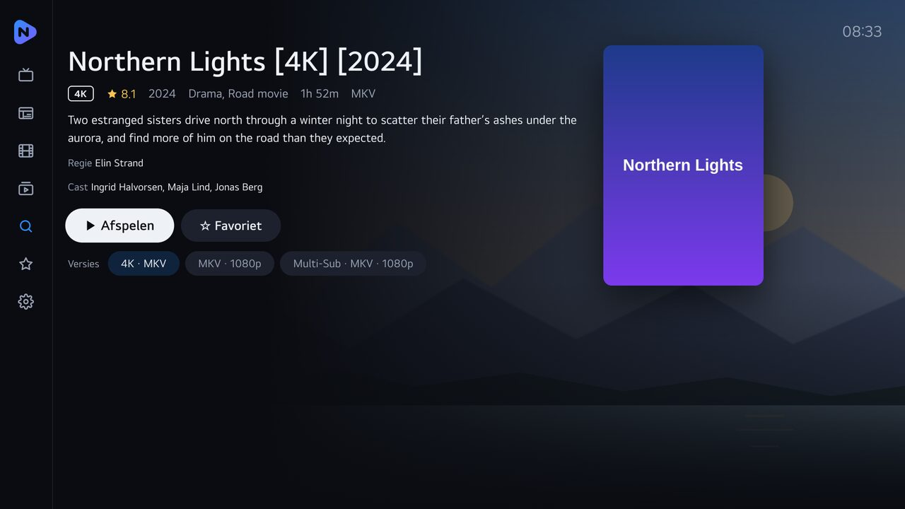
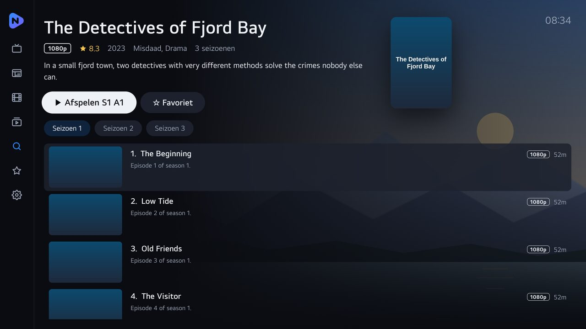

Films en series zijn beschikbaar voor Xtream-accounts.

- **De detailpagina** toont de inhoud, de cast, de kwaliteit (bijvoorbeeld 4K of Dolby Vision) en de knoppen *Afspelen*, *Verder* en *Favoriet*. Bestaat een film in meerdere versies, dan staan die als keuze onder de knoppen.
- **Series:** kies seizoen en aflevering. Als een aflevering afloopt, start de volgende na een aftelling.
- **Tijdens het kijken:**
  - OK pauzeert.
  - Links/rechts springen 10 seconden (ingedrukt houden voor grotere sprongen). Een voorbeeldbeeld laat zien waar je uitkomt, en OK springt erheen.
  - Omhoog toont de knoppen op het scherm.
  - Terug verbergt eerst de tijdbalk en de knoppen; druk nogmaals op Terug om te stoppen. Nyvy onthoudt waar je was.

### Versies

Aanbieders hebben dezelfde film vaak in meerdere versies, bijvoorbeeld 4K, 1080p of met andere talen en ondertitels. Nyvy groepeert ze: de detailpagina toont ze onder *Versies*, en tijdens het afspelen wissel je onder *Audio en ondertiteling* → *Versie*.

### Verder kijken en recent toegevoegd

Bovenaan *Films* en *Series* staan je favorieten, *Verder kijken* (wat je bent begonnen) en *Recent toegevoegd* (wat de aanbieder als laatste toevoegde). Op de detailpagina van iets wat je bent begonnen, staat bijvoorbeeld *Verder vanaf 42:10*, met *Vanaf het begin* ernaast.

### 4K, HDR en Dolby Vision

- **Markeringen:** 4K, 1080p, 720p of SD, soms met HDR of DV (Dolby Vision). Nyvy toont alleen wat het zeker weet, uit de titel of van het afspelen, dus niet elke film heeft een markering.
- **Dolby Vision** speelt als Dolby Vision als de tv het ondersteunt. Sommige bestanden (Blu-ray-kopieën met twee beeldlagen) en tv’s zonder Dolby Vision tonen de film in HDR10, met dezelfde resolutie.

## Audio en ondertiteling {#audio-subtitles}

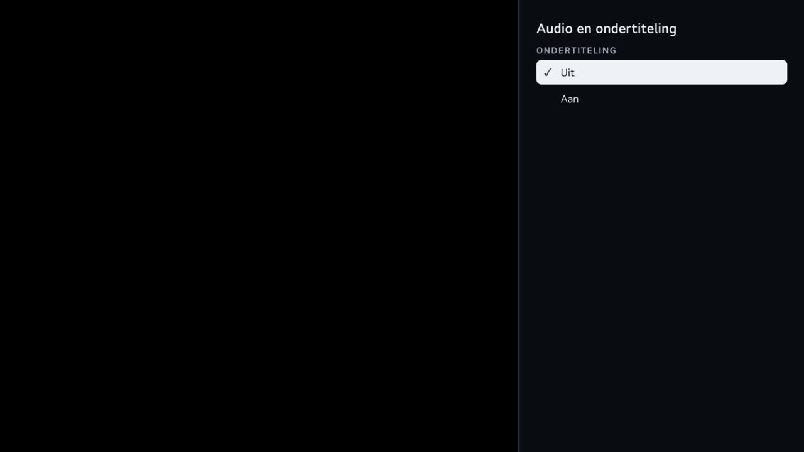

- **Films en series:** druk op omlaag of Groen om audiospoor, ondertiteling en versie te kiezen.
- **Live tv:** kies *Audio en ondertiteling* in de infobalk (of druk op Groen) om de ondertiteling van de uitzending aan of uit te zetten en het audiospoor te kiezen.
- **Standaardinstellingen:** onder *Instellingen → Algemeen* kies je de voorkeurstaal voor audio, of ondertiteling aan staat, de ondertiteltalen (1e en 2e keuze) en de grootte en stijl van de tekst.

### Tekst- en beeldondertitels

- **Tekstondertitels** (bijvoorbeeld SRT en ASS) tekent Nyvy zelf, in de grootte en stijl die je kiest.
- **Beeldondertitels** (PGS, van Blu-ray) zijn kant-en-klare afbeeldingen en worden getoond zoals ze zijn. Grootte en stijl hebben er geen invloed op.
- **Ondertitels van de uitzending** bij live tv (DVB en teletekst) tekent de tv. In Nyvy zet je ze alleen aan of uit.

### Sporen die niet kunnen worden afgespeeld

Een spoor dat de tv niet kan afspelen, is grijs met de tekst *niet af te spelen op dit apparaat*. Het vaakst zijn dat DTS en Dolby TrueHD. Heeft een film alleen zulk geluid, dan meldt Nyvy dat bij het starten, en speelt de film zonder geluid: kies een andere versie als die er is. *Instellingen* → *Over* toont welke formaten je tv kan afspelen.

### Grootte en stijl van ondertitels

Onder *Instellingen* → *Algemeen* kies je *Grootte ondertiteling* (Klein, Gemiddeld, Groot of Extra groot) en *Stijl ondertiteling* (Omlijning of Achtergrondvak). Een voorbeeld laat zien hoe het eruitziet.

*Helderheid van ondertitels* maakt ondertitels minder wit als ze te fel aanvoelen, in stappen tot 70%. Dat geldt voor tekst- en beeldondertitels, maar niet voor ondertitels van de uitzending bij live tv, die de tv tekent.

## Zoeken, favorieten en sorteren {#search}

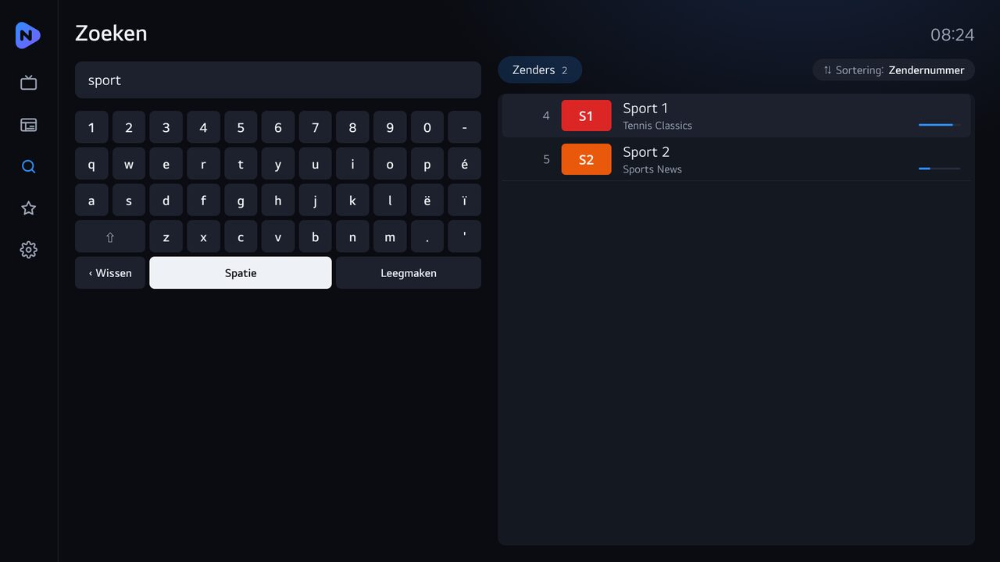

- **Zoeken:** typ met het schermtoetsenbord of met de cijfers van de afstandsbediening. Zoeken vindt zenders, films en series en negeert accenten (*malmo* vindt *Malmö*).
- **Favorieten:** kies ☆ *Favoriet* op de detailpagina van een film of serie, rechts van de zenderlijst of in de infobalk op volledig scherm (Rood is een sneltoets). Favorieten staan bovenaan in elke lijst en onder *Favorieten* in het menu.
- **Sorteren:** de knop *Sortering* bovenaan de lijsten (of Groen). Zenders kun je sorteren op nummer, kwaliteit of naam, films en series bijvoorbeeld op recent toegevoegd, jaar, beoordeling of kwaliteit. Series kun je ook sorteren op de lengte van de afleveringen.

### Favorieten toevoegen en terugvinden

- **Een zender:** selecteer hem in de lijst in *Live tv*, druk op rechts en kies ☆ *Favoriet*. Op volledig scherm zit dezelfde knop in de infobalk (druk op OK).
- **Een film of serie:** kies ☆ *Favoriet* op de detailpagina.
- **Terugvinden:** onder *Favorieten* in het menu, verdeeld in zenders, films en series, en bovenaan elke lijst.
- **Verwijderen:** kies ★ *Verwijder favoriet* op dezelfde plek.

## Instellingen {#settings}

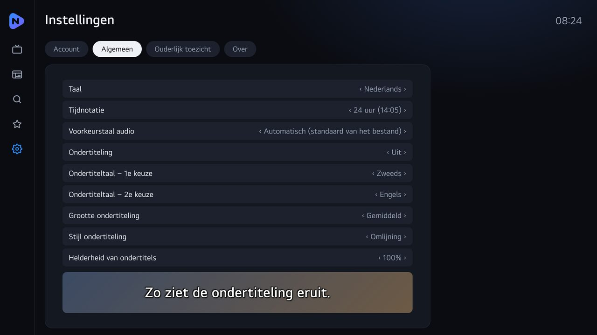
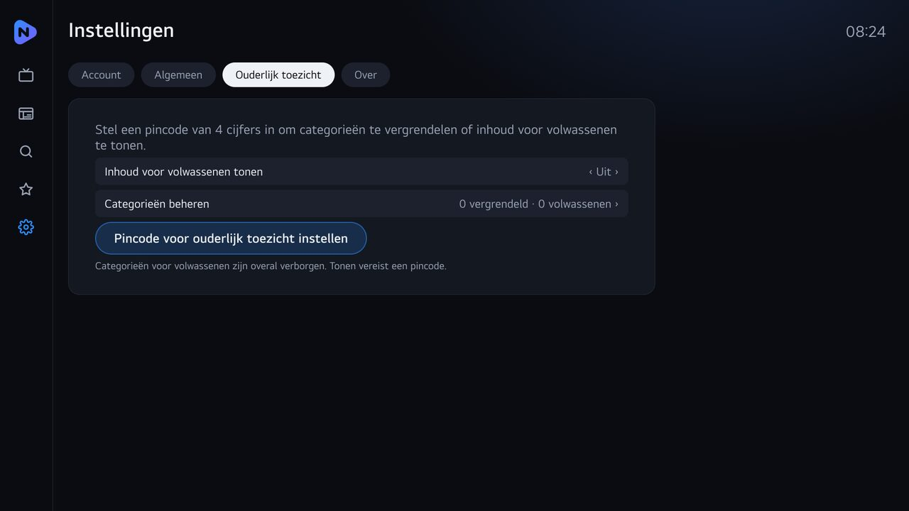
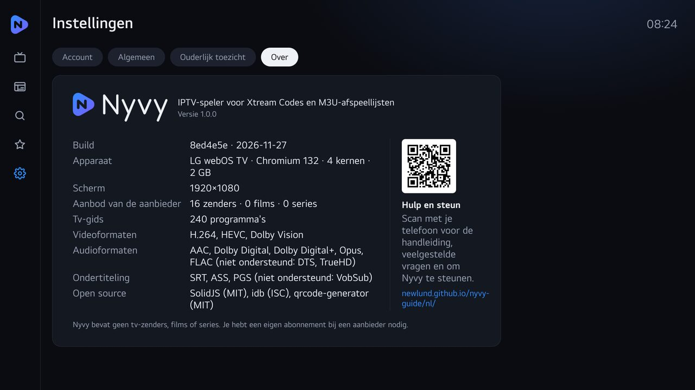

- **Account:**
  - Toont je gegevens, wanneer het aanbod is bijgewerkt en de knop *Aanbod bijwerken*.
  - **Gegevens wijzigen:** nieuw serveradres, nieuw wachtwoord of nieuwe afspeellijst. Favorieten en hervatpunten blijven bewaard zolang het hetzelfde account is.
  - **Uitloggen** verwijdert het account en de gegevens ervan van de tv.
- **Algemeen:** taal, tijdnotatie, audio en ondertiteling.
- **Ouderlijk toezicht:**
  - Inhoud voor volwassenen is vanaf het begin verborgen.
  - Met een pincode van vier cijfers kun je die tonen en afzonderlijke categorieën vergrendelen of verbergen.
  - Vergrendelde categorieën vragen om de pincode.
- **Over:** versie, welke formaten je tv kan afspelen en de link naar deze pagina.

### Ouderlijk toezicht instellen

1. Ga naar *Instellingen* → *Ouderlijk toezicht* en kies *Pincode voor ouderlijk toezicht instellen*. Voer vier cijfers in en daarna dezelfde cijfers nog een keer.
2. *Inhoud voor volwassenen tonen*: inhoud voor volwassenen is vanaf het begin verborgen, en tonen vraagt de pincode. Categorieën die op inhoud voor volwassenen lijken, bijvoorbeeld met XXX of 18+ in de naam, worden automatisch gemarkeerd.
3. *Categorieën beheren*: OK op een categorie wisselt tussen *🔒 Vergrendeld* (vraagt de pincode), *🔞 Volwassenen* (verborgen zolang inhoud voor volwassenen verborgen is) en uit.
4. Een vergrendelde categorie open je met OK en de pincode. Ze blijft daarna ontgrendeld tot je Nyvy sluit.
5. *Pincode wijzigen* en *Pincode verwijderen* staan op dezelfde pagina.

### Als je de pincode vergeet

De pincode kan in Nyvy niet worden hersteld, met opzet, want anders kon een kind eromheen. Ook *Uitloggen* vraagt de pincode. Wat overblijft, is Nyvy van de tv verwijderen en opnieuw installeren. Dan meld je je opnieuw aan, en favorieten, waar je was gebleven en instellingen zijn weg.

### Privacy

Alles wat Nyvy bewaart, blijft op je tv: je accountgegevens (versleuteld), het aanbod, de tv-gids, favorieten, waar je was gebleven en instellingen. Er wordt niets naar Nyvy gestuurd. *Uitloggen* verwijdert alles. Meer op de pagina [Privacy](privacy.html).

## Veelgestelde vragen {#faq}

### "Deze zender zendt nu niet uit"
De stream van de aanbieder ligt eruit of de zender zendt alleen bij bepaalde evenementen uit. Probeer het later opnieuw of kies een andere zender. OK probeert het opnieuw.

### "De aanbieder staat nu geen extra verbindingen toe"
Veel abonnementen staan maar één stream tegelijk toe. Sluit de app op andere apparaten die hetzelfde account gebruiken, wacht even en probeer het opnieuw.

### "De aanbieder reageert niet"
Controleer de internetverbinding van de tv. Werkt die, dan ligt het probleem waarschijnlijk bij de aanbieder.

### Een film heeft geen geluid
De film heeft waarschijnlijk alleen geluid in DTS of Dolby TrueHD, dat LG-tv's niet in apps kunnen afspelen. Kies een ander audiospoor of een andere versie van de film als die er is.

### De tv-gids is leeg (M3U)
Niet elke afspeellijst noemt een tv-gids. Vraag je aanbieder om het adres van een XMLTV-gids en vul het in via *Instellingen → Account → Gegevens wijzigen*.

### Ik zie geen films en series (M3U)
Afspeellijsten geven in Nyvy alleen live tv. Heb je een Xtream-account, log daar dan mee in om films en series te krijgen.

### Hoe sluit ik Nyvy af?
Druk op Terug tot het zijmenu gemarkeerd is, druk nog een keer op Terug en kies *Afsluiten*.

### ‘Opnieuw proberen… (2/3)’
Het starten bleef hangen, en Nyvy probeert het zelf tot drie keer opnieuw. Meestal is het een tijdelijk probleem bij de aanbieder. Lukt ook de derde poging niet, dan toont Nyvy wat er mis is.

### ‘Deze titel is niet beschikbaar bij de aanbieder’
De aanbieder toont de titel, maar heeft het bestand niet meer. Dat kan in Nyvy niet worden opgelost. Kies een andere versie als die er is.

### Het beeld hapert of blijft laden
Controleer het netwerk. 4K heeft ongeveer 25 Mbit/s stabiel nodig, en een bekabelde verbinding is betrouwbaarder dan wifi. Hapert maar één zender of film, dan ligt het probleem meestal bij de aanbieder.

### Ondertitels verschijnen niet
Controleer of onder *Audio en ondertiteling* het juiste spoor gekozen is. Sommige sporen hebben alleen tekst voor zinnen in andere talen, en in stille scènes verschijnt niets. Ondertitels van de uitzending bij live tv zijn er alleen als de zender ze uitzendt.

### De tijden in de tv-gids kloppen niet
Controleer de tijd en tijdzone in de instellingen van de tv zelf. Kloppen die, dan zijn de gidsgegevens van de aanbieder niet juist.

### Een zender heeft geen programma-informatie (M3U)
Nyvy koppelt zenders aan de tv-gids via tvg-id, anders via de zendernaam. Heeft een zender geen van beide, of wijkt de naam af, dan lukt het koppelen niet. De aanbieder kan dat in de afspeellijst verbeteren.

### Het aanbod lijkt verouderd
Nyvy werkt het aanbod en de tv-gids bij als je de app start en ze ouder zijn dan 12 uur. Meteen bijwerken: *Instellingen* → *Account* → *Aanbod bijwerken*.

## Woordenlijst

- **Xtream Codes:** een veelgebruikte manier waarop iptv-aanbieders zenders, films en series leveren, met een serveradres, een gebruikersnaam en een wachtwoord.
- **M3U:** een afspeellijst: een lange lijst met zenders en hun adressen. Geeft live tv, maar geen films en series in Nyvy.
- **EPG / XMLTV:** tv-gidsgegevens: wat er wanneer op tv is. XMLTV is het bestandsformaat.
- **Terugkijken (catch-up):** programma’s bekijken die al zijn uitgezonden, uit het archief van de aanbieder (gemarkeerd met ↺).
- **4K:** een beeld van 3840×2160 punten, vier keer zoveel als Full HD (1080p).
- **HDR:** een groter contrast- en kleurbereik dan een gewoon beeld. HDR10 is de meest voorkomende variant.
- **Dolby Vision:** een HDR-variant waarbij het beeld per scène wordt aangepast.
- **Dolby Digital / Dolby Digital Plus:** gangbare surroundgeluidsformaten die de tv kan afspelen.
- **DTS / Dolby TrueHD:** geluidsformaten uit de bioscoop en van Blu-ray die tv’s van LG niet in apps kunnen afspelen.
