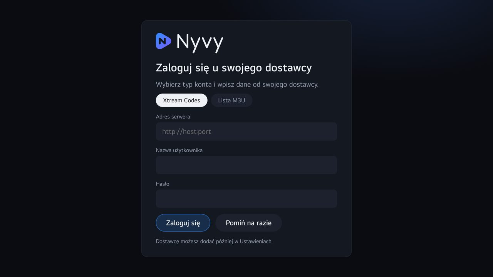
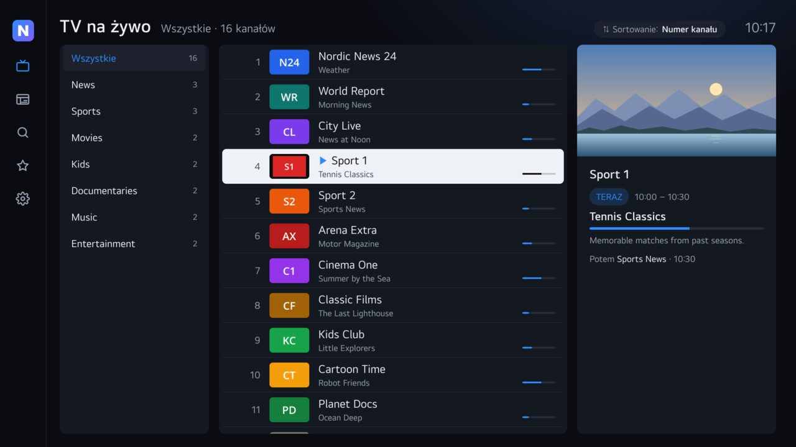
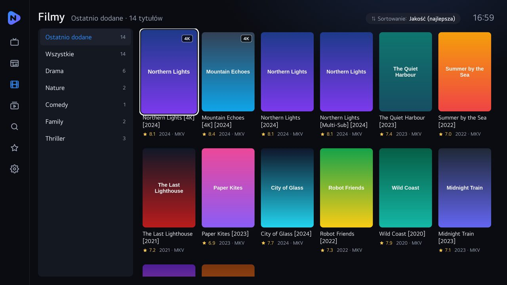
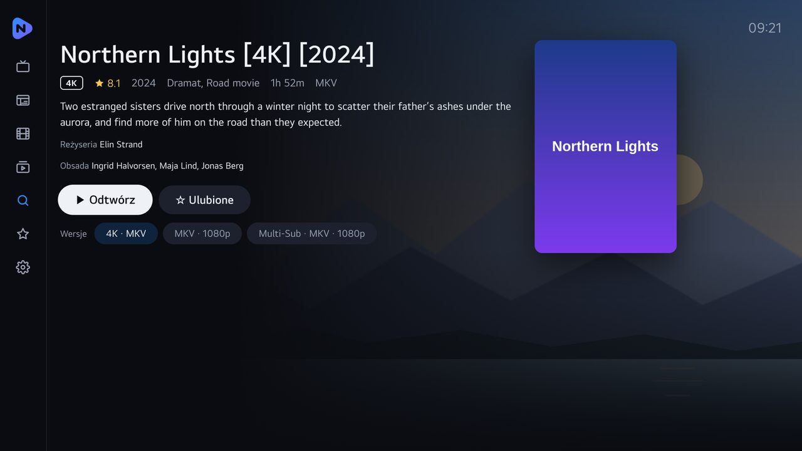
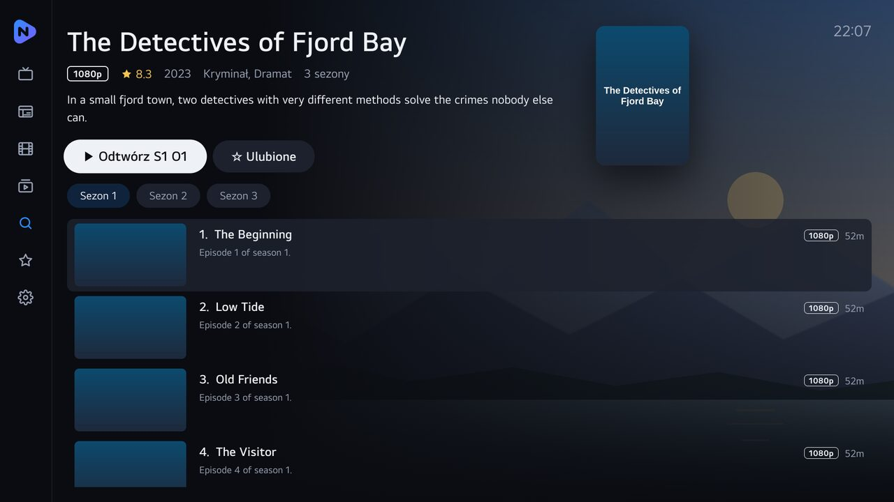
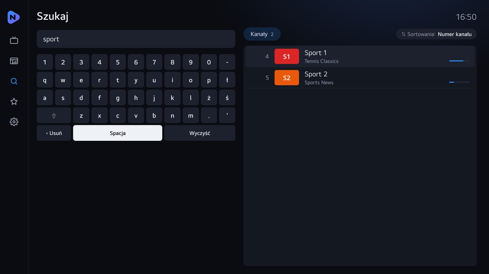
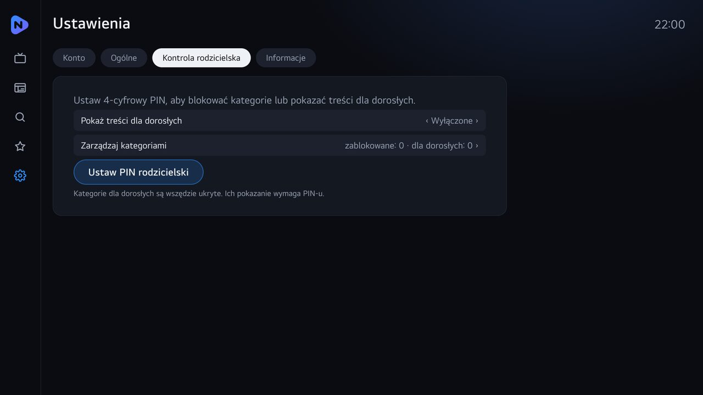
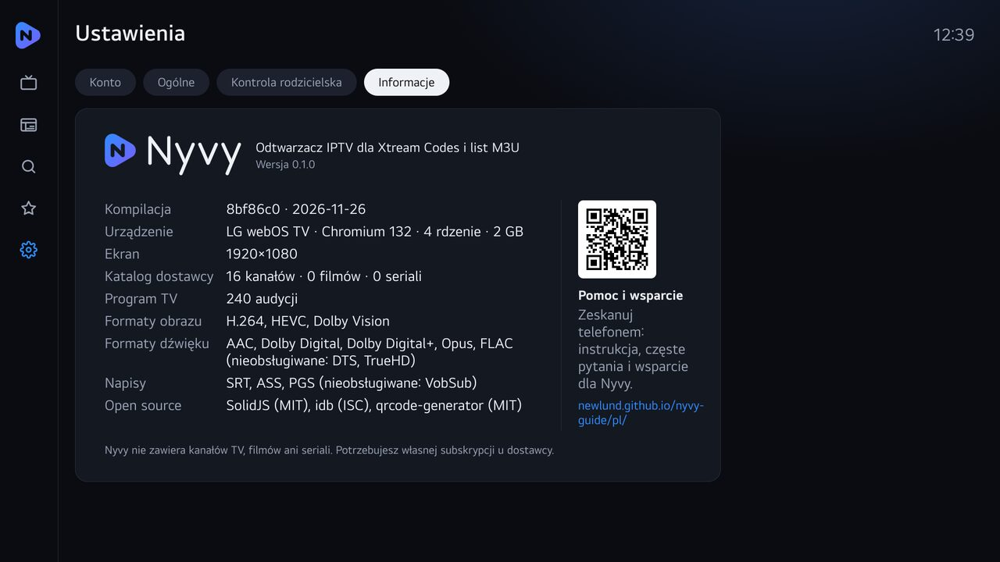

# Instrukcja

Wszystko, czego potrzebujesz, aby zacząć korzystać z Nyvy i wycisnąć z aplikacji jak najwięcej.

**Spis treści:** [Pierwsze kroki](#getting-started) · [Pilot](#remote) · [TV na żywo](#live-tv) · [Program TV i catch-up](#tv-guide) · [Filmy i seriale](#films-series) · [Dźwięk i napisy](#audio-subtitles) · [Wyszukiwanie, ulubione i sortowanie](#search) · [Ustawienia](#settings) · [Częste pytania](#faq)

## Pierwsze kroki {#getting-started}

Nyvy nie zawiera własnych kanałów. Potrzebujesz subskrypcji u dostawcy IPTV i danych, które od niego otrzymałeś.

### Logowanie

Przy pierwszym uruchomieniu Nyvy wybierz typ konta:

| Typ konta | Co wpisujesz | Co otrzymujesz |
|---|---|---|
| **Xtream Codes** | Adres serwera, nazwę użytkownika i hasło | TV na żywo, program TV, catch-up, filmy, seriale i stan konta |
| **Lista M3U** | Adres listy i w razie potrzeby adres programu TV | TV na żywo z grupami, program TV, ulubione i wyszukiwanie |

> Masz „link M3U” z `get.php?username=…&password=…`? To w rzeczywistości konto Xtream. Nyvy to rozpozna i zaproponuje logowanie jako Xtream, dzięki czemu dostaniesz też filmy i seriale.

Po zalogowaniu Nyvy pobiera katalog (kanały, filmy i seriale) oraz program TV. Za pierwszym razem może to potrwać minutę, później idzie szybko. Przy uruchomieniu Nyvy katalog i program aktualizują się automatycznie, jeśli są starsze niż 12 godzin, a w każdej chwili możesz je odświeżyć w *Ustawienia → Konto*.

Chcesz najpierw się rozejrzeć? Wybierz *Pomiń na razie*. Dostawcę możesz dodać później w *Ustawienia → Konto → Dodaj dostawcę*.

## Pilot {#remote}

| Przycisk | Działanie |
|---|---|
| Strzałki i OK | Poruszanie się i wybór |
| Wstecz | Powrót. W menu bocznym: zamknięcie Nyvy |
| Czerwony · Zielony · Żółty | Skróty (zobacz niżej) |
| CH+ / CH− | Zmiana kanału · przewijanie list |
| Odtwórz/Pauza | Pauza i wznowienie |
| Przewijanie | Skok o 60 sekund |
| Info | Pasek informacji (TV na żywo) |
| Cyfry | Przejście prosto do numeru kanału |

Działa też Magic Remote: wskaż, aby zaznaczyć, kliknij, aby wybrać, i przewijaj kółkiem.

**Pilot nie ma kolorowych przycisków?** Wiele pilotów Magic Remote ich nie ma i nie są potrzebne: wszystko działa za pomocą przycisków na ekranie. ☆ *Ulubione* jest na stronie szczegółów filmów i seriali, na prawo od listy kanałów (naciśnij w prawo) oraz na pasku informacji na pełnym ekranie. *Sortowanie* jest na górze list, a *Dźwięk i napisy* oraz *Poprzedni kanał* na pasku informacji. Jeśli mimo to chcesz skrótów, naciśnij **123** na pilocie: na ekranie pojawi się panel z kolorowymi przyciskami. Czerwony: ulubione · Zielony: sortowanie albo dźwięk i napisy podczas oglądania · Żółty: poprzedni kanał.

### Co robi Wstecz

| Gdzie jesteś | Wstecz |
|---|---|
| Menu boczne | Pyta, czy zamknąć Nyvy |
| Lista w *TV na żywo*, *Filmy* lub *Seriale* | Najpierw do kategorii, potem do menu bocznego |
| Wyszukiwanie lub ustawienia | Do menu bocznego |
| Strona szczegółów filmu lub serialu | Powrót do listy |
| Odtwarzany film lub odcinek | Najpierw ukrywa pasek przewijania i przyciski; kolejne naciśnięcie kończy. Nyvy pamięta, gdzie skończyłeś |
| TV na żywo na pełnym ekranie | Po kolei: czyści wpisywany numer kanału, opuszcza rząd przycisków, ukrywa pasek informacji, opuszcza pełny ekran |
| Otwarta lista kanałów lub *Dźwięk i napisy* | Zamyka ją |
| Okno dialogowe, np. PIN | Zamyka je bez zmian |

## TV na żywo {#live-tv}

- **Wybór kanału:** po lewej są kategorie, w środku kanały z bieżącym programem. OK odtwarza kanał w podglądzie, ponowne OK włącza pełny ekran.
- **Na pełnym ekranie:**
  - Góra/dół lub CH+/CH− zmieniają kanał.
  - OK wybiera przyciski paska informacji: *Kanały*, *Dźwięk i napisy*, ☆ *Ulubione*, *Poprzedni kanał*, kanał w górę/w dół i *Wstecz*. Lewo/prawo przechodzi między nimi, OK wybiera.
  - Lewo/prawo lub Info pokazują pasek informacji (teraz i potem).
  - Cyfry przechodzą do numeru kanału.
  - Wstecz najpierw ukrywa pasek informacji; naciśnij Wstecz ponownie, aby wyjść z pełnego ekranu.

### Więcej o TV na żywo

- **Podgląd:** OK na kanale z listy odtwarza go w okienku po prawej; ponowne OK włącza pełny ekran. Wstecz z pełnego ekranu wraca do listy, a podgląd gra dalej.
- **Zmiana kanału na pełnym ekranie:** naciśnij OK i wybierz *Kanały* – lista kanałów otworzy się na obrazie.
- **Numery kanałów:** wpisz cyfry pilotem. Nyvy przełączy po chwili.
- **Poprzedni kanał:** przycisk na pasku informacji wraca do kanału, który oglądałeś wcześniej.
- **Oznaczenia:** ↺ oznacza, że kanał ma catch-up. Kreska pod programem pokazuje, ile już minęło. W okienku po prawej *Catch-up · 2 dni* pokazuje, jak daleko wstecz sięga archiwum.
- **Sortowanie według jakości:** Nyvy odczytuje HD i 4K z nazw kanałów, więc najlepsze kanały są na początku.

## Program TV i catch-up {#tv-guide}

- **Program TV** pokazuje audycje wszystkich kanałów w siatce z linią „teraz”. OK na trwającej audycji uruchamia kanał.
- **Catch-up:** kanały oznaczone ↺ mają archiwum u dostawcy. Możesz w nich cofać się w programie, uruchomić audycję, która już była, i przewijać ją.

### Poruszanie się po przewodniku

- Góra/dół zmienia kanał, a CH+/CH− przewija o stronę.
- Lewo/prawo przesuwa w czasie, o jeden program. Do przodu przewodnik sięga trzech dni. Wstecz tylko na kanałach z catch-upem, tak daleko, jak sięga archiwum.
- OK na trwającym programie włącza kanał na pełnym ekranie. Przy programie, który dopiero będzie, Nyvy pokazuje, kiedy się zaczyna, np. *Początek o 21:00*.

### Oglądanie programu, który już był

1. Otwórz *Program TV* i wybierz kanał z ↺.
2. Naciskaj w lewo, aż dojdziesz do programu. Programy, które można obejrzeć później, są oznaczone ↺, a informacja mówi *Catch-up: OK, aby oglądać od początku*.
3. Naciśnij OK. Program zaczyna się od początku.
4. Przewijaj lewo/prawo, pauzuj OK i kończ Wstecz, jak przy filmie.

## Filmy i seriale {#films-series}

Filmy i seriale są dostępne dla kont Xtream.

- **Strona szczegółów** pokazuje opis, obsadę, jakość (na przykład 4K lub Dolby Vision) i przyciski *Odtwórz*, *Wznów* i *Ulubione*. Jeśli film ma kilka wersji, są one wyświetlane do wyboru pod przyciskami.
- **Seriale:** wybierz sezon i odcinek. Po zakończeniu odcinka kolejny startuje po odliczaniu.
- **Podczas oglądania:**
  - OK wstrzymuje.
  - Lewo/prawo przeskakują o 10 sekund (przytrzymaj, aby skakać dalej). Obraz podglądu pokazuje, gdzie trafisz, a OK tam przeskakuje.
  - Góra pokazuje przyciski na ekranie.
  - Wstecz najpierw ukrywa pasek postępu i przyciski; naciśnij Wstecz ponownie, aby zakończyć. Nyvy zapamiętuje miejsce.

### Wersje

Dostawcy często mają ten sam film w kilku wersjach, np. 4K, 1080p albo z innymi językami i napisami. Nyvy je grupuje: strona szczegółów pokazuje je w sekcji *Wersje*, a podczas odtwarzania zmieniasz je w *Dźwięk i napisy* → *Wersja*.

### Kontynuuj oglądanie i ostatnio dodane

Na początku *Filmy* i *Seriale* są twoje ulubione, *Oglądaj dalej* (to, co zacząłeś) i *Ostatnio dodane* (to, co dostawca dodał ostatnio). Na stronie szczegółów czegoś, co zacząłeś, widać np. *Wznów od 42:10*, a obok *Odtwórz od początku*.

### 4K, HDR i Dolby Vision

- **Oznaczenia:** 4K, 1080p, 720p lub SD, czasem z HDR lub DV (Dolby Vision). Nyvy pokazuje tylko to, co wie na pewno, z tytułu lub z odtwarzania, więc nie każdy film ma oznaczenie.
- **Dolby Vision** jest odtwarzane jako Dolby Vision, gdy telewizor to obsługuje. Niektóre pliki (kopie Blu-ray z dwiema warstwami obrazu) i telewizory bez Dolby Vision pokazują film w HDR10, w tej samej rozdzielczości.

## Dźwięk i napisy {#audio-subtitles}

- **Filmy i seriale:** naciśnij dół lub Zielony, aby wybrać ścieżkę dźwiękową, napisy i wersję.
- **TV na żywo:** wybierz *Dźwięk i napisy* na pasku informacji (lub naciśnij Zielony), aby włączyć lub wyłączyć napisy z transmisji i wybrać ścieżkę dźwiękową.
- **Ustawienia domyślne:** w *Ustawienia → Ogólne* wybierasz preferowany język dźwięku, czy napisy mają być włączone, języki napisów (1. i 2. wybór) oraz rozmiar i styl tekstu.

### Napisy tekstowe i graficzne

- **Napisy tekstowe** (np. SRT i ASS) Nyvy rysuje samo, w wybranym rozmiarze i stylu.
- **Napisy graficzne** (PGS, z Blu-ray) to gotowe obrazy i są pokazywane bez zmian. Rozmiar i styl na nie nie wpływają.
- **Napisy z transmisji** w TV na żywo (DVB i telegazeta) rysuje telewizor. W Nyvy tylko je włączasz lub wyłączasz.

### Ścieżki, których nie da się odtworzyć

Ścieżka, której telewizor nie potrafi odtworzyć, jest wyszarzona z napisem *nie można odtworzyć na tym urządzeniu*. Najczęściej to DTS i Dolby TrueHD. Jeśli film ma tylko taki dźwięk, Nyvy mówi o tym na starcie, a film gra bez dźwięku: wybierz inną wersję, jeśli jest. W *Ustawienia* → *Informacje* zobaczysz, jakie formaty obsługuje twój telewizor.

Jeśli głównego dźwięku filmu nie można odtworzyć, ale inną ścieżkę tak, Nyvy odtwarza tę ścieżkę, a komunikat informuje, którą. Ścieżki z komentarzem są wybierane tylko wtedy, gdy nic innego nie da się odtworzyć; nadal możesz wybrać je sam.

### Rozmiar i styl napisów

W *Ustawienia* → *Ogólne* wybierasz *Rozmiar napisów* (Małe, Średnie, Duże lub Bardzo duże) i *Styl napisów* (Obrys lub Tło). Podgląd pokazuje efekt.

*Jasność napisów* sprawia, że napisy są mniej białe, jeśli wydają się zbyt jasne, stopniowo do 10%. Dotyczy to napisów tekstowych i graficznych, ale nie napisów z transmisji w TV na żywo, które rysuje telewizor.

## Wyszukiwanie, ulubione i sortowanie {#search}

- **Wyszukiwanie:** pisz klawiaturą ekranową lub cyframi pilota. Wyszukiwanie znajduje kanały, filmy i seriale i ignoruje znaki diakrytyczne (*malmo* znajduje *Malmö*, *lodz* znajduje *Łódź*).
- **Ulubione:** wybierz ☆ *Ulubione* na stronie szczegółów filmu lub serialu, na prawo od listy kanałów albo na pasku informacji na pełnym ekranie (Czerwony to skrót). Ulubione są na początku każdej listy i w *Ulubione* w menu.
- **Sortowanie:** przycisk *Sortowanie* u góry list (lub Zielony). Kanały można sortować według numeru, jakości lub nazwy, a filmy i seriale na przykład według ostatnio dodanych, roku, oceny lub jakości. Seriale można też sortować według długości odcinków.

### Dodawanie i znajdowanie ulubionych

- **Kanał:** zaznacz go na liście w *TV na żywo*, naciśnij w prawo i wybierz ☆ *Ulubione*. Na pełnym ekranie ten sam przycisk jest na pasku informacji (naciśnij OK).
- **Film lub serial:** wybierz ☆ *Ulubione* na stronie szczegółów.
- **Znajdowanie:** w *Ulubione* w menu, z podziałem na kanały, filmy i seriale, oraz na początku każdej listy.
- **Usuwanie:** wybierz ★ *Usuń z ulubionych* w tym samym miejscu.

## Ustawienia {#settings}

- **Konto:**
  - Pokazuje twoje dane, datę aktualizacji katalogu i przycisk *Odśwież katalog*.
  - **Edytuj dane:** nowy adres serwera, nowe hasło lub nowa lista. Ulubione i miejsca wznowienia zostają, dopóki to jest to samo konto.
  - **Wyloguj się** usuwa konto i jego dane z telewizora.
- **Ogólne:** język, format czasu, dźwięk i napisy.
- **Kontrola rodzicielska:**
  - Treści dla dorosłych są od początku ukryte.
  - Za pomocą 4-cyfrowego PIN-u możesz je pokazać oraz blokować lub ukrywać poszczególne kategorie.
  - Zablokowane kategorie wymagają PIN-u.
- **Informacje:** wersja, formaty, które twój telewizor może odtwarzać, i link do tej strony.

### Konfiguracja kontroli rodzicielskiej

1. Przejdź do *Ustawienia* → *Kontrola rodzicielska* i wybierz *Ustaw PIN rodzicielski*. Wpisz cztery cyfry, a potem te same jeszcze raz.
2. *Pokaż treści dla dorosłych*: treści dla dorosłych są od początku ukryte, a ich pokazanie wymaga PIN-u. Kategorie wyglądające na treści dla dorosłych, np. z XXX lub 18+ w nazwie, są oznaczane automatycznie.
3. *Zarządzaj kategoriami*: OK na kategorii przełącza między *🔒 Zablokowana* (wymaga PIN-u), *🔞 Dla dorosłych* (ukryta, gdy treści dla dorosłych są ukryte) i wyłączone.
4. Zablokowaną kategorię otwierasz OK i PIN-em. Pozostaje odblokowana, dopóki nie zamkniesz Nyvy.
5. *Zmień PIN* i *Usuń PIN* są na tej samej stronie.

### Jeśli zapomnisz PIN-u

PIN-u nie da się zresetować w Nyvy, celowo, bo inaczej dziecko mogłoby go obejść. *Wyloguj się* też wymaga PIN-u. Pozostaje usunąć Nyvy z telewizora i zainstalować ponownie. Wtedy logujesz się od nowa, a ulubione, miejsca, w których skończyłeś, i ustawienia znikają.

### Prywatność

Wszystko, co Nyvy zapisuje, zostaje na twoim telewizorze: dane konta (zaszyfrowane), katalog, przewodnik TV, ulubione, miejsca, w których skończyłeś, i ustawienia. Nic nie jest wysyłane do Nyvy. *Wyloguj się* usuwa wszystko. Więcej na stronie [Prywatność](privacy.html).

## Częste pytania {#faq}

### „Ten kanał teraz nie nadaje”
Transmisja dostawcy nie działa albo kanał nadaje tylko podczas określonych wydarzeń. Spróbuj później lub wybierz inny kanał. OK ponawia próbę.

### „Dostawca nie pozwala teraz na więcej połączeń”
Wiele subskrypcji pozwala tylko na jeden strumień naraz. Zamknij aplikację na innych urządzeniach korzystających z tego samego konta, poczekaj chwilę i spróbuj ponownie.

### „Dostawca nie odpowiada”
Sprawdź połączenie internetowe telewizora. Jeśli działa, problem najpewniej leży po stronie dostawcy.

### Film nie ma dźwięku
Film ma najpewniej dźwięk tylko w DTS lub Dolby TrueHD, którego telewizory LG nie odtwarzają w aplikacjach. Wybierz inną ścieżkę dźwiękową lub inną wersję filmu, jeśli jest dostępna.

### Słyszę komentarz zamiast filmu
Głównego dźwięku filmu (często DTS) nie można odtworzyć na telewizorze, więc Nyvy odtwarza jedyną możliwą ścieżkę, czasem komentarz. Komunikat na początku mówi, którą. Wybierz inną wersję filmu, jeśli jest dostępna.

### Program TV jest pusty (M3U)
Nie każda lista wskazuje program TV. Poproś dostawcę o adres programu XMLTV i wpisz go w *Ustawienia → Konto → Edytuj dane*.

### Nie widzę filmów i seriali (M3U)
W Nyvy listy dają tylko TV na żywo. Jeśli masz konto Xtream, zaloguj się nim, aby mieć filmy i seriale.

### Jak zamknąć Nyvy?
Naciskaj Wstecz, aż menu boczne zostanie zaznaczone, naciśnij Wstecz jeszcze raz i wybierz *Zamknij*.

### „Ponowna próba… (2/3)”
Uruchamianie utknęło, a Nyvy samo próbuje ponownie, do trzech razy. Zwykle to chwilowy problem u dostawcy. Jeśli i trzecia próba się nie uda, Nyvy pokaże, co jest nie tak.

### „Ten tytuł nie jest dostępny u dostawcy”
Dostawca pokazuje tytuł, ale nie ma już pliku. Nie da się tego naprawić w Nyvy. Wybierz inną wersję, jeśli jest.

### Obraz się zacina lub ciągle wczytuje
Sprawdź sieć. 4K potrzebuje około 25 Mbit/s stabilnie, a połączenie kablowe jest pewniejsze niż Wi-Fi. Jeśli zacina się tylko jeden kanał lub film, problem zwykle leży po stronie dostawcy.

### Napisy się nie pojawiają
Sprawdź, czy w *Dźwięk i napisy* wybrana jest właściwa ścieżka. Niektóre ścieżki mają tekst tylko dla kwestii w innych językach, a w cichych scenach nic się nie pojawia. Napisy z transmisji w TV na żywo są tylko wtedy, gdy kanał je nadaje.

### Godziny w przewodniku TV się nie zgadzają
Sprawdź godzinę i strefę czasową w ustawieniach samego telewizora. Jeśli są poprawne, błędne są dane przewodnika od dostawcy.

### Kanał nie ma informacji o programie (M3U)
Nyvy dopasowuje kanały do przewodnika TV po tvg-id, a w razie braku po nazwie kanału. Jeśli kanał nie ma żadnego z nich albo nazwa się różni, dopasowanie się nie uda. Dostawca może to poprawić w liście.

### Katalog wygląda na nieaktualny
Nyvy aktualizuje katalog i przewodnik TV przy uruchomieniu aplikacji, jeśli mają ponad 12 godzin. Aby zaktualizować od razu: *Ustawienia* → *Konto* → *Odśwież katalog*.

### Nie znalazłeś odpowiedzi?
Zgłoś problem lub zaproponuj ulepszenie na [GitHubie](https://github.com/newlund/nyvy-guide/issues) (potrzebujesz bezpłatnego konta GitHub). Podaj, jaką masz wersję (*Ustawienia* → *Informacje*), i co się stało. Strona jest publiczna: nie podawaj adresu dostawcy ani danych logowania.

## Słowniczek

- **Xtream Codes:** popularny sposób, w jaki dostawcy IPTV udostępniają kanały, filmy i seriale, z adresem serwera, nazwą użytkownika i hasłem.
- **M3U:** lista odtwarzania: długa lista kanałów i ich adresów. Daje TV na żywo, ale w Nyvy nie daje filmów ani seriali.
- **EPG / XMLTV:** dane przewodnika TV, czyli co i kiedy leci. XMLTV to format pliku.
- **Catch-up:** oglądanie programów, które już były, z archiwum dostawcy (oznaczone ↺).
- **4K:** obraz 3840×2160 punktów, cztery razy więcej niż Full HD (1080p).
- **HDR:** szerszy zakres kontrastu i kolorów niż zwykły obraz. HDR10 to najczęstsza odmiana.
- **Dolby Vision:** odmiana HDR, w której obraz jest dostosowywany scena po scenie.
- **Dolby Digital / Dolby Digital Plus:** popularne formaty dźwięku przestrzennego, które telewizor odtwarza.
- **DTS / Dolby TrueHD:** formaty dźwięku z kina i Blu-ray, których telewizory LG nie odtwarzają w aplikacjach.
