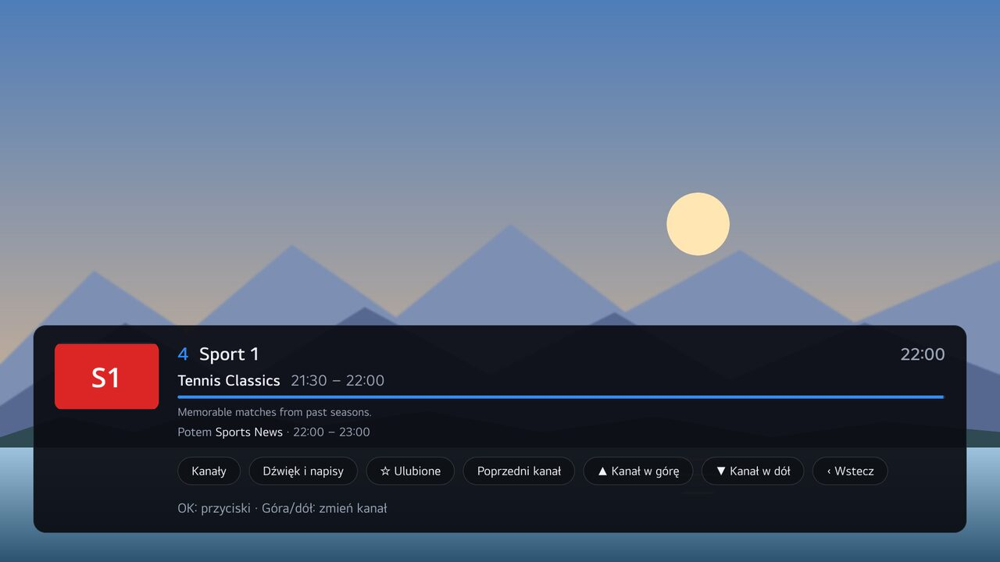
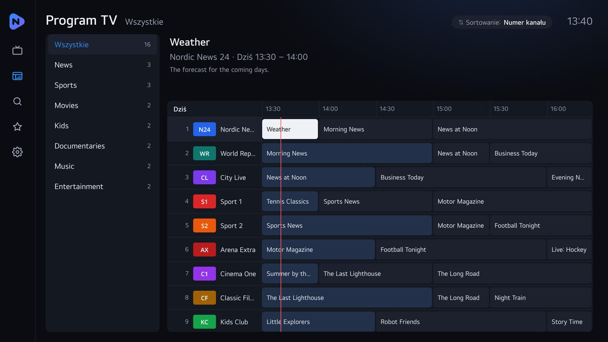
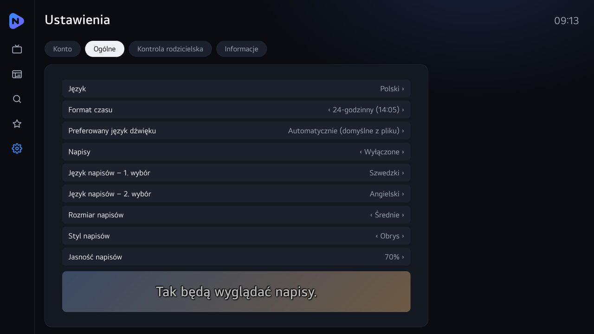

# Instrukcja

Wszystko, czego potrzebujesz, aby zacząć korzystać z Nyvy i wycisnąć z aplikacji jak najwięcej.

**Spis treści:** [Pierwsze kroki](#getting-started) · [Pilot](#remote) · [TV na żywo](#live-tv) · [Program TV i catch-up](#tv-guide) · [Filmy i seriale](#films-series) · [Dźwięk i napisy](#audio-subtitles) · [Wyszukiwanie, ulubione i sortowanie](#search) · [Ustawienia](#settings) · [Częste pytania](#faq)

## Pierwsze kroki {#getting-started}

Nyvy nie zawiera własnych kanałów. Potrzebujesz subskrypcji u dostawcy IPTV i danych, które od niego otrzymałeś.

### Logowanie

Przy pierwszym uruchomieniu Nyvy wybierz typ konta:

| Typ konta | Co wpisujesz | Co otrzymujesz |
|---|---|---|
| **Xtream Codes** | Adres serwera, nazwę użytkownika i hasło | TV na żywo, program TV, catch-up, filmy, seriale i stan konta |
| **Lista M3U** | Adres listy i w razie potrzeby adres programu TV | TV na żywo z grupami, program TV, ulubione i wyszukiwanie |

> Masz „link M3U” z `get.php?username=…&password=…`? To w rzeczywistości konto Xtream. Nyvy to rozpozna i zaproponuje logowanie jako Xtream, dzięki czemu dostaniesz też filmy i seriale.

Po zalogowaniu Nyvy pobiera katalog (kanały, filmy i seriale) oraz program TV. Za pierwszym razem może to potrwać minutę, później idzie szybko. Przy uruchomieniu Nyvy katalog i program aktualizują się automatycznie, jeśli są starsze niż 12 godzin, a w każdej chwili możesz je odświeżyć w *Ustawienia → Konto*.

Chcesz najpierw się rozejrzeć? Wybierz *Pomiń na razie*. Dostawcę możesz dodać później w *Ustawienia → Konto → Dodaj dostawcę*.

## Pilot {#remote}

| Przycisk | Działanie |
|---|---|
| Strzałki i OK | Poruszanie się i wybór |
| Wstecz | Powrót. W menu bocznym: zamknięcie Nyvy |
| Czerwony | Dodanie lub usunięcie ulubionego |
| Zielony | Sortowanie (w listach) · dźwięk i napisy (podczas oglądania) |
| Żółty | Poprzedni kanał (TV na żywo na pełnym ekranie) |
| CH+ / CH− | Zmiana kanału · przewijanie list |
| Odtwórz/Pauza | Pauza i wznowienie |
| Przewijanie | Skok o 60 sekund |
| Info | Pasek informacji (TV na żywo) |
| Cyfry | Przejście prosto do numeru kanału |

Działa też Magic Remote: wskaż, aby zaznaczyć, kliknij, aby wybrać, i przewijaj kółkiem.

## TV na żywo {#live-tv}

- **Wybór kanału:** po lewej są kategorie, w środku kanały z bieżącym programem. OK odtwarza kanał w podglądzie, ponowne OK włącza pełny ekran.
- **Na pełnym ekranie:**
  - Góra/dół lub CH+/CH− zmieniają kanał.
  - OK otwiera listę kanałów.
  - Lewo/prawo lub Info pokazują pasek informacji (teraz i potem) oraz przyciski dla Magic Remote.
  - Cyfry przechodzą do numeru kanału, a Żółty wraca do poprzedniego kanału.
  - Wstecz wychodzi z pełnego ekranu.

## Program TV i catch-up {#tv-guide}

- **Program TV** pokazuje audycje wszystkich kanałów w siatce z linią „teraz”. OK na trwającej audycji uruchamia kanał.
- **Catch-up:** kanały oznaczone ↺ mają archiwum u dostawcy. Możesz w nich cofać się w programie, uruchomić audycję, która już była, i przewijać ją.

## Filmy i seriale {#films-series}

Filmy i seriale są dostępne dla kont Xtream.

- **Strona szczegółów** pokazuje opis, obsadę, jakość (na przykład 4K lub Dolby Vision) i przyciski *Odtwórz*, *Wznów* i *Ulubione*. Jeśli film ma kilka wersji, są one wyświetlane do wyboru pod przyciskami.
- **Seriale:** wybierz sezon i odcinek. Po zakończeniu odcinka kolejny startuje po odliczaniu.
- **Podczas oglądania:**
  - OK wstrzymuje.
  - Lewo/prawo przeskakują o 10 sekund (przytrzymaj, aby skakać dalej). Obraz podglądu pokazuje, gdzie trafisz, a OK tam przeskakuje.
  - Góra pokazuje przyciski na ekranie.
  - Wstecz najpierw ukrywa pasek postępu i przyciski; naciśnij Wstecz ponownie, aby zakończyć. Nyvy zapamiętuje miejsce.

## Dźwięk i napisy {#audio-subtitles}

- **Filmy i seriale:** naciśnij dół lub Zielony, aby wybrać ścieżkę dźwiękową, napisy i wersję.
- **TV na żywo:** naciśnij Zielony, aby włączyć lub wyłączyć napisy z transmisji i wybrać ścieżkę dźwiękową.
- **Ustawienia domyślne:** w *Ustawienia → Ogólne* wybierasz preferowany język dźwięku, czy napisy mają być włączone, języki napisów (1. i 2. wybór) oraz rozmiar i styl tekstu.

## Wyszukiwanie, ulubione i sortowanie {#search}

- **Wyszukiwanie:** pisz klawiaturą ekranową lub cyframi pilota. Wyszukiwanie znajduje kanały, filmy i seriale i ignoruje znaki diakrytyczne (*malmo* znajduje *Malmö*, *lodz* znajduje *Łódź*).
- **Ulubione:** naciśnij Czerwony na kanale, filmie lub serialu. Ulubione są na początku każdej listy i w *Ulubione* w menu.
- **Sortowanie:** przycisk *Sortowanie* u góry list (lub Zielony). Kanały można sortować według numeru, jakości lub nazwy, a filmy i seriale na przykład według ostatnio dodanych, roku, oceny lub jakości. Seriale można też sortować według długości odcinków.

## Ustawienia {#settings}

- **Konto:**
  - Pokazuje twoje dane, datę aktualizacji katalogu i przycisk *Odśwież katalog*.
  - **Edytuj dane:** nowy adres serwera, nowe hasło lub nowa lista. Ulubione i miejsca wznowienia zostają, dopóki to jest to samo konto.
  - **Wyloguj się** usuwa konto i jego dane z telewizora.
- **Ogólne:** język, format czasu, dźwięk i napisy.
- **Kontrola rodzicielska:**
  - Treści dla dorosłych są od początku ukryte.
  - Za pomocą 4-cyfrowego PIN-u możesz je pokazać oraz blokować lub ukrywać poszczególne kategorie.
  - Zablokowane kategorie wymagają PIN-u.
- **Informacje:** wersja, formaty, które twój telewizor może odtwarzać, i link do tej strony.

## Częste pytania {#faq}

### „Ten kanał teraz nie nadaje”
Transmisja dostawcy nie działa albo kanał nadaje tylko podczas określonych wydarzeń. Spróbuj później lub wybierz inny kanał. OK ponawia próbę.

### „Dostawca nie pozwala teraz na więcej połączeń”
Wiele subskrypcji pozwala tylko na jeden strumień naraz. Zamknij aplikację na innych urządzeniach korzystających z tego samego konta, poczekaj chwilę i spróbuj ponownie.

### „Dostawca nie odpowiada”
Sprawdź połączenie internetowe telewizora. Jeśli działa, problem najpewniej leży po stronie dostawcy.

### Film nie ma dźwięku
Film ma najpewniej dźwięk tylko w DTS lub Dolby TrueHD, którego telewizory LG nie odtwarzają w aplikacjach. Wybierz inną ścieżkę dźwiękową lub inną wersję filmu, jeśli jest dostępna.

### Program TV jest pusty (M3U)
Nie każda lista wskazuje program TV. Poproś dostawcę o adres programu XMLTV i wpisz go w *Ustawienia → Konto → Edytuj dane*.

### Nie widzę filmów i seriali (M3U)
W Nyvy listy dają tylko TV na żywo. Jeśli masz konto Xtream, zaloguj się nim, aby mieć filmy i seriale.

### Jak zamknąć Nyvy?
Naciskaj Wstecz, aż menu boczne zostanie zaznaczone, naciśnij Wstecz jeszcze raz i wybierz *Zamknij*.
