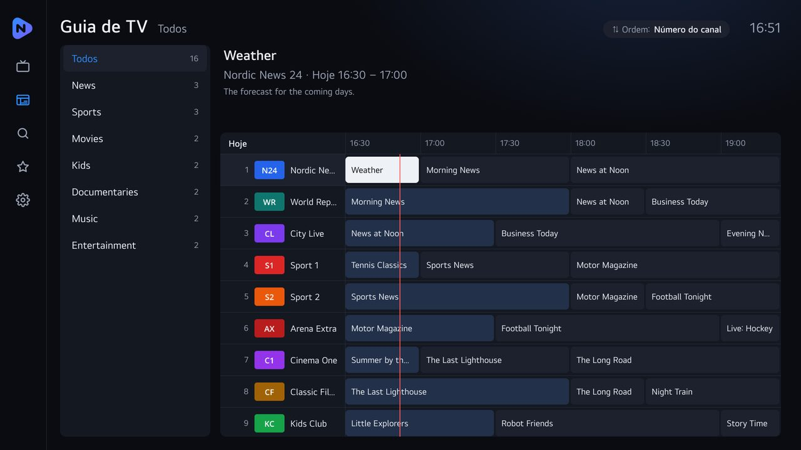
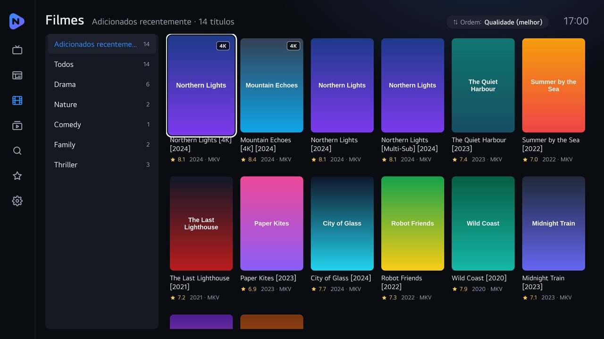
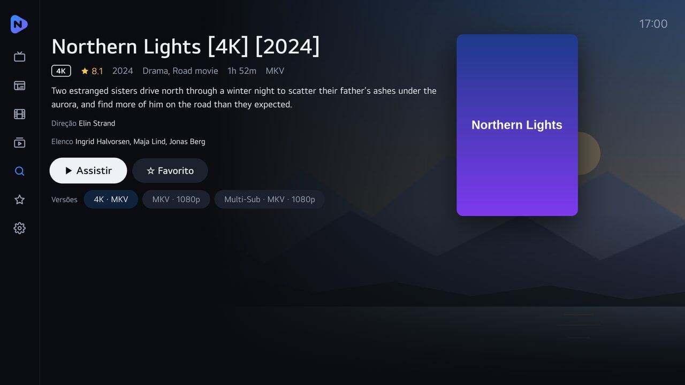
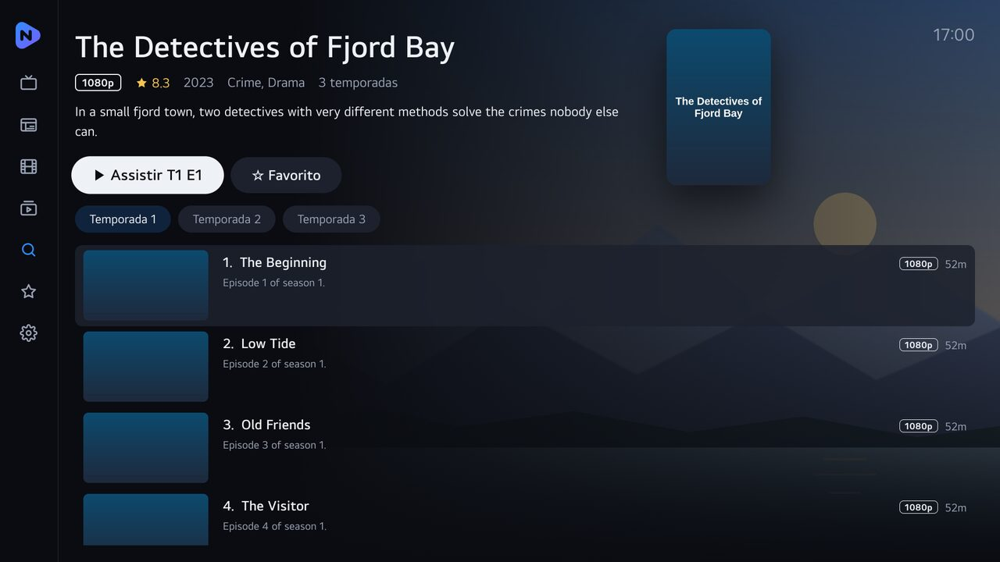
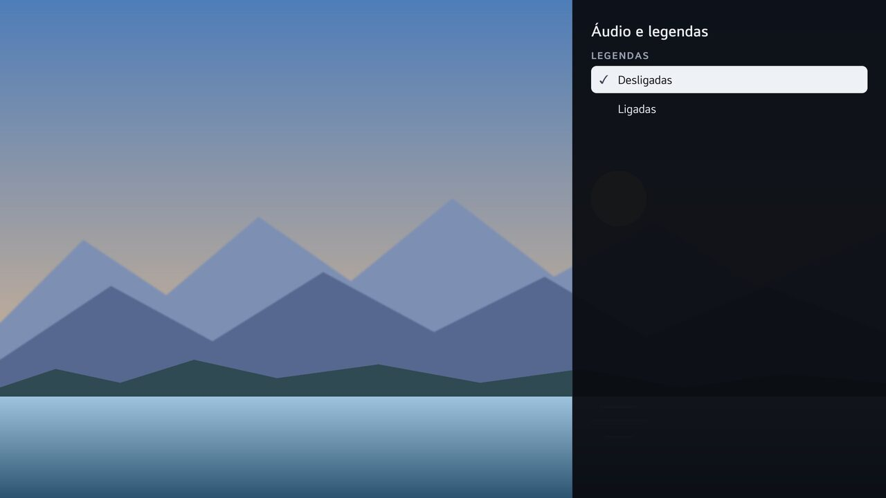
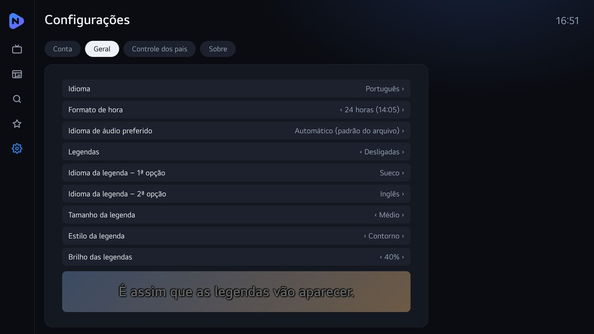
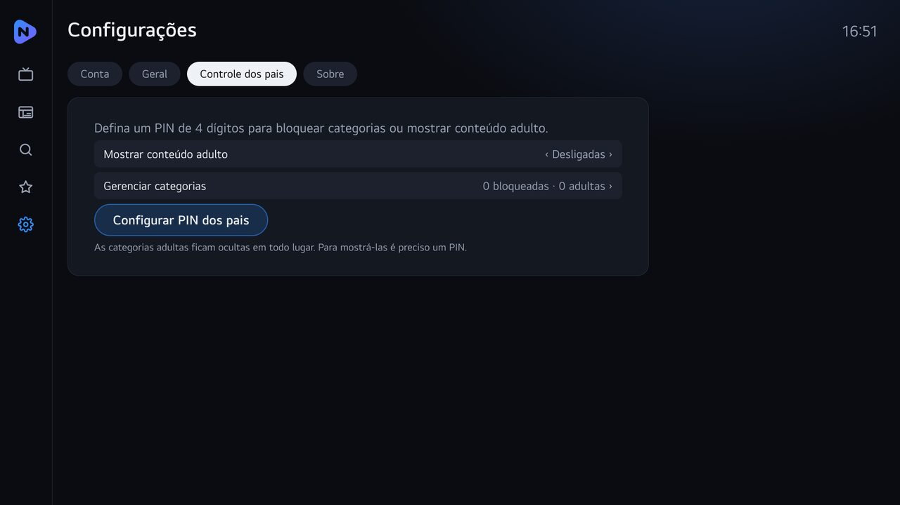
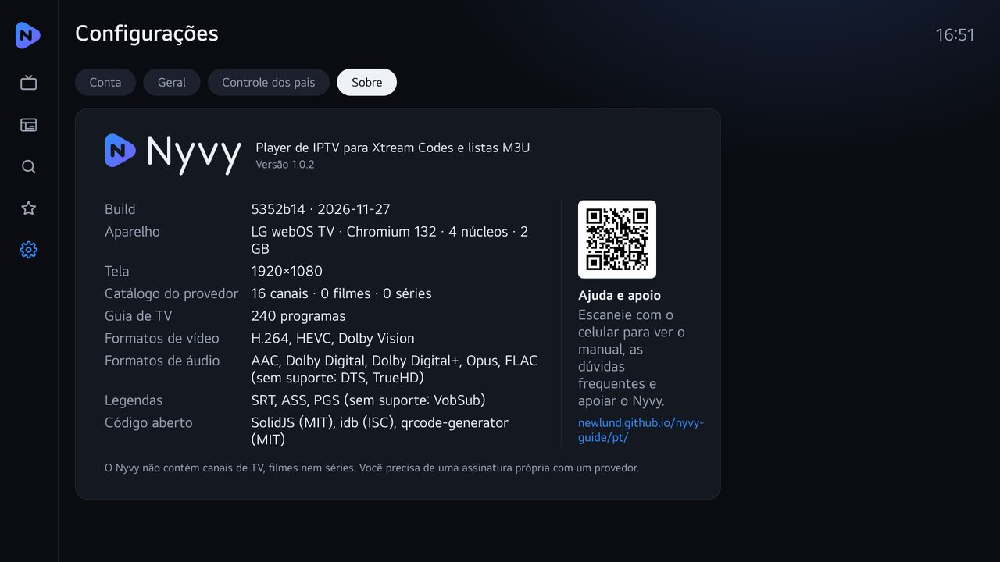

# Manual

Tudo o que você precisa para começar com o Nyvy e aproveitar ao máximo.

**Conteúdo:** [Primeiros passos](#getting-started) · [O controle remoto](#remote) · [TV ao vivo](#live-tv) · [Guia de TV e catch-up](#tv-guide) · [Filmes e séries](#films-series) · [Áudio e legendas](#audio-subtitles) · [Busca, favoritos e ordem](#search) · [Configurações](#settings) · [Dúvidas frequentes](#faq)

## Primeiros passos {#getting-started}

O Nyvy não tem canais próprios. Você precisa de uma assinatura com um provedor de IPTV e dos dados que ele passou.

### Entrar

Na primeira vez que abrir o Nyvy, escolha o tipo de conta:

| Tipo de conta | O que você digita | O que você ganha |
|---|---|---|
| **Xtream Codes** | Endereço do servidor, usuário e senha | TV ao vivo, guia de TV, catch-up, filmes, séries e status da conta |
| **Lista M3U** | O endereço da lista e, se necessário, o do guia | TV ao vivo com grupos, guia de TV, favoritos e busca |

> Recebeu um "link M3U" com `get.php?username=…&password=…`? Na verdade é uma conta Xtream. O Nyvy reconhece isso e oferece entrar como Xtream, e aí você ganha também filmes e séries.

Depois de entrar, o Nyvy baixa o catálogo (canais, filmes e séries) e o guia de TV. Na primeira vez pode levar um minuto; depois é rápido. Ao abrir o Nyvy, o catálogo e o guia são atualizados automaticamente se tiverem mais de 12 horas, e você sempre pode atualizar em *Configurações → Conta*.

Quer dar uma olhada primeiro? Escolha *Pular por enquanto*. Você pode adicionar seu provedor depois em *Configurações → Conta → Adicionar provedor*.

## O controle remoto {#remote}

| Botão | Função |
|---|---|
| Setas e OK | Navegar e selecionar |
| Voltar | Voltar. No menu lateral: sair do Nyvy |
| Vermelho · Verde · Amarelo | Atalhos (veja abaixo) |
| CH+ / CH− | Trocar de canal · rolar listas |
| Play/Pausa | Pausar e continuar |
| Avançar/voltar | Pular 60 segundos |
| Info | Mostrar a barra de informações (TV ao vivo) |
| Números | Ir direto para um número de canal |

O Magic Remote também funciona: aponte para destacar, clique para selecionar e role com a roda.

**O seu controle não tem botões coloridos?** Muitos Magic Remote não têm, e você não precisa deles: tudo funciona com botões na tela. ☆ *Favorito* fica na página de detalhes de filmes e séries, à direita da lista de canais (pressione direita) e na barra de informações em tela cheia. *Ordenar* fica no topo das listas, e *Áudio e legendas* e *Canal anterior* na barra de informações. Se mesmo assim quiser os atalhos, pressione **123** no controle: um painel com os botões coloridos aparece na tela. Vermelho: favorito · Verde: ordenar, ou áudio e legendas enquanto assiste · Amarelo: canal anterior.

### O que Voltar faz

| Onde você está | Voltar |
|---|---|
| O menu lateral | Pergunta se você quer sair do Nyvy |
| Uma lista em *TV ao vivo*, *Filmes* ou *Séries* | Primeiro para as categorias, depois para o menu lateral |
| A busca ou as configurações | Para o menu lateral |
| A página de detalhes de um filme ou série | Volta para a lista |
| Um filme ou episódio sendo reproduzido | Primeiro esconde a barra de progresso e os botões; o próximo toque sai. O Nyvy lembra onde você parou |
| TV ao vivo em tela cheia | Na ordem: apaga um número de canal sendo digitado, sai da fileira de botões, esconde a barra de informações, sai da tela cheia |
| A lista de canais ou *Áudio e legendas* está aberta | Fecha |
| Uma caixa de diálogo, como o PIN | Fecha sem mudar nada |

## TV ao vivo {#live-tv}

- **Escolher canal:** as categorias ficam à esquerda e os canais com o programa atual no meio. OK toca o canal na prévia; OK de novo abre em tela cheia.
- **Em tela cheia:**
  - Cima/baixo ou CH+/CH− trocam de canal.
  - OK seleciona os botões da barra de informações: *Canais*, *Áudio e legendas*, ☆ *Favorito*, *Canal anterior*, canal acima/abaixo e *Voltar*. Esquerda/direita alternam entre eles, OK seleciona.
  - Esquerda/direita ou Info mostram a barra de informações com agora e a seguir.
  - Números vão para um canal.
  - Voltar esconde primeiro a barra de informações; pressione Voltar de novo para sair da tela cheia.

### Mais sobre a TV ao vivo

- **Prévia:** OK em um canal da lista o reproduz no quadro à direita; OK de novo abre em tela cheia. Voltar da tela cheia leva à lista, e a prévia continua.
- **Trocar de canal em tela cheia:** pressione OK e escolha *Canais*, e a lista de canais abre sobre a imagem.
- **Números de canal:** digite os números no controle. O Nyvy troca depois de um instante.
- **Canal anterior:** o botão na barra de informações leva de volta ao canal que você via antes.
- **Marcações:** ↺ significa que o canal tem catch-up. A linha sob o programa mostra quanto já passou. No quadro à direita, *Catch-up · 2 dias* mostra até onde vai o arquivo.
- **Ordenar por qualidade:** o Nyvy lê HD e 4K nos nomes dos canais, então os melhores vêm primeiro.

## Guia de TV e catch-up {#tv-guide}

- **O guia de TV** mostra a programação de todos os canais em uma grade com uma linha de "agora". OK em um programa em andamento abre o canal.
- **Catch-up:** canais com ↺ têm arquivo no provedor. Neles você pode voltar no guia, abrir um programa que já passou e avançar ou voltar nele.

### Navegar no guia

- Cima/baixo troca de canal, e CH+/CH− passa uma página de cada vez.
- Esquerda/direita anda no tempo, um programa de cada vez. Para frente, o guia vai até três dias. Para trás, só nos canais com catch-up, até onde vai o arquivo.
- OK em um programa no ar abre o canal em tela cheia. Em um programa futuro, o Nyvy mostra quando ele começa, por exemplo *Começa às 21:00*.

### Assistir a um programa que já passou

1. Abra *Guia de TV* e escolha um canal com ↺.
2. Pressione esquerda até chegar ao programa. Os programas que dá para ver depois são marcados com ↺, e a informação diz *Catch-up: OK para assistir do início*.
3. Pressione OK. O programa começa do início.
4. Avance ou volte com esquerda/direita, pause com OK e saia com Voltar, como em um filme.

## Filmes e séries {#films-series}

Filmes e séries estão disponíveis para contas Xtream.

- **A página de detalhes** mostra sinopse, elenco, qualidade (por exemplo 4K ou Dolby Vision) e os botões *Assistir*, *Continuar* e *Favorito*. Se um filme tiver várias versões, elas aparecem como opções abaixo dos botões.
- **Séries:** escolha temporada e episódio. Quando um episódio termina, o próximo começa após uma contagem regressiva.
- **Assistindo:**
  - OK pausa.
  - Esquerda/direita pulam 10 segundos (segure para pulos maiores). Uma imagem de prévia mostra onde você vai cair, e OK pula para lá.
  - Cima mostra os botões na tela.
  - Voltar esconde primeiro a barra de progresso e os botões; pressione Voltar de novo para sair. O Nyvy lembra onde você parou.

### Versões

Os provedores costumam ter o mesmo filme em várias versões, por exemplo 4K, 1080p ou com outros idiomas e legendas. O Nyvy as agrupa: a página de detalhes as mostra em *Versões*, e durante a reprodução você troca em *Áudio e legendas* → *Versão*.

### Continuar assistindo e adicionados recentemente

No início de *Filmes* e *Séries* ficam seus favoritos, *Continuar assistindo* (o que você começou) e *Adicionados recentemente* (o que o provedor adicionou por último). A página de detalhes de algo que você começou mostra, por exemplo, *Continuar de 42:10*, com *Assistir do início* ao lado.

### 4K, HDR e Dolby Vision

- **Marcações:** 4K, 1080p, 720p ou SD, às vezes com HDR ou DV (Dolby Vision). O Nyvy só mostra o que sabe com certeza, pelo título ou pela reprodução, então nem todo filme tem marcação.
- **Dolby Vision** é reproduzido como Dolby Vision quando a TV suporta. Alguns arquivos (cópias de Blu-ray com duas camadas de imagem) e TVs sem Dolby Vision mostram o filme em HDR10, na mesma resolução.

## Áudio e legendas {#audio-subtitles}

- **Filmes e séries:** pressione baixo ou Verde para escolher a faixa de áudio, as legendas e a versão.
- **TV ao vivo:** escolha *Áudio e legendas* na barra de informações (ou pressione Verde) para ligar ou desligar as legendas da transmissão e escolher a faixa de áudio.
- **Padrões:** em *Configurações → Geral* você escolhe o idioma de áudio preferido, se as legendas ficam ligadas, os idiomas da legenda (1ª e 2ª opção) e o tamanho e estilo do texto.

### Legendas de texto e de imagem

- **Legendas de texto** (por exemplo SRT e ASS) são desenhadas pelo Nyvy, no tamanho e estilo que você escolher.
- **Legendas de imagem** (PGS, de Blu-ray) são imagens prontas e aparecem como são. Tamanho e estilo não as afetam.
- **Legendas da transmissão** na TV ao vivo (DVB e teletexto) são desenhadas pela TV. No Nyvy você só as liga ou desliga.

### Faixas que não podem ser reproduzidas

Uma faixa que a TV não consegue reproduzir aparece esmaecida com o texto *não reproduz neste aparelho*. As mais comuns são DTS e Dolby TrueHD. Se um filme só tem esse áudio, o Nyvy avisa ao começar, e o filme toca sem som: escolha outra versão, se houver. *Configurações* → *Sobre* mostra quais formatos sua TV reproduz.

Se o som principal de um filme não puder ser reproduzido, mas outra faixa puder, o Nyvy reproduz essa e um aviso diz qual é. Faixas de comentário só são escolhidas quando nada mais pode ser reproduzido; você ainda pode escolhê-las.

### Tamanho e estilo das legendas

Em *Configurações* → *Geral* você escolhe *Tamanho da legenda* (Pequeno, Médio, Grande ou Muito grande) e *Estilo da legenda* (Contorno ou Caixa de fundo). Uma prévia mostra como vai ficar.

*Brilho das legendas* deixa as legendas menos brancas se parecerem claras demais, em etapas até 10%. Vale para legendas de texto e de imagem, mas não para as legendas da transmissão na TV ao vivo, que a TV desenha.

## Busca, favoritos e ordem {#search}

- **Busca:** digite com o teclado na tela ou com os números do controle. A busca encontra canais, filmes e séries e ignora acentos (*malmo* encontra *Malmö*).
- **Favoritos:** escolha ☆ *Favorito* na página de detalhes de um filme ou série, à direita da lista de canais ou na barra de informações em tela cheia (Vermelho é um atalho). Os favoritos aparecem primeiro em cada lista e em *Favoritos* no menu.
- **Ordem:** o botão *Ordem* no alto das listas (ou Verde). Canais podem ser ordenados por número, qualidade ou nome, e filmes e séries por, por exemplo, adicionados recentemente, ano, nota ou qualidade. As séries também podem ser ordenadas pela duração dos episódios.

### Adicionar e encontrar favoritos

- **Um canal:** selecione-o na lista de *TV ao vivo*, pressione direita e escolha ☆ *Favorito*. Em tela cheia, o mesmo botão está na barra de informações (pressione OK).
- **Um filme ou série:** escolha ☆ *Favorito* na página de detalhes.
- **Encontrar:** em *Favoritos* no menu, separados em canais, filmes e séries, e no início de cada lista.
- **Remover:** escolha ★ *Remover dos favoritos* no mesmo lugar.

## Configurações {#settings}

- **Conta:**
  - Mostra seus dados, quando o catálogo foi atualizado e o botão *Atualizar catálogo*.
  - **Editar dados:** novo endereço do servidor, nova senha ou nova lista. Favoritos e pontos de retomada são mantidos enquanto for a mesma conta.
  - **Sair** remove a conta e os dados dela da TV.
- **Geral:** idioma, formato de hora, áudio e legendas.
- **Controle dos pais:**
  - O conteúdo adulto fica oculto desde o início.
  - Com um PIN de quatro dígitos você pode mostrá-lo e bloquear ou ocultar categorias.
  - Categorias bloqueadas pedem o PIN.
- **Sobre:** versão, quais formatos sua TV reproduz e o link para esta página.

### Configurar o controle dos pais

1. Vá em *Configurações* → *Controle dos pais* e escolha *Configurar PIN dos pais*. Digite quatro números e depois os mesmos de novo.
2. *Mostrar conteúdo adulto*: o conteúdo adulto fica oculto desde o início, e mostrá-lo pede o PIN. Categorias que parecem adultas, por exemplo com XXX ou 18+ no nome, são marcadas automaticamente.
3. *Gerenciar categorias*: OK em uma categoria alterna entre *🔒 Bloqueado* (pede o PIN), *🔞 Adulto* (oculta enquanto o conteúdo adulto estiver oculto) e desligado.
4. Você abre uma categoria bloqueada com OK e o PIN. Ela fica desbloqueada até você fechar o Nyvy.
5. *Alterar PIN* e *Remover PIN* ficam na mesma página.

### Se você esquecer o PIN

O PIN não pode ser redefinido no Nyvy, de propósito, porque senão uma criança poderia contorná-lo. *Sair* também pede o PIN. O que resta é remover o Nyvy da TV e instalá-lo de novo. Aí você entra de novo, e favoritos, pontos onde parou e configurações se perdem.

### Privacidade

Tudo o que o Nyvy guarda fica na sua TV: os dados da conta (criptografados), o catálogo, o guia de TV, os favoritos, onde você parou e as configurações. Nada é enviado ao Nyvy. *Sair* apaga tudo. Saiba mais na página [Privacidade](privacy.html).

## Dúvidas frequentes {#faq}

### "Este canal não está transmitindo agora"
A transmissão do provedor caiu ou o canal só transmite em certos eventos. Tente mais tarde ou escolha outro canal. OK tenta de novo.

### "O provedor não permite mais conexões agora"
Muitas assinaturas permitem só uma transmissão por vez. Feche o app em outros aparelhos que usam a mesma conta, espere um pouco e tente de novo.

### "O provedor não está respondendo"
Verifique a conexão de internet da TV. Se estiver funcionando, o problema provavelmente é do provedor.

### Um filme está sem som
Provavelmente o filme só tem áudio em DTS ou Dolby TrueHD, que as TVs LG não reproduzem em apps. Escolha outra faixa de áudio ou outra versão do filme, se houver.

### Ouço um comentário em vez do filme
O som principal do filme (muitas vezes DTS) não pode ser reproduzido na TV, então o Nyvy reproduz a única faixa possível, às vezes um comentário. O aviso no início diz qual é. Escolha outra versão do filme, se houver.

### O guia de TV está vazio (M3U)
Nem toda lista indica um guia. Peça ao seu provedor o endereço de um guia XMLTV e digite em *Configurações → Conta → Editar dados*.

### Não vejo filmes nem séries (M3U)
No Nyvy, listas dão só TV ao vivo. Se você tem uma conta Xtream, entre com ela para ter filmes e séries.

### Como saio do Nyvy?
Pressione Voltar até o menu lateral ficar selecionado, pressione Voltar de novo e escolha *Sair*.

### “Tentando de novo… (2/3)”
O início travou, e o Nyvy tenta de novo sozinho, até três vezes. Geralmente é um problema temporário do provedor. Se a terceira tentativa também falhar, o Nyvy mostra o que há de errado.

### “Este título não está disponível no provedor”
O provedor lista o título, mas não tem mais o arquivo. Isso não pode ser corrigido no Nyvy. Escolha outra versão, se houver.

### A imagem trava ou fica carregando
Verifique a rede. O 4K precisa de cerca de 25 Mbit/s estáveis, e uma conexão a cabo é mais confiável que o Wi-Fi. Se só um canal ou filme trava, o problema geralmente é do provedor.

### As legendas não aparecem
Verifique se a faixa certa está escolhida em *Áudio e legendas*. Algumas faixas só têm texto para falas em outros idiomas, e nada aparece em cenas silenciosas. Legendas da transmissão na TV ao vivo só existem quando o canal as envia.

### Os horários do guia de TV estão errados
Verifique a hora e o fuso horário nas configurações da própria TV. Se estiverem certos, os dados do guia do provedor estão errados.

### Um canal não tem informações de programa (M3U)
O Nyvy associa os canais ao guia de TV pelo tvg-id, ou então pelo nome do canal. Se um canal não tem nenhum dos dois, ou o nome é diferente, a associação falha. O provedor pode corrigir isso na lista.

### O catálogo parece desatualizado
O Nyvy atualiza o catálogo e o guia de TV ao abrir o app, se tiverem mais de 12 horas. Para atualizar na hora: *Configurações* → *Conta* → *Atualizar catálogo*.

## Glossário

- **Xtream Codes:** uma forma comum de provedores de IPTV oferecerem canais, filmes e séries, com um endereço de servidor, um usuário e uma senha.
- **M3U:** uma lista de reprodução: uma longa lista de canais e seus endereços. Oferece TV ao vivo, mas não filmes e séries no Nyvy.
- **EPG / XMLTV:** dados do guia de TV: o que passa e quando. XMLTV é o formato do arquivo.
- **Catch-up:** assistir a programas que já passaram, do arquivo do provedor (marcados com ↺).
- **4K:** uma imagem de 3840×2160 pontos, quatro vezes mais que Full HD (1080p).
- **HDR:** uma faixa de contraste e cores maior que a de uma imagem comum. HDR10 é a variante mais comum.
- **Dolby Vision:** uma variante de HDR em que a imagem é ajustada cena a cena.
- **Dolby Digital / Dolby Digital Plus:** formatos comuns de som surround que a TV reproduz.
- **DTS / Dolby TrueHD:** formatos de áudio de cinema e Blu-ray que as TVs LG não reproduzem em apps.
