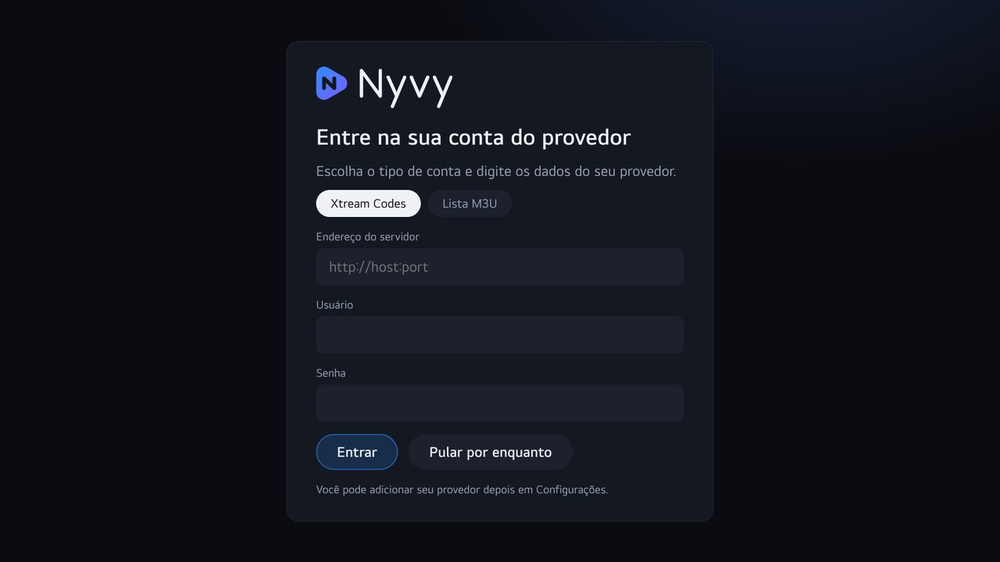
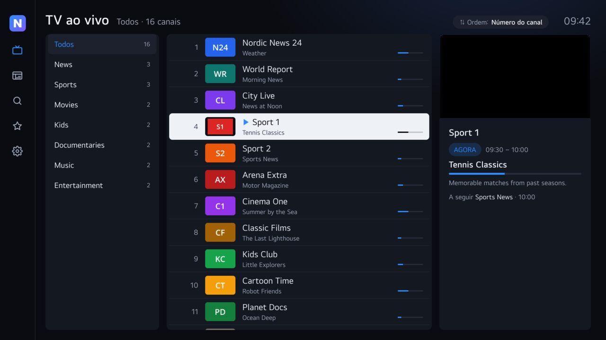
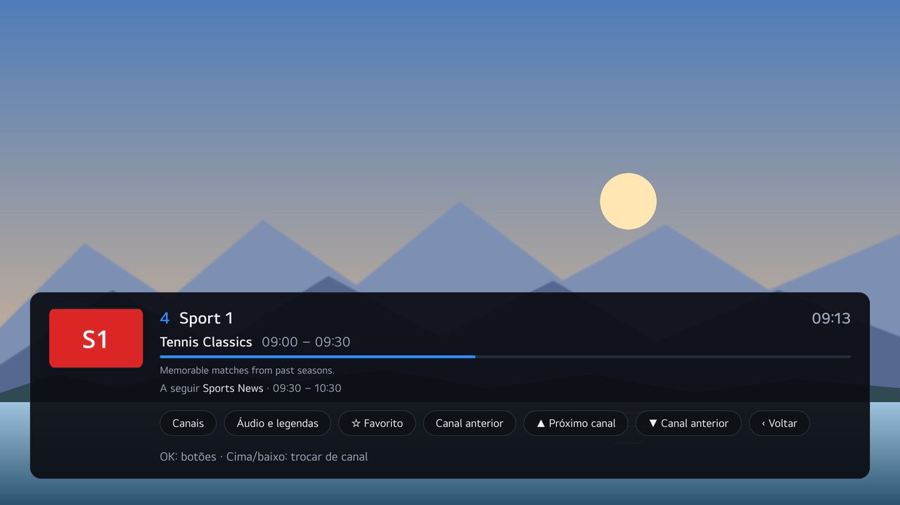
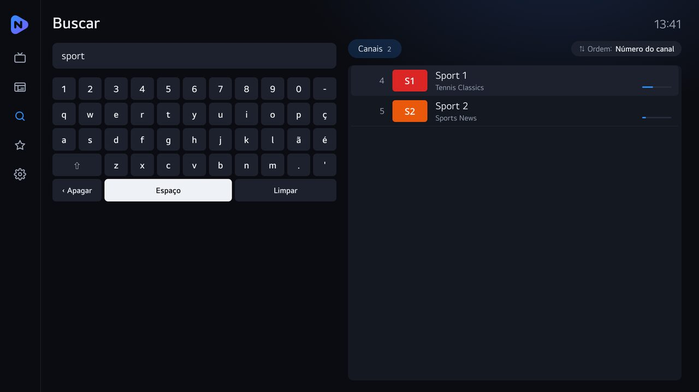

# Manual

Tudo o que você precisa para começar com o Nyvy e aproveitar ao máximo.

**Conteúdo:** [Primeiros passos](#getting-started) · [O controle remoto](#remote) · [TV ao vivo](#live-tv) · [Guia de TV e catch-up](#tv-guide) · [Filmes e séries](#films-series) · [Áudio e legendas](#audio-subtitles) · [Busca, favoritos e ordem](#search) · [Configurações](#settings) · [Dúvidas frequentes](#faq)

## Primeiros passos {#getting-started}

O Nyvy não tem canais próprios. Você precisa de uma assinatura com um provedor de IPTV e dos dados que ele passou.

### Entrar

Na primeira vez que abrir o Nyvy, escolha o tipo de conta:

| Tipo de conta | O que você digita | O que você ganha |
|---|---|---|
| **Xtream Codes** | Endereço do servidor, usuário e senha | TV ao vivo, guia de TV, catch-up, filmes, séries e status da conta |
| **Lista M3U** | O endereço da lista e, se necessário, o do guia | TV ao vivo com grupos, guia de TV, favoritos e busca |

> Recebeu um "link M3U" com `get.php?username=…&password=…`? Na verdade é uma conta Xtream. O Nyvy reconhece isso e oferece entrar como Xtream, e aí você ganha também filmes e séries.

Depois de entrar, o Nyvy baixa o catálogo (canais, filmes e séries) e o guia de TV. Na primeira vez pode levar um minuto; depois é rápido. Ao abrir o Nyvy, o catálogo e o guia são atualizados automaticamente se tiverem mais de 12 horas, e você sempre pode atualizar em *Configurações → Conta*.

Quer dar uma olhada primeiro? Escolha *Pular por enquanto*. Você pode adicionar seu provedor depois em *Configurações → Conta → Adicionar provedor*.

## O controle remoto {#remote}

| Botão | Função |
|---|---|
| Setas e OK | Navegar e selecionar |
| Voltar | Voltar. No menu lateral: sair do Nyvy |
| Vermelho | Adicionar ou remover favorito |
| Verde | Ordenar (em listas) · áudio e legendas (assistindo) |
| Amarelo | Canal anterior (TV ao vivo em tela cheia) |
| CH+ / CH− | Trocar de canal · rolar listas |
| Play/Pausa | Pausar e continuar |
| Avançar/voltar | Pular 60 segundos |
| Info | Mostrar a barra de informações (TV ao vivo) |
| Números | Ir direto para um número de canal |

O Magic Remote também funciona: aponte para destacar, clique para selecionar e role com a roda.

## TV ao vivo {#live-tv}

- **Escolher canal:** as categorias ficam à esquerda e os canais com o programa atual no meio. OK toca o canal na prévia; OK de novo abre em tela cheia.
- **Em tela cheia:**
  - Cima/baixo ou CH+/CH− trocam de canal.
  - OK abre a lista de canais.
  - Esquerda/direita ou Info mostram a barra de informações com agora e a seguir, e botões para o Magic Remote.
  - Números vão para um canal, e Amarelo volta ao canal anterior.
  - Voltar esconde primeiro a barra de informações; pressione Voltar de novo para sair da tela cheia.

## Guia de TV e catch-up {#tv-guide}

- **O guia de TV** mostra a programação de todos os canais em uma grade com uma linha de "agora". OK em um programa em andamento abre o canal.
- **Catch-up:** canais com ↺ têm arquivo no provedor. Neles você pode voltar no guia, abrir um programa que já passou e avançar ou voltar nele.

## Filmes e séries {#films-series}

Filmes e séries estão disponíveis para contas Xtream.

- **A página de detalhes** mostra sinopse, elenco, qualidade (por exemplo 4K ou Dolby Vision) e os botões *Assistir*, *Continuar* e *Favorito*. Se um filme tiver várias versões, elas aparecem como opções abaixo dos botões.
- **Séries:** escolha temporada e episódio. Quando um episódio termina, o próximo começa após uma contagem regressiva.
- **Assistindo:**
  - OK pausa.
  - Esquerda/direita pulam 10 segundos (segure para pulos maiores). Uma imagem de prévia mostra onde você vai cair, e OK pula para lá.
  - Cima mostra os botões na tela.
  - Voltar esconde primeiro a barra de progresso e os botões; pressione Voltar de novo para sair. O Nyvy lembra onde você parou.

## Áudio e legendas {#audio-subtitles}

- **Filmes e séries:** pressione baixo ou Verde para escolher a faixa de áudio, as legendas e a versão.
- **TV ao vivo:** pressione Verde para ligar ou desligar as legendas da transmissão e escolher a faixa de áudio.
- **Padrões:** em *Configurações → Geral* você escolhe o idioma de áudio preferido, se as legendas ficam ligadas, os idiomas da legenda (1ª e 2ª opção) e o tamanho e estilo do texto.

## Busca, favoritos e ordem {#search}

- **Busca:** digite com o teclado na tela ou com os números do controle. A busca encontra canais, filmes e séries e ignora acentos (*malmo* encontra *Malmö*).
- **Favoritos:** pressione Vermelho em um canal, filme ou série. Os favoritos aparecem primeiro em cada lista e em *Favoritos* no menu.
- **Ordem:** o botão *Ordem* no alto das listas (ou Verde). Canais podem ser ordenados por número, qualidade ou nome, e filmes e séries por, por exemplo, adicionados recentemente, ano, nota ou qualidade. As séries também podem ser ordenadas pela duração dos episódios.

## Configurações {#settings}

- **Conta:**
  - Mostra seus dados, quando o catálogo foi atualizado e o botão *Atualizar catálogo*.
  - **Editar dados:** novo endereço do servidor, nova senha ou nova lista. Favoritos e pontos de retomada são mantidos enquanto for a mesma conta.
  - **Sair** remove a conta e os dados dela da TV.
- **Geral:** idioma, formato de hora, áudio e legendas.
- **Controle dos pais:**
  - O conteúdo adulto fica oculto desde o início.
  - Com um PIN de quatro dígitos você pode mostrá-lo e bloquear ou ocultar categorias.
  - Categorias bloqueadas pedem o PIN.
- **Sobre:** versão, quais formatos sua TV reproduz e o link para esta página.

## Dúvidas frequentes {#faq}

### "Este canal não está transmitindo agora"
A transmissão do provedor caiu ou o canal só transmite em certos eventos. Tente mais tarde ou escolha outro canal. OK tenta de novo.

### "O provedor não permite mais conexões agora"
Muitas assinaturas permitem só uma transmissão por vez. Feche o app em outros aparelhos que usam a mesma conta, espere um pouco e tente de novo.

### "O provedor não está respondendo"
Verifique a conexão de internet da TV. Se estiver funcionando, o problema provavelmente é do provedor.

### Um filme está sem som
Provavelmente o filme só tem áudio em DTS ou Dolby TrueHD, que as TVs LG não reproduzem em apps. Escolha outra faixa de áudio ou outra versão do filme, se houver.

### O guia de TV está vazio (M3U)
Nem toda lista indica um guia. Peça ao seu provedor o endereço de um guia XMLTV e digite em *Configurações → Conta → Editar dados*.

### Não vejo filmes nem séries (M3U)
No Nyvy, listas dão só TV ao vivo. Se você tem uma conta Xtream, entre com ela para ter filmes e séries.

### Como saio do Nyvy?
Pressione Voltar até o menu lateral ficar selecionado, pressione Voltar de novo e escolha *Sair*.
