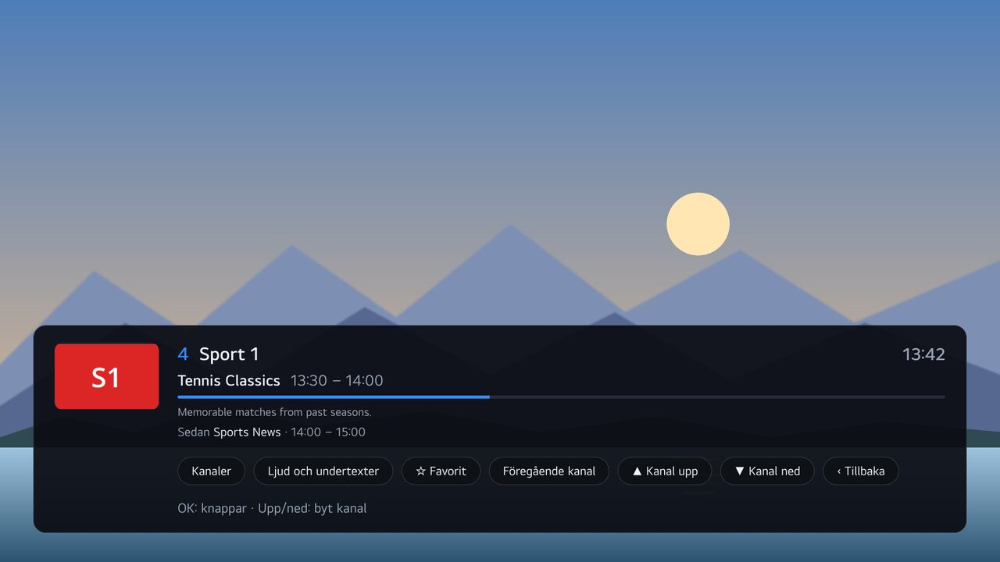
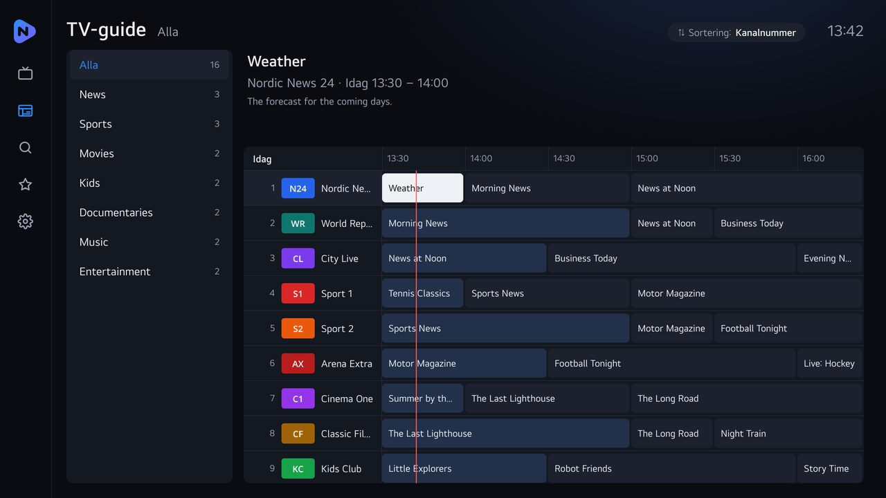
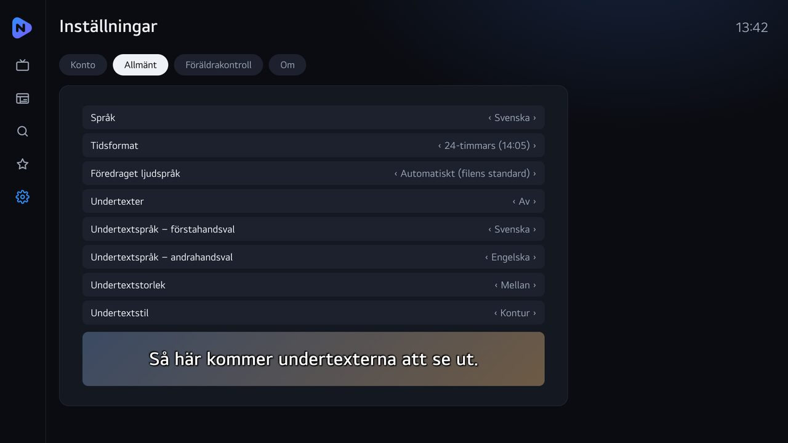
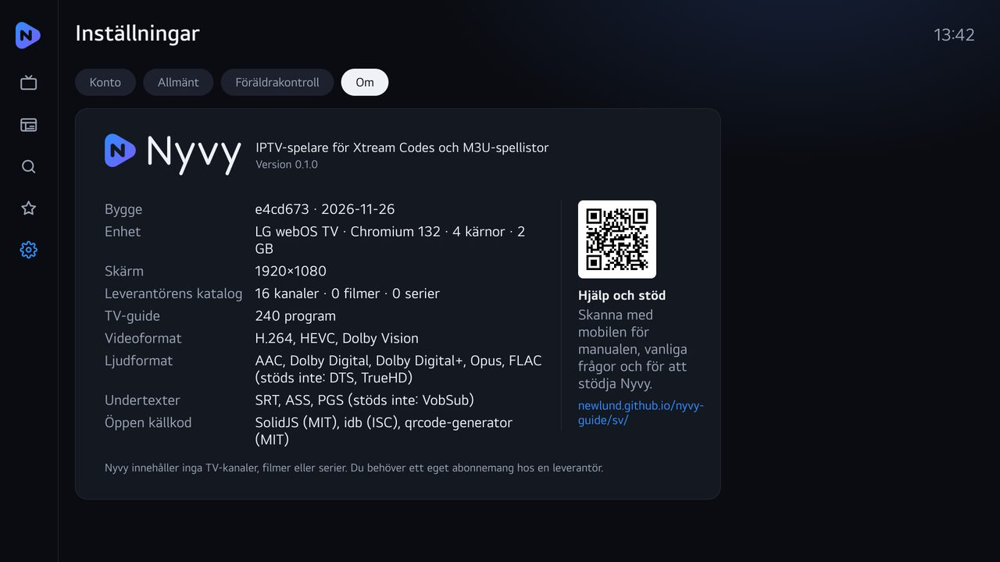

# Manual

Allt du behöver för att komma igång med Nyvy och få ut det mesta av appen.

**Innehåll:** [Kom igång](#kom-igang) · [Fjärrkontrollen](#fjarrkontrollen) · [Live-TV](#live-tv) · [TV-guide och catch-up](#tv-guide-och-catch-up) · [Filmer och serier](#filmer-och-serier) · [Ljud och undertexter](#ljud-och-undertexter) · [Sök, favoriter och sortering](#sok-favoriter-och-sortering) · [Inställningar](#installningar) · [Vanliga frågor](#vanliga-fragor)

## Kom igång {#kom-igang}

Nyvy innehåller inga kanaler själv. Du behöver ett abonnemang hos en IPTV-leverantör, och uppgifterna du fått av dem.

### Logga in

När du startar Nyvy första gången väljer du kontotyp:

| Kontotyp | Det här fyller du i | Det här får du |
|---|---|---|
| **Xtream Codes** | Serveradress, användarnamn och lösenord | Live-TV, TV-guide, catch-up, filmer, serier och kontostatus |
| **M3U-spellista** | Spellistans adress, och vid behov TV-guidens adress | Live-TV med grupper, TV-guide, favoriter och sök |

> Har du fått en "M3U-länk" som innehåller `get.php?username=…&password=…`? Då är det egentligen ett Xtream-konto. Nyvy känner igen det och erbjuder att logga in som Xtream i stället, så får du även filmer och serier.

Efter inloggningen hämtar Nyvy utbudet (kanaler, filmer och serier) och TV-guiden. Första gången kan det ta en minut, sedan går det snabbt. När du startar Nyvy uppdateras utbudet och guiden automatiskt om de är äldre än 12 timmar, och du kan alltid uppdatera själv under *Inställningar → Konto*.

Vill du titta runt först? Välj *Hoppa över*. Du kan lägga till leverantören senare under *Inställningar → Konto → Lägg till leverantör*.

## Fjärrkontrollen {#fjarrkontrollen}

| Knapp | Gör |
|---|---|
| Pilar och OK | Flytta och välja |
| Tillbaka | Gå tillbaka. I sidomenyn: avsluta Nyvy |
| Röd · Grön · Gul | Genvägar (se nedan) |
| CH+ / CH− | Byt kanal · bläddra i listor |
| Play/Paus | Pausa och fortsätta |
| Spola fram/bak | Hoppa 60 sekunder |
| Info | Visa informationsraden (live-TV) |
| Siffror | Gå direkt till ett kanalnummer |

Magic Remote fungerar också: peka för att markera, klicka för att välja och scrolla med hjulet.

**Inga färgknappar på fjärrkontrollen?** Många Magic Remote saknar dem, och du behöver dem inte: allt fungerar med knappar på skärmen. ☆ *Favorit* finns på detaljsidan för filmer och serier, till höger om kanallistan (tryck höger) och i informationsraden i helskärm. *Sortering* finns högst upp i listorna, och *Ljud och undertexter* och *Föregående kanal* i informationsraden. Vill du ändå använda genvägarna, tryck **123** på fjärrkontrollen: en panel med färgknapparna visas på skärmen. Röd: favorit · Grön: sortering, eller ljud och undertexter när du tittar · Gul: föregående kanal.

## Live-TV {#live-tv}

- **Välj kanal:** till vänster finns kategorierna, i mitten kanalerna med pågående program. OK spelar kanalen i förhandsrutan, OK igen ger helskärm.
- **I helskärm:**
  - Upp/ned eller CH+/CH− byter kanal.
  - OK väljer informationsradens knappar: *Kanaler*, *Ljud och undertexter*, ☆ *Favorit*, *Föregående kanal*, kanal upp/ned och *Tillbaka*. Vänster/höger flyttar mellan dem, OK väljer.
  - Vänster/höger eller Info visar informationsraden med nu och sedan.
  - Siffror går till ett kanalnummer.
  - Tillbaka döljer först informationsraden; tryck Tillbaka igen för att gå ur helskärm.

## TV-guide och catch-up {#tv-guide-och-catch-up}

- **TV-guiden** visar programmen för alla kanaler i ett rutnät med en linje för "nu". OK på ett pågående program startar kanalen.
- **Catch-up:** kanaler med ↺ har arkiv hos leverantören. Där kan du bläddra bakåt i guiden och starta ett program som redan har sänts, och spola i det.

## Filmer och serier {#filmer-och-serier}

Filmer och serier finns för Xtream-konton.

- **Detaljsidan** visar handling, skådespelare, kvalitet (till exempel 4K eller Dolby Vision) och knapparna *Spela*, *Fortsätt* och *Favorit*. Finns filmen i flera versioner visas de som val under knapparna.
- **Serier:** välj säsong och avsnitt. När ett avsnitt tar slut startar nästa efter en nedräkning.
- **När du tittar:**
  - OK pausar.
  - Vänster/höger hoppar 10 sekunder (håll in för längre hopp). En förhandsbild visar var du hamnar, och OK hoppar dit.
  - Upp visar knapparna på skärmen.
  - Tillbaka döljer först tidslinjen och knapparna; tryck Tillbaka igen för att avsluta. Nyvy kommer ihåg var du var.

## Ljud och undertexter {#ljud-och-undertexter}

- **Filmer och serier:** tryck ned eller Grön för att välja ljudspår, undertexter och version.
- **Live-TV:** välj *Ljud och undertexter* i informationsraden (eller tryck Grön) för att slå på eller av sändningens undertexter (till exempel SVT:s svenska undertexter) och välja ljudspår.
- **Standardval:** under *Inställningar → Allmänt* väljer du föredraget ljudspråk, om undertexter ska vara på, första- och andrahandsspråk för undertexter, samt textstorlek och stil.

## Sök, favoriter och sortering {#sok-favoriter-och-sortering}

- **Sök:** skriv med tangentbordet på skärmen eller med fjärrkontrollens siffror. Sökningen hittar kanaler, filmer och serier, och bryr sig inte om accenter (*malmo* hittar *Malmö*).
- **Favoriter:** välj ☆ *Favorit* på detaljsidan för en film eller serie, till höger om kanallistan eller i informationsraden i helskärm (Röd är en genväg). Favoriterna finns först i varje lista och under *Favoriter* i menyn.
- **Sortering:** knappen *Sortering* högst upp i listorna (eller Grön). Kanaler kan sorteras efter nummer, kvalitet eller namn, och filmer och serier efter till exempel senast tillagda, år, betyg eller kvalitet. Serier kan även sorteras efter avsnittens längd.

## Inställningar {#installningar}

- **Konto:**
  - Visar dina uppgifter, när utbudet uppdaterades, och knappen *Uppdatera utbudet*.
  - **Ändra uppgifter:** ny serveradress, nytt lösenord eller ny spellista. Favoriter och var du slutade sparas så länge det är samma konto.
  - **Logga ut** raderar konto och sparad data från TV:n.
- **Allmänt:** språk, tidsformat, ljud och undertexter.
- **Föräldrakontroll:**
  - Vuxeninnehåll är dolt från början.
  - Med en fyrsiffrig PIN-kod kan du visa det, och låsa eller dölja enskilda kategorier.
  - Låsta kategorier kräver PIN-koden.
- **Om:** version, vilka format din TV kan spela, och länken till den här sidan.

## Vanliga frågor {#vanliga-fragor}

### "Kanalen sänder inte just nu"
Leverantörens sändning är nere eller kanalen sänder bara vid vissa evenemang. Prova igen senare eller välj en annan kanal. Tryck OK för att försöka igen.

### "Leverantören tillåter inte fler anslutningar just nu"
Många abonnemang tillåter bara en ström åt gången. Stäng appen på andra enheter som använder samma konto, vänta en stund och försök igen.

### "Leverantören svarar inte"
Kontrollera TV:ns internetanslutning. Fungerar den, ligger felet troligen hos leverantören.

### En film har inget ljud
Filmen har troligen bara ljud i DTS eller Dolby TrueHD, som LG-TV inte kan spela upp via appar. Välj ett annat ljudspår eller en annan version av filmen om det finns.

### TV-guiden är tom (M3U)
Alla spellistor anger ingen TV-guide. Fråga leverantören efter adressen till en XMLTV-guide och fyll i den under *Inställningar → Konto → Ändra uppgifter*.

### Jag ser inte filmer och serier (M3U)
Spellistor ger bara live-TV i Nyvy. Har du ett Xtream-konto, logga in med det för att få filmer och serier.

### Hur avslutar jag Nyvy?
Tryck Tillbaka tills sidomenyn är markerad, tryck Tillbaka igen och välj *Avsluta*.
