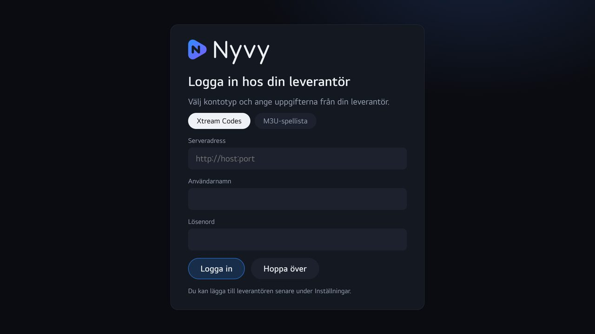
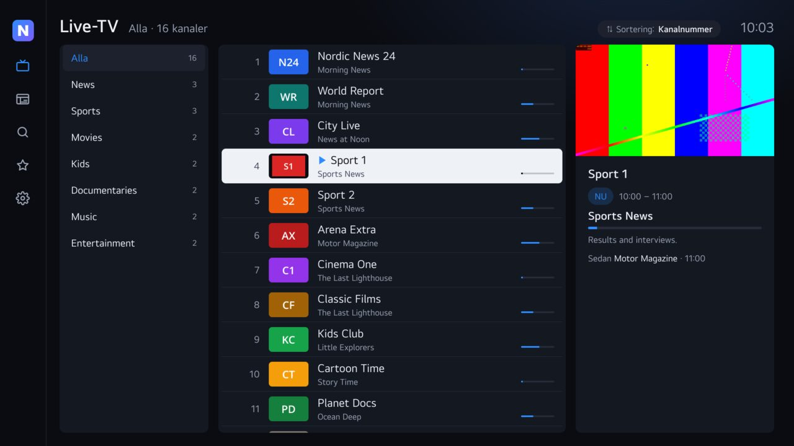
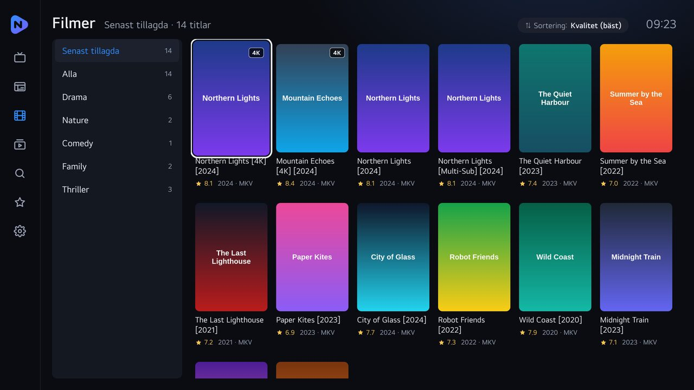
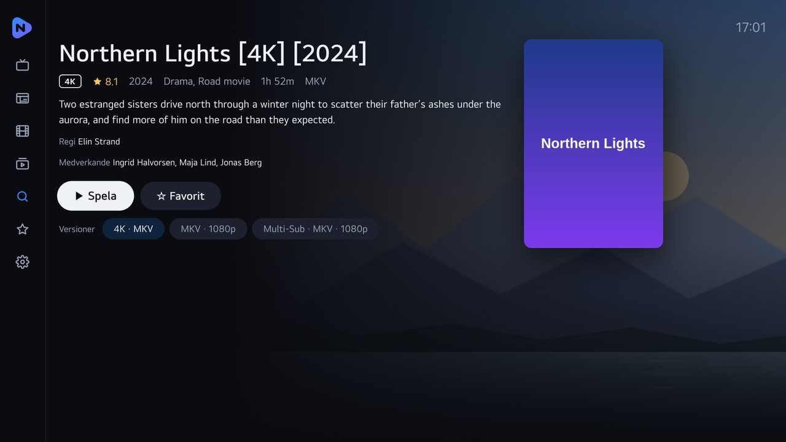
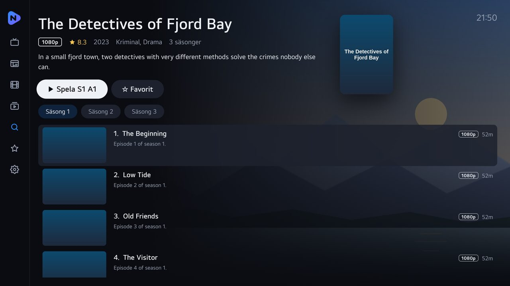
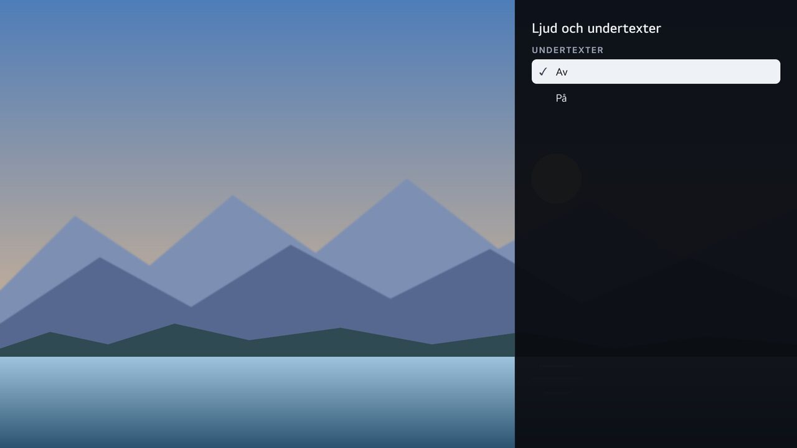
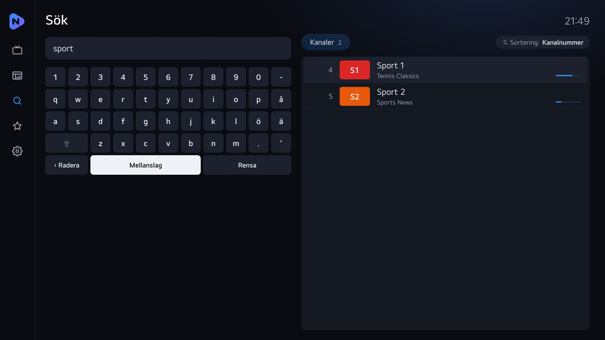
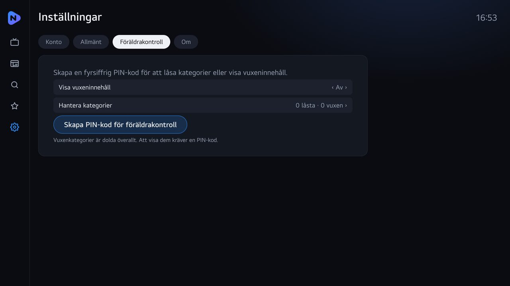

# Manual

Allt du behöver för att komma igång med Nyvy och få ut det mesta av appen.

**Innehåll:** [Kom igång](#kom-igang) · [Fjärrkontrollen](#fjarrkontrollen) · [Live-TV](#live-tv) · [TV-guide och catch-up](#tv-guide-och-catch-up) · [Filmer och serier](#filmer-och-serier) · [Ljud och undertexter](#ljud-och-undertexter) · [Sök, favoriter och sortering](#sok-favoriter-och-sortering) · [Inställningar](#installningar) · [Vanliga frågor](#vanliga-fragor)

## Kom igång {#kom-igang}

Nyvy innehåller inga kanaler själv. Du behöver ett abonnemang hos en IPTV-leverantör, och uppgifterna du fått av dem.

### Logga in

När du startar Nyvy första gången väljer du kontotyp:

| Kontotyp | Det här fyller du i | Det här får du |
|---|---|---|
| **Xtream Codes** | Serveradress, användarnamn och lösenord | Live-TV, TV-guide, catch-up, filmer, serier och kontostatus |
| **M3U-spellista** | Spellistans adress, och vid behov TV-guidens adress | Live-TV med grupper, TV-guide, favoriter och sök |

> Har du fått en "M3U-länk" som innehåller `get.php?username=…&password=…`? Då är det egentligen ett Xtream-konto. Nyvy känner igen det och erbjuder att logga in som Xtream i stället, så får du även filmer och serier.

Efter inloggningen hämtar Nyvy utbudet (kanaler, filmer och serier) och TV-guiden. Första gången kan det ta en minut, sedan går det snabbt. När du startar Nyvy uppdateras utbudet och guiden automatiskt om de är äldre än 12 timmar, och du kan alltid uppdatera själv under *Inställningar → Konto*.

Vill du titta runt först? Välj *Hoppa över*. Du kan lägga till leverantören senare under *Inställningar → Konto → Lägg till leverantör*.

## Fjärrkontrollen {#fjarrkontrollen}

| Knapp | Gör |
|---|---|
| Pilar och OK | Flytta och välja |
| Tillbaka | Gå tillbaka. I sidomenyn: avsluta Nyvy |
| Röd · Grön · Gul | Genvägar (se nedan) |
| CH+ / CH− | Byt kanal · bläddra i listor |
| Play/Paus | Pausa och fortsätta |
| Spola fram/bak | Hoppa 60 sekunder |
| Info | Visa informationsraden (live-TV) |
| Siffror | Gå direkt till ett kanalnummer |

Magic Remote fungerar också: peka för att markera, klicka för att välja och scrolla med hjulet.

**Inga färgknappar på fjärrkontrollen?** Många Magic Remote saknar dem, och du behöver dem inte: allt fungerar med knappar på skärmen. ☆ *Favorit* finns på detaljsidan för filmer och serier, till höger om kanallistan (tryck höger) och i informationsraden i helskärm. *Sortering* finns högst upp i listorna, och *Ljud och undertexter* och *Föregående kanal* i informationsraden. Vill du ändå använda genvägarna, tryck **123** på fjärrkontrollen: en panel med färgknapparna visas på skärmen. Röd: favorit · Grön: sortering, eller ljud och undertexter när du tittar · Gul: föregående kanal.

### Vad Tillbaka gör

| Där du är | Tillbaka |
|---|---|
| Sidomenyn | Frågar om du vill avsluta Nyvy |
| En lista i *Live-TV*, *Filmer* eller *Serier* | Först till kategorierna, sedan till sidomenyn |
| Sökningen eller inställningarna | Till sidomenyn |
| En films eller series detaljsida | Tillbaka till listan |
| Film eller serie som spelas | Döljer först spolningslisten och knapparna; nästa tryck avslutar. Nyvy kommer ihåg var du var |
| Live-TV i helskärm | I tur och ordning: rensar ett påbörjat kanalnummer, lämnar knappraden, döljer informationsraden, lämnar helskärm |
| Kanallistan eller *Ljud och undertexter* är öppen | Stänger den |
| En dialogruta, till exempel PIN-koden | Stänger den utan att ändra något |

## Live-TV {#live-tv}

- **Välj kanal:** till vänster finns kategorierna, i mitten kanalerna med pågående program. OK spelar kanalen i förhandsrutan, OK igen ger helskärm.
- **I helskärm:**
  - Upp/ned eller CH+/CH− byter kanal.
  - OK väljer informationsradens knappar: *Kanaler*, *Ljud och undertexter*, ☆ *Favorit*, *Föregående kanal*, kanal upp/ned och *Tillbaka*. Vänster/höger flyttar mellan dem, OK väljer.
  - Vänster/höger eller Info visar informationsraden med nu och sedan.
  - Siffror går till ett kanalnummer.
  - Tillbaka döljer först informationsraden; tryck Tillbaka igen för att gå ur helskärm.

### Mer om live-TV

- **Förhandsvisning:** OK på en kanal i listan spelar den i rutan till höger; OK igen ger helskärm. Tillbaka från helskärm tar dig till listan, och förhandsvisningen fortsätter.
- **Byta kanal i helskärm:** tryck OK och välj *Kanaler*, så öppnas kanallistan ovanpå bilden.
- **Kanalnummer:** skriv siffrorna med fjärrkontrollen. Nyvy byter kanal efter ett ögonblick.
- **Föregående kanal:** knappen i informationsraden tar dig tillbaka till kanalen du såg på innan.
- **Märkningar:** ↺ betyder att kanalen har catch-up. Strecket under programmet visar hur långt det har kommit. I rutan till höger visar *Catch-up · 2 dagar* hur långt bakåt arkivet räcker.
- **Sortera efter kvalitet:** Nyvy läser HD och 4K ur kanalnamnen, så de bästa kanalerna hamnar först.

## TV-guide och catch-up {#tv-guide-och-catch-up}

- **TV-guiden** visar programmen för alla kanaler i ett rutnät med en linje för "nu". OK på ett pågående program startar kanalen.
- **Catch-up:** kanaler med ↺ har arkiv hos leverantören. Där kan du bläddra bakåt i guiden och starta ett program som redan har sänts, och spola i det.

### Gå runt i guiden

- Upp/ned byter kanal, och CH+/CH− bläddrar en sida i taget.
- Vänster/höger flyttar i tiden, ett program i taget. Framåt räcker guiden tre dagar. Bakåt går det bara på kanaler med catch-up, så långt arkivet räcker.
- OK på ett program som sänds nu startar kanalen i helskärm. På ett kommande program visar Nyvy när det börjar, till exempel *Börjar 21:00*.

### Se ett program som redan har sänts

1. Öppna *TV-guide* och välj en kanal med ↺.
2. Tryck vänster tills du kommer till programmet. Program som går att se i efterhand är märkta ↺, och informationen säger *Catch-up: OK för att se från början*.
3. Tryck OK. Programmet börjar från början.
4. Spola med vänster/höger, pausa med OK och avsluta med Tillbaka, som för en film.

## Filmer och serier {#filmer-och-serier}

Filmer och serier finns för Xtream-konton.

- **Detaljsidan** visar handling, skådespelare, kvalitet (till exempel 4K eller Dolby Vision) och knapparna *Spela*, *Fortsätt* och *Favorit*. Finns filmen i flera versioner visas de som val under knapparna.
- **Serier:** välj säsong och avsnitt. När ett avsnitt tar slut startar nästa efter en nedräkning.
- **När du tittar:**
  - OK pausar.
  - Vänster/höger hoppar 10 sekunder (håll in för längre hopp). En förhandsbild visar var du hamnar, och OK hoppar dit.
  - Upp visar knapparna på skärmen.
  - Tillbaka döljer först tidslinjen och knapparna; tryck Tillbaka igen för att avsluta. Nyvy kommer ihåg var du var.

### Versioner

Samma film finns ofta i flera versioner hos leverantören, till exempel 4K, 1080p eller med andra språk och undertexter. Nyvy samlar dem: på detaljsidan visas de under *Versioner*, och medan filmen spelas byter du under *Ljud och undertexter* → *Version*.

### Fortsätt titta och senast tillagt

Först i *Filmer* och *Serier* finns dina favoriter, *Fortsätt titta* (det du har påbörjat) och *Senast tillagda* (det leverantören har lagt till senast). På detaljsidan för något du har påbörjat står det till exempel *Fortsätt från 42:10*, och *Spela från början* finns bredvid.

### 4K, HDR och Dolby Vision

- **Märkningar:** 4K, 1080p, 720p eller SD, ibland med HDR eller DV (Dolby Vision). Nyvy visar bara det den vet säkert, från titeln eller från när filmen har spelats, så alla filmer har inte en märkning.
- **Dolby Vision** spelas som Dolby Vision när TV:n klarar det. Vissa filer (Blu-ray-kopior med två bildlager) och TV-apparater utan Dolby Vision visar i stället filmen i HDR10, med samma upplösning.

## Ljud och undertexter {#ljud-och-undertexter}

- **Filmer och serier:** tryck ned eller Grön för att välja ljudspår, undertexter och version.
- **Live-TV:** välj *Ljud och undertexter* i informationsraden (eller tryck Grön) för att slå på eller av sändningens undertexter (till exempel SVT:s svenska undertexter) och välja ljudspår.
- **Standardval:** under *Inställningar → Allmänt* väljer du föredraget ljudspråk, om undertexter ska vara på, första- och andrahandsspråk för undertexter, samt textstorlek och stil.

### Text- och bildundertexter

- **Textundertexter** (till exempel SRT och ASS) ritar Nyvy själv, i den storlek och stil du väljer.
- **Bildundertexter** (PGS, från Blu-ray) är färdiga bilder och visas som de är. Storlek och stil påverkar dem inte.
- **Sändningens undertexter** i live-TV (DVB och text-TV) ritar TV:n. I Nyvy slår du bara på eller av dem.

### Spår som inte kan spelas

Ett spår som TV:n inte kan spela visas nedtonat med texten *kan inte spelas på den här enheten*. Vanligast är DTS och Dolby TrueHD. Har en film bara sådant ljud säger Nyvy det när den börjar, och filmen spelas utan ljud: välj en annan version om det finns. Under *Inställningar* → *Om* ser du vilka format din TV klarar.

Kan filmens huvudljud inte spelas men ett annat spår kan det, spelar Nyvy det spåret och en notis säger vilket. Kommentatorspår väljs bara när inget annat går att spela; du kan fortfarande välja dem själv.

### Undertexternas storlek och stil

Under *Inställningar* → *Allmänt* väljer du *Undertextstorlek* (Liten, Mellan, Stor eller Extra stor) och *Undertextstil* (Kontur eller Bakgrundsruta). En förhandsvisning visar hur det blir.

*Undertexternas ljusstyrka* gör undertexterna mindre vita om de känns för ljusa, i steg ner till 10 %. Det gäller text- och bildundertexter, men inte sändningens undertexter i live-TV, som TV:n ritar.

## Sök, favoriter och sortering {#sok-favoriter-och-sortering}

- **Sök:** skriv med tangentbordet på skärmen eller med fjärrkontrollens siffror. Sökningen hittar kanaler, filmer och serier, och bryr sig inte om accenter (*malmo* hittar *Malmö*).
- **Favoriter:** välj ☆ *Favorit* på detaljsidan för en film eller serie, till höger om kanallistan eller i informationsraden i helskärm (Röd är en genväg). Favoriterna finns först i varje lista och under *Favoriter* i menyn.
- **Sortering:** knappen *Sortering* högst upp i listorna (eller Grön). Kanaler kan sorteras efter nummer, kvalitet eller namn, och filmer och serier efter till exempel senast tillagda, år, betyg eller kvalitet. Serier kan även sorteras efter avsnittens längd.

### Lägga till och hitta favoriter

- **En kanal:** markera den i listan i *Live-TV*, tryck höger och välj ☆ *Favorit*. I helskärm finns samma knapp i informationsraden (tryck OK).
- **En film eller serie:** välj ☆ *Favorit* på detaljsidan.
- **Hitta dem:** under *Favoriter* i menyn, uppdelat i kanaler, filmer och serier, och först i varje lista.
- **Ta bort:** välj ★ *Ta bort favorit* på samma ställe.

## Inställningar {#installningar}

- **Konto:**
  - Visar dina uppgifter, när utbudet uppdaterades, och knappen *Uppdatera utbudet*.
  - **Ändra uppgifter:** ny serveradress, nytt lösenord eller ny spellista. Favoriter och var du slutade sparas så länge det är samma konto.
  - **Logga ut** raderar konto och sparad data från TV:n.
- **Allmänt:** språk, tidsformat, ljud och undertexter.
- **Föräldrakontroll:**
  - Vuxeninnehåll är dolt från början.
  - Med en fyrsiffrig PIN-kod kan du visa det, och låsa eller dölja enskilda kategorier.
  - Låsta kategorier kräver PIN-koden.
- **Om:** version, vilka format din TV kan spela, och länken till den här sidan.

### Ställa in föräldrakontroll

1. Gå till *Inställningar* → *Föräldrakontroll* och välj *Skapa PIN-kod för föräldrakontroll*. Ange fyra siffror, och samma siffror en gång till.
2. *Visa vuxeninnehåll*: vuxeninnehåll är dolt från början, och att visa det kräver PIN-koden. Kategorier som ser ut att vara för vuxna, till exempel med XXX eller 18+ i namnet, märks automatiskt.
3. *Hantera kategorier*: tryck OK på en kategori för att växla mellan *🔒 Låst* (kräver PIN-koden), *🔞 Vuxen* (dold när vuxeninnehåll är dolt) och av.
4. En låst kategori öppnar du med OK och PIN-koden. Den är sedan upplåst tills du stänger Nyvy.
5. *Byt PIN-kod* och *Ta bort PIN-kod* finns på samma sida.

### Om du glömmer PIN-koden

PIN-koden kan inte återställas i Nyvy, med flit, eftersom ett barn annars kunde ta sig förbi den. Även *Logga ut* kräver PIN-koden. Det som återstår är att ta bort Nyvy från TV:n och installera appen igen. Då loggar du in på nytt, och favoriter, var du slutade och inställningar försvinner.

### Integritet

Allt Nyvy sparar stannar på din TV: kontouppgifterna (krypterade), utbudet, TV-guiden, favoriter, var du slutade och inställningar. Ingenting skickas till Nyvy. *Logga ut* tar bort allt. Läs mer på sidan [Integritet](integritet.html).

## Vanliga frågor {#vanliga-fragor}

### "Kanalen sänder inte just nu"
Leverantörens sändning är nere eller kanalen sänder bara vid vissa evenemang. Prova igen senare eller välj en annan kanal. Tryck OK för att försöka igen.

### "Leverantören tillåter inte fler anslutningar just nu"
Många abonnemang tillåter bara en ström åt gången. Stäng appen på andra enheter som använder samma konto, vänta en stund och försök igen.

### "Leverantören svarar inte"
Kontrollera TV:ns internetanslutning. Fungerar den, ligger felet troligen hos leverantören.

### En film har inget ljud
Filmen har troligen bara ljud i DTS eller Dolby TrueHD, som LG-TV inte kan spela upp via appar. Välj ett annat ljudspår eller en annan version av filmen om det finns.

### Jag hör en kommentar i stället för filmen
Filmens huvudljud (ofta DTS) kan inte spelas på TV:n, så Nyvy spelar det enda spår som går, ibland ett kommentatorspår. Notisen när filmen börjar säger vilket. Välj en annan version av filmen om det finns.

### TV-guiden är tom (M3U)
Alla spellistor anger ingen TV-guide. Fråga leverantören efter adressen till en XMLTV-guide och fyll i den under *Inställningar → Konto → Ändra uppgifter*.

### Jag ser inte filmer och serier (M3U)
Spellistor ger bara live-TV i Nyvy. Har du ett Xtream-konto, logga in med det för att få filmer och serier.

### Hur avslutar jag Nyvy?
Tryck Tillbaka tills sidomenyn är markerad, tryck Tillbaka igen och välj *Avsluta*.

### ”Försöker igen… (2/3)”
Starten fastnade, och Nyvy försöker igen av sig själv upp till tre gånger. Oftast är det ett tillfälligt problem hos leverantören. Går det inte efter tredje försöket visar Nyvy vad som är fel.

### ”Titeln finns inte hos leverantören”
Leverantören listar titeln men har inte filen längre. Det går inte att åtgärda i Nyvy. Välj en annan version om det finns.

### Bilden hackar eller laddar om
Kontrollera nätverket. 4K behöver ungefär 25 Mbit/s stabilt, och trådbunden anslutning är säkrare än wifi. Hackar bara en kanal eller film ligger problemet oftast hos leverantören. När bilden i en film står still i väntan på data visas en snurra på den tills den fortsätter.

### Inställningar visar "Download stalled"
Leverantören slutade skicka spellistan eller TV-guiden halvvägs, och Nyvy gav upp efter 30 sekunder. Det du redan hade finns kvar. Försök igen senare: *Inställningar* → *Konto* → *Uppdatera utbudet*.

### Undertexterna syns inte
Kontrollera att rätt spår är valt under *Ljud och undertexter*. Vissa spår innehåller bara text för repliker på andra språk, och i tysta scener syns inget. Sändningens undertexter i live-TV finns bara när kanalen sänder dem.

### Tiderna i TV-guiden stämmer inte
Kontrollera tid och tidszon i TV:ns egna inställningar. Stämmer de är det leverantörens guidedata som är fel.

### En kanal saknar programinformation (M3U)
Nyvy matchar kanalerna mot TV-guiden med tvg-id, annars med kanalnamnet. Saknar kanalen båda, eller skiljer sig namnet, går den inte att matcha. Leverantören kan rätta det i spellistan.

### Utbudet verkar gammalt
Nyvy uppdaterar utbudet och TV-guiden när du startar appen, om de är äldre än 12 timmar. Vill du uppdatera direkt: *Inställningar* → *Konto* → *Uppdatera utbudet*.

### Hittade du inget svar?
Rapportera ett problem eller föreslå en förbättring på [GitHub](https://github.com/newlund/nyvy-guide/issues) (du behöver ett gratis GitHub-konto). Skriv vilken version du har (*Inställningar* → *Om*) och vad som hände.

## Ordlista {#ordlista}

- **Xtream Codes:** ett vanligt sätt för IPTV-leverantörer att leverera kanaler, filmer och serier, med en serveradress, ett användarnamn och ett lösenord.
- **M3U:** en spellista: en lång lista med kanaler och deras adresser. Ger live-TV, men inte filmer och serier i Nyvy.
- **EPG / XMLTV:** TV-guidedata, alltså vad som sänds när. XMLTV är filformatet.
- **Catch-up:** att se program som redan har sänts, från leverantörens arkiv (märkt ↺).
- **4K:** bild med 3840×2160 punkter, fyra gånger så många som Full HD (1080p).
- **HDR:** större kontrast- och färgomfång än vanlig bild. HDR10 är den vanligaste varianten.
- **Dolby Vision:** en HDR-variant där bilden justeras scen för scen.
- **Dolby Digital / Dolby Digital Plus:** vanliga surroundljudformat som TV:n klarar.
- **DTS / Dolby TrueHD:** ljudformat från bio och Blu-ray som LG:s TV-apparater inte kan spela i appar.
