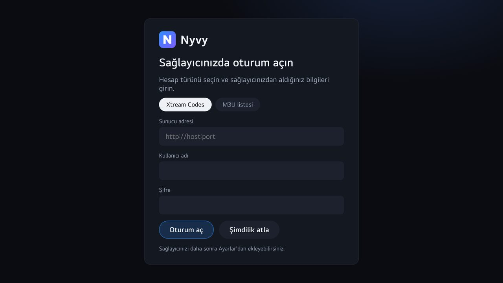
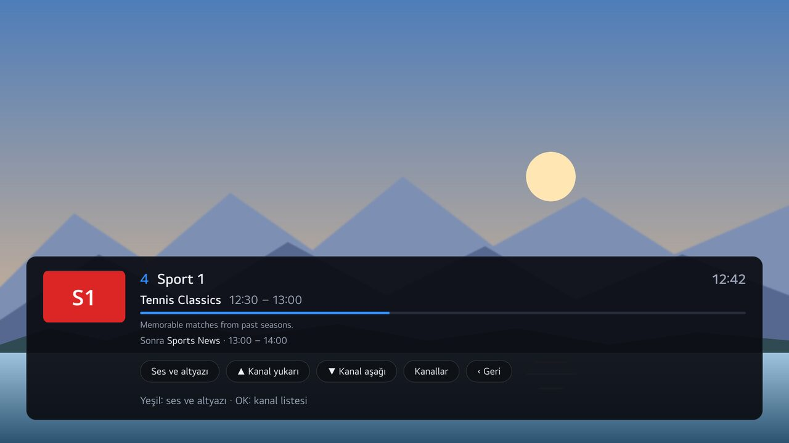
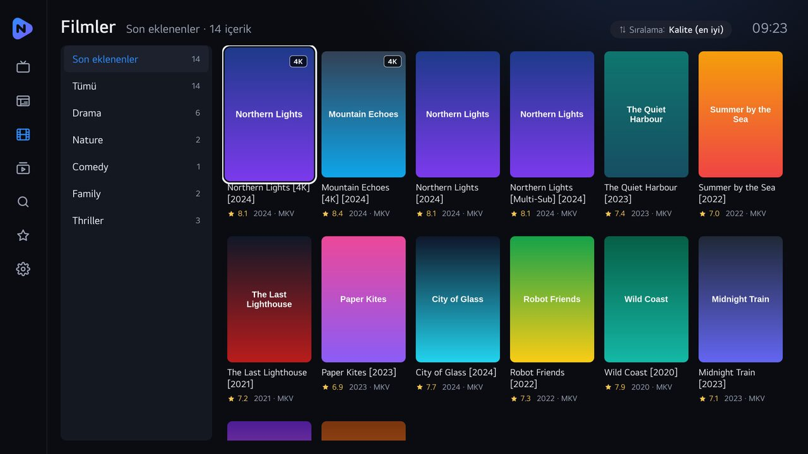
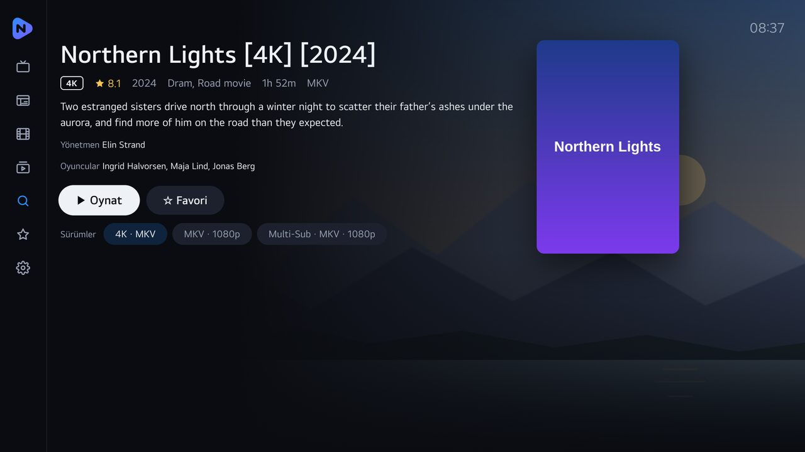
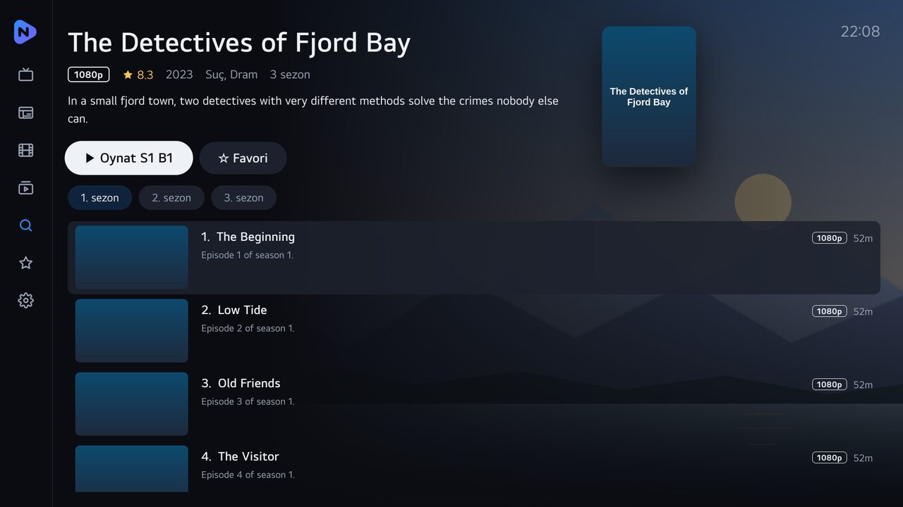
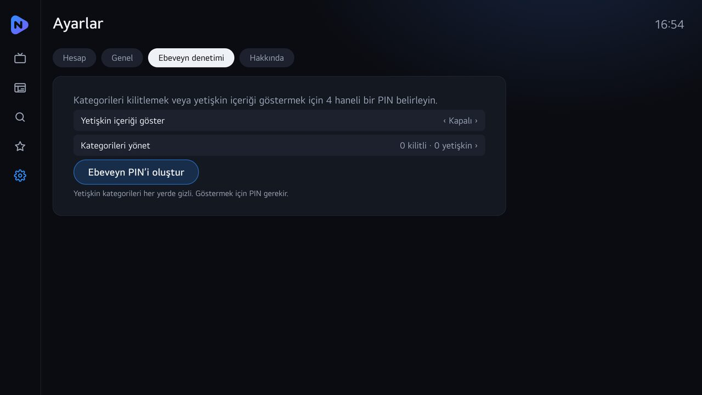

# Kılavuz

Nyvy’ye başlamak ve uygulamadan en iyi şekilde yararlanmak için gereken her şey.

**İçindekiler:** [Başlarken](#getting-started) · [Kumanda](#remote) · [Canlı TV](#live-tv) · [TV rehberi ve catch-up](#tv-guide) · [Filmler ve diziler](#films-series) · [Ses ve altyazı](#audio-subtitles) · [Arama, favoriler ve sıralama](#search) · [Ayarlar](#settings) · [Sık sorulan sorular](#faq)

## Başlarken {#getting-started}

Nyvy kendisi kanal içermez. Bir IPTV sağlayıcısında aboneliğinizin ve onlardan aldığınız bilgilerin olması gerekir.

### Oturum açma

Nyvy’yi ilk kez başlattığınızda hesap türünü seçin:

| Hesap türü | Girdiğiniz bilgiler | Elde ettikleriniz |
|---|---|---|
| **Xtream Codes** | Sunucu adresi, kullanıcı adı ve şifre | Canlı TV, TV rehberi, catch-up, filmler, diziler ve hesap durumu |
| **M3U listesi** | Liste adresi ve gerekirse rehber adresi | Gruplarla canlı TV, TV rehberi, favoriler ve arama |

> İçinde `get.php?username=…&password=…` bulunan bir "M3U bağlantısı" mı aldınız? Bu aslında bir Xtream hesabıdır. Nyvy bunu tanır ve Xtream olarak oturum açmayı önerir; böylece filmleri ve dizileri de alırsınız.

Oturum açtıktan sonra Nyvy kataloğu (kanallar, filmler ve diziler) ve TV rehberini indirir. İlk seferde bir dakika sürebilir, sonra hızlıdır. Nyvy’yi başlattığınızda katalog ve rehber 12 saatten eskiyse otomatik olarak güncellenir; dilediğiniz zaman *Ayarlar → Hesap* bölümünden kendiniz de güncelleyebilirsiniz.

Önce etrafa bakmak mı istiyorsunuz? *Şimdilik atla*’yı seçin. Sağlayıcınızı daha sonra *Ayarlar → Hesap → Sağlayıcı ekle* bölümünden ekleyebilirsiniz.

## Kumanda {#remote}

| Tuş | İşlev |
|---|---|
| Oklar ve OK | Gezinme ve seçme |
| Geri | Geri dönme. Yan menüde: Nyvy’den çıkma |
| Kırmızı · Yeşil · Sarı | Kısayollar (aşağıya bakın) |
| CH+ / CH− | Kanal değiştirme · listelerde sayfa geçme |
| Oynat/Duraklat | Duraklatma ve devam etme |
| İleri/geri sarma | 60 saniye atlama |
| Info | Bilgi çubuğunu gösterme (canlı TV) |
| Rakamlar | Doğrudan bir kanal numarasına gitme |

Magic Remote da çalışır: işaretlemek için gösterin, seçmek için tıklayın ve tekerlekle kaydırın.

**Kumandanızda renkli tuşlar yok mu?** Birçok Magic Remote’ta yoktur ve onlara ihtiyacınız yok: her şey ekrandaki düğmelerle çalışır. ☆ *Favori* film ve dizilerin ayrıntı sayfasında, kanal listesinin sağında (sağa basın) ve tam ekranda bilgi çubuğunda bulunur. *Sıralama* listelerin üstünde, *Ses ve altyazı* ile *Önceki kanal* bilgi çubuğundadır. Yine de kısayolları kullanmak isterseniz kumandada **123** tuşuna basın: ekranda renkli tuşların olduğu bir panel açılır. Kırmızı: favori · Yeşil: sıralama veya izlerken ses ve altyazı · Sarı: önceki kanal.

### Geri ne yapar

| Bulunduğunuz yer | Geri |
|---|---|
| Yan menü | Nyvy’den çıkmak isteyip istemediğinizi sorar |
| *Canlı TV*, *Filmler* veya *Diziler* içindeki bir liste | Önce kategorilere, sonra yan menüye |
| Arama veya ayarlar | Yan menüye |
| Bir filmin veya dizinin ayrıntı sayfası | Listeye döner |
| Oynatılan bir film veya bölüm | Önce ilerleme çubuğunu ve düğmeleri gizler; sonraki basış çıkar. Nyvy kaldığınız yeri hatırlar |
| Tam ekran canlı TV | Sırasıyla: yazılmakta olan kanal numarasını siler, düğme satırından çıkar, bilgi çubuğunu gizler, tam ekrandan çıkar |
| Kanal listesi veya *Ses ve altyazı* açık | Kapatır |
| Bir iletişim kutusu, örneğin PIN | Hiçbir şeyi değiştirmeden kapatır |

## Canlı TV {#live-tv}

- **Kanal seçme:** solda kategoriler, ortada şu anki programla birlikte kanallar bulunur. OK kanalı önizleme penceresinde oynatır, tekrar OK tam ekran yapar.
- **Tam ekranda:**
  - Yukarı/aşağı veya CH+/CH− kanal değiştirir.
  - OK bilgi çubuğunun düğmelerini seçer: *Kanallar*, *Ses ve altyazı*, ☆ *Favori*, *Önceki kanal*, kanal yukarı/aşağı ve *Geri*. Sol/sağ aralarında gezinir, OK seçer.
  - Sol/sağ veya Info, şimdi ve sonrası bilgisini içeren bilgi çubuğunu gösterir.
  - Rakamlar bir kanal numarasına gider.
  - Geri önce bilgi çubuğunu gizler; tam ekrandan çıkmak için Geri’ye tekrar basın.

### Canlı TV hakkında daha fazlası

- **Önizleme:** listedeki bir kanalda OK, kanalı sağdaki pencerede oynatır; tekrar OK tam ekrana geçer. Tam ekrandan Geri sizi listeye götürür ve önizleme devam eder.
- **Tam ekranda kanal değiştirme:** OK’ye basın ve *Kanallar* seçin; kanal listesi görüntünün üzerinde açılır.
- **Kanal numaraları:** rakamları kumandayla yazın. Nyvy kısa bir süre sonra kanalı değiştirir.
- **Önceki kanal:** bilgi çubuğundaki düğme sizi daha önce izlediğiniz kanala geri götürür.
- **İşaretler:** ↺, kanalda catch-up olduğu anlamına gelir. Programın altındaki çizgi ne kadar ilerlediğini gösterir. Sağdaki pencerede *Catch-up · 2 gün* arşivin ne kadar geriye gittiğini gösterir.
- **Kaliteye göre sıralama:** Nyvy kanal adlarından HD ve 4K bilgisini okur, böylece en iyi kanallar başa gelir.

## TV rehberi ve catch-up {#tv-guide}

- **TV rehberi** tüm kanalların programlarını "şimdi" çizgisi olan bir tabloda gösterir. Yayındaki bir programda OK kanalı başlatır.
- **Catch-up:** ↺ işaretli kanalların sağlayıcıda arşivi vardır. Bu kanallarda rehberde geriye gidebilir, yayınlanmış bir programı başlatabilir ve içinde ileri geri gidebilirsiniz.

### Rehberde gezinme

- Yukarı/aşağı kanal değiştirir, CH+/CH− ise birer sayfa kaydırır.
- Sol/sağ zamanda birer program ilerler veya geriler. İleriye doğru rehber üç gün kadar gider. Geriye doğru yalnızca catch-up olan kanallarda, arşiv ne kadar gidiyorsa o kadar.
- Şu anda yayındaki bir programda OK, kanalı tam ekranda açar. Gelecekteki bir programda Nyvy ne zaman başlayacağını gösterir, örneğin *Başlangıç: 21:00*.

### Yayınlanmış bir programı izleme

1. *TV Rehberi* açın ve ↺ işaretli bir kanal seçin.
2. Programa gelene kadar sola basın. Sonradan izlenebilen programlar ↺ ile işaretlidir ve bilgide *Catch-up: baştan izlemek için OK* yazar.
3. OK’ye basın. Program baştan başlar.
4. Sol/sağ ile ileri geri sarın, OK ile duraklatın ve Geri ile çıkın; tıpkı bir filmde olduğu gibi.

## Filmler ve diziler {#films-series}

Filmler ve diziler Xtream hesaplarında bulunur.

- **Ayrıntı sayfası** konuyu, oyuncuları, kaliteyi (örneğin 4K veya Dolby Vision) ve *Oynat*, *Devam et* ve *Favori* düğmelerini gösterir. Bir filmin birden fazla sürümü varsa düğmelerin altında seçenek olarak görünür.
- **Diziler:** sezon ve bölüm seçin. Bir bölüm bittiğinde sonraki bölüm geri sayımdan sonra başlar.
- **İzlerken:**
  - OK duraklatır.
  - Sol/sağ 10 saniye atlar (daha uzun atlamalar için basılı tutun). Bir önizleme görüntüsü nereye geleceğinizi gösterir, OK oraya atlar.
  - Yukarı ekrandaki düğmeleri gösterir.
  - Geri önce ilerleme çubuğunu ve düğmeleri gizler; çıkmak için Geri’ye tekrar basın. Nyvy kaldığınız yeri hatırlar.

### Sürümler

Sağlayıcılarda aynı film çoğu zaman birkaç sürümde bulunur, örneğin 4K, 1080p ya da farklı dil ve altyazılarla. Nyvy bunları bir araya getirir: ayrıntı sayfası onları *Sürümler* altında gösterir, oynatma sırasında ise *Ses ve altyazı* → *Sürüm* altından değiştirirsiniz.

### İzlemeye devam et ve son eklenenler

*Filmler* ve *Diziler* bölümlerinin başında favorileriniz, *İzlemeye devam et* (başladıklarınız) ve *Son eklenenler* (sağlayıcının en son ekledikleri) yer alır. Başladığınız bir şeyin ayrıntı sayfasında örneğin *42:10 itibarıyla devam et* yazar, yanında da *Baştan oynat* bulunur.

### 4K, HDR ve Dolby Vision

- **İşaretler:** 4K, 1080p, 720p veya SD, bazen HDR veya DV (Dolby Vision) ile birlikte. Nyvy yalnızca kesin olarak bildiğini gösterir, başlıktan veya oynatmadan; bu yüzden her filmde işaret olmayabilir.
- **Dolby Vision**, televizyon destekliyorsa Dolby Vision olarak oynatılır. Bazı dosyalar (iki görüntü katmanlı Blu-ray kopyaları) ve Dolby Vision olmayan televizyonlar filmi bunun yerine aynı çözünürlükte HDR10 olarak gösterir.

## Ses ve altyazı {#audio-subtitles}

- **Filmler ve diziler:** ses parçasını, altyazıyı ve sürümü seçmek için aşağı veya Yeşil tuşuna basın.
- **Canlı TV:** yayın altyazısını açıp kapatmak ve ses parçasını seçmek için bilgi çubuğunda *Ses ve altyazı*’yı seçin (veya Yeşil tuşuna basın).
- **Varsayılanlar:** *Ayarlar → Genel* bölümünde tercih edilen ses dilini, altyazının açık olup olmayacağını, birinci ve ikinci tercih altyazı dillerini ve yazı boyutuyla stilini seçersiniz.

### Metin ve görüntü altyazıları

- **Metin altyazılarını** (örneğin SRT ve ASS) Nyvy, seçtiğiniz boyut ve stilde kendisi çizer.
- **Görüntü altyazıları** (PGS, Blu-ray’den) hazır görüntülerdir ve oldukları gibi gösterilir. Boyut ve stil onları etkilemez.
- **Yayın altyazılarını** canlı TV’de (DVB ve teletekst) televizyon çizer. Nyvy’de yalnızca açıp kapatırsınız.

### Oynatılamayan parçalar

Televizyonun oynatamadığı bir parça soluk görünür ve yanında *bu cihazda oynatılamaz* yazar. En yaygın olanları DTS ve Dolby TrueHD’dir. Bir filmde yalnızca böyle bir ses varsa Nyvy başlarken bunu söyler ve film sessiz oynar: varsa başka bir sürüm seçin. *Ayarlar* → *Hakkında* televizyonunuzun hangi biçimleri oynatabildiğini gösterir.

Bir filmin ana sesi oynatılamıyor ama başka bir parça oynatılabiliyorsa, Nyvy o parçayı oynatır ve bir bildirim hangisi olduğunu söyler. Yorum parçaları yalnızca başka hiçbir şey oynatılamadığında seçilir; yine de bunları kendiniz seçebilirsiniz.

### Altyazı boyutu ve stili

*Ayarlar* → *Genel* altında *Altyazı boyutu* (Küçük, Orta, Büyük veya Çok büyük) ve *Altyazı stili* (Kontur veya Arka plan kutusu) seçersiniz. Bir önizleme nasıl görüneceğini gösterir.

*Altyazı parlaklığı*, beyaz altyazılar çok parlak geliyorsa onları %10’a kadar adım adım kısar. Metin ve görüntü altyazıları için geçerlidir, televizyonun çizdiği canlı TV yayın altyazıları için geçerli değildir.

## Arama, favoriler ve sıralama {#search}

- **Arama:** ekran klavyesiyle veya kumandanın rakamlarıyla yazın. Arama kanalları, filmleri ve dizileri bulur ve aksanları dikkate almaz (*malmo*, *Malmö*’yü bulur).
- **Favoriler:** bir film veya dizinin ayrıntı sayfasında, kanal listesinin sağında veya tam ekranda bilgi çubuğunda ☆ *Favori*’yi seçin (Kırmızı bir kısayoldur). Favoriler her listede ilk sırada ve menüdeki *Favoriler* bölümünde görünür.
- **Sıralama:** listelerin üstündeki *Sıralama* düğmesi (veya Yeşil). Kanallar numaraya, kaliteye veya ada göre, filmler ve diziler örneğin son eklenenlere, yıla, puana veya kaliteye göre sıralanabilir. Diziler ayrıca bölüm süresine göre de sıralanabilir.

### Favori ekleme ve bulma

- **Bir kanal:** *Canlı TV* içindeki listede kanalı seçin, sağa basın ve ☆ *Favori* seçin. Tam ekranda aynı düğme bilgi çubuğundadır (OK’ye basın).
- **Bir film veya dizi:** ayrıntı sayfasında ☆ *Favori* seçin.
- **Bulma:** menüdeki *Favoriler* bölümünde, kanallar, filmler ve diziler olarak ayrılmış şekilde ve her listenin başında.
- **Kaldırma:** aynı yerde ★ *Favorilerden çıkar* seçin.

## Ayarlar {#settings}

- **Hesap:**
  - Bilgilerinizi, kataloğun ne zaman güncellendiğini ve *Kataloğu güncelle* düğmesini gösterir.
  - **Bilgileri düzenle:** yeni sunucu adresi, yeni şifre veya yeni liste. Aynı hesap olduğu sürece favoriler ve kaldığınız yerler korunur.
  - **Oturumu kapat** hesabı ve verilerini televizyondan siler.
- **Genel:** dil, saat biçimi, ses ve altyazı.
- **Ebeveyn denetimi:**
  - Yetişkin içerik baştan gizlidir.
  - Dört haneli bir PIN ile gösterebilir, tek tek kategorileri kilitleyebilir veya gizleyebilirsiniz.
  - Kilitli kategoriler PIN ister.
- **Hakkında:** sürüm, televizyonunuzun oynatabildiği biçimler ve bu sayfanın bağlantısı.

### Ebeveyn denetimini ayarlama

1. *Ayarlar* → *Ebeveyn denetimi* bölümüne gidin ve *Ebeveyn PIN’i oluştur* seçin. Dört rakam girin, ardından aynı rakamları bir kez daha girin.
2. *Yetişkin içeriği göster*: yetişkin içeriği baştan gizlidir ve göstermek PIN gerektirir. Yetişkin içeriğe benzeyen kategoriler, örneğin adında XXX veya 18+ geçenler, otomatik olarak işaretlenir.
3. *Kategorileri yönet*: bir kategoride OK, *🔒 Kilitli* (PIN gerektirir), *🔞 Yetişkin* (yetişkin içeriği gizliyken gizli) ve kapalı arasında geçiş yapar.
4. Kilitli bir kategoriyi OK ve PIN ile açarsınız. Nyvy’yi kapatana kadar kilidi açık kalır.
5. *PIN’i değiştir* ve *PIN’i kaldır* aynı sayfadadır.

### PIN’i unutursanız

PIN, Nyvy’de bilerek sıfırlanamaz; aksi halde bir çocuk onu aşabilirdi. *Oturumu kapat* de PIN gerektirir. Geriye Nyvy’yi televizyondan kaldırıp yeniden yüklemek kalır. Ardından yeniden oturum açarsınız; favoriler, kaldığınız yerler ve ayarlar silinir.

### Gizlilik

Nyvy’nin kaydettiği her şey televizyonunuzda kalır: hesap bilgileriniz (şifreli), katalog, TV rehberi, favoriler, kaldığınız yerler ve ayarlar. Nyvy’ye hiçbir şey gönderilmez. *Oturumu kapat* hepsini siler. Ayrıntılar [Gizlilik](privacy.html) sayfasında.

## Sık sorulan sorular {#faq}

### "Bu kanal şu anda yayın yapmıyor"
Sağlayıcının yayını kesilmiş veya kanal yalnızca belirli etkinliklerde yayın yapıyordur. Daha sonra tekrar deneyin veya başka bir kanal seçin. OK yeniden dener.

### "Sağlayıcı şu anda daha fazla bağlantıya izin vermiyor"
Birçok abonelik aynı anda yalnızca bir yayına izin verir. Aynı hesabı kullanan diğer cihazlarda uygulamayı kapatın, biraz bekleyin ve tekrar deneyin.

### "Sağlayıcı yanıt vermiyor"
Televizyonun internet bağlantısını kontrol edin. Bağlantı çalışıyorsa sorun büyük olasılıkla sağlayıcıdadır.

### Bir filmde ses yok
Filmde büyük olasılıkla yalnızca DTS veya Dolby TrueHD ses vardır; LG televizyonlar bunları uygulamalarda oynatamaz. Varsa başka bir ses parçası veya filmin başka bir sürümünü seçin.

### Film yerine bir yorum duyuyorum
Filmin ana sesi (genellikle DTS) televizyonda oynatılamıyor, bu yüzden Nyvy oynatılabilen tek parçayı, bazen bir yorum parçasını oynatır. Başlangıçtaki bildirim hangisi olduğunu söyler. Varsa filmin başka bir sürümünü seçin.

### TV rehberi boş (M3U)
Her liste bir TV rehberi belirtmez. Sağlayıcınızdan bir XMLTV rehberinin adresini isteyin ve *Ayarlar → Hesap → Bilgileri düzenle* bölümüne girin.

### Filmleri ve dizileri göremiyorum (M3U)
Nyvy’de listeler yalnızca canlı TV verir. Xtream hesabınız varsa filmler ve diziler için onunla oturum açın.

### Nyvy’den nasıl çıkarım?
Yan menü seçili olana kadar Geri tuşuna basın, tekrar Geri’ye basın ve *Çık*’ı seçin.

### “Yeniden deneniyor… (2/3)”
Başlatma takıldı ve Nyvy en fazla üç kez kendiliğinden yeniden deniyor. Genellikle sağlayıcıda geçici bir sorundur. Üçüncü deneme de başarısız olursa Nyvy sorunun ne olduğunu gösterir.

### “Bu içerik sağlayıcıda bulunmuyor”
Sağlayıcı başlığı listeliyor ama dosyası artık yok. Bu Nyvy’de düzeltilemez. Varsa başka bir sürüm seçin.

### Görüntü takılıyor veya sürekli yükleniyor
Ağı kontrol edin. 4K için yaklaşık 25 Mbit/sn kararlı hız gerekir ve kablolu bağlantı Wi-Fi’den daha güvenilirdir. Yalnızca bir kanal veya film takılıyorsa sorun genellikle sağlayıcıdadır.

### Altyazılar görünmüyor
*Ses ve altyazı* altında doğru parçanın seçili olduğunu kontrol edin. Bazı parçalar yalnızca başka dillerdeki repliklerin metnini içerir ve sessiz sahnelerde hiçbir şey görünmez. Canlı TV’deki yayın altyazıları yalnızca kanal onları gönderdiğinde vardır.

### TV rehberindeki saatler yanlış
Televizyonun kendi ayarlarında saati ve saat dilimini kontrol edin. Bunlar doğruysa sağlayıcının rehber verileri hatalıdır.

### Bir kanalda program bilgisi yok (M3U)
Nyvy kanalları TV rehberiyle tvg-id’ye, yoksa kanal adına göre eşleştirir. Kanalda ikisi de yoksa veya ad farklıysa eşleştirme yapılamaz. Sağlayıcı bunu listede düzeltebilir.

### Katalog eski görünüyor
Nyvy, uygulamayı başlattığınızda 12 saatten eskiyse kataloğu ve TV rehberini günceller. Hemen güncellemek için: *Ayarlar* → *Hesap* → *Kataloğu güncelle*.

### Yanıtı bulamadınız mı?
Bir sorunu bildirin veya bir iyileştirme önerin: [GitHub](https://github.com/newlund/nyvy-guide/issues) (ücretsiz bir GitHub hesabı gerekir). Hangi sürümü kullandığınızı (*Ayarlar* → *Hakkında*) ve ne olduğunu yazın. Sayfa herkese açıktır: sağlayıcınızın adresini veya giriş bilgilerinizi eklemeyin.

## Sözlük

- **Xtream Codes:** IPTV sağlayıcılarının kanal, film ve dizileri bir sunucu adresi, kullanıcı adı ve parolayla sunmasının yaygın bir yolu.
- **M3U:** bir oynatma listesi: kanallar ve adreslerinden oluşan uzun bir liste. Canlı TV sağlar, ancak Nyvy’de film ve dizi sağlamaz.
- **EPG / XMLTV:** TV rehberi verileri, yani ne zaman ne yayınlandığı. XMLTV dosya biçimidir.
- **Catch-up:** sağlayıcının arşivinden daha önce yayınlanmış programları izlemek (↺ ile işaretli).
- **4K:** 3840×2160 noktalık bir görüntü; Full HD’nin (1080p) dört katı.
- **HDR:** normal bir görüntüden daha geniş kontrast ve renk aralığı. HDR10 en yaygın türdür.
- **Dolby Vision:** görüntünün sahne sahne ayarlandığı bir HDR türü.
- **Dolby Digital / Dolby Digital Plus:** televizyonun oynatabildiği yaygın çevre sesi biçimleri.
- **DTS / Dolby TrueHD:** LG televizyonların uygulamalarda oynatamadığı sinema ve Blu-ray ses biçimleri.
