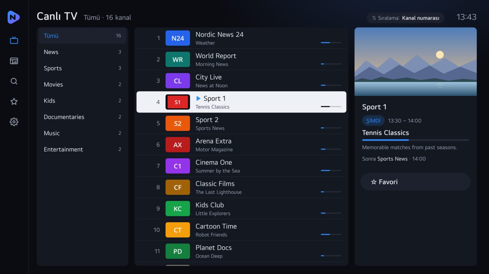
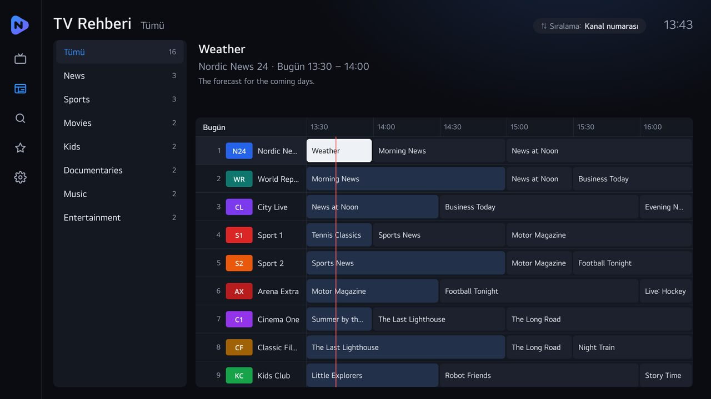
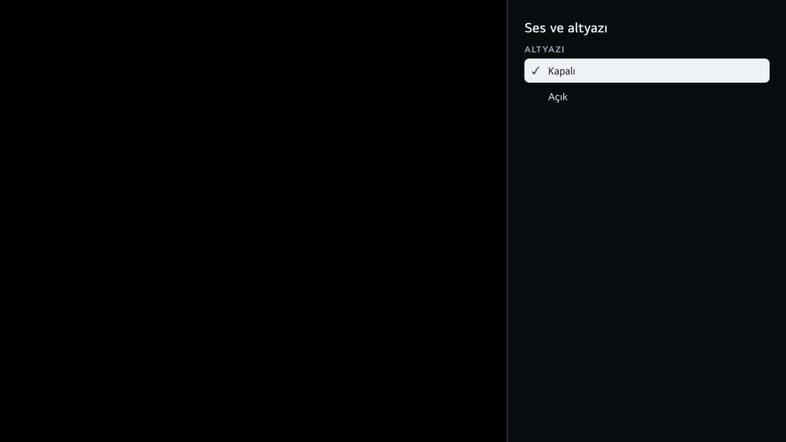
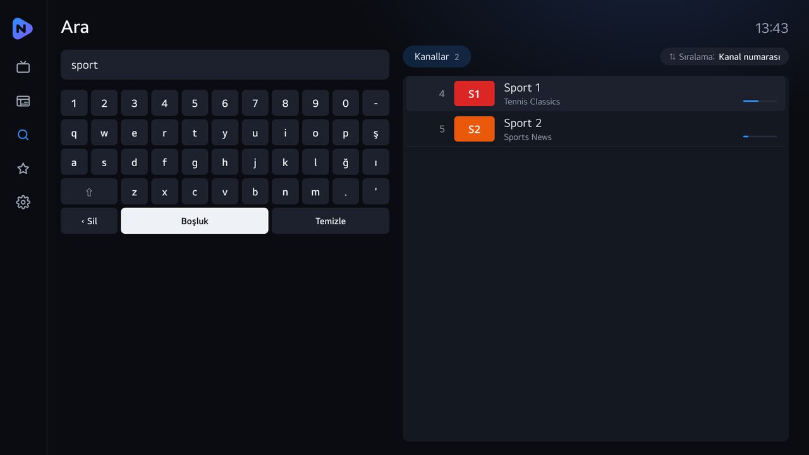
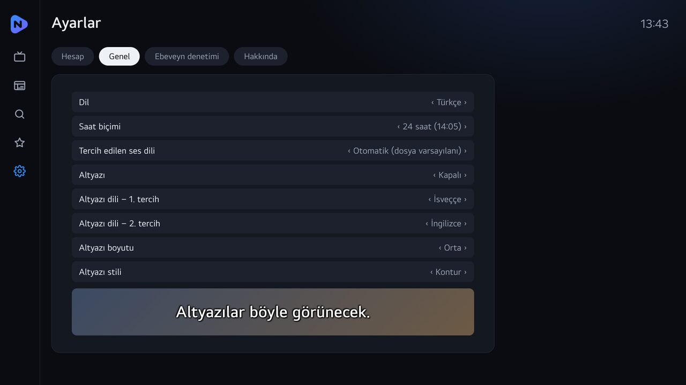
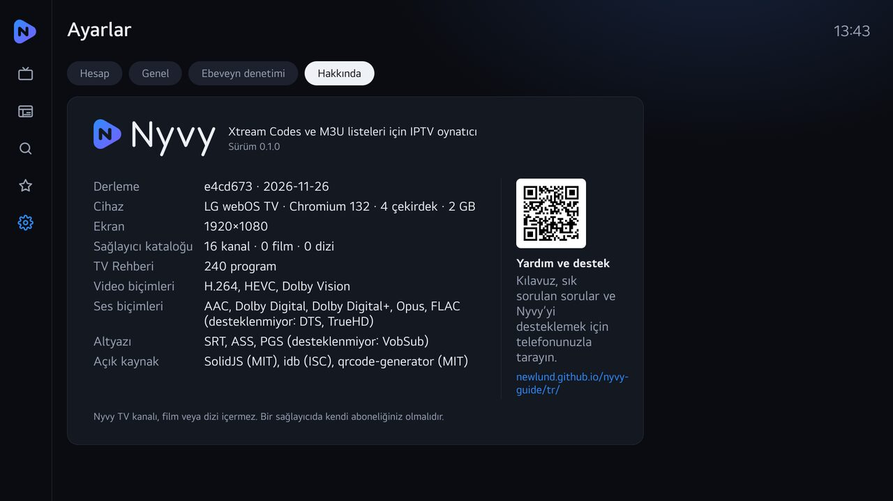

# Kılavuz

Nyvy’ye başlamak ve uygulamadan en iyi şekilde yararlanmak için gereken her şey.

**İçindekiler:** [Başlarken](#getting-started) · [Kumanda](#remote) · [Canlı TV](#live-tv) · [TV rehberi ve catch-up](#tv-guide) · [Filmler ve diziler](#films-series) · [Ses ve altyazı](#audio-subtitles) · [Arama, favoriler ve sıralama](#search) · [Ayarlar](#settings) · [Sık sorulan sorular](#faq)

## Başlarken {#getting-started}

Nyvy kendisi kanal içermez. Bir IPTV sağlayıcısında aboneliğinizin ve onlardan aldığınız bilgilerin olması gerekir.

### Oturum açma

Nyvy’yi ilk kez başlattığınızda hesap türünü seçin:

| Hesap türü | Girdiğiniz bilgiler | Elde ettikleriniz |
|---|---|---|
| **Xtream Codes** | Sunucu adresi, kullanıcı adı ve şifre | Canlı TV, TV rehberi, catch-up, filmler, diziler ve hesap durumu |
| **M3U listesi** | Liste adresi ve gerekirse rehber adresi | Gruplarla canlı TV, TV rehberi, favoriler ve arama |

> İçinde `get.php?username=…&password=…` bulunan bir "M3U bağlantısı" mı aldınız? Bu aslında bir Xtream hesabıdır. Nyvy bunu tanır ve Xtream olarak oturum açmayı önerir; böylece filmleri ve dizileri de alırsınız.

Oturum açtıktan sonra Nyvy kataloğu (kanallar, filmler ve diziler) ve TV rehberini indirir. İlk seferde bir dakika sürebilir, sonra hızlıdır. Nyvy’yi başlattığınızda katalog ve rehber 12 saatten eskiyse otomatik olarak güncellenir; dilediğiniz zaman *Ayarlar → Hesap* bölümünden kendiniz de güncelleyebilirsiniz.

Önce etrafa bakmak mı istiyorsunuz? *Şimdilik atla*’yı seçin. Sağlayıcınızı daha sonra *Ayarlar → Hesap → Sağlayıcı ekle* bölümünden ekleyebilirsiniz.

## Kumanda {#remote}

| Tuş | İşlev |
|---|---|
| Oklar ve OK | Gezinme ve seçme |
| Geri | Geri dönme. Yan menüde: Nyvy’den çıkma |
| Kırmızı · Yeşil · Sarı | Kısayollar (aşağıya bakın) |
| CH+ / CH− | Kanal değiştirme · listelerde sayfa geçme |
| Oynat/Duraklat | Duraklatma ve devam etme |
| İleri/geri sarma | 60 saniye atlama |
| Info | Bilgi çubuğunu gösterme (canlı TV) |
| Rakamlar | Doğrudan bir kanal numarasına gitme |

Magic Remote da çalışır: işaretlemek için gösterin, seçmek için tıklayın ve tekerlekle kaydırın.

**Kumandanızda renkli tuşlar yok mu?** Birçok Magic Remote’ta yoktur ve onlara ihtiyacınız yok: her şey ekrandaki düğmelerle çalışır. ☆ *Favori* film ve dizilerin ayrıntı sayfasında, kanal listesinin sağında (sağa basın) ve tam ekranda bilgi çubuğunda bulunur. *Sıralama* listelerin üstünde, *Ses ve altyazı* ile *Önceki kanal* bilgi çubuğundadır. Yine de kısayolları kullanmak isterseniz kumandada **123** tuşuna basın: ekranda renkli tuşların olduğu bir panel açılır. Kırmızı: favori · Yeşil: sıralama veya izlerken ses ve altyazı · Sarı: önceki kanal.

## Canlı TV {#live-tv}

- **Kanal seçme:** solda kategoriler, ortada şu anki programla birlikte kanallar bulunur. OK kanalı önizleme penceresinde oynatır, tekrar OK tam ekran yapar.
- **Tam ekranda:**
  - Yukarı/aşağı veya CH+/CH− kanal değiştirir.
  - OK bilgi çubuğunun düğmelerini seçer: *Kanallar*, *Ses ve altyazı*, ☆ *Favori*, *Önceki kanal*, kanal yukarı/aşağı ve *Geri*. Sol/sağ aralarında gezinir, OK seçer.
  - Sol/sağ veya Info, şimdi ve sonrası bilgisini içeren bilgi çubuğunu gösterir.
  - Rakamlar bir kanal numarasına gider.
  - Geri önce bilgi çubuğunu gizler; tam ekrandan çıkmak için Geri’ye tekrar basın.

## TV rehberi ve catch-up {#tv-guide}

- **TV rehberi** tüm kanalların programlarını "şimdi" çizgisi olan bir tabloda gösterir. Yayındaki bir programda OK kanalı başlatır.
- **Catch-up:** ↺ işaretli kanalların sağlayıcıda arşivi vardır. Bu kanallarda rehberde geriye gidebilir, yayınlanmış bir programı başlatabilir ve içinde ileri geri gidebilirsiniz.

## Filmler ve diziler {#films-series}

Filmler ve diziler Xtream hesaplarında bulunur.

- **Ayrıntı sayfası** konuyu, oyuncuları, kaliteyi (örneğin 4K veya Dolby Vision) ve *Oynat*, *Devam et* ve *Favori* düğmelerini gösterir. Bir filmin birden fazla sürümü varsa düğmelerin altında seçenek olarak görünür.
- **Diziler:** sezon ve bölüm seçin. Bir bölüm bittiğinde sonraki bölüm geri sayımdan sonra başlar.
- **İzlerken:**
  - OK duraklatır.
  - Sol/sağ 10 saniye atlar (daha uzun atlamalar için basılı tutun). Bir önizleme görüntüsü nereye geleceğinizi gösterir, OK oraya atlar.
  - Yukarı ekrandaki düğmeleri gösterir.
  - Geri önce ilerleme çubuğunu ve düğmeleri gizler; çıkmak için Geri’ye tekrar basın. Nyvy kaldığınız yeri hatırlar.

## Ses ve altyazı {#audio-subtitles}

- **Filmler ve diziler:** ses parçasını, altyazıyı ve sürümü seçmek için aşağı veya Yeşil tuşuna basın.
- **Canlı TV:** yayın altyazısını açıp kapatmak ve ses parçasını seçmek için bilgi çubuğunda *Ses ve altyazı*’yı seçin (veya Yeşil tuşuna basın).
- **Varsayılanlar:** *Ayarlar → Genel* bölümünde tercih edilen ses dilini, altyazının açık olup olmayacağını, birinci ve ikinci tercih altyazı dillerini ve yazı boyutuyla stilini seçersiniz.

## Arama, favoriler ve sıralama {#search}

- **Arama:** ekran klavyesiyle veya kumandanın rakamlarıyla yazın. Arama kanalları, filmleri ve dizileri bulur ve aksanları dikkate almaz (*malmo*, *Malmö*’yü bulur).
- **Favoriler:** bir film veya dizinin ayrıntı sayfasında, kanal listesinin sağında veya tam ekranda bilgi çubuğunda ☆ *Favori*’yi seçin (Kırmızı bir kısayoldur). Favoriler her listede ilk sırada ve menüdeki *Favoriler* bölümünde görünür.
- **Sıralama:** listelerin üstündeki *Sıralama* düğmesi (veya Yeşil). Kanallar numaraya, kaliteye veya ada göre, filmler ve diziler örneğin son eklenenlere, yıla, puana veya kaliteye göre sıralanabilir. Diziler ayrıca bölüm süresine göre de sıralanabilir.

## Ayarlar {#settings}

- **Hesap:**
  - Bilgilerinizi, kataloğun ne zaman güncellendiğini ve *Kataloğu güncelle* düğmesini gösterir.
  - **Bilgileri düzenle:** yeni sunucu adresi, yeni şifre veya yeni liste. Aynı hesap olduğu sürece favoriler ve kaldığınız yerler korunur.
  - **Oturumu kapat** hesabı ve verilerini televizyondan siler.
- **Genel:** dil, saat biçimi, ses ve altyazı.
- **Ebeveyn denetimi:**
  - Yetişkin içerik baştan gizlidir.
  - Dört haneli bir PIN ile gösterebilir, tek tek kategorileri kilitleyebilir veya gizleyebilirsiniz.
  - Kilitli kategoriler PIN ister.
- **Hakkında:** sürüm, televizyonunuzun oynatabildiği biçimler ve bu sayfanın bağlantısı.

## Sık sorulan sorular {#faq}

### "Bu kanal şu anda yayın yapmıyor"
Sağlayıcının yayını kesilmiş veya kanal yalnızca belirli etkinliklerde yayın yapıyordur. Daha sonra tekrar deneyin veya başka bir kanal seçin. OK yeniden dener.

### "Sağlayıcı şu anda daha fazla bağlantıya izin vermiyor"
Birçok abonelik aynı anda yalnızca bir yayına izin verir. Aynı hesabı kullanan diğer cihazlarda uygulamayı kapatın, biraz bekleyin ve tekrar deneyin.

### "Sağlayıcı yanıt vermiyor"
Televizyonun internet bağlantısını kontrol edin. Bağlantı çalışıyorsa sorun büyük olasılıkla sağlayıcıdadır.

### Bir filmde ses yok
Filmde büyük olasılıkla yalnızca DTS veya Dolby TrueHD ses vardır; LG televizyonlar bunları uygulamalarda oynatamaz. Varsa başka bir ses parçası veya filmin başka bir sürümünü seçin.

### TV rehberi boş (M3U)
Her liste bir TV rehberi belirtmez. Sağlayıcınızdan bir XMLTV rehberinin adresini isteyin ve *Ayarlar → Hesap → Bilgileri düzenle* bölümüne girin.

### Filmleri ve dizileri göremiyorum (M3U)
Nyvy’de listeler yalnızca canlı TV verir. Xtream hesabınız varsa filmler ve diziler için onunla oturum açın.

### Nyvy’den nasıl çıkarım?
Yan menü seçili olana kadar Geri tuşuna basın, tekrar Geri’ye basın ve *Çık*’ı seçin.
